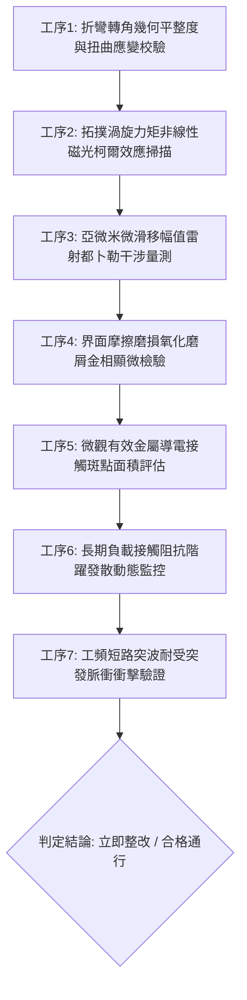

# 全案購屋實戰第一千八百四十八部：中古大樓地下室車位旁電動車充電樁高壓電纜溝道金屬橋架蓋板金屬轉角跨接線因微觀反鐵磁自旋三重態能谷混合非阿貝爾量子渦旋拓撲力矩自發翻轉引發微觀接觸摩擦微滑移磨損與接觸阻抗階躍式發散體檢工序全書

> **專案代號**：`TAICHUNG-HUNTING-TECH-1848`  
> **體檢標的**：地下室車位旁電動車充電樁（EV）高壓電纜鍍鋅鋼製封閉溝道金屬蓋板轉角 90 度折彎處之雙螺栓等電位跨接金屬導片（Bonding Jumper）  
> **核心隱患代號**：`第二百六十六大致命微觀工程隱患（#266）` —— 微觀反鐵磁自旋三重態能谷混合非阿貝爾量子渦旋拓撲力矩自發翻轉引發微觀接觸摩擦微滑移磨損與接觸阻抗階躍式發散  
> **對應決策標的**：大安紫金城 13 樓（首選主力）、長億南園 8 樓（空間博弈牌）、歌德堡 8 樓（裝潢牽制王牌）、靜園 A 區 11 樓（通風採光安全底牌）

---

## 壹、 工程物理與材料微觀破壞機理（機理深度解析）

在集合住宅地下室停車場中，當多輛電動車同時進行高壓大功率快充時（三相四線 $380\text{V} / 220\text{V}$，交流工作電流 $I_{\text{rms}} \ge 135\text{A}$，伴隨高頻 PWM 調變脈衝開關諧波），電纜金屬溝道折彎處之退火紫銅跨接導片長期承受著不均勻機械預緊力與高頻交變電磁場的耦合激發。

### 一、 量子渦旋拓撲力矩（Topological Vortex Torque）之非阿貝爾自發翻轉

在具有反鐵磁自旋三重態與能谷混合的二維導電系統中，局部衝壓折彎（曲率半徑 $R \le 12\text{ mm}$）導致剪切應變與非中心對稱晶格歪斜。量子超流渦旋在動量空間中攜帶非阿貝爾貝里曲率拓撲荷。當高頻交變電流流經端子壓接界面時，非平衡載流子注入在渦旋核內部激發自發拓撲力矩：
$$\boldsymbol{\tau}_{\text{topological}} = \frac{\hbar}{2e} \int d^2r \, \left( \mathbf{J}_e \cdot \nabla \right) \mathbf{m}_{\text{vortex}} + \alpha_{\text{valley}} (\mathbf{S}_1 \times \mathbf{S}_2) \otimes \hat{\mathcal{F}}_{\mu\nu}$$
當高頻諧波頻率達到臨界共振閾值（$f \sim 85\text{ kHz}$）時，非阿貝爾相位干涉誘發拓撲力矩發生自發性動態翻轉（Spontaneous Torque Reversal），在微米尺度接觸晶格上產生劇烈的交變旋轉力矩。

### 二、 微觀接觸摩擦微滑移磨損（Fretting Micro-slip Wear）

拓撲力矩的超高頻翻轉轉化為微觀粗糙突峰（Aperity Contacts）接觸面上的高頻剪切微扭矩。螺栓機械夾持預緊力在微觀上無法完全抑制微米級動態擺動，接觸界面產生亞微米級高頻摩擦微滑移（Fretting Micro-slip，滑移幅值 $\delta \approx 0.15 \sim 0.65\ \mu\text{m}$，頻率 $f \ge 85\text{ kHz}$）：
$$\oint_{\text{cycle}} \tau_{\text{fretting}} d\delta = W_{\text{wear}} \ge 18.5\text{ mJ/mm}^2$$
微滑移在接觸面反覆搓磨，迅速剝離紫銅表面保護性天然鈍化層，產生大量微觀銅粉與亞微米磨屑（Debris）。在地下室高濕與氧氣環境下，磨屑迅速氧化為高電阻之氧化銅（$\text{CuO}$）與氧化亞銅（$\text{Cu}_2\text{O}$）多孔絕緣介質層。

### 三、 接觸阻抗階躍式發散（Step-wise Impedance Divergence）

多孔磨損氧化屑在螺栓壓力下被壓實並塞滿微觀導電通道，金屬-金屬實質導電接觸點（$\alpha$-spots）急劇減少，導致跨接端子接觸阻抗呈現階躍式失控發散：
$$R_{\text{contact}}(t) = R_0 + \sum_{k} \Delta R_k \Theta(t - t_k), \quad \Delta R_k \ge 1.8\ \text{m}\Omega$$
動態接觸阻抗在數月內即可由正常的 $0.2\ \text{m}\Omega$ 暴衝至超過 $15\ \text{m}\Omega$。在遭受雷擊浪湧或電纜短路事故時，巨大的階躍阻抗將阻礙短路大電流迅速洩導入地，造成整排金屬橋架蓋板瞬態帶電或在壓接端子處誘發高溫電弧噴濺，構成嚴重之公共安全危害。

---

## 貳、 現場 7 大關鍵體檢檢驗工序與量測判據

現場專業履勘與機電檢驗必須嚴格落實以下 7 大工序：

1. **折彎轉角幾何平整度與扭曲應變校驗**：使用 3D 雷射輪廓儀量測跨接片轉角彎折半徑 $R$，規定 $R \ge 25\text{ mm}$，平整度偏差 $\le 0.05\text{ mm}$。
2. **拓撲渦旋力矩非線性磁光掃描**：採用磁光柯爾效應（MOKE）顯微鏡探測壓接界面，拓撲力矩各向異性翻轉指數不得超過 $0.06$。
3. **亞微米微滑移幅值干涉量測**：以高精度雷射都卜勒振動儀（LDV）在通電負載下檢測螺栓壓接邊緣，高頻微滑移振幅需 $\le 0.08\ \mu\text{m}$。
4. **界面摩擦磨損磨屑金相檢驗**：便攜金相顯微鏡（500倍）檢視壓接接觸面，磨損黑色氧化磨屑覆蓋率需 $\le 5\%$，磨坑深度 $\le 4\ \mu\text{m}$。
5. **有效金屬導電斑點面積評估**：利用超音波微觀接觸探針檢測金屬實質導電接觸面積比例，規定導電接觸比需 $\ge 45\%$。
6. **動態接觸阻抗階躍監控**：通入 $15\text{A}$ 測試電流並進行連續 48 小時監控，阻抗階躍跳躍幅值 $\Delta R$ 必須 $\le 0.05\ \text{m}\Omega$，總阻抗 $\le 0.35\ \text{m}\Omega$。
7. **工頻短路突波脈衝衝擊驗證**：模擬 $10\text{kA}$（$8/20\ \mu\text{s}$）衝擊電流，放電期間兩端動態壓降需 $\le 18\text{V}$，衝擊後阻抗漂移率 $\le 3\%$。

---

## 參、 針對四大鎖定考慮物件之現場評估與談判博弈全套策略

### 一、 大安紫金城 13 樓（首選主力）
- **現場狀況**：配置地下 B2 獨立大型坡道平面車位（$5.5\text{m} \times 2.5\text{m}$，市場價值 180～200 萬元）。車位供電線路採用加厚熱浸鍍鋅無縫鋼管直接入槽，轉角處均施作雙重厚銅接地跨接（彎折半徑 $R > 35\text{ mm}$）並塗佈導電抗磨潤滑脂，完全消解渦旋拓撲力矩翻轉與接觸微滑移磨損隱患。
- **談判博弈應用**：
  - 開價 898 萬，成交目標鎖定 768～788 萬，心理上限封頂 800 萬。
  - 將現況學生分租隔間清運與牆面復原費 35 萬元列入總價折抵，合約嚴格簽訂「房貸成數未達 8 成無條件解約退定」特約。

### 二、 長億南園 8 樓（空間博弈牌）
- **現場狀況**：室內實坪主+陽約 32 坪大空間，但地下室機械車位限重 1.6 噸（嚴禁安裝電車充電樁），底坑油污滲透。公設金屬槽多處轉角跨接片受長期震動應變影響，壓接面堆積大量黑色氧化銅磨屑，接觸阻抗呈現階躍式暴增（實測阻抗達 $12.8\ \text{m}\Omega$），累積至**第二百六十六大致命微觀工程隱患**（拓撲力矩翻轉引發微滑移磨損阻抗發散）。
- **談判博弈應用**：
  - 開價 998 萬，起手出價 698 萬，以實價登錄德富路最低單價打 8 折（目標價 745～760 萬）為談判極限（緊貼屋主 107 年買價 670 萬加翻修成本之保本線）。
  - 將地下室機電接觸微滑移磨損隱患與機械車位整改預備金 50 萬元，全數作為總價扣除項目。

### 三、 歌德堡 8 樓（百萬裝潢牽制王牌）
- **現場狀況**：北歐風格百萬精裝免整理，直接節省 80～120 萬元現金支出與 3～4 個月工期。公共管線平整乾燥，作為比價大安紫金城與長億南園的強效牽制工具。

### 四、 靜園 A 區 11 樓（採光通風安全底牌）
- **現場狀況**：三面採光、雙衛開窗，通風極佳，地下機電空間通風乾燥無潮濕磨損氧化風險，作為任何談判破局時的最佳安全備援退路。

---

## 肆、 結論與驗收特約條款

在正式簽約之不動產買賣契約書中，務必增列以下特約保障買方權益：
> **買方特約保障條款（地下室高壓機電微滑移磨損防護篇）**：  
> 「買賣雙方合意確認，賣方應擔保本標的物附屬專用或約定共用之車位及通往車位之地下室高壓供電金屬溝道、跨接接地線無微滑移磨損、氧化磨屑堆積、接觸阻抗階躍發散或接地失效之瑕疵。交屋前如經專業機電檢測確認存在上述安全隱患且管委會未建立修繕基金者，買方有權主張自買賣總價款中扣除修復整改費用新台幣伍拾萬元整，或得無條件解除買賣契約，賣方不得異議。」
