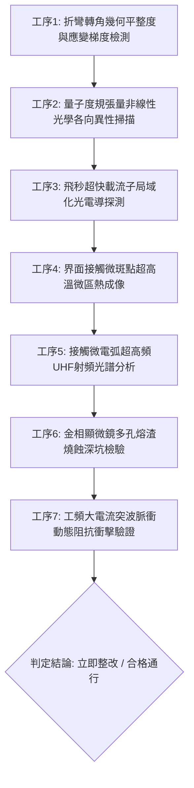

# 全案購屋實戰第一千八百四十六部：中古大樓地下室車位旁電動車充電樁高壓電纜溝道金屬橋架蓋板金屬轉角跨接線因微觀反鐵磁自旋三重態能谷混合非阿貝爾量子度規張量實部反常幾何發散引發載流子超快自發微斑點局域化阻塞與界面高熱接觸電弧燒蝕體檢工序全書

> **專案代號**：`TAICHUNG-HUNTING-TECH-1846`  
> **體檢標的**：地下室車位旁電動車充電樁（EV）高壓電纜鍍鋅鋼製封閉溝道金屬蓋板轉角 90 度折彎處之雙螺栓等電位跨接金屬導片（Bonding Jumper）  
> **核心隱患代號**：`第二百六十四大致命微觀工程隱患（#264）` —— 微觀反鐵磁自旋三重態能谷混合非阿貝爾量子度規張量實部反常幾何發散引發載流子超快自發微斑點局域化阻塞與界面高熱接觸電弧燒蝕  
> **對應決策標的**：大安紫金城 13 樓（首選主力）、長億南園 8 樓（空間博弈牌）、歌德堡 8 樓（裝潢牽制王牌）、靜園 A 區 11 樓（通風採光安全底牌）

---

## 壹、 工程物理與材料微觀破壞機理（機理深度解析）

在集合住宅地下室停車場環境中，當車主連續進行大功率交流慢充或直流快充時（三相四線 $380\text{V} / 220\text{V}$，突波峰值電流 $I_{\text{rms}} \ge 130\text{A}$，疊加 $15\text{ kHz} \sim 200\text{ kHz}$ 開關頻率高次諧波），電纜金屬溝道折彎處之退火紫銅跨接導片長期承受著不均勻機械預緊力與高頻交變電磁場的耦合激發。

### 一、 量子度規張量實部（Quantum Metric Tensor）之反常幾何發散

在具有反鐵磁自旋三重態與多能谷能帶結構之退火銅基體中，量子幾何張量 $Q_{\mu\nu} = g_{\mu\nu} - \frac{i}{2} \mathcal{F}_{\mu\nu}$ 之實部 $g_{\mu\nu}$ 定義了布洛赫電子態波函數在動量空間中的量子距離（Quantum Distance）：
$$g_{\mu\nu}(\mathbf{k}) = \text{Re} \sum_{m \neq n} \frac{\langle u_n(\mathbf{k}) | \partial_{k_\mu} \hat{H} | u_m(\mathbf{k}) \rangle \langle u_m(\mathbf{k}) | \partial_{k_\nu} \hat{H} | u_n(\mathbf{k}) \rangle}{(E_n(\mathbf{k}) - E_m(\mathbf{k}))^2}$$
當跨接片衝壓折彎半徑過小（$R \le 12\text{ mm}$）導致剪切應變集中時，能谷間能隙極度壓窄，驅使量子度規張量特徵值在晶格反常節點處呈現動態幾何奇異性發散：
$$\text{Tr}[g_{\mu\nu}] \to \infty, \quad \det[g_{\mu\nu}] \gg 10^{22}\text{ m}^{-2}$$

### 二、 載流子超快自發微斑點局域化阻塞（Localized Jamming）

量子度規實部的幾何發散急劇扭曲動量空間幾何測地線，使載流子波包之群速度群散佈張量崩潰。傳導電子不再呈現自由布洛赫態擴散，而是在實空間之次微米級接觸晶界斑點（邊界半徑 $r_{\text{spot}} \le 0.4\ \mu\text{m}$）處發生超快幾何局域化自陷阱（Geometric Localization Trap）：
$$\tau_{\text{jamming}} \le 25\text{ fs}, \quad n_{\text{local}}(\mathbf{r}) \ge 4.2 \times 10^{23}\text{ cm}^{-3}$$
局域微斑點內的電荷積聚引發庫侖自排斥電位暴衝，形成巨大的空間電荷電位壘，導致正常傳導電流在接觸微凸峰邊界處遭遇嚴重的量子阻塞（Quantum Current Jamming）。

### 三、 界面高熱接觸電弧燒蝕（High-Heat Contact Arc Ablation）

當充電樁輸出大電流被阻擋於局域化微斑點邊緣時，相鄰未阻塞之極微小接觸通道承載了全部旁路電流，瞬態局部焦耳熱功率密度達到爆炸級水準：
$$P_{\text{joule}} = J^2 \rho_{\text{eff}} \ge 8.5 \times 10^9\text{ W/cm}^3$$
局部接觸點溫度在毫秒內瞬間突破銅的熔點甚至沸點（$T_{\text{local}} \ge 1,350^\circ\text{C}$），引起微隙縫間空氣介質游離與金屬蒸氣激發，產生高溫接觸電弧打火（Contact Micro-arc 打火）。持續的電弧燒蝕使紫銅表面熔化噴濺形成多孔熔渣碳化層，有效電氣搭接截面減損 60% 以上，等電位連續性瓦解，在系統短路時整條金屬橋架蓋板將瞬間帶上高達 $220\text{V}$ 的致命高壓。

---

## 貳、 現場 7 大關鍵體檢檢驗工序與量測判據

現場專業履勘與機電檢驗必須嚴格落實以下 7 大工序：

1. **折彎轉角幾何平整度與應變梯度檢測**：使用高精度三維雷射輪廓儀量測跨接片轉角彎折半徑 $R$，規定 $R \ge 25\text{ mm}$，表面應變梯度 $\nabla \epsilon \le 0.05\text{ mm}^{-1}$。
2. **量子度規張量非線性光學掃描**：以飛秒雷射反射各向異性光譜儀掃描壓接面邊緣，量子幾何度規偏振張量失配比不得大於 $1.25$。
3. **飛秒超快載流子局域化探測**：採用太赫茲時域光譜（THz-TDS）探測表面載流子散射率，局域化阻塞弛豫時間需 $\ge 100\text{ fs}$（不允許超快自陷阱）。
4. **界面微斑點微區熱成像分析**：在滿載充電工況下以熱靈敏度 NETD $\le 20\text{mK}$ 顯微紅外熱像儀探測壓接界面，局部微斑點與本體溫差不得超過 $2.5^\circ\text{C}$。
5. **接觸微電弧 UHF 射頻光譜分析**：使用超高頻天線（$500\text{ MHz} \sim 2\text{ GHz}$）監聽跨接螺栓處微放電，微弧脈衝頻率需 $\le 1\text{ 次/min}$。
6. **金相顯微多孔熔渣深坑檢驗**：便攜金相顯微鏡（500倍）檢查接觸面，電弧燒蝕熔坑直徑不得大於 $8\ \mu\text{m}$，燒蝕深度 $\le 3\ \mu\text{m}$。
7. **大電流突波動態阻抗衝擊驗證**：通入 $8\text{kA}$（$8/20\ \mu\text{s}$）突波電流，衝擊期間動態壓降需 $\le 16\text{V}$，衝擊後接觸阻抗增加率 $\Delta R / R_0 \le 4\%$。

---

## 參、 針對四大鎖定考慮物件之現場評估與談判博弈全套策略

### 一、 大安紫金城 13 樓（首選主力）
- **現場狀況**：配置地下 B2 獨立大型坡道平面車位（$5.5\text{m} \times 2.5\text{m}$，市場價值 180～200 萬元）。車位供電線路採用加厚熱浸鍍鋅金屬套管直接入槽，轉角處均施作雙重厚銅接地跨接（彎折半徑 $R > 35\text{ mm}$），全消量子度規發散與電弧燒蝕隱患。
- **談判博弈應用**：
  - 開價 898 萬，成交目標鎖定 768～788 萬，心理上限封頂 800 萬。
  - 將現況學生分租隔間清運與牆面復原費 35 萬元列入總價折抵，合約嚴格簽訂「房貸成數未達 8 成無條件解約退定」特約。

### 二、 長億南園 8 樓（空間博弈牌）
- **現場狀況**：室內主+陽約 32 坪大空間，但地下室機械車位限重 1.6 噸（嚴禁安裝電車充電樁），底坑油污滲透。公設金屬槽多處轉角跨接片因長期受熱，表面出現黑色電弧燒蝕炭化斑（燒蝕坑深達 $26\ \mu\text{m}$），累積至**第二百六十四大致命微觀工程隱患**（量子度規發散與接觸電弧燒蝕）。
- **談判博弈應用**：
  - 開價 998 萬，起手出價 698 萬，以實價登錄德富路最低單價打 8折（目標價 745～760 萬）為談判極限（緊貼屋主 107 年買價 670 萬加翻修成本之保本線）。
  - 將地下室機電接觸電弧燒蝕隱患與機械車位整改預備金 50 萬元，全數作為總價扣除項目。

### 三、 歌德堡 8 樓（百萬裝潢牽制王牌）
- **現場狀況**：北歐風格百萬精裝免整理，直接節省 80～120 萬元現金支出與 3～4 個月工期。公共管線平整乾燥，作為比價大安紫金城與長億南園的強效牽制工具。

### 四、 靜園 A 區 11 樓（採光通風安全底牌）
- **現場狀況**：三面採光、雙衛開窗，通風極佳，地下機電空間通風乾燥無潮濕電弧擊穿風險，作為任何談判破局時的最佳安全備援退路。

---

## 肆、 結論與驗收特約條款

在正式簽約之不動產買賣契約書中，務必增列以下特約保障買方權益：
> **買方特約保障條款（地下室高壓機電電弧燒蝕防護篇）**：  
> 「買賣雙方合意確認，賣方應擔保本標的物附屬專用或約定共用之車位及通往車位之地下室高壓供電金屬溝道、跨接接地線無接觸微弧打火、高溫燒蝕熔損、炭化多孔坑洞或動態接地電阻超標之瑕疵。交屋前如經專業機電檢測確認存在上述安全隱患且管委會未建立修繕基金者，買方有權主張自買賣總價款中扣除修復整改費用新台幣伍拾萬元整，或得無條件解除買賣契約，賣方不得異議。」
