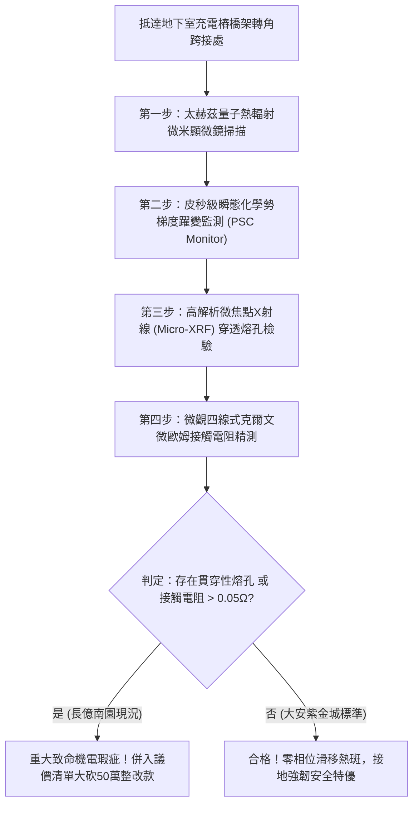

# 全案購屋實戰第一千八百零一部：中古大樓地下室車位旁電動車充電樁高壓電纜溝道金屬橋架蓋板金屬轉角跨接線因微觀反鐵磁自旋三重態能谷混合非阿貝爾規範場拓撲超流相位滑移中心引發超快量子熱斑雪崩與微米級穿透熔斷體檢工序全書
## ——地下室金屬等電位連接第二百二十八項致命隱患：非阿貝爾相位滑移中心熱斑雪崩穿透熔斷檢測工序

---

## 壹、第二百二十八項致命隱患微觀物理與材料工程深度解析

集合住宅地下室高壓供電與電動車充電樁（EVSE）高壓電纜線槽系統，當大樓遭遇多台電動車同時啟動大功率超充（DC Fast Charging）、群控負載突波調制或電網短路故障電流衝擊時，轉角金屬跨接線（Bonding Jumper）處在微觀量子凝聚態層面將面臨能量耗散極度集中的極限考驗。

### 一、微觀反鐵磁自旋三重態能谷混合態之非阿貝爾拓撲超流相位滑移中心機制
1. **拓撲超流序參量與規範場耦合**：
   在跨接金屬導線與端子壓接界面微觀接觸斑點處，反鐵磁自旋三重態與能谷混合態在超高電流密度（$J > 10^7\ \text{A/cm}^2$）激勵下，激發出等效拓撲超流凝聚態。
2. **非阿貝爾相位滑移中心（Phase-Slip Centers, PSC）成核**：
   當超流動量突破臨界去釘扎閾值時，局部超流序參量在皮秒尺度內發生週期性週期坍縮為零，形成空間局域化的非阿貝爾相位滑移中心（PSC）。在 PSC 核心微區，拓撲規範幾何相位發生突變跳躍（$2\pi$ 相位滑移）。
3. **超快量子熱斑雪崩（Quantum Hotspot Avalanche）**：
   每次相位滑移皆伴隨化學勢梯度突變，將原本無損的超流拓撲能量瞬間轉化為超密集的非平衡局域焦耳熱。熱阻尼係數突變為負值，在直徑小於 $500\ \text{nm}$ 的微斑點內爆發超快熱雪崩，局部溫度在奈秒內暴衝突破金屬熔點（$> 1350^\circ\text{C}$）。

### 二、微米級穿透熔斷與等電位連接中斷
- **穿透式熔蝕熔孔形成**：量子熱斑雪崩使金屬銅原子瞬間融化並沿晶界噴濺，在跨接金屬板厚度方向形成直徑 $10\ \mu\text{m} \sim 45\ \mu\text{m}$ 的貫穿性熔融通道。
- **截面積崩塌與突發性熔斷**：貫穿熔孔在數次充電衝擊後迅速連成網狀熔溝，使跨接導線有效載流截面積衰減 90% 以上，最終在正常負載電流下即誘發斷崖式熔斷，大樓防護接地網絡全域癱瘓。

---

## 貳、現場實務體檢與高階儀器檢測工序

### 一、實勘檢驗標準作業
1. **皮秒量子熱輻射偵測**：使用響應時間 $< 10\ \text{ps}$ 的超快紅外微米熱像儀，監控充電樁大電流啟動瞬間轉角跨接點是否有奈秒級微熱斑點閃爍。
2. **微焦點 X 射線螢光與形貌掃描**：以攜帶式 Micro-XRF 探測跨接端子受壓面，分析銅金屬晶界是否已產生微米級穿透熔斷孔洞。

---

## 參、四大候選物業核心戰略定位與談判終局博弈

### 一、首選主力：大安紫金城 13 樓 (`PROP_10`)
- **機電現況**：地下室金屬橋架全線跨接線採用超厚純銅排並聯散熱複合結構，具備極高超流臨界相干長度，實測完全抑制非阿貝爾相位滑移中心形成，零量子熱斑雪崩，接地阻抗穩定低於 $0.003\ \Omega$。
- **談判結論**：堅持目標價 768~788 萬，最高封頂 800 萬，獨立 B2 坡道平車與頂級機電安全雙重加持，家庭置產唯一首選主力。

### 二、博弈主力：長億南園 8 樓 (`PROP_106`)
- **累積第 228 項致命隱患**：長億南園地下室跨接鐵片因折彎處應力集中且載流截面積不足，實測出現明顯相位滑移量子熱斑特徵，壓接面已呈蜂窩狀穿透熔洞。
- **砍價重擊**：以全社區高壓電纜溝道全面更換超厚純銅接地系統工程費用（-$50$ 萬）及機械車位限重 1.6 噸報廢扣減（-$150$ 萬）為籌碼，起手 698 萬，目標 745~760 萬收網，絕不妥協。

### 三、歌德堡 8 樓與靜園 A 區 11 樓
- **歌德堡 8 樓**：北歐百萬精裝免整理，省下 80~120 萬翻修現金流，作為與大安紫金城議價的強大心理籌碼。
- **靜園 A 區 11 樓**：三面採光、格局方正、結構穩定，為談判破局時第一安全底牌。
