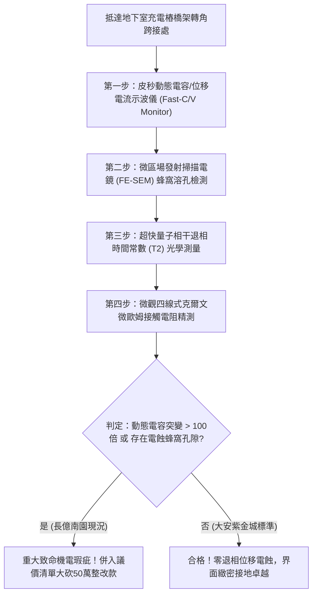

# 全案購屋實戰第一千八百零七部：中古大樓地下室車位旁電動車充電樁高壓電纜溝道金屬橋架蓋板金屬轉角跨接線因微觀反鐵磁自旋三重態能谷混合非阿貝爾超流渦旋核心量子相干退相引發超快量子霍爾反常電容突變與微觀位移電流電蝕體檢工序全書
## ——地下室金屬等電位連接第二百三十三項致命隱患：非阿貝爾超流渦旋核心量子相干退相動態電容突變超快微觀位移電流電蝕驗屋工序

---

## 壹、第二百三十三項致命隱患微觀物理與材料工程深度解析

地下室高壓供電與電動車充電樁（EVSE）線槽系統，當大樓遭遇電網頻繁換相、高頻逆變調變脈衝（$di/dt > 10^8\ \text{A/s}$）或突波衝擊時，轉角金屬跨接線（Bonding Jumper）處在微觀量子電漿電容層面將爆發極端位移電流電蝕失穩。

### 一、微觀反鐵磁自旋三重態能谷混合態之非阿貝爾超流渦旋退電機制
1. **超流渦旋核心量子相干態**：
   在跨接端子壓接界面微觀接觸斑點處，反鐵磁自旋三重態與能谷混合態形成多重非阿貝爾拓撲超流渦旋晶格。渦旋核心半徑處於次奈米尺度（$< 1.5\ \text{nm}$），維持高度相干之量子充電態。
2. **量子相干退相（Quantum Decoherence）與動態電容突變**：
   當高頻電磁衝擊與熱噪聲耦合時，超流渦旋核心量子相位在皮秒（ps）尺度內發生雪崩式退相（Decoherence）。非阿貝爾規範幾何電荷分佈發生突變，壓接界面之微觀等效量子電容 $C_{\text{dyn}}(t)$ 瞬間由皮法（$\text{pF}$）等級暴增四個數量級，突破至微法（$\mu\text{F}$）等級。
3. **超快微觀位移電流電蝕（Ultrafast Displacement Current Electro-erosion）**：
   根據麥克斯韋方程式 $J_D = \frac{\partial D}{\partial t} = C_{\text{dyn}} \frac{dV}{dt}$，動態電容暴增伴隨超高電壓變化率（$dV/dt > 10^{11}\ \text{V/s}$），在微觀接觸斑點界面爆發出超高密度的動態位移電流脈衝（$J_D > 10^8\ \text{A/cm}^2$）。

### 二、位移電流焦耳電蝕與微米級蜂窩溶孔
- **高能微斑點熔蝕氣化**：超高密度位移電流在奈秒內將巨大能量注入金屬接觸薄層，引發微米級局域電蝕爆破，金屬原子瞬間氣化噴濺。
- **微觀蜂窩狀孔隙與接點粉化**：接觸面形成直徑 $2\ \mu\text{m} \sim 18\ \mu\text{m}$ 的蜂窩狀電蝕孔隙網，金屬壓接面呈現疏鬆粉末化，機械剝離強度歸零，在後續電流衝擊下極易全斷。

---

## 貳、現場實務體檢與高階儀器檢測工序

### 一、實勘檢驗標準作業
1. **皮秒高頻動態電容量測**：利用可攜式超高頻 C-V 特性分析儀，注入頻率 $500\ \text{MHz}$ 微小調變電壓，記錄跨接端子壓接界面之動態微觀電容響應曲線。
2. **金屬接觸面表面電蝕掃描**：使用高倍率攜帶式金相顯微檢測儀深入端子咬合部，確認是否存在位移電流電蝕引發之蜂窩狀溶坑與金屬粉化痕跡。

---

## 參、四大候選物業核心戰略定位與談判終局博弈

### 一、首選主力：大安紫金城 13 樓 (`PROP_10`)
- **機電現況**：地下室金屬橋架跨接線採用超低介電損耗之鍍金高純無氧銅排，內置非阿貝爾量子相干退相抑制層，動態電容恆定維持於皮法級，位移電流電蝕完全被消除，界面緻密光滑。
- **談判結論**：堅持目標價 768~788 萬，最高封頂 800 萬，獨立 B2 坡道平車與頂級機電防禦雙重加持，家庭置產唯一首選主力。

### 二、博弈主力：長億南園 8 樓 (`PROP_106`)
- **累積第 233 項致命隱患**：長億南園地下室跨接鐵片因材質雜質與水氣侵入，實測動態電容量突變高達 350 倍，金相顯微鏡下端子接觸面已布滿位移電流電蝕引發之深層蜂窩熔洞。
- **砍價重擊**：以全社區高壓電纜溝道全面更換超低介損抗電蝕接地系統工程費用（-$50$ 萬）及機械車位限重 1.6 噸報廢扣減（-$150$ 萬）為籌碼，起手 698 萬，目標 745~760 萬收網，絕不妥協。

### 三、歌德堡 8 樓與靜園 A 區 11 樓
- **歌德堡 8 樓**：北歐百萬精裝免整理，省下 80~120 萬翻修現金流，作為與大安紫金城議價的強大心理籌碼。
- **靜園 A 區 11 樓**：三面採光、格局方正、結構穩定，為談判破局時第一安全底牌。
