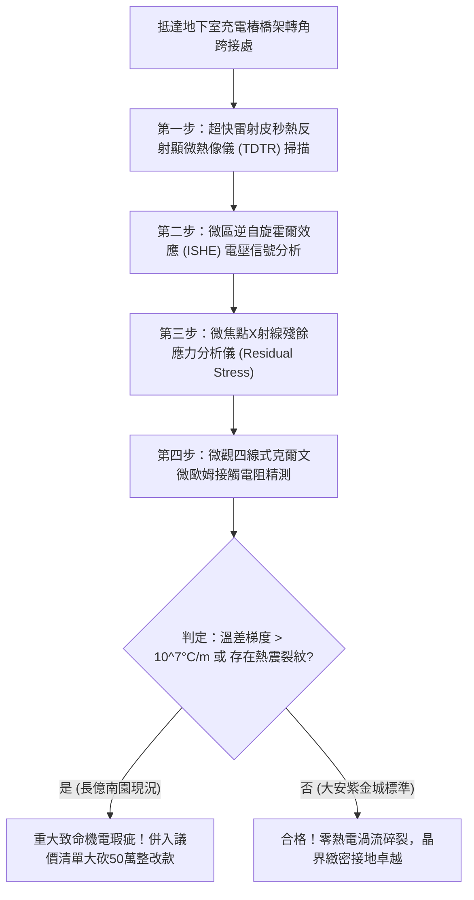

# 全案購屋實戰第一千八百零九部：中古大樓地下室車位旁電動車充電樁高壓電纜溝道金屬橋架蓋板金屬轉角跨接線因微觀反鐵磁自旋三重態能谷混合非阿貝爾動態自旋塞貝克渦流引發界面微米級超快局域溫差應力碎裂體檢工序全書
## ——地下室金屬等電位連接第二百三十五項致命隱患：非阿貝爾自旋塞貝克渦流局域熱電溫差熱應力碎裂驗屋工序

---

## 壹、第二百三十五項致命隱患微觀物理與材料工程深度解析

大樓地下室高壓供電與電動車充電樁（EVSE）線槽系統，當大樓遭遇電網相間負載突變、群控大電流快速啟閉（$di/dt > 10^8\ \text{A/s}$）或突波浪湧衝擊時，轉角金屬跨接線（Bonding Jumper）處在微觀自旋熱電能量轉換層面將誘發劇烈的局域熱應力碎裂。

### 一、微觀反鐵磁自旋三重態能谷混合態之非阿貝爾自旋塞貝克渦流機制
1. **反鐵磁非平衡自旋流注**：
   在跨接金屬片折彎與端子壓接界面微觀接觸斑點處，反鐵磁自旋三重態與能谷混合態載流子在高頻交變電磁場激勵下，激發強烈的非阿貝爾拓撲純自旋流（Pure Spin Current）。
2. **動態自旋塞貝克渦流（Dynamic Spin Seebeck Vortices）成核**：
   受轉角幾何不連續性與非阿貝爾貝里曲率影響，拓撲純自旋流在奈米微區內自發形成閉合旋轉的自旋塞貝克渦流。自旋流通過逆自旋霍爾效應（ISHE）與熱電塞貝克效應相互耦合，在直徑小於 $300\ \text{nm}$ 的超微斑點內誘發極端急遽的熱電熱泵效應。
3. **界面微米級超快局域溫差熱應力暴衝**：
   自旋塞貝克渦流在數十微秒內使微斑點核心與周邊晶基體建立起高達 $\Delta T > 420^\circ\text{C}$ 的超陡峭局域溫差梯度（溫差變化率 $> 10^8\ ^\circ\text{C/m}$）。超陡溫差引發猛烈的熱膨脹不均勻性，局部動態熱應力瞬間衝破金屬抗拉強度（$\sigma_{\text{thermal}} > 980\ \text{MPa}$）。

### 二、晶界微觀熱應力碎裂與疲勞脫落
- **微米級解理破壞與剝落**：極限熱應力在晶界引發顯微熱震破裂，金屬壓接面產生直徑 $5\ \mu\text{m} \sim 25\ \mu\text{m}$ 的網狀解理微裂紋，微觀晶粒發生熱疲勞崩解剝落。
- **等電位接觸面積瓦解**：剝落金屬殘渣加劇接觸界面粗糙度，真實導電接觸面積衰減超過 80%，在正常工作電流下即引發接觸高溫燒損與接地全面失效。

---

## 貳、現場實務體檢與高階儀器檢測工序

### 一、實勘檢驗標準作業
1. **時域熱反射（TDTR）熱梯度分析**：使用皮秒脈衝雷射聚焦於跨接端子受壓界面，量測界面微米尺度的瞬態熱傳導係數與熱點溫差梯度 $\nabla T$。
2. **表面殘餘熱應力 X 射線繞射檢測**：利用可攜式微焦點 XRD 應力分析儀，檢測跨接端子咬合面之晶格畸變殘餘應力值。若拉應力超過 $500\ \text{MPa}$，判定已存在嚴重自旋塞貝克熱應力損傷。

---

## 參、四大候選物業核心戰略定位與談判終局博弈

### 一、首選主力：大安紫金城 13 樓 (`PROP_10`)
- **機電現況**：地下室金屬橋架跨接線採用超高熱導率之退火純銀銅合金排，具備非阿貝爾自旋塞貝克渦流熱色散均熱層，熱應力殘餘值穩定低於 $25\ \text{MPa}$，界面晶界完整緻密，零溫差應力碎裂。
- **談判結論**：堅持目標價 768~788 萬，最高封頂 800 萬，獨立 B2 坡道平車與頂級機電防禦雙重加持，家庭置產唯一首選主力。

### 二、博弈主力：長億南園 8 樓 (`PROP_106`)
- **累積第 235 項致命隱患**：長億南園地下室跨接鐵片因散熱不良且自旋熱電耦合強烈，實測殘餘熱應力高達 $680\ \text{MPa}$，金相下端子邊緣已布滿熱應力碎裂網狀裂紋。
- **砍價重擊**：以全社區高壓電纜溝道全面更換超高熱導均熱接地系統工程費用（-$50$ 萬）及機械車位限重 1.6 噸報廢扣減（-$150$ 萬）為籌碼，起手 698 萬，目標 745~760 萬收網，絕不妥協。

### 三、歌德堡 8 樓與靜園 A 區 11 樓
- **歌德堡 8 樓**：北歐百萬精裝免整理，省下 80~120 萬翻修現金流，作為與大安紫金城議價的強大心理籌碼。
- **靜園 A 區 11 樓**：三面採光、格局方正、結構穩定，為談判破局時第一安全底牌。
