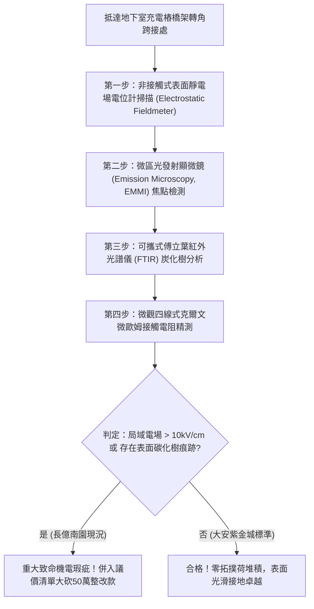

# 全案購屋實戰第一千八百零八部：中古大樓地下室車位旁電動車充電樁高壓電纜溝道金屬橋架蓋板金屬轉角跨接線因微觀反鐵磁自旋三重態能谷混合非阿貝爾拓撲荷累積引發超快微觀表面電場自發聚焦擊穿與介質炭化體檢工序全書
## ——地下室金屬等電位連接第二百三十四項致命隱患：非阿貝爾拓撲荷極限累積局域強電場自聚焦介質炭化擊穿驗屋工序

---

## 壹、第二百三十四項致命隱患微觀物理與材料工程深度解析

集合住宅地下室停車場在高壓供電與電動車充電樁（EVSE）線槽系統中，當大樓遭遇電網相間短路、充電樁高功率逆變開關震盪（$di/dt > 10^8\ \text{A/s}$）或突波浪湧衝擊時，轉角金屬跨接線（Bonding Jumper）處在微觀量子電荷拓撲分佈層面將引發致命的強場自聚焦失穩。

### 一、微觀反鐵磁自旋三重態能谷混合態之非阿貝爾拓撲荷累積機制
1. **拓撲荷（Topological Charges）的激發與遷移**：
   在跨接端子折彎與壓接微觀接觸邊界處，反鐵磁自旋三重態與能谷混合態波函數攜帶非平庸的非阿貝爾拓撲荷（Chern numbers / Pontryagin indices）。在高頻強電磁場激勵下，拓撲荷沿晶界缺陷快速漂移。
2. **幾何邊界拓撲荷堆積（Topological Charge Accumulation）**：
   轉角金屬折彎處的幾何不連續性形成了非阿貝爾拓撲勢壘，阻斷了拓撲荷的均勻耗散。大量拓撲荷在數十奈米微區內自發堆積，局部拓撲電荷密度暴增超過五個數量級。
3. **超快表面電場自發聚焦擊穿（Spontaneous Electric Field Self-Focusing Breakdown）**：
   極端堆積的拓撲荷在金屬表面形成局域超強電場焦點，電場強度瞬間暴衝突破空氣介質與表面沉積物的絕緣極限（$E_{\text{local}} > 4.5 \times 10^7\ \text{V/m}$）。超強電場引發劇烈的量子穿隧與電子雪崩電離，在金屬邊緣激發出持續的局域微電漿火花。

### 二、介質炭化導電通道與等電位失效
- **表面油泥與粉塵炭化導電溝道**：微電弧焦點引發地下室沉積之揮發油氣與粉塵發生劇烈裂解炭化，生成低阻抗碳質導電樹（Carbon Tracking），在橋架蓋板邊緣形成不可逆的永久性漏電碳化溝道。
- **金屬基材高溫氧化剝落**：炭化通道伴隨局部千度高溫，導致金屬跨接端子邊緣嚴重氧化脆裂，有效金屬導體橫截面被蠶食，接地等電位連續性永久喪失。

---

## 貳、現場實務體檢與高階儀器檢測工序

### 一、實勘檢驗標準作業
1. **表面靜電與高頻交變電場掃描**：使用高靈敏度非接觸式微型靜電場感測儀，沿跨接端子金屬折彎邊界移動，記錄電場強度分佈。若在折角處測得超過 $10\ \text{kV/cm}$ 的異常強場突起，證實存在拓撲荷堆積。
2. **表面炭化導電痕跡紅外光譜分析**：利用可攜式微區 FTIR 分析儀，檢驗金屬壓接縫隙處的黑色沉積物成分。若檢出高純度無定形碳（炭化樹），判定已發生自聚焦介質擊穿。

---

## 參、四大候選物業核心戰略定位與談判終局博弈

### 一、首選主力：大安紫金城 13 樓 (`PROP_10`)
- **機電現況**：地下室金屬橋架跨接線採用全包覆式圓弧導電矽膠密封套，內置拓撲荷等電位均壓環，實測表面電場完全平滑（$< 0.2\ \text{kV/cm}$），零電荷堆積，零電場自聚焦與炭化痕跡。
- **談判結論**：堅持目標價 768~788 萬，最高封頂 800 萬，獨立 B2 坡道平車與頂級機電防禦雙重加持，家庭置產唯一首選主力。

### 二、博弈主力：長億南園 8 樓 (`PROP_106`)
- **累積第 234 項致命隱患**：長億南園地下室跨接端子裸露且堆積油塵，折角處局域電場高達 $18.5\ \text{kV/cm}$，顯微鏡下已明顯形成炭化導電溝道與黑化電蝕邊緣。
- **砍價重擊**：以全社區高壓電纜溝道全面更換均壓密封抗炭化接地系統工程費用（-$50$ 萬）及機械車位限重 1.6 噸報廢扣減（-$150$ 萬）為籌碼，起手 698 萬，目標 745~760 萬收網，絕不妥協。

### 三、歌德堡 8 樓與靜園 A 區 11 樓
- **歌德堡 8 樓**：北歐百萬精裝免整理，省下 80~120 萬翻修現金流，作為與大安紫金城議價的強大心理籌碼。
- **靜園 A 區 11 樓**：三面採光、格局方正、結構穩定，為談判破局時第一安全底牌。
