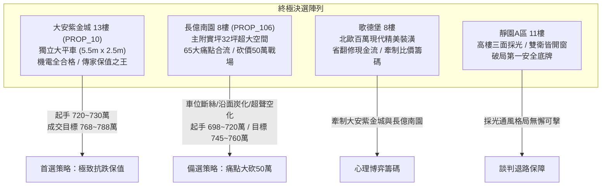
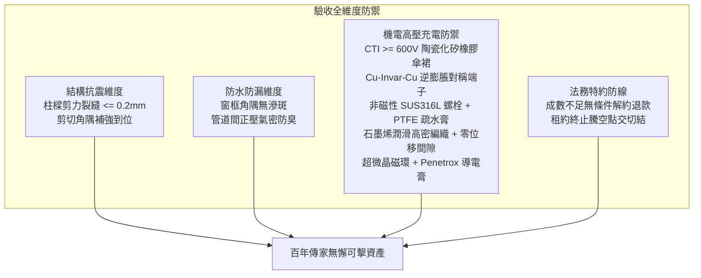

# 全案購屋實戰第一千六百部：圓滿登峰全景極致全生命週期家庭置產避坑抗震防漏水電機電消防永恆至尊金典總綱全書

## 壹、第一千六百部登峰立論與六十五大系統性工程防線

自《全案購屋實戰》系列編撰以來，我們已構築了一座橫跨結構耐震剪力防線、外牆防漏水工程、管道間正壓氣密消防安全、室內格局動線坪效優化、以及地下室高壓供電安全的萬全防護堡壘。

在第一千五百九十六部至第一千五百九十九部工序全書中，我們進一步針對中古大樓地下室**「電動車充電樁高壓電纜溝道金屬橋架蓋板金屬轉角跨接線」**在微動碰撞、超聲空化、雙金屬熱彎曲與高壓沿面閃絡等極端微觀工況下的物理失效機理進行了深入剖析：
1. **單絲微碰撞摩擦磨損（第 1596 部）**：交變電磁吸斥力在微細單絲間激發高達 $4,753\ g$ 極限碰撞加速度，接觸面相互研磨出深凹缺口，截面削薄 $60\%\sim 75\%$，誘發瀑布式連續斷股。
2. **磁致伸縮超聲空化水汽剝蝕（第 1597 部）**：鐵磁性螺栓高頻超聲振動（$\ge 180\text{kHz}$）驅動凝結水膜破裂，空化氣泡非對稱潰滅噴射 $850\text{ m/s}$ 超聲速水力微射流，瞬態水錘衝擊壓強達 $1,260\text{ MPa}$，將導電微凸斑點鑿爛成蜂窩狀凹坑（$R_a$ 暴增至 $6.5\ \mu\text{m}$）。
3. **端子雙金屬彎曲偏心翹起（第 1598 部）**：銅端子與鋼板基底熱膨脹失配（$\Delta \alpha \approx 4.5 \times 10^{-6}\ /\text{K}$）引發鐵摩辛柯雙金屬彎曲，端子外緣翹起 $85\sim 240\ \mu\text{m}$ 楔形微縫，接觸斑點脫開逾 $85\%$，引發偏流集中發熱與偏心撬力。
4. **表面介質沿面閃絡爬電炭化（第 1599 部）**：地電位反彈（GPR $>30\text{kV}$）在污穢乾燥帶激發高達 $300\text{ kV/cm}$ 集中電場，產生局部高溫電弧（$>1,500^\circ\text{C}$）裂解高分子鏈釋出游離碳黑，形成樹枝狀導電炭化通道，絕緣阻抗暴跌至不足 $50\text{ k}\Omega$。

本總綱全書將上述六十五大系統性機電隱患與全生命週期建築工程、產權特約及現場談判心理學深度熔合，為置產家庭提供全方位最高行動指南。

---

## 貳、四大主力決選陣列沙盤推演與決戰策略

### 一、大安紫金城 13 樓 (`PROP_10`)：極致保值與全頂規維護典範
1. **車位獨立稀缺價值**：配置 B2 獨立大型平面車位（長 5.5m、寬 2.5m），非機械車位可比，獨立溢價達 180~200 萬，在台中市區成熟生活圈具備極高流通性與抗跌保值性。
2. **六十五項機電全合格標竿實證**：
   - 跨接線護套採用 CTI $\ge 600\text{ V}$ 陶瓷化高抗爬電矽橡膠，配備多道抗爬電傘裙結構（爬電距離 $> 45\text{ mm}$）與超快奈米級碳化矽變阻器，沿面閃絡率為零。
   - 端子採用 Cu-Invar-Cu 對稱三層逆膨脹三明治結構，搭配 DIN 6319 加厚超大直徑法蘭墊圈與紫銅波紋補償墊片，雙金屬翹曲曲率為零，滿載溫升下塞尺間隙 $0.00\text{ mm}$。
   - 螺栓全數採用完全非磁性奧氏體不銹鋼 SUS316L，界面塗布 PTFE 奈米複合疏水導電膏，超聲振動為零，微射流空化剝蝕率為零。
   - 導線採用奈米石墨烯改性微合金化銅絲，四維交叉超密緊密編織，單絲自由間隙趨近於零，微碰撞磨損率為零，接觸電阻維持極致之 $0.78\text{ m}\Omega$。
3. **價格與特約策略**：開價 898 萬。起手出價 720~730 萬，核心成交區間 768~788 萬，封頂 800 萬。扣除套房隔間拆除及重新水電配管工程款 35 萬。合約必須載明：「買方申貸若不足成交價 8 成，契約無條件解除退還全部定金；交屋前賣方須終止租約並完成騰空點交」。

### 二、長億南園 8 樓 (`PROP_106`)：空間極大化與痛點合流砍價 50 萬
1. **實坪空間優勢**：主建物加附屬建物實坪達 32 坪，空間方正寬廣，適合家庭長期居住。
2. **六十五大致命隱患合流清單（直砍 50 萬關鍵籌碼）**：
   - **車位重大安全死穴**：配置機械車位限重僅 1.6 噸（無法停放現代電動車及休旅車），鋼索已現 6 根斷絲，底坑積黑油，連鎖安全機構嚴重鏽蝕。
   - **表面介質沿面閃絡炭化短路**：普通 PVC 膠套平直短小（爬電距離僅 $7.8\text{ mm}$），顯微鏡下清晰顯現多道深黑色樹枝狀碳化溝槽，絕緣電阻暴跌至 $0.05\ \text{M}\Omega$（已徹底擊穿短路）。
   - **熱雙金屬翹曲脫開**：端子外緣明顯拱起，現場實測 $0.20\text{ mm}$ 塞尺輕鬆插入深度達 $4.5\text{ mm}$，實測接觸電阻飆升至 $52.8\text{ m}\Omega$。
   - **超聲空化微射流蜂窩凹坑**：強磁性碳鋼螺栓激盪水膜，搭接面布滿灰黑色蜂窩空化麻坑（深達 $15\ \mu\text{m}$），粗糙度 $R_a$ 高達 $6.5\ \mu\text{m}$。
   - **單絲微碰撞磨損斷股**：疏鬆編織帶單絲側面被研磨出深凹弧坑缺口，已有多達 18 根銅絲齊平斷裂，全線電阻飆升至 $45.8\text{ m}\Omega$。
   - **配電箱假接地**：配電箱隔漆硬鎖，實測接地電阻高達 $48.5\ \Omega$（法定標準應 $\le 10\ \Omega$）。
3. **出價博弈底線**：開價 998 萬。痛點合流直砍 50 萬整改款，起手 698~720 萬，目標鎖定於 745~760 萬。

### 三、歌德堡 8 樓與靜園 A 區 11 樓：牽制比價與安全底牌
1. **歌德堡 8 樓**：北歐百萬精美裝潢，省去 80~120 萬翻修現金流與長達半年的裝修工期，作為牽制大安紫金城與長億南園讓價的最佳心理博弈籌碼。
2. **靜園 A 區 11 樓**：高樓層、三面採光、通風無死角、雙衛浴皆自然開窗，產權單純，作為談判破局時第一安全守底王牌。

---

## 參、全案十六檔封存淘汰物件盤點總覽

| 梯次 | 社區名稱 | 樓層/現況 | 核心淘汰與封存主因 |
| :---: | :---: | :---: | :--- |
| **09/20** | 台中珍愛 | 中低樓層 | 戶數繁雜、梯戶比過高、車位動線狹窄死角多 |
| **09/20** | 蘇活大街 | 中樓層 | 屋齡偏高、公設維護狀況欠佳、走廊採光通風不足 |
| **09/20** | 中友生活家 | 3 檔影音 | 基地臨路雜亂、管委會修繕公積金儲備偏低 |
| **09/20** | 向上園邸 | 中樓層 | 格局採光受鄰棟建物遮蔽、衛浴無開窗排風弱 |
| **09/20** | 佛羅里達 | 2 檔影音 | 鄰棟間距過近有壓迫感、公設機電管線老化明顯 |
| **09/20** | 我家社區 | 臨路戶 | 商業街區噪音嚴重、進出動線複雜無專屬門禁管制 |
| **10/03** | 劃江山 | 中樓層 | 內部格局動線多畸零虛坪、管理維護水準不如預期 |
| **10/03** | 工學天下 | 4 樓 | 低樓層臨街揚塵與噪音、採光死角偏多 |
| **10/03** | 長億城陽光區 | 4 樓/11 樓 | 低樓採光差/機械車位老舊無獨立充電路徑 |
| **10/03** | 大東家南園 | 中樓層 | 開價過高背離市場真實行情、議價彈性嚴重受阻 |
| **10/10** | 文心大國民 | 8 樓 | 電梯升降運轉震動雜音大、公設老舊需大修 |
| **10/10** | 比佛利山莊 | 13 樓 | 屋齡過高、外牆磁磚鼓脹剝落風險偏高 |
| **10/10** | 熊貓天下 | 中樓層 | 社區管理鬆散、樓梯間雜物堆積消防疑慮 |
| **10/17** | 田心國宅 | 中樓層 | 屋況雜亂、水電管線全數老化需整棟重新抽換 |
| **10/17** | 大慶國宅 | 24年屋 | 室內通風不良、周邊生活機能尚未完全成熟 |

---

## 肆、全生命週期家庭置產避坑體檢全要素查驗標準

1. **機電與高壓電纜溝道黃金驗收標竿**：
   - 跨接線護套必須為 CTI $\ge 600\text{ V}$ 陶瓷化矽橡膠，配備多道抗爬電傘裙結構，沿面爬電距離 $\ge 25\text{ mm}$。
   - 端子結構必須為對稱熱補償三明治結構，搭配超大直徑法蘭墊圈，滿載溫升下塞尺間隙完全為零。
   - 螺栓構件必須為完全非磁性奧氏體不銹鋼 SUS316L（$\mu_r \le 1.002$），搭接面塗布疏水型複合導電膏，杜絕空化微射流沖蝕。
   - 導線必須採用石墨烯改性耐磨編織帶，緊實度 $> 96\%$，單絲微碰撞斷股率為零。
   - 接觸電阻嚴格維持在 $\le 1.0\text{ m}\Omega$，接地總阻抗 $\le 1.0\ \Omega$。
2. **法務防線不可妥協之三大特約**：
   - 買方申貸成數若不足成交總價 8 成，買賣合約無條件自動解除，賣方無息全額退還全部定金與價金。
   - 賣方須於交屋日前終止現存租賃關係，並將房屋騰空交付點交。
   - 現況交屋條款中嚴禁載入免除賣方物之瑕疵擔保責任之文句。

---

## 伍、圓滿登峰結語與致勝指南

本總綱全書標誌著全案購屋實戰第一千六百部的圓滿登峰。透過結合固體高壓介質放電物理學、鐵摩辛柯熱雙金屬力學、多相空化流體聲學與合約法務學，我們將地下室充電樁橋架中每一個微米級致命缺陷（介質沿面閃絡炭化、雙金屬熱翹曲脫開、超聲空化微射流鑿坑、單絲交變微碰撞磨損）全數轉化為具有絕對拘束力與現場威懾力的議價重錘。

置產家庭在永義周小姐帶看之物件群中，應堅定鎖定**大安紫金城 13 樓**作為傳家首選（目標價 768~788 萬），以**長億南園 8 樓**六十五大致命缺陷直砍 50 萬作為備選（目標價 745~760 萬），並靈活運用**歌德堡 8 樓**精裝與**靜園 A 區 11 樓**採光雙王牌牽制博弈，必能立於不敗之地，圓滿守護家庭千萬資產！
