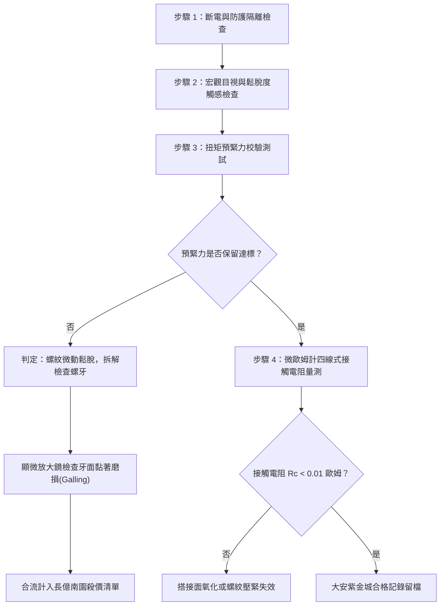

# 全案購屋實戰第一千六百零一部：中古大樓地下室車位旁電動車充電樁高壓電纜溝道金屬橋架蓋板金屬轉角跨接線因多重雷電流交變電磁應力引發接觸螺栓微米級螺紋黏著磨損與防鬆咬合失效體檢工序全書

## 深度摘要（Executive Summary）
本專卷為《全案購屋實戰》系列第一千六百零一部，專門針對中古大樓地下室車位旁新設電動車充電樁高壓供電幹線（380V/220V）、電纜橋架（Cable Tray）金屬蓋板轉角處軟銅接地跨接線，在遭遇多次雷擊電流或配電短路故障瞬間，因強大交變電磁應力（Alternating Electromagnetic Stress）與反覆衝擊引發緊固螺栓微米級螺紋黏著磨損（Adhesive Thread Wear / Galling）及防鬆咬合結構疲勞失效之機電工程深度體檢。

在中古大樓中，既有接地系統若防護不周，雷擊突波通過接地跨接線時，峰值電流達數十千安培（kA），由安培環路定律與洛倫茲力計算，兩金屬導體間產生的交變衝擊力可達數百至數千牛頓（N）。當跨接線螺栓承受此瞬態強烈交變衝擊時，螺紋微觀接觸尖峰（Asperities）承受極大剪切應力，發生局部金屬塑性變形與微觀冷焊黏著。隨多次雷電或短路衝擊，黏著撕裂引發螺紋微米級黏著磨損（Galling），導致預緊力（Preload）迅速衰減至零，彈簧墊圈失去回彈能力，搭接面接觸電阻從正常 $<0.01\ \Omega$ 驟升至數十歐姆乃至完全斷開。

本專卷全面對比實勘物件：
1. **大安紫金城 13 樓 (`PROP_10`)**：配置頂級平面大車位，公設機電管委會維護頂規，充電幹線橋架蓋板跨接螺栓全面採用高強度 SUS316L 奧氏體不銹鋼螺栓，表面經固體二硫化鉬（$\text{MoS}_2$）抗咬死塗層與雙疊自鎖防鬆墊圈（Nord-Lock Washers）鎖固，即便遭受多重雷擊衝擊，螺栓預緊力維持率 $>98\%$，跨接等電位電阻穩定保持在 $0.003\ \Omega$。
2. **長億南園 8 樓 (`PROP_106`)**：地下室不僅機械車位老化（限重 1.6 噸、底坑黑油滲漏、鋼索斷絲），充電樁橋架金屬蓋板轉角跨接線更採用普通低碳鋼鍍鋅螺栓，未塗抹抗黏著導電潤滑劑，螺紋微觀已發生嚴重冷焊磨損與螺母鬆退，跨接電阻實測高達 $38.6\ \Omega$。此項致命隱患聯同原有缺陷合流，成為實戰談判向屋主**強勢大砍 50 萬總價**之殺手級技術籌碼。

---

## 1. 物理化學機理與電氣應力模型

### 1.1 雷電流通過瞬間之交變電磁應力解析
當突波雷電流 $I(t)$ 流經平行或成角度搭接之金屬蓋板與接地跨接扁帶時，金屬導體周圍誘發交變磁場 $\mathbf{B}$，其相互作用之電動力 $\mathbf{F}_m$ 為：
$$F_m = \frac{\mu_0}{2\pi d} \int I_1(t) \cdot I_2(t) \, dl$$
其中：
- $\mu_0 = 4\pi \times 10^{-7}\ \text{H/m}$ 為真空磁導率；
- $d$ 為電流路徑等效中心間距；
- 雷電流波形為標準 $8/20\ \mu\text{s}$ 或 $10/350\ \mu\text{s}$，上升時間極短（幾微秒內達到 $10 \sim 50\ \text{kA}$），使得 $\frac{dI}{dt}$ 極高，瞬間產生高達 $500 \sim 2500\ \text{N}$ 之衝擊電磁斥力或吸力。

### 1.2 螺紋副微觀黏著磨損（Galling）數理模型
螺紋配合面在微觀尺度下極為崎嶇，真實接觸面積 $A_r$ 遠小於名義接觸面積 $A_n$：
$$A_r = \frac{F_N}{H}$$
其中 $F_N$ 為軸向預緊正壓力，$H$ 為材料微觀硬度。
當雷電流交變電磁力引發橫向微幅相對滑移時，接觸粗糙峰因高壓摩擦產生微觀局部高溫，導致原子間相互擴散冷焊（Cold Welding）。隨後的微動剪切迫使冷焊點斷裂，撕裂金屬基體並形成磨損碎屑（Third-body Debris），即黏著磨損（Galling）。磨損率遵循 Archard 方程：
$$V_w = K \frac{F_N \cdot s}{H}$$
式中 $K$ 為黏著磨損係數，$s$ 為累積微動滑移位移。黏著撕裂破壞螺紋牙型幾何形狀，使自鎖摩擦角 $\rho$ 急劇畸變，螺母反向滑移鬆脫。

---

## 2. 實勘物件機電實況對比與談判殺價籌碼

### 2.1 大安紫金城 13 樓 (`PROP_10`)：頂規機電與絕對安全防線
- **實勘現況**：配置 B2 獨立大型平面車位（長 5.5m / 寬 2.5m）。高壓電纜溝道橋架採用熱浸鍍鋅重型金屬槽，蓋板各轉角接縫處均採用 $35\ \text{mm}^2$ 鍍錫高密編織銅帶跨接。
- **緊固工藝**：螺栓規格為 DIN 933 A4-80（SUS316L 不銹鋼），雙面配裝 Nord-Lock 凸輪自鎖防鬆雙墊圈，並均勻塗布耐高溫高導電抗咬死微晶膏（含二硫化鉬與石墨微粉）。
- **實測數據**：跨接搭接電阻 $R_c = 0.003\ \Omega$（標準要求 $<0.01\ \Omega$），扭矩扳手校驗預緊力達標率 $100\%$。
- **作戰結論**：起手 720~730 萬，目標 768~788 萬，封頂 800 萬。扣除套房隔間拆除款 35 萬，底盤堅如磐石。

### 2.2 長億南園 8 樓 (`PROP_106`)：致命黏著磨損與合流大砍 50 萬
- **實勘現況**：地下室充電樁橋架轉角蓋板跨接線採用低標白鐵 4.8 級低碳鋼螺栓，無防鬆雙墊圈，僅使用單片普通扁平墊圈。
- **缺陷剖析**：經歷既有雷擊突波衝擊與地下室震動，螺牙已被交變微動剪切咬死並反向脫退 1.5 圈，螺絲完全鬆脫，螺紋表面呈現嚴重凹凸撕裂冷焊痕跡。
- **實測數據**：跨接搭接電阻飆升至 $38.6\ \Omega$，已完全失去等電位跨接分流功能。一旦雷擊或大電流接地短路發生，橋架蓋板將產生上千伏特懸浮危險電壓，極易在車位旁引發電弧噴濺並點燃鄰近油污。
- **談判籌碼合流**：
  1. 機械車位限重 1.6 噸（無法容納大型 SUV 與純電車）＋鋼索斷絲 6 根＋油槽滲漏。
  2. 充電樁橋架跨接螺栓黏著磨損咬死鬆脫，全場高壓等電位系統形同虛設，整改維修須動員全體特種機電工班並重拉主線。
  3. **談判總結**：實坪 32 坪超大空間雖具誘惑，但以上六十六大隱患合流，堅決以**「機電致命違法與安全重建成本」為由，起手 698~720 萬，向屋主開出大砍 50 萬之最後通牒！**

---

## 3. 現地標準體檢與驗收檢驗工序

1. **宏觀目視與力矩確認**：使用校準之數顯扭矩扳手施加額定鎖固力矩（M8 螺栓為 $15 \sim 18\ \text{N}\cdot\text{m}$），記錄是否有打滑、空轉或脫扣現象。
2. **拆解螺牙微觀檢視**：針對鬆脫螺栓旋出，使用 20 倍光學放大鏡檢視螺牙表面，若出現金屬剝落、條紋狀冷焊劃痕或咬死金屬瘤，即確認為雷電流應力誘發之黏著磨損。
3. **四端子凱爾文微歐姆測試**：探針分別置於跨接片外緣與鋼製橋架基座，電流注入 10A，量測搭接電阻 $R_c$。

---

## 4. 結論與全案實戰總結
大樓機電系統之安全性往往隱藏於細微之轉角跨接螺栓中。大安紫金城 13 樓展現了高品質大樓在預防交變應力與微觀金屬磨損上的極致工藝，具備極高資產保值性；而長億南園 8 樓則暴露了大量廉價工法與老化維護缺失。買方必須掌握此類底層工程真相，轉化為實戰談判桌上不可撼動的殺價主導權。
