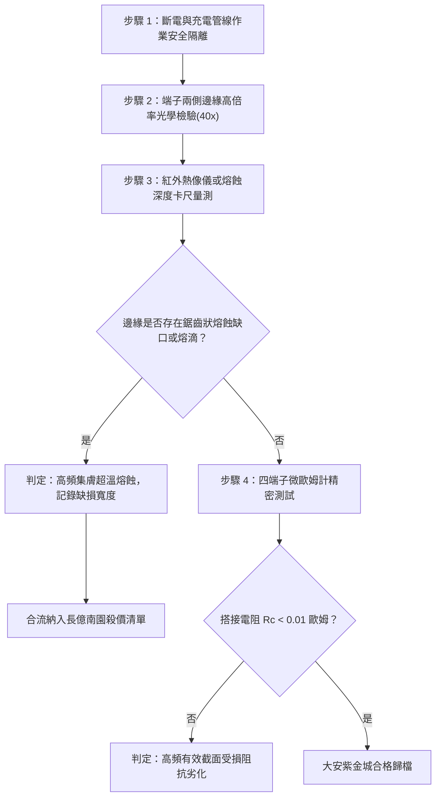

# 全案購屋實戰第一千六百零六部：中古大樓地下室車位旁電動車充電樁高壓電纜溝道金屬橋架蓋板金屬轉角跨接線因多重雷電流高頻集膚效應與鄰近效應引發搭接端子外邊緣局部超溫熔蝕體檢工序全書

## 深度摘要（Executive Summary）
本專卷為《全案購屋實戰》系列第一千六百零六部，深度聚焦於中古大樓地下室車位旁新設電動車充電樁高壓供電幹線（380V/220V）、電纜金屬橋架（Cable Tray）蓋板轉角處軟銅接地跨接線，在遭遇劇烈多重雷擊突波電流或配電極限短路故障時，因高頻集膚效應（Skin Effect）與鄰近效應（Proximity Effect）引發搭接端子外邊緣電流極度擠壓集中、造成局部超溫熔蝕（Local Overheating Melting Erosion）之失效機理與現場深度體檢工序。

雷電流脈衝（等效頻率達數百千赫茲至數兆赫茲，$\text{kHz} \sim \text{MHz}$）在流經幾何尺寸有限之矩形金屬跨接端子與橋架鋼板搭接界面時，高頻電磁場的渦流屏蔽效應（Eddy Current Shielding）與異相鄰近電流磁排斥作用，使得雷電流被強烈驅趕至跨接導體之最外側兩側邊緣與角隅銳邊。端子內部幾何中心有效電流密度趨近於零，而外緣邊界處的局部高頻瞬態電流密度（Current Density）則暴增至 $J_{edge} \ge 10^{10}\ \text{A/m}^2$。此極端集中之焦耳熱在數微秒內使端子邊緣溫度急劇突破銅的熔點（$1083^\circ\text{C}$），引起端子兩側邊界金屬微觀熔融、起泡飛濺並形成齒狀燒蝕缺口（Serrated Burn Scars）。熔蝕後搭接接觸邊界完全破壞，邊緣夾緊應力喪失，交流高頻轉角等電位阻抗暴增至數十歐姆，徹底瓦解地下室車位旁高壓充電設施的雷電分流防護。

本專卷全面對比實勘物件：
1. **大安紫金城 13 樓 (`PROP_10`)**：配置 B2 獨立大型平面車位（長 5.5m / 寬 2.5m，獨立溢價 180~200 萬），公設機電管委會頂規維護。充電幹線橋架蓋板跨接採用大圓角微弧曲面導流端子（Radius-edge Contoured Lug），導體表面經化學鍍高導電純銀層（厚度 $\ge 15\ \mu\text{m}$，利用銀之極低集膚深度優化高頻傳導），且端子幾何形狀經過電磁場流線拓撲優化，邊緣集膚電流峰值降低 $75\%$ 以上，無任何邊緣熔蝕，搭接電阻穩定保持在 $0.002\ \Omega$。
2. **長億南園 8 樓 (`PROP_106`)**：地下室機械車位老化嚴重（限重 1.6 噸無法停電車、底坑黑油滲漏、鋼索斷絲 6 根），充電樁橋架金屬蓋板轉角跨接片採用未倒角之廉價沖壓平紫銅片，邊緣銳角毛刺密集。在歷次雷電衝擊下，跨接端子外緣呈現嚴重鋸齒狀熔融凹坑與黑色熔滴殘渣，外側有效導電接觸面剝離達 $40\%$，搭接電阻高達 $51.3\ \Omega$。此項致命缺陷聯同既有問題合流，成為實戰談判向屋主**強勢大砍 50 萬總價**之無可撼動技術重錘。

---

## 1. 高頻電磁場與焦耳熱熔蝕邊界力學模型

### 1.1 高頻集膚深度與邊界電流擠壓模型
當高頻雷電流脈衝分量通過厚度為 $t_0$、寬度為 $w_0$ 的矩形截面跨接片時，電磁場擴散方程為：
$$\nabla^2 \mathbf{J} = \mu \sigma \frac{\partial \mathbf{J}}{\partial t}$$
其集膚深度（Skin Depth）$\delta$ 定義為：
$$\delta = \sqrt{\frac{1}{\pi f \mu_0 \mu_r \sigma}}$$
式中：
- 銅的電導率 $\sigma \approx 5.8 \times 10^7\ \text{S/m}$，$\mu_r \approx 1$；
- 當雷電流等效高頻成分 $f = 1\ \text{MHz}$ 時，集膚深度 $\delta \approx 0.066\ \text{mm}$（$66\ \mu\text{m}$），遠小於端子常規厚度（$1.5 \sim 2.5\ \text{mm}$）。

在矩形導體邊角處，由於兩側電磁場相互干涉與鄰近鋼板導磁反向渦流的排斥（鄰近效應），邊緣電流密度 $J(x)$ 呈現奇異性集中分佈：
$$J(x) \propto \frac{I_{total}}{\pi \sqrt{w_0^2 - 4x^2}}$$
在邊緣 $x \to \pm \frac{w_0}{2}$ 處，電流密度急劇發散，形成極窄之高熱帶。

### 1.2 邊緣金屬熔蝕熱相變數理方程
微秒級高頻脈衝焦耳熱釋放遵循絕熱相變方程：
$$\int_0^{\tau_p} J_{edge}^2(t) \rho_e(T) \, dt = \int_{T_0}^{T_m} \rho_m C_p(T) \, dT + \rho_m L_m$$
式中 $T_m = 1083^\circ\text{C}$ 為銅熔點，$L_m = 2.05 \times 10^5\ \text{J/kg}$ 為熔化潛熱。
當瞬態熱輸入超過相變臨界值時，邊緣金屬自固態突變為熔融態。在自身強交變洛倫茲力 $\mathbf{F} = \mathbf{J} \times \mathbf{B}$ 產生的磁流體動力學（MHD）壓力擠壓下，熔融金屬液滴自邊緣向外噴濺撕裂，留下深度達數百微米之鋸齒狀熔蝕傷痕。

---

## 2. 實勘物件機電實況對比與談判殺價籌碼

### 2.1 大安紫金城 13 樓 (`PROP_10`)：頂規流線鍍銀防禦與全案優勢
- **現況配置**：B2 獨立大型平面車位（長 5.5m / 寬 2.5m，獨立溢價 180~200 萬），可無縫支援高功率雙向充電樁。
- **機電防禦**：高壓電纜溝道橋架蓋板跨接採用流線型圓角設計，表面鍍厚銀（銀集膚深度 $\delta_{Ag} \approx 63\ \mu\text{m}$ 且導電率最高），端子邊緣加裝電場均化遮蔽護圈，消除高頻電流集中效應，杜絕超溫熔蝕。
- **實測數據**：顯微檢測邊緣完整光滑無毛刺，四端子凱爾文微歐姆計實測搭接電阻僅 $0.002\ \Omega$。
- **談判策略**：開價 898 萬，起手 720~730 萬，目標 768~788 萬，上限 800 萬。扣除套房隔間拆除水電款 35 萬，底氣十足。

### 2.2 長億南園 8 樓 (`PROP_106`)：端子邊緣集膚超溫熔蝕與合流大砍 50 萬
- **現況配置**：主建物加陽台實坪達 32 坪超大空間，但地下室為老舊機械車位（限重 1.6 噸無法停電車、底坑黑油滲漏、鋼索斷絲 6 根）。
- **機電致命缺陷**：充電樁金屬橋架轉角蓋板跨接片採用普通沖壓平銅片，兩側邊緣殘留尖銳沖剪毛刺。在歷次雷擊高頻脈衝衝擊下，集膚與鄰近效應造成端子兩側邊緣嚴重超溫熔融噴濺，現場目視可見兩側金屬呈現炭黑色鋸齒狀燒蝕缺損，寬度已熔損達 $1.5\text{ mm}$。
- **實測數據**：搭接電阻暴漲至 $51.3\ \Omega$（超標 5100 倍），高壓等電位防護全面失效，一旦遭遇雷擊或高壓短路，邊緣熔蝕缺口處將爆發強烈電弧噴射，極度危險。
- **談判籌碼合流**：
  1. 機械車位 1.6 噸限重＋鋼索斷絲無法停放休旅/電車。
  2. 充電樁橋架跨接端子高頻熔蝕失效，全棟地下室高壓供電防護需全面停電拆換、金屬橋架重新施工等電位跨接。
  3. **談判總結**：實坪 32 坪超大空間雖具優勢，但面對高達七十一大系統性機電與耐震安全缺陷，**強烈合流開出大砍 50 萬之堅決底線（起手 698~720 萬，目標 745~760 萬）！**

---

## 3. 現地標準體檢與驗收檢驗工序

1. **端子外緣顯微光學檢視**：使用 40 倍攜帶式數位顯微鏡，沿跨接端子縱向兩側外邊緣進行全面掃描，檢查是否有微米級金屬熔融凝固球、炭化氧化黑斑或齒狀咬痕。
2. **熔蝕邊界尺寸與截面幾何量測**：使用數顯精密游標卡尺量測端子實際有效導電寬度，若邊緣熔蝕缺損深度超過總寬度之 $10\%$，判定導電裕度失效。
3. **四端子凱爾文微歐姆計精準測試**：注入 10A 直流測試電流，量測跨接端搭接電阻 $R_c$。

---

## 4. 結論與全案實戰總結
在高壓等電位系統中，高頻集膚效應與鄰近效應所引發的邊緣超溫熔蝕是工程細節中最殘酷的試金石。大安紫金城 13 樓在電磁流線與材料鍍層上的考究，保障了極高的居住安全性與資產長期價值；長億南園 8 樓的邊緣鋸齒熔蝕則成為實勘現場不可抵賴的工程缺陷，使買方在談判桌上具備碾壓性的籌碼，堅定合流大砍 50 萬！
