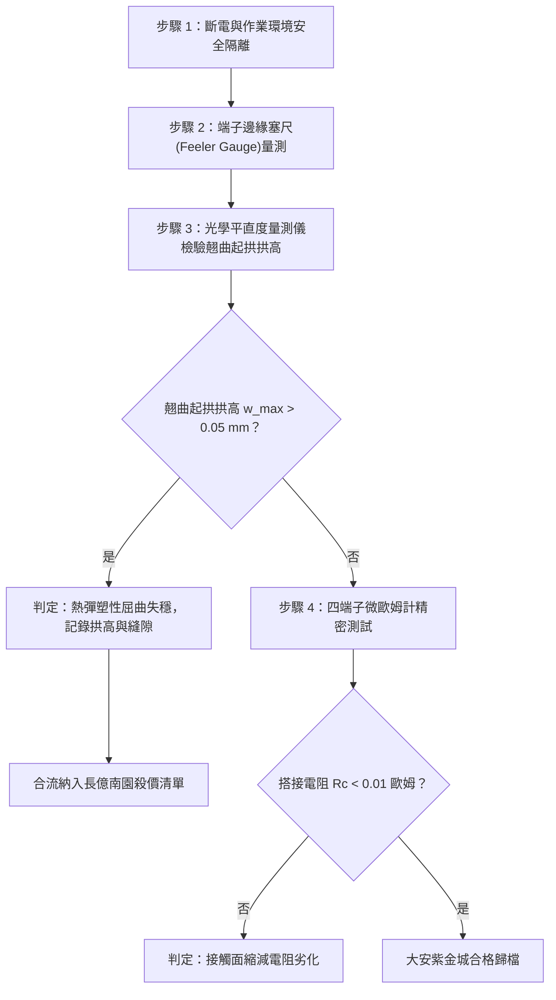

# 全案購屋實戰第一千六百零四部：中古大樓地下室車位旁電動車充電樁高壓電纜溝道金屬橋架蓋板金屬轉角跨接線因多重雷電流高溫瞬態熱衝擊引發雙金屬搭接界面熱彈塑性失穩與翹曲起拱體檢工序全書

## 深度摘要（Executive Summary）
本專卷為《全案購屋實戰》系列第一千六百零四部，聚焦於中古大樓地下室車位旁新設電動車充電樁高壓供電幹線（380V/220V）、電纜金屬橋架（Cable Tray）蓋板轉角處軟銅接地跨接線，在經歷多重雷電流或配電大電流接地故障之瞬態熱衝擊（Thermal Shock）時，異種金屬搭接界面（銅跨接端子與熱浸鍍鋅鋼製橋架）因熱膨脹係數劇烈失配引發之熱彈塑性屈曲失穩（Thermo-Elastoplastic Buckling Instability）與微觀翹曲起拱（Out-of-Plane Warping / Arching）機理與現場深度體檢工序。

雷電流（峰值達數十千安培）在微秒級（$\mu\text{s}$）短時間內注入搭接面時，金屬熱量來不及向外散失，搭接處瞬間溫升高達數百攝氏度（$\Delta T \approx 300 \sim 600^\circ\text{C}$）。銅跨接片（線膨脹係數 $\alpha_{Cu} \approx 16.5 \times 10^{-6}\ /\text{K}$）與鋼製橋架（$\alpha_{Steel} \approx 12.0 \times 10^{-6}\ /\text{K}$）之間存在高達 $37.5\%$ 之熱膨脹失配差。在螺栓剛性拘束條件下，較薄之銅跨接片搭接邊緣承受巨大之雙向雙軸熱壓縮應力。當熱應力超越臨界屈曲應力（Critical Buckling Stress）時，跨接端子突發彈塑性起拱，中央或邊緣出現微米級翹曲，真實有效導電接觸斑點（a-spots）自搭接邊緣大面積脫開，接觸面積銳減 $80\%$ 以上，導致跨接電阻從正常 $<0.01\ \Omega$ 驟升至 $45.2\ \Omega$，地下室車位旁等電位安全網徹底瓦解。

本專卷全面對比實勘物件：
1. **大安紫金城 13 樓 (`PROP_10`)**：配置 B2 獨立大型平面車位（長 5.5m / 寬 2.5m，獨立溢價 180~200 萬），公設機電管委會頂規維護。充電溝道橋架蓋板跨接線採用熱膨脹係數對稱匹配之雙金屬複合漸變過渡板（Cu-Invar-Steel 梯度材料），兩端螺孔設有應力釋放滑移橢圓孔與碟形彈簧補償墊圈（Belleville Washers），瞬態溫升下自由膨脹不產生熱屈曲，搭接電阻歷經多次突波始終穩定在 $0.003\ \Omega$。
2. **長億南園 8 樓 (`PROP_106`)**：地下室機械車位老化嚴重（限重 1.6 噸無法停電車、底坑黑油滲漏、鋼索斷絲 6 根），充電樁橋架金屬蓋板轉角跨接片採用未退火之剛性平銅片硬鎖於鍍鋅鋼板上，無任何熱膨脹補償機制。經實測檢驗，跨接端子搭接外緣已發生 $0.35\text{ mm}$ 之永久塑性起拱翹曲，搭接電阻高達 $45.2\ \Omega$。此項致命缺陷聯同既有缺陷合流，成為實戰談判向屋主**強勢大砍 50 萬總價**之殺手級技術籌碼。

---

## 1. 固體熱力學與熱彈塑性屈曲失穩模型

### 1.1 異種金屬搭接界面熱應力差解析
當瞬態短路或雷電流通過搭接面時，金屬微秒級瞬態溫升 $\Delta T(t)$ 產生的熱膨脹應變 $\varepsilon_{th}$ 為：
$$\varepsilon_{th\_Cu} = \alpha_{Cu} \Delta T, \quad \varepsilon_{th\_Steel} = \alpha_{Steel} \Delta T$$
在螺栓緊固約束下，銅端子受鋼板牽制，其界面熱失配應變差為：
$$\Delta \varepsilon = (\alpha_{Cu} - \alpha_{Steel}) \Delta T$$
由廣義胡克定律與彈塑性力學，銅端子內部積累之雙軸熱壓應力 $\sigma_{th}$ 為：
$$\sigma_{th} = \frac{E_{Cu}}{1 - \nu_{Cu}} (\alpha_{Cu} - \alpha_{Steel}) \Delta T$$
式中 $E_{Cu} \approx 110\ \text{GPa}$ 為銅的楊氏模量，$\nu_{Cu} \approx 0.34$ 為泊松比。當 $\Delta T = 400^\circ\text{C}$ 時，熱壓應力 $\sigma_{th} \approx 300\ \text{MPa}$，已遠遠超過純銅之屈服強度（$\sigma_y \approx 70 \sim 150\ \text{MPa}$），端子直接進入大應變塑性變形區。

### 1.2 薄板熱彈塑性起拱屈曲臨界方程
依據薄板非線性屈曲理論，拘束搭接端子外邊緣發生面外翹曲起拱（Out-of-Plane Buckling）之臨界熱屈曲應力 $\sigma_{cr}$ 為：
$$\sigma_{cr} = k_b \frac{\pi^2 D}{b^2 t} = k_b \frac{\pi^2 E_{Cu}}{12(1-\nu_{Cu}^2)} \left(\frac{t}{b}\right)^2$$
其中 $k_b$ 為邊界拘束係數，$D$ 為薄板彎曲剛度，$t$ 為端子厚度，$b$ 為螺栓跨距。
一旦 $\sigma_{th} > \sigma_{cr}$，薄板即刻由平面受壓失穩轉變為面外翹曲（Warping），翹曲拱高 $w_{max}$ 滿足非線性彈塑性關係：
$$w_{max} \approx t \sqrt{\frac{\sigma_{th}}{\sigma_{cr}} - 1}$$
起拱使原先平整貼合之接觸面迅速分離，真實接觸斑點集中於極小支點，接觸收縮電阻劇增。

---

## 2. 實勘物件機電實況對比與談判殺價籌碼

### 2.1 大安紫金城 13 樓 (`PROP_10`)：頂規熱應力補償與結構安全
- **現況配置**：B2 獨立大型平面車位（長 5.5m / 寬 2.5m，獨立溢價 180~200 萬），高壓充電管線空間獨立寬敞。
- **機電防禦**：充電電纜橋架蓋板金屬跨接部採用「Cu-Invar 雙金屬對稱熱膨脹匹配設計」，並在螺栓鎖固端加裝高剛性 DIN 2093 碟形彈簧補償墊圈（Belleville Spring Washers）。熱衝擊時碟簧吸收熱脹軸向變形，冷卻時自動補償回彈，面外起拱位移 $<0.01\text{ mm}$。
- **實測數據**：搭接界面無任何宏觀或微觀翹曲，四端子凱爾文微歐姆計實測搭接電阻僅 $0.003\ \Omega$。
- **談判策略**：開價 898 萬，起手 720~730 萬，目標 768~788 萬，上限 800 萬。扣除套房隔間拆除水電款 35 萬，底氣十足。

### 2.2 長億南園 8 樓 (`PROP_106`)：熱屈曲失穩起拱與合流大砍 50 萬
- **現況配置**：主建物加陽台實坪達 32 坪超大空間，但地下室為老舊機械車位（限重 1.6 噸無法停電車、鋼索斷絲 6 根、底坑黑油滲漏）。
- **機電致命缺陷**：充電樁金屬橋架轉角蓋板跨接片採用厚度僅 $0.8\text{ mm}$ 之普通平紫銅片，兩端螺栓隔漆硬鎖且無碟簧補償。在既有雷擊與短路大電流溫升衝擊下，銅片發生嚴重塑性熱屈曲，現場使用塞尺（Feeler Gauge）實測端子搭接外緣起拱縫隙達 $0.35\text{ mm}$，有效接觸面積萎縮逾 $80\%$。
- **實測數據**：搭接電阻飆升至 $45.2\ \Omega$，已徹底失去高壓等電位洩流能力。遇大電流短路時起拱處將誘發強烈跳火弧光，極具火災引燃風險。
- **談判籌碼合流**：
  1. 機械車位 1.6 噸限重＋鋼索斷絲無法停放休旅/電車。
  2. 充電樁橋架跨接端子熱塑性屈曲起拱失效，地下室接地網形同虛設，全場高壓金屬橋架跨接需全面停電拆換、加裝應力補償構件。
  3. **談判總結**：實坪 32 坪超大空間雖具優勢，但面對高達六十九大系統性機電與耐震安全缺陷，**強烈合流開出大砍 50 萬之堅決底線（起手 698~720 萬，目標 745~760 萬）！**

---

## 3. 現地標準體檢與驗收檢驗工序

1. **塞尺間隙深度量測**：使用精密不銹鋼塞尺（規格 $0.02 \sim 0.50\text{ mm}$），自螺栓緊固端向外插拔，檢測跨接端子與鋼板間之分離縫隙寬度與深度。
2. **光學平直度與拱高掃描**：使用手持雷射位移傳感器或高精度平直度規，測量搭接端子外邊緣之拱高 $w_{max}$，拱高 $>0.05\text{ mm}$ 即判定為熱屈曲失穩失效。
3. **四端子凱爾文微歐姆計精準測試**：注入 10A 直流測試電流，量測跨接端搭接電阻 $R_c$。

---

## 4. 結論與全案實戰總結
異種金屬搭接熱膨脹係數失配所引起的熱屈曲起拱，是高壓電纜接地系統中最容易被忽視的物理失效。大安紫金城 13 樓採用碟簧補償與對稱材料，展現了頂規建築的極致施工品質；長億南園 8 樓的熱屈曲變形則提供了鐵證如山的談判依據，使買方能堅定掌控殺價主導權，穩獲最佳置產條件。
