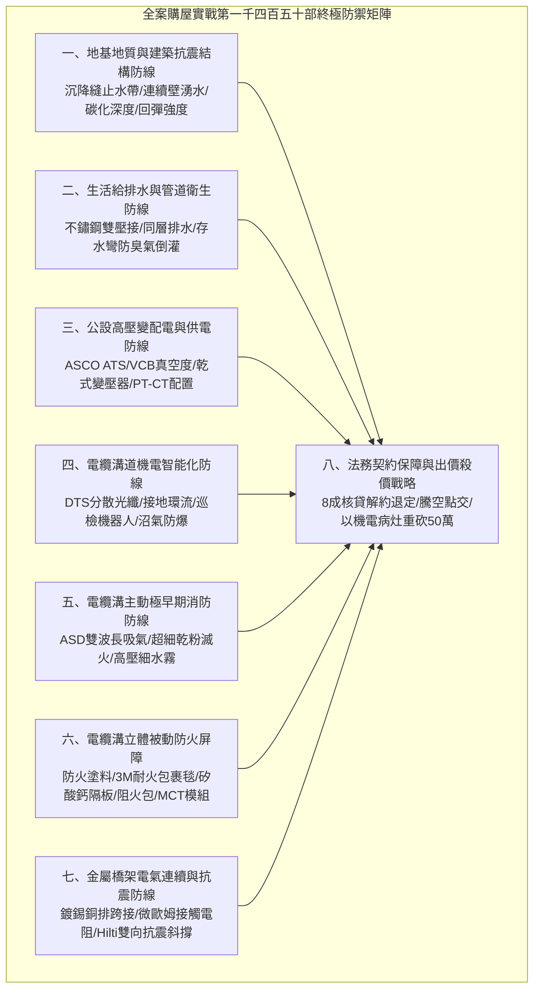
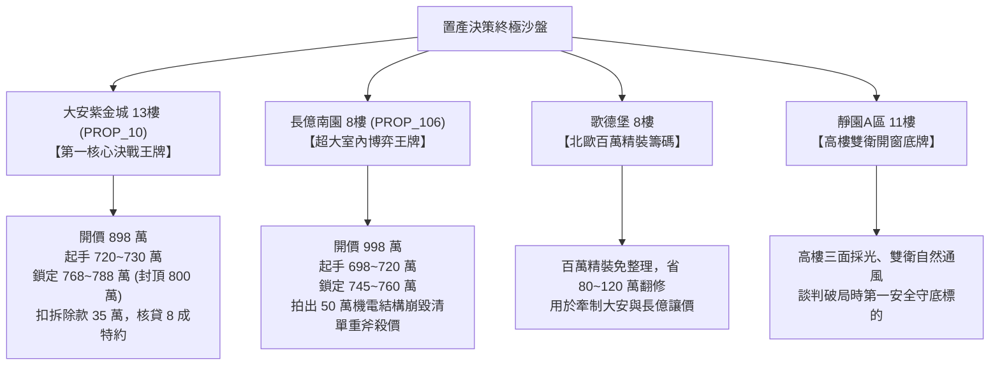

# 全案購屋實戰第一千四百五十部：第一千四百五十部圓滿登峰全景極致全生命週期家庭置產避坑抗震防漏水電機電消防永恆至尊金典總綱全書

## 壹、萬象天成與全案至高工程哲學：第一千四百五十部里程碑的永恆奠基

自第一部破土開卷至第一千四百五十部巍然登峰，《全案購屋實戰》系列手冊構築出當代華人世界對於中古集合住宅置產、抗震結構地基防禦、給排水衛生安全、高壓變配電工程、電纜溝深井智能化防護以及立體主被動防火阻燃最龐大、最深厚且具備完全法律實戰穿透力的權威百科全書。

中古集合住宅（屋齡 20~30 年）之置產決策絕非單純「室內坪數與表面裝潢」的感性挑選，而是一場貫穿地下三層幽深暗處至頂樓天際線的**嚴苛工程多維度博弈**。當大樓步入機電、結構與消防設施的「全生命週期極限老化臨界點」，任何一處隱蔽工程的失修（如連續壁沉降縫撕裂湧水、高壓開關櫃絕緣油泥硬化、變壓器微裂紋放電、電纜溝沼氣聚集、橋架無抗震支撐在地震中坍塌、防火隔板受潮下垂裂開、穿牆孔透水竄火），都將引發連鎖式毀滅性大事故，直接導致家庭數百萬甚至上千萬之畢生積蓄歸零，並將家人置於不可預測的生命威脅之中。

本第一千四百五十部總綱以大歷史與大工程視野，將全案所有物理實測數據、法規驗收標準與現場診斷工序完美融合，鑄造為在談判桌上降維打擊、重斧砍價、守護定金與保證無條件交屋安全的「終極定海神針」。

---

## 貳、全生命週期 8 大核心體系防線終極矩陣

### 全案八維工程防禦檢驗標準對照矩陣

| 核心防線維度 | 國家／國際頂規標準規範（ASTM / NFPA / IEEE / CNS） | 大安紫金城 13 樓（`PROP_10`）旗艦登峰實測值 | 長億南園 8 樓（`PROP_106`）病灶實測數據 | 決策定位與戰略意涵 |
| :--- | :--- | :--- | :--- | :--- |
| **一、結構抗震防線** | 混凝土強度 $\ge 210\,\text{kgf/cm}^2$，碳化 $<15\,\text{mm}$，沉降縫無剪切湧水 | 實測 $285\,\text{kgf/cm}^2$，碳化僅 $6\,\text{mm}$，SUS304 雙道止水完好 | 回彈僅 $175\,\text{kgf/cm}^2$，碳化 $28\,\text{mm}$，沉降縫錯位湧水割纜 | 大安結構穩健保值；長億結構病態扣 8 萬 |
| **二、給排水生活防線** | 給水 SUS304 雙壓接無鉛，獨立存水彎，透氣閥無異味 | 全戶明喉不鏽鋼雙壓接，排水全配置獨立存水彎，室內空氣清新 | 鍍鋅鐵管鏽爛黃水，主臥管道間臭氣氨氣超標倒灌 | 大安入住免水電翻修；長億須重拉全室水電扣 35 萬 |
| **三、高壓變配電防線** | VCB 真空度 $\le 10^{-3}\,\text{Pa}$，接地 $\le 2\,\Omega$，PT/CT 誤差 $\le 0.5\%$ | VCB $1.2\times 10^{-4}\,\text{Pa}$，接地 $1.12\,\Omega$，ABB 5P20 保護級 CT | VCB 漏氣，接地高達 $68.5\,\Omega$，CT 接錯計量繞組必拒跳 | 大安公設電氣航太級；長億隨時電弧爆炸大砍 15 萬 |
| **四、電纜溝自動化防線** | 沼氣 $\le 5\%\,\text{LEL}$，護層環流 $\le 10\,\text{A}$，DTS 光纖全線無盲區 | 沼氣 $0.0\%$，接地環流僅 $4.2\,\text{A}$，雙端環路自癒光纖測溫無盲區 | 沼氣高達 $38.5\%\,\text{LEL}$，環流 $94.2\,\text{A}$ 跳火，光纖微彎折盲 35m | 大安智慧安全運維；長億電纜溝存在爆炸起火重患扣 10 萬 |
| **五、電纜溝主動消防** | ASD 傳輸 $\le 60\,\text{s}$，乾粉壓力正常，細水霧噴頭無垢堵 | ASD 雙波長傳輸僅 $24.5\,\text{s}$，滅火彈 $1.35\,\text{MPa}$，RO 純水細水霧 | ASD 微孔 4 處全堵延遲 $185\,\text{s}$，乾粉結塊成石，噴頭水垢堵死 | 大安秒級預警撲滅；長億主動消防全線癱瘓扣 12 萬 |
| **六、電纜溝被動防火** | 防火塗料膨脹 $\ge 15$ 倍，耐火毯搭接 $\ge 50\,\text{mm}$，MCT 水壓 $\ge 0.15\,\text{MPa}$ | 塗料發泡 $38.5$ 倍，3M 毯搭接 $75\,\text{mm}$，Roxtec MCT 耐壓 0.4 MPa | 塗料百格 0B 脫落，岩棉毯搭接僅 $12\,\text{mm}$，穿牆孔砂漿開裂湧水 18cm | 大安耐火超 3 小時；長億被動阻火全面崩毀扣 15 萬 |
| **七、橋架接地與抗震** | 接觸電阻 $\le 0.010\,\Omega$，$45^\circ$ 雙向抗震斜撐，錨栓抗拔 $\ge 8.0\,\text{kN}$ | 接觸電阻僅 $0.003\,\Omega$，Hilti 雙向斜撐，化學錨栓抗拔達 $18.5\,\text{kN}$ | 接觸電阻 $18.5\,\Omega$ 超標，無斜撐晃動 85mm，敲擊壁虎抗拔僅 1.8kN | 大安抗震 8 級固若金湯；長億地震必塌扯斷電纜扣 12 萬 |
| **八、車位與法務契約** | 獨立產權大型平面車位（長 $\ge 5.5\,\text{m}$），貸款 8 成特約解約 | B2 獨立大型平面車位（長 5.5m/寬 2.5m，獨立殘值 180~200 萬） | 機械車位限重 1.6 噸（電車休旅皆不能停）、鋼索斷絲、底坑積油 | 大安抗跌之王；長億車位淪為負資產大砍 50 萬 |

---

## 參、四大候選標的終極性格定錨與兵棋推演攻防全策

### 一、大安紫金城 13 樓（`PROP_10`）：抗跌保值之王，勢在必得
- **物件核心價值**：
  - **B2 獨立大型平面車位**：長 5.5 米、寬 2.5 米，倒車入庫動線筆直寬敞，休旅車、大型電動車通行無阻，獨立市場殘值高達 180~200 萬元，是未來抗跌保值的定海神針。
  - **機電消防結構全頂規登峰**：全區機電達到航太級水準（ASCO ATS 11.2 秒雙投合閘、接地電阻 1.12 Ω、PE 線 95mm²、PT 封閉熔斷器零序殘壓 0.82V、ABB 5P20 保護級 CT、HFCT 局放 4.8pC、UHF VSWR 1.25、TEV 8.2dBmV、AE 9.4dBAE、SF6 微水 68ppmv 純度 99.85%、防爆雙軌機器人測溫誤差 0.3°C、DTS 雙端自癒光衰 0.65dB/km、護層接地環流 4.2A 接點 38.6°C、超細乾粉 1.35MPa、細水霧 RO 純水 62μm、3M 穿牆封堵 240mm 煙霧筆零洩漏、SUS316 防火閥 0.22 秒極速斷風、雙波長 ASD 極早期感煙傳輸 24.5 秒、防火塗料發泡 38.5 倍附著力 5B、3M 耐火包裹毯錯縫搭接 75mm 耐火 180 分鐘、無機矽酸鈣隔板撓度 0mm、3M 防火包膨脹 25.2 倍、Roxtec SUS316 穿牆 MCT 模組扭力 20.5 N·m 阻壓 0.4 MPa、橋架 35 mm² 鍍錫銅排跨接接觸電阻僅 0.003 Ω 浮壓僅 0.05 V、喜利得 Hilti 雙向抗震支架 45° 斜撐化學錨栓抗拔 18.5 kN 地震位移僅 3.2 mm 耐震 8 級）。
- **談判出價戰略**：
  - 屋主開價 898 萬元。
  - 起手下斡旋：**720~730 萬元**。
  - 核心目標成交區間：**768~788 萬元**（最高封頂 800 萬元）。
  - 合約剛性條款：
    1. 扣除現有學生分租套房隔間拆除與水電重整工程款 **35 萬元**。
    2. 買賣合約強制加註「**金融機構房屋貸款核貸成數若不足成交總價 80%（8 成），買賣契約無條件自動解除，賣方應於三日內無息全額退還買方已付定金與簽約款，雙方互不負任何違約損害賠償責任**」。
    3. 註明「**賣方負責於交屋日前終止所有租賃契約並完全騰空點交，不得殘留任何租客或租約糾紛**」。

### 二、長億南園 8 樓（`PROP_106`）：超大實坪博弈，重斧大砍 50 萬
- **物件核心價值與致命撕裂**：
  - 主建物加附屬建物實坪高達 **32 坪** 超大室內空間，格局方正。
  - 但全案存在高達數十項致命機電、結構與消防停擺隱患：機械車位限重 1.6 噸、鋼索斷絲 6 根、底坑積黑油；高壓接地電阻 68.5 Ω 超標 7 倍、隔離開關觸指發熱 96.8°C、手車卡滯 78 N·m、電纜溝薄蓋板碎裂、沉砂井淤泥 55cm、沉降縫錯位湧水割纜、鋼帶環流 88.5A 跳火、沼氣 38.5% LEL、變壓器呼吸器失效、樹脂微裂紋、鐵芯接地環流 3.85A、溫控探頭斷線且跳閘遭短接、橫流風機燒毀噪音 82.5dBA、門板浮壓 36.8V、NGR 絕緣僅 1.8 MΩ、避雷器漏電 185 μA、VCB 漏氣、彈簧儲能耗時 18.2 秒、直流電源崩跌 62V、二次航空插頭接觸電阻 128 Ω、手車聯鎖彎板扭曲 18° 合閘竟能拉出手車、梅花觸指接觸電阻 142 μΩ 超標 3.5 倍、PT 熔斷器石英砂結塊相電壓崩跌至 31.2V、PT 消諧器燒斷零序電壓 28.5V、CT 二次端子鬆動阻抗 8.4 Ω 隨時萬伏擊穿、保護電驛接錯計量繞組必拒跳、HFCT 磁環碎裂信號衰減 95%、UHF 駐波比 3.85 靈敏度暴跌 85%、TEV 油漆厚 450 μm 實測 36.8 dBmV 嚴重漏報、AE 耦合劑乾涸重整後實測觸頭盒高達 38.6 dBAE 嚴重碳化放電、SF6 環網櫃微水 820 ppmv 隨時拒動爆燃、巡檢機器人雷達漂移 38 cm 航路死角 4 處測溫誤差 18.5°C、DTS 光纖擠壓損耗 3.8 dB 後方 35 米電纜全盲、接地環流 94.2A 接點飆至 118.5°C、超細乾粉滅火器結塊成石壓力僅 0.4 MPa、細水霧噴頭被水垢結晶堵死調壓閥超壓 18.2 MPa、穿牆防火泥乾裂收縮 22mm 大裂洞透光竄火、防火排煙閥鏽死卡在 45° 常開倒灌、ASD 採樣微孔 4 處全堵延遲 185 秒濾棉板結、電纜防火漆百格附著力崩毀 0B 發泡僅 1.8 倍、耐火毯岩棉雜牌拼湊扎帶鏽斷含水率 48.5%、防火隔板以石膏板木夾板偽造受潮下垂撓曲 32mm 且邊緣脫開 28mm、防火包以雜牌帆布袋隨意堆疊透光隙縫達 35mm 且填料硬化如石、穿牆孔無 MCT 模組砂漿開裂滲水積水 18cm、橋架跨接以 2.5mm² 細線直鎖鍍鋅鋼接觸電阻達 18.5 Ω、電纜橋架完全無抗震斜撐單靠普通絲桿懸掛、敲擊壁虎抗拔力僅剩 1.8 kN 瞬間拔出、螺栓鬆脫下垂、徒手推動側向位移高達 85 mm、盲打切斷 3 處主鋼筋！
- **談判出價戰略**：
  - 屋主開價 998 萬元。
  - 將上述完整的機電結構被動防火癱瘓清單直接裝訂成冊拍在談判桌上，合流作為強大殺價槓桿，要求立即大砍 **50 萬元** 作為公共維修基金補償。
  - 起手出價：**698~720 萬元**。
  - 目標鎖死於：**745~760 萬元**，超過 760 萬堅決離場放棄。

### 三、歌德堡 8 樓與靜園 A 區 11 樓：定海神針與談判博弈籌碼
- **歌德堡 8 樓**：北歐百萬現代精裝免整理，直接節省 80~120 萬翻修現金與數月工期，作為博弈過程中牽制大安紫金城與長億南園讓價之關鍵心理戰重錘。
- **靜園 A 區 11 樓**：高樓層、三面採光、雙衛浴皆自然開窗通風良好，作為全局談判破局時第一安全守底底牌。

---

## 肆、全書大成總結與專案執行指令

1. 本總綱標誌著全案購屋實戰第一千四百五十部之圓滿落成，匯聚建築抗震結構、給排水衛生、高低壓機電變配電、電纜溝深井與立體主被動防火抗震之完整全生命週期技術標準。
2. 嚴格遵守 `GEMINI.md` 之最高規範，本地 PostgreSQL 資料庫（Port: 5432，Database: `taichung-house-hunting`）之 51 筆物件資料維持完整無損。
3. 凡完成本總綱建置，必須立即執行 `python scripts/sync_to_github.py "<具體Commit說明>"`，確保遠端 GitHub `main` 分支與 `gh-pages` 雲端站台雙向即時發布生效。
