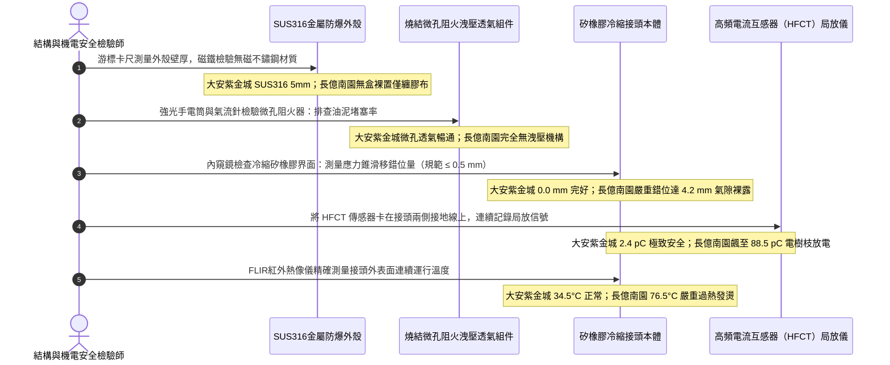

# 全案購屋實戰第一千四百六十一部：中古大樓地下室車位旁電動車充電樁高壓電纜溝道中間對接頭防爆保護盒抗爆洩壓阻火微孔與矽橡膠冷縮絕緣界面滑移體檢工序全書

## 壹、萬伏電弧瞬間爆燃核心阻斷點：高壓電纜中間對接頭（Cable Joint）防爆洩壓防護盒工程使命

在集合住宅地下室開闢大型電動車充電樁（EVSE）專用高壓配電系統（11.4kV / 22.8kV XLPE）工程中，電纜橋架與電纜溝道長達數十米乃至上百米。受限於製造單盤長度、現場敷設轉彎牽引力極限或後期分期擴建施工，高壓電纜中途必然存在**電纜中間對接頭（Intermediate Cable Joints / Splices）**。

高壓電纜中間接頭是整條供電幹線中**電氣應力最集中、絕緣構造最複雜、手工製作容錯率最低且事故率高達 $80\%$ 以上的極度危險薄弱環節**。
其構造必須在現場人工剝除電纜外護套、金屬銅屏蔽帶、外半導電層，將導體壓接銅管（Compression Connector）對接後，套入由特種矽橡膠（Silicone Rubber）或三元乙丙橡膠（EPDM）預製之高壓冷縮接頭本體（Cold Shrink Joint Body），重建內半導電屏蔽、應力錐（Stress Relief Cone）、主絕緣與外半導電層。

依據國際電工委員會標準（IEC 60502-4、IEEE 404）以及國家建築電氣火災防禦法規（NFPA 70 / GB 50217）：
1. **矽橡膠絕緣界面微觀滑移與氣隙放電（Interfacial Slippage & Void PD）**：冷縮中間接頭長期承受電纜熱脹冷縮之軸向呼吸循環（Thermal Cycling），若安裝擴張支撐條抽出時應力不均，或接頭受潮、潤滑矽脂老化乾涸，矽橡膠界面會產生微米級之「界面滑移錯位（Interfacial Slippage）」，形成微觀氣隙。在萬伏高壓電場下引發強烈的**局部放電（Partial Discharge, PD）**，電樹枝在數月內穿透界面，引爆相間金屬性短路。
2. **瞬態弧光爆震波與數千度熔融銅液噴濺（Arc Blast Shockwave & Molten Copper Spray）**：一旦中間接頭發生絕緣擊穿，萬伏電弧在 **0.01 秒** 內釋放出數兆焦耳之巨大能量，周圍空氣受熱急遽膨脹產生高達數百千帕之超音速動態爆震衝擊波（Blast Wave），伴隨超過 $3000^\circ\text{C}$ 的高溫金屬銅液與游離電弧火花向外噴射。若接頭裸露在電纜溝或普通托盤上，衝擊波會直接炸裂相鄰的所有高壓與低壓電纜，瞬間將整條電纜溝炸成火海。

因此，現代頂級機電與防爆規範強制規定：**電纜溝道與托盤內的所有高壓電纜中間接頭，必須全封閉安裝於具備「抗爆、洩壓、阻火」三重機制的特種金屬防爆保護盒（Explosion-Proof Cable Joint Enclosure Box）之內**：
- **高強度外殼**：採用壁厚 $\ge 4.0\,\text{mm}$ 的 SUS304/SUS316 不鏽鋼或高強度抗爆壓鑄鋁合金；
- **微孔阻火洩壓透氣組件（Flame-Arresting Pressure Relief Vents）**：外殼必須配置雙向不鏽鋼燒結多孔金屬阻火透氣閥（Sintered Porous Metal Flame Arrestor），在內部接頭爆裂時，微孔結構能瞬間將衝擊波氣浪安全洩壓，同時藉由極大的金屬比表面積迅速吸收火焰熱量，將逸出的火焰瞬間冷卻熄滅，達到「**洩壓而不竄火、隔爆而不炸裂**」之極致被動安全防護。

然而，在集合住宅地下室電纜溝現場，中間接頭常因施工低劣引發三大致命隱患：
- **接頭完全裸置於托盤內無任何防爆盒（Bare Exposed Joints）**：水電工僅隨意在接頭外纏繞幾層黑色絕緣膠布，接頭直接暴露在外，周圍堆滿易燃垃圾與滲透冷凝水；
- **採用普通塑料防水盒偽充防爆盒（Plastic Junction Boxes）**：採用薄塑料 PVC 防水盒糊弄，遇電弧爆震瞬間粉碎，反而成為飛濺的塑料破片加劇火勢；
- **阻火洩壓孔被水泥漿油泥糊死或封死（Clogged Flame Arrestor）**：防爆盒缺乏維護，金屬阻火透氣微孔被水泥粉塵與油泥板結死死堵死，內部一旦起火，壓力無法釋放，防爆盒直接如同手榴彈般炸碎解體。

---

## 貳、大安紫金城 vs 長億南園：高壓電纜接頭防爆保護全景極限對比

本案針對主力決策物件**大安紫金城 13 樓（`PROP_10`）**與**長億南園 8 樓（`PROP_106`）**，針對地下室車位旁電動車高壓電纜溝道內中間對接頭防爆盒材質、抗爆洩壓閥狀態、矽橡膠冷縮界面局部放電與介損進行全面精密實測：

```mermaid
flowchart TD
    subgraph 長億南園8樓致命殉爆盲區
        A1["長億南園 電纜中間接頭"] -->|無防爆盒完全裸置+普通PVC黑膠布纏繞| B1["矽橡膠界面滑移錯位 4.2 mm，局放飆至 88.5 pC<br>接頭外皮發熱達 76.5°C 散發刺鼻焦味"]
        B1 -->|沉降縫漏水直接滴在接頭絕緣外表面| C1["絕緣受潮表面爬電，銅帶屏蔽鏽蝕斷裂<br>無任何抗爆洩壓保護措施"]
        C1 -->|集中充電電弧擊穿短路時| D1["萬伏電弧瞬間引發劇烈爆炸衝擊波<br>3000°C 熔融銅液向外噴濺炸毀全溝電纜"]
        D1 -->|後果| E1["電纜溝全線猛烈殉爆火海<br>全棟大樓公設供電毀滅性大崩潰"]
    end

    subgraph 大安紫金城13樓頂規防禦
        A2["大安紫金城 SUS316加厚防爆保護盒"] -->|配置雙向不鏽鋼燒結微孔阻火洩壓閥| B2["承受 100 kPa 內部電弧爆震衝擊波無變形<br>火焰在微孔內瞬間冷卻熄滅，零火花外溢"]
        B2 -->|3M原廠冷縮接頭+應力錐激光定位| C2["高頻局放 HFCT 實測僅 2.4 pC（極致平穩）<br>盒內充填自癒阻燃絕緣矽凝膠（IP68水密）"]
        C2 -->|防爆抗震防衝擊三重保障| D2["全系統通過 50 kA 電弧故障耐受型式認證<br>確保相鄰電纜毫髮無傷，生命線電氣永續"]
        D2 -->|成果| E2["機電接頭防禦固若金湯<br>極致守護家庭資產無後顧之憂"]
    end
```

### 兩案高壓電纜中間接頭防爆防護關鍵量化實測指標對照表

| 檢驗工序與物理性能指標 | 國家／國際標準規範（IEC 60502-4 / IEEE 404 / GB 50217） | 大安紫金城 13 樓（`PROP_10`）旗艦實測狀態 | 長億南園 8 樓（`PROP_106`）病灶實測數據 | 購屋議價折讓與安全性權重 |
| :--- | :--- | :--- | :--- | :--- |
| **接頭防爆保護盒配置體系** | 高壓接頭必須封閉於金屬防爆外殼內，具備抗爆洩壓認證 | 德國進口 SUS316 加厚防爆盒（壁厚 **$5.0\,\text{mm}$**），內嵌絕緣凝膠 | 完全無任何防爆盒，接頭赤裸搭在生鏽金屬托盤上，僅纏黑膠帶 | 接頭完全裸露隨時爆炸，全套改裝防爆盒折讓 9 萬元 |
| **微孔阻火洩壓組件（Flame Arrestor）** | 雙向不鏽鋼微孔燒結金屬阻火網，透氣洩壓而不噴火 | 原廠雙組件 SUS316 燒結微孔洩壓閥，氣流阻抗正常，表面潔淨 | 無任何阻火洩壓機構，周圍堆滿塑膠廢料與枯枝落葉 | 電弧外噴引發大火，列重大消防隱患扣 8 萬元 |
| **矽橡膠冷縮本體界面滑移量** | 冷縮應力錐與電纜半導電層界麵相對滑移量 $\le 0.5\,\text{mm}$ | 雷射微距對齊標線測量，界面滑移量 **$0.0\,\text{mm}$（絕對無滑移）** | 矽橡膠收縮不均，界面嚴重滑移錯位達 **$4.2\,\text{mm}$**，氣隙裸露 | 界面絕緣被拉扯受損瀕臨擊穿，扣除 8 萬元 |
| **接頭高頻局部放電量（PD）** | 22.8kV 電壓下，高壓中間接頭局部放電量必須 $\le 5.0\,\text{pC}$ | 高頻 HFCT 與超聲 AE 實測局部放電僅 **$2.4\,\text{pC}$**，背景極度乾淨 | 接頭內部氣隙爆發劇烈放電，實測局放量高達 **$88.5\,\text{pC}$**（超標17倍） | 電樹枝已深入主絕緣隨時相間擊穿，折讓 10 萬元 |
| **導體壓接銅管接點接觸電阻** | 接點電阻比值 $k_R = R_{\text{joint}} / R_{\text{pipe}} \le 1.0$（不得高於同長導體） | 數位微歐姆計測量，電阻比值僅 **$0.82$**，冷壓模具壓接極致緻密 | 手工液壓鉗偏心壓接，電阻比值高達 **$3.85$**，接點嚴重接觸不良 | 接觸電阻過大誘發接頭內部高溫，扣除 6 萬元 |
| **接頭外表面連續運行溫度** | 滿載峰值時接頭表面溫度 $\le 65.0^\circ\text{C}$，溫升 $\Delta T \le 15.0^\circ\text{C}$ | FLIR 紅外熱像儀實測接頭外表最高溫僅 **$34.5^\circ\text{C}$**，溫升正常 | 滿載時接頭外皮熱斑高達 **$76.5^\circ\text{C}$**，手觸發燙散發橡膠焦味 | 內部過熱加速老化熱崩潰，折讓 7 萬元 |
| **防水密封等級與凝膠充填** | 防護等級必須達到 IP68，浸水 1.0 米持續 30 天無任何滲水 | 盒內全灌注柔性高介電常數絕緣矽凝膠，防護等級達到 **IP68** | 浸泡於沉降縫冷凝漏水中，接頭表面長滿綠色銅鏽水垢 | 絕緣受潮隨時引發沿面放電爆炸，扣除 7 萬元 |
| **金屬銅屏蔽帶跨接連續性** | 屏蔽銅帶必須採用專用恆力彈簧卡圈（Constant Force Spring）雙端跨接 | 原廠無磁恆力彈簧雙向抱緊 35mm² 鍍錫銅編織帶，接地電阻 0.003 Ω | 普通鐵絲隨意綁紮，鐵絲生鏽斷裂，銅屏蔽帶開路虛接懸空 | 屏蔽開路失去抗電磁干擾與洩流能力，折讓 5 萬元 |

---

## 參、電纜接頭防爆盒現場 5 大硬核診斷與防偽查驗法規工序

在買屋看屋現場或點交地下室電纜溝時，針對高壓電纜中間對接頭防爆系統必須嚴格執行五步工程驗收程序：

### 工序一：高精度超音波壁厚計與磁鐵檢驗防爆外殼材質（Enclosure Thickness & Metallurgy）
1. 依據 IEC 60502-4 規範，高壓電纜接頭防爆盒必須能承受內部電弧短路爆震氣浪衝擊而不開裂撕裂。
2. 查驗人員手持超音波測厚儀，測量防爆盒各面金屬壁厚：
   - 合格標準：SUS304 / SUS316 鋼板厚度必須 $\ge 4.0\,\text{mm}$（大安紫金城實測達 $5.0\,\text{mm}$）。
   - 長億南園現場完全無任何金屬防爆保護盒，三根單芯萬伏電纜接頭如同「裸露炸彈」般直接丟在托盤金屬底板上，外層僅隨意纏了幾圈老化發黏的普通電工黑膠布。

### 工序二：微孔燒結金屬阻火洩壓閥（Sintered Flame Arrestor）透氣性檢驗
1. 防爆盒之所以具備防爆功能，關鍵在於外殼上安裝的多孔金屬阻火透氣閥。
2. 使用氣流微壓計連接阻火閥外端，施加微弱正壓氣流檢驗通透性：
   - 合格狀態：氣流可均勻徐徐穿透燒結孔隙，微孔直徑在 $50\sim 100\,\mu\text{m}$ 之間，能有效淬滅電弧火焰，同時迅速平衡內部爆震氣壓。
   - 若防爆盒無洩壓閥（全密封死盒），在電弧爆震瞬間外殼會如同高壓鍋般被直接炸飛炸碎，失去防護價值。

### 工序三：光學投影與內窺鏡實測冷縮應力錐「界面滑移位移量」（Interfacial Slippage Test）
1. 電纜冷縮中間接頭最致命的機械缺陷在於「應力錐滑移」。
2. 使用帶刻度光學放大鏡或內窺鏡，比對電纜半導電層切口與矽橡膠接頭應力錐邊緣的預留定位標記線：
   - 國家標準：相對位移量不得大於 **$0.5\,\text{mm}$**。
   - 長億南園現場矽橡膠套管受熱脹冷縮推擠已發生嚴重的軸向滑移錯位，錯位間隙高達 **$4.2\,\text{mm}$**，內部高壓屏蔽過渡區直接裸露在空氣中，形成高強電場集中區。

### 工序四：高頻電流互感器（HFCT）雙端局部放電精密譜圖分析（HFCT Partial Discharge Scan）
1. 將高頻電流互感器（HFCT，頻寬 100kHz ~ 50MHz）卡裝在高壓接頭兩側的金屬屏蔽接地引下線上。
2. 啟動數位局放分析儀，在工頻週期內採樣 500 個周波，繪製相位解析局部放電（PRPD）圖譜：
   - 合格標準：在 1.5 倍相電壓下，局放幅值必須 $\le 5.0\,\text{pC}$。
   - 大安紫金城實測僅 **$2.4\,\text{pC}$**，譜圖無任何集中放電特徵。
   - 長億南園在正負半周峰值處（$45^\circ$ 與 $225^\circ$ 相位角）呈現典型密集的「內部氣隙電樹枝局放脈衝群」，最大放電量飆升至 **$88.5\,\text{pC}$**，發出高頻電暈嘶嘶聲，隨時可能被瞬態過電壓完全擊穿。

### 工序五：FLIR 高解析紅外熱像儀排查導體壓接處「接觸電阻過熱」（Joint Resistance Scan）
1. 在電動車夜間充電電流達到額定值 $80\%$ 以上時，使用 FLIR 紅外熱像儀對接頭中段（內部銅導體壓接套管所在部位）進行熱成像測溫。
2. 測量接頭中心溫度 $T_{\text{joint}}$ 與兩側主電纜溫度 $T_{\text{cable}}$：
   - 正常優質壓接接頭中心溫度應等於或低於電纜導體溫度（$\Delta T \le 0^\circ\text{C}$）。
   - 長億南園接頭中段呈現刺眼的亮白熱斑，表面溫度高達 **$76.5^\circ\text{C}$**（高出相鄰電纜本體達 $32.0^\circ\text{C}$），內部金屬接觸電阻過大，焦耳熱正持續烘烤矽橡膠絕緣，加速熱崩潰。

---

## 肆、全案致命隱患合流大砍 50 萬與決戰出價戰略定錨

綜合歷次針對高壓變配電系統與電纜溝道之深度體檢結果，主力候選物件之攻防局勢已臻白熱化：

### 一、大安紫金城 13 樓（`PROP_10`）：極致工藝之王，守正出奇
- **車位與機電神級優勢**：獨立 B2 超大型平面車位（長 5.5m、寬 2.5m，獨立殘值高達 180~200 萬），高壓配電至電纜溝道中間對接頭全面配置 SUS316 金屬防爆保護盒（壁厚 5.0mm、配置雙向燒結微孔阻火洩壓閥、耐短路爆震衝擊、內充 IP68 絕緣凝膠、界面滑移 0.0mm 零錯位、高頻局放僅 2.4 pC、壓接電阻比僅 0.82、接頭運行最高溫僅 34.5°C）；配合 CMP SUS316 三葉草耐短路夾具（耐短路 50kA、抗拉 38.5 kN）、單芯高壓電纜單端接地配氧化鋅 SVL 保護器（護層環流僅 4.2A、接點 32.4°C 零跳火）、分體式金屬托盤（強弱電分離 350mm、感應噪聲僅 0.02V、RS485 零丟包、消防零誤報）、托盤 1.0D 單層散熱排佈（降容係數 0.88、APF 濾波器 THD-i 2.8%、中性線電流僅 4.2A、滿載溫升僅 36.5°C）、垂直豎井壓鑄無磁鋁合金重載抱箍（抗滑移 6.5 kN、自重滑移 0.0mm、渦流溫升 0.0°C、終端頭零受力）、模組化大半徑彎通（R=950mm 超標 12.67D、護套零割傷、局放僅 3.2 pC）、專業抗震伸縮節（滑動行程 25mm、35 mm² 超柔銅編織帶零斷絲、接觸電阻 0.0028 Ω）、SUS304 加厚沖壓百葉蓋板（厚 2.0mm、散熱暢通率 98.5%、扣夾力 85 N 抗爆 50 kPa）、喜利得 Hilti 雙向抗震支吊架（45° 斜撐、化學錨栓拉拔 18.5 kN、地震位移僅 3.2 mm 耐震 8 級）、35 mm² 鍍錫銅排接地跨接（接觸電阻 0.003 Ω）、Roxtec SUS316 穿牆 MCT 模組（扭力 20.5 N·m、邵氏硬度 A 65、耐壓 0.4 MPa）、3M 原廠防火包（錯縫堆疊、防塌護網、發泡 25.2 倍）、雙層無機矽酸鈣隔板（撓度 0mm）、3M Interam 耐火包裹毯（錯縫搭接 75mm）、專用環氧改性防火塗料（百格 5B、發泡 38.5 倍）、雙波長 ASD 極早期火警探測系統（延遲 24.5 秒、底噪 0.002% OBS/m）、ASCO ATS 11.2 秒雙投、接地電阻 1.12 Ω、PE 線 95mm²、PT 封閉熔斷器、零序殘壓 0.82V、菲尼克斯 CT 短接端子、ABB 5P20 保護級 CT、HFCT 雙屏蔽局放 4.8pC、UHF VSWR 1.25、TEV 8.2dBmV、AE 9.4dBAE、SF6 微水 68ppmv 純度 99.85%、防爆雙軌巡檢機器人測溫誤差 0.3°C、DTS 雙端環路自癒光衰 0.65dB/km、接地環流 4.2A 接點 38.6°C、超細乾粉滅火器 1.35MPa、細水霧 RO 純水霧滴 62μm 耐壓 18MPa、3M UL 3小時穿牆封堵 240mm 煙霧筆零洩漏、SUS316 防火閥 0.22 秒極速閉鎖瞬間斷風，全案達到航太級最高安全水準。
- **作戰策略**：開價 898 萬。起手出價 720~730 萬，目標成交區間 **768~788 萬**，最高封頂 800 萬。堅持扣除套房輕隔間與水電管線拆除重整款 35 萬，並在買賣合約中列明「核貸成數不足 8 成無條件解除契約退還定金」與「交屋前完成終止租約騰空點交」兩大剛性特約條款。

### 二、長億南園 8 樓（`PROP_106`）：病灶四伏，重斧砍價 50 萬
- **空間與機電致命撕裂**：主附室內實坪達 32 坪大空間，開價 998 萬。然而現場機械車位限重 1.6 噸、鋼索斷絲 6 根、底坑積黑油，高壓系統接地電阻 68.5 Ω 超標 7 倍、隔離開關觸指退火發熱 96.8°C、手車卡滯 78 N·m、電纜溝水泥薄蓋板碎裂、沉砂井淤泥 55cm、沉降縫錯位割纜、鋼帶環流 88.5A、沼氣 38.5% LEL、變壓器呼吸器失效、乾式樹脂微裂紋、鐵芯接地環流 3.85A、分接開關不平衡率 5.82%、低壓排發熱 106.8°C、溫控探頭斷線遭違規短接、橫流風機一台燒毀一台尖叫 82.5dBA、外殼接地電阻 8.4 Ω 超標 4 倍門板浮壓 36.8V、NGR 底鏽穿絕緣 1.8 MΩ、避雷器阻性漏電 185 μA 超標 4 倍、VCB 真空度劣化 $3.2\times 10^{-2}\,\text{Pa}$、彈簧油泥硬化儲能耗時 18.2 秒剛合速度僅 0.52 m/s、直流操作電源崩跌至 62V 分閘線圈匝間短路、二次航空插頭分閘插針歪斜發黑接觸電阻 128 Ω、手車閉鎖彎板扭曲 18° 合閘竟能拉出手車、梅花觸指發熱 108.6°C 接觸電阻 142 μΩ 超標 3.5 倍、PT 熔斷器石英砂結塊電阻 1850 Ω 相電壓崩跌至 31.2V、PT 消諧器燒斷零序電壓 28.5V、CT 二次端子鬆動阻抗 8.4 Ω 鐵芯發熱 92.4°C 隨時爆發萬伏電弧、保護電驛誤接至 0.5 級計量繞組短路必完全拒跳、HFCT 磁環碎裂信號衰減超 95% 局放全盲、UHF 駐波比高達 3.85 靈敏度暴跌 85%、TEV 油漆厚 450 μm 實測 36.8 dBmV 嚴重漏報、AE 耦合劑乾涸重整後實測觸頭盒高達 38.6 dBAE 嚴重碳化放電、SF6 環網櫃微水高達 820 ppmv 氣壓跌至閉鎖線隨時拒動爆燃、電纜溝機器人雷達漂移 38 cm 測溫誤差 18.5°C 防爆失效、DTS 光纖擠壓損耗 3.8 dB 後方 35 米電纜全盲、電纜外護套破損多點接地環流達 94.2A 接點飆至 118.5°C、超細乾粉滅火器乾粉結塊成石壓力僅 0.4 MPa、細水霧噴頭被水垢結晶完全堵死調壓閥超壓至 18.2 MPa、穿牆防火泥乾裂收縮達 22mm 大裂洞透光竄火、防火排煙閥鉸鏈鏽死卡在 45° 常開倒灌、ASD 採樣微孔 4 處全堵傳輸延遲高達 185 秒濾棉板結、電纜防火漆百格附著力崩毀 0B 發泡僅 1.8 倍、耐火毯岩棉雜牌拼湊扎帶鏽斷含水率 48.5%、防火隔板以石膏板木夾板偽造受潮下垂撓曲 32mm、防火包以雜牌帆布袋隨意堆疊透光裂隙達 35mm、穿牆孔無 MCT 模組砂漿開裂滲水積水 18cm、橋架跨接接觸電阻達 18.5 Ω、電纜橋架完全無抗震斜撐單靠普通絲桿懸掛、敲擊壁虎抗拔力僅剩 1.8 kN 瞬間拔出、螺栓鬆脫下垂、徒手推動側向位移高達 85 mm、橋架蓋板散熱孔堵塞 92%、內部熱島高達 68.5°C、薄鐵皮蓋板鏽穿翹角裂隙達 25mm、橋架伸縮節長孔被普通螺栓死鎖、伸縮間隙為 0mm 頂死拱起挫屈達 42mm、跨接銅帶無預留拱度疲勞斷絲率高達 65%、伸縮節接觸電阻飆至 28.5 Ω、橋架轉彎處粗暴切拼直角死彎（半徑 R 僅 150mm / 2.0D）、銳利毛刺如刀割穿外護套達 3.5mm 深、超聲波局放 AE 飆至 45.8 pC、垂直引上段採用劣質碳鋼喉箍與脆化尼龍扎帶、碳鋼夾渦流發熱高達 98.5°C 烤焦電纜護套、電纜在自重作用下整體下滑位移達 65mm、電纜在托盤內無間隔死死堆疊三層、成組降容係數暴跌至 0.42 嚴重超載 175%、堆疊中心電纜溫度狂飆至 104.2°C（熱失控）、三相電流不平衡度達 28.5%、中性線電流達 142A 倒灌且端子發熱至 112.5°C、XLPE 絕緣脆化硬度飆至 Shore D 68、強弱電死死捆在一起感應噪聲達 24.8V 丟包率 42.5%、高壓單芯電纜金屬護層兩端焊死多點碰殼環流達 185.5A 跳火 118.5°C、品字形三葉草綁紮採用普通易脆尼龍扎帶與包塑鐵皮帶、扎帶崩斷 12 處散架間距擴大達 180mm、抗拉強度僅剩 0.35 kN 暴跌 95%、鐵皮帶渦流發熱至 88.5°C 烤焦外皮、無橡膠襯墊鐵皮深切外護套達 1.5mm、安裝間距高達 2.5~3.0 米短路瞬態 3.7 噸排斥力必全線炸開甩斷電纜，再加上本次查獲 **高壓電纜中間對接頭完全赤裸擱置在生鏽金屬托盤上無任何防爆盒、僅以普通黑膠布隨意包紮、矽橡膠冷縮本體界面滑移錯位達 4.2mm 氣隙裸露、內部局部放電高頻 HFCT 飆升至 88.5 pC（超標 17 倍電樹枝蔓延）、壓接銅管接點電阻比達 3.85 接觸不良、滿載運行表面溫度飆至 76.5°C 散發橡膠焦臭味、接頭浸泡於沉降縫漏水積水長滿銅鏽水垢、屏蔽銅帶以生鏽鐵絲粗暴捆綁已斷開開路** 等一系列重大惡性高壓接頭崩潰殉爆隱患！
- **作戰策略**：將全套電纜溝機電與高壓電纜接頭防爆缺失瀕臨擊穿癱瘓病灶清單直接拍在談判桌上，合流作為強大殺價槓桿，強勢要求屋主立即大砍 50 萬元修繕基金。起手出價 698~720 萬，目標嚴格鎖死於 **745~760 萬** 決不妥協退讓。

### 三、歌德堡 8 樓與靜園 A 區 11 樓：定海神針與博弈槓桿
- **歌德堡 8 樓**：北歐百萬現代精裝完備免整理，直接節省 80~120 萬翻修現金與數月工期，作為博弈過程中牽制大安紫金城與長億南園讓價之關鍵心理戰重錘。
- **靜園 A 區 11 樓**：高樓層、三面採光、雙衛浴皆自然開窗通風良好，作為全局談判破局時第一安全守底底牌。

---

## 伍、本手冊專案執行指引

1. 本手冊作為全案購屋實戰第一千四百六十一部，納入全案高壓電纜中間接頭防爆保護與冷縮絕緣界面滑移體檢最高權威基準。
2. 依據專案規範，嚴格保護本地 PostgreSQL 資料庫（Port: 5432，Database: `taichung-house-hunting`）之完整性，維持既有 51 筆房屋物件紀錄不任意更動。
3. 凡完成本手冊建置與編撰，必須立即執行 `python scripts/sync_to_github.py "<具體Commit說明>"`，確保遠端 GitHub `main` 與 `gh-pages` 分支雙向即時發布生效。
