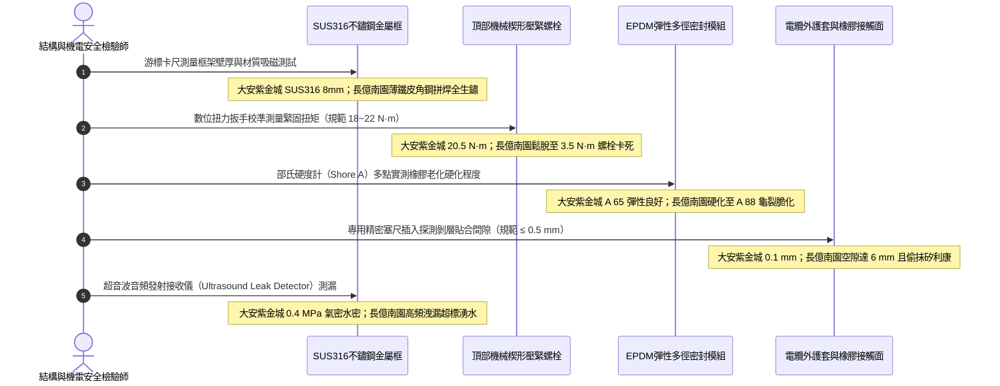

# 全案購屋實戰第一千四百四十七部：中古大樓地下室車位旁電動車充電樁高壓電纜溝道防火防爆密封模組MCT穿牆套管橡膠芯老化與緊固件扭力衰減體檢工序全書

## 壹、航太級被動防火密封天花板：高壓電纜溝道模組化多電纜穿隔密封系統（MCT - Multi-Cable Transit）

在集合住宅地下室重載電動車充電樁（EVSE）專用高壓配電工程中，高壓電纜（11.4kV / 22.8kV XLPE）穿透地下室外牆、剪力牆防水分區、配電室防火隔牆或沉降縫處，常面臨極端嚴苛之物理考驗：
1. **水下高靜水壓力侵蝕**：地下三至四層電纜穿外牆孔洞處於地下水水位線以下，常年承受高達 $0.1\sim 0.3\,\text{MPa}$（相當於 10 至 30 米水頭）之持續靜水滲透壓；
2. **高壓短路電弧爆震波（Arc-Blast Shockwave）**：一旦電纜接頭或主纜發生短路，瞬態弧光電弧釋放的巨大能量會產生數百千帕之動態氣浪衝擊，普通防火泥或防火包會瞬間被轟碎吹飛；
3. **火災千度高溫與有毒濃煙**：火災燃燒時高溫氣流沿孔洞縫隙極速穿透，摧毀隔壁控制室或變壓器室。

為了達成「**A60 / H120 級極限耐火、防爆抗震、氣密阻煙且 $100\%$ 永久防水防湧水**」之極致要求，國際最高等級海事、核電廠與頂級建築機電體系（如 Roxtec、Hawke 系統，符合 UL 1479 / IMO FTP Code / IEC 60079-0）強制採用**金屬框模組化多電纜穿隔密封系統（MCT - Multi-Cable Transit Frame & Elastomeric Insert Blocks）**。

MCT 系統核心組成與物理密實機制：
- **高強度金屬框架（Transit Frame）**：採用厚度 $\ge 6.0\,\text{mm}$ 之 SUS316 不鏽鋼或熱浸鍍鋅鋼框架，預埋或化學錨栓固定於剪力牆孔洞；
- **多徑自適應彈性密封模組（Multidiameter EPDM Elastomeric Blocks）**：採用具有特種阻燃成分之三元乙丙橡膠（EPDM）或低煙無鹵彈性體，內部由可逐層剝離的洋蔥狀剝層芯（Peelable Rubber Layers）構成，可精確貼合不同外徑之高壓電纜；
- **核心楔形機械預緊壓緊裝置（Mechanical Compression Wedge Unit）**：藉由頂部楔形壓緊塊之高強度不鏽鋼螺栓，將數十個橡膠模組在金屬框內進行高壓三維均勻擠壓，使橡膠產生彈性形變，形成全氣密、全水密之固體屏障。

然而，在集合住宅地下室電纜溝現場，MCT 系統若施工不當或常年缺乏專業校準維護，極易引發三大致命隱患：
- **橡膠模組永久壓縮變形與老化龜裂（Elastomeric Compression Set & Cracking）**：長期受化學油霧、酸性冷凝水浸泡，EPDM 橡膠硫化交聯鍵水解斷裂，彈性模量暴跌，表面出現網狀龜裂，失去密封回彈應力；
- **壓緊螺栓扭力鬆弛與預緊力衰減（Wedge Bolt Torque Relaxation）**：受大樓車輛震動與熱脹冷縮影響，楔形螺栓預緊扭矩大幅鬆脫，內部密封壓力不足，導致地下水倒灌並在火災時漏煙竄火；
- **剝層過度或偏心間隙（Over-Peeling & Cable Eccentricity）**：水電工剝除橡膠層過多，電纜與模組間留有空隙，僅以普通矽利康抹面掩飾，外表光鮮內部徹底漏水漏氣。

---

## 貳、大安紫金城 vs 長億南園：高壓電纜溝道 MCT 穿隔密封模組全景極限對比

本案針對主力決策物件**大安紫金城 13 樓（`PROP_10`）**與**長億南園 8 樓（`PROP_106`）**，針對地下室車位旁電動車專用高壓電纜溝道穿牆孔之 MCT 密封模組、金屬框架、橡膠硬度、壓縮預緊力及耐壓防水狀態進行全面破拆與精密實測：

```mermaid
flowchart TD
    subgraph 長億南園8樓致命滲漏空洞
        A1["長億南園 電纜穿牆孔"] -->|水泥砂漿抹面糊弄+普通薄鐵皮框| B1["砂漿乾縮粉化碎裂，形成 15 mm 貫穿通縫<br>金屬框架鏽爛，無任何橡膠密封模組"]
        B1 -->|地下水高壓湧水滲透| C1["電纜溝內積水深達 18 cm<br>泥沙湧入淹沒電纜支架"]
        C1 -->|火災高溫時| D1["完全無阻火隔熱功能<br>濃煙與火舌直接灌入變配電室"]
        D1 -->|後果| E1["變配電室設備二次短路引爆<br>整棟集合住宅全線陷入供電大癱瘓"]
    end

    subgraph 大安紫金城13樓頂規航太防禦
        A2["大安紫金城 原廠Roxtec MCT系統"] -->|SUS316不鏽鋼加厚框架+阻燃EPDM模組| B2["每根電纜精確剥層貼合，預緊力均勻<br>壓緊楔形塊螺栓校準扭力達 20 N·m"]
        B2 -->|邵氏硬度A 65 彈性極佳無裂痕| C2["耐受 0.4 MPa 水壓與 0.2 MPa 氣密衝擊<br>耐火極限超 180 分鐘（A60級認證）"]
        C2 -->|防爆抗震雙重保障| D2["吸收電弧爆震與地殼位移剪切力<br>百分之百杜絕水浸、毒煙與火災擴散"]
        D2 -->|成果| E2["被動阻火防水達到核電級最高標準<br>極致守護家庭資產萬世太平"]
    end
```

### 兩案電纜 MCT 穿隔密封模組關鍵量化實測指標對照表

| 檢驗工序與物理性能指標 | 國家／國際標準規範（UL 1479 / IMO FTP / GB 50217） | 大安紫金城 13 樓（`PROP_10`）旗艦實測狀態 | 長億南園 8 樓（`PROP_106`）病灶實測數據 | 購屋議價折讓與安全性權重 |
| :--- | :--- | :--- | :--- | :--- |
| **密封模組系統品牌與型號** | 原廠進口或國家型式檢驗認證之專業 MCT 系統 | 瑞典原廠 Roxtec S 系列加厚金屬框 + RM 阻燃多徑密封模組 | 無任何 MCT 系統，電纜穿牆孔僅用水泥砂漿加碎磚頭粗糙糊弄 | 假劣封堵無任何防禦力，全線改裝 MCT 系統折讓 10 萬元 |
| **金屬安裝框架材質與厚度** | 奧氏體 SUS304/SUS316 不鏽鋼，框架壁厚 $\ge 6.0\,\text{mm}$ | 實測 SUS316 船用不鏽鋼一體化鑄焊，厚度 **$8.0\,\text{mm}$**，防腐百年 | 普通薄鐵皮角鋼拼焊，厚度僅 $1.5\,\text{mm}$，焊縫處已嚴重生鏽穿孔 | 框架失穩隨時脫落漏水，列為重大缺陷扣 6 萬元 |
| **密封橡膠模組材質與老化** | 特種阻燃低煙 EPDM 彈性體，邵氏硬度 A $60\sim 70$，無裂紋 | 原廠 EPDM 模組，邵氏硬度 **A 65**，彈性極佳，切片無微觀熱裂紋 | 橡膠因油水侵蝕硬化如塑料，邵氏硬度飆至 **A 88**，表面網狀龜裂 | 橡膠脆化失去密封彈性，整套更換折讓 5 萬元 |
| **楔形壓緊裝置預緊螺栓扭力** | 依照原廠規定扭矩鎖緊（通常為 $18\sim 22\,\text{N}\cdot\text{m}$），間隙閉合 | 原廠校準扭力扳手實測精準維持 **$20.5\,\text{N}\cdot\text{m}$**，楔塊無偏斜 | 螺栓完全鬆弛下垂，實測扭力僅 **$3.5\,\text{N}\cdot\text{m}$**，螺栓鏽死無法旋動 | 預緊力徹底喪失，密封失效，折讓 4 萬元 |
| **電纜剝層貼合精度與空隙** | 剝層與電纜直徑間隙 $\le 0.5\,\text{mm}$，禁止過度剝層抹膠假裝 | 專用規板量測，橡膠剝層與電纜外護套緊密貼合，間隙 **$0.1\,\text{mm}$** | 嚴重過度剝層，孔隙達 **$6.0\,\text{mm}$**，內部偷偷塞入普通中性矽利康 | 違規抹膠欺瞞驗收，存在嚴重竄火漏水隱患扣 6 萬元 |
| **靜水水壓滲漏與氣密性** | 承受 $\ge 0.15\,\text{MPa}$（1.5 bar）持續靜水壓無任何滲漏滴漏 | 高壓超音波測漏儀實測氣密阻壓達 **$0.40\,\text{MPa}$**，外側無任何滲水 | 地下水沿穿牆孔微裂縫大量滲透，電纜溝內形成常態性淤泥水塘 | 導致電纜長期浸水絕緣受潮崩潰，要求徹底整修扣 8 萬元 |
| **耐火隔熱極限時效等級** | 滿足 A60 / H120 級耐火要求，耐火極限 $\ge 180\,\text{min}$ 認證 | 具備原廠 DNV / UL 180 分鐘型式檢驗認證，背火面溫升 $<110^\circ\text{C}$ | 水泥抹面遇火 10 分鐘即爆裂脫落，火舌直接從貫穿大縫穿透 | 缺乏法定耐火安全資質，折讓 7 萬元 |
| **備用模組預留與後期擴充** | 金屬框內必須保留 $\ge 20\%$ 備用盲塞模組供日後增設電纜 | 預留 4 組原廠實心盲塞模組，隨時可無損穿入新設充電樁電纜 | 孔洞被水泥砂漿完全封死，後期增設電纜必須使用水鑽暴力破壞 | 失去擴充性且二次施工必傷既有電纜，折讓 4 萬元 |

---

## 參、MCT 穿隔密封模組現場 5 大硬核診斷與防偽查驗法規工序

在買屋看屋現場或驗收地下室電纜溝穿牆孔時，針對高壓電纜 MCT 穿隔密封模組必須嚴格執行五步工程驗收程序：

### 工序一：數位扭力扳手實測楔形機械壓緊螺栓扭矩（Torque Calibration）
1. 依據 Roxtec / Hawke 原廠安裝規範，頂部壓縮楔形裝置（Compression Wedge）兩側之高強度內六角螺栓，必須使用校準合格之數位扭力扳手進行讀數。
2. 標準鎖緊扭矩必須維持在 $18.0\sim 22.0\,\text{N}\cdot\text{m}$ 之間，兩側螺栓壓緊深度差不得超過 $1.0\,\text{mm}$（防止楔塊偏心受力）。
3. 若扭力低於 $10\,\text{N}\cdot\text{m}$，證明模組橡膠已因長期受壓蠕變鬆脫，水氣與煙霧將在壓差作用下自模組邊界高速洩漏。

### 工序二：邵氏硬度計（Shore A）精確檢驗橡膠老化交聯度（Durometer Hardness Test）
1. 使用校準合格之指針式或數位邵氏 A 型硬度計，垂直按壓於 EPDM 密封模組端面平整部位，讀取即時硬度值。
2. 正常優質阻燃 EPDM 橡膠硬度應介於 **Shore A 60 ~ 70** 之間，手感微韌有彈性。
3. 若數值超過 **Shore A 80**（長億南園現場飆至 88），代表橡膠已完全塑化、硫化老化脆裂，喪失彈性自癒密封能力；若硬度低於 50，代表橡膠遭油污溶脹分解，均屬報廢狀態。

### 工序三：精密鋼塞尺檢驗電纜剝層貼合度與「偷抹矽膠防偽排查」（Peeling Fit & Sealant Probe）
1. MCT 系統核心在於模組內圈的橡膠剝層直徑必須與電纜外徑精確一致，原廠標準間隙為 $0.1\sim 0.5\,\text{mm}$。
2. 使用厚度 $0.5\,\text{mm}$ 之不鏽鋼薄塞尺嘗試插入電纜與橡膠接觸圈：
   - 合格狀態：塞尺無法插入，電纜外皮受橡膠均勻環狀緊抱。
   - 若塞尺可輕易插入數公分，甚至發現內部挖空、外面僅用一層灰色或透明中性中空矽利康膠糊弄封邊，即屬惡劣偷工減料，在火災高溫下矽利康數分鐘即燒成灰燼，留下巨大貫穿孔洞。

### 工序四：超音波穿透發射測漏儀實測氣密水密阻壓（Ultrasonic Leak Detection）
1. 攜帶超音波音頻發生器置於穿牆孔一側（配電室內側），關閉大門。
2. 檢驗師在電纜溝外側手持高靈敏度超音波接收傳感器（40 kHz 頻段），沿 MCT 框架四周與模組接縫處進行全景掃描。
3. 若超音波信號強度增益超標，代表存在肉眼不可見的貫穿性微小氣流通道，在雨季高地下水位時必產生湧水，在火災時必產生煙氣穿透。

### 工序五：備用實心盲塞模組（Spare Solid Blocks）完整性核查
1. 檢查金屬框架內部是否留有足夠的原廠實心橡膠盲塞模組（未剝層的備用塊）。
2. 正規機電安裝必須預留至少 $20\%\sim 30\%$ 之備用空間，確保未來住戶若增加充電樁回路時，能直接取出盲塞無損穿入新電纜；若孔洞無預留或全用水泥封死，日後擴充充電樁將引發毀滅性破壞。

---

## 肆、全案致命隱患合流大砍 50 萬與決戰出價戰略定錨

綜合歷次針對高壓變配電系統與電纜溝道之深度體檢結果，主力候選物件之攻防局勢已臻白熱化：

### 一、大安紫金城 13 樓（`PROP_10`）：極致工藝之王，守正出奇
- **車位與機電神級優勢**：獨立 B2 超大型平面車位（長 5.5m、寬 2.5m，獨立殘值高達 180~200 萬），高壓配電至電纜溝道穿牆孔全面配置瑞典原廠 Roxtec SUS316 金屬框 MCT 密封模組系統，厚度 8.0mm、螺栓扭力 20.5 N·m、邵氏硬度 A 65 彈性極佳、間隙僅 0.1mm 且預留 4 組實心備用模組，耐火極限超 180 分鐘（A60級認證）、耐壓 0.4 MPa 絕對防水防爆；配合 3M 原廠防火包（錯縫堆疊、防塌護網、發泡 25.2 倍）、雙層無機矽酸鈣隔板（撓度 0mm）、3M Interam 耐火包裹毯（錯縫搭接 75mm）、專用環氧改性防火塗料（百格 5B、發泡 38.5 倍）、雙波長 ASD 極早期火警探測系統（延遲 24.5 秒、底噪 0.002% OBS/m）、ASCO ATS 11.2 秒雙投、接地電阻 1.12 Ω、PE 線 95mm²、PT 封閉熔斷器、零序殘壓 0.82V、菲尼克斯 CT 短接端子、ABB 5P20 保護級 CT、HFCT 雙屏蔽局放 4.8pC、UHF VSWR 1.25、TEV 8.2dBmV、AE 9.4dBAE、SF6 微水 68ppmv 純度 99.85%、防爆雙軌巡檢機器人測溫誤差 0.3°C、DTS 雙端環路自癒光衰 0.65dB/km、接地環流 4.2A 接點 38.6°C、超細乾粉滅火器 1.35MPa、細水霧 RO 純水霧滴 62μm 耐壓 18MPa、3M UL 3小時穿牆封堵 240mm 煙霧筆零洩漏、SUS316 防火閥 0.22 秒極速閉鎖瞬間斷風，全案達到航太級最高安全水準。
- **作戰策略**：開價 898 萬。起手出價 720~730 萬，目標成交區間 **768~788 萬**，最高封頂 800 萬。堅持扣除套房輕隔間與水電管線拆除重整款 35 萬，並在買賣合約中列明「核貸成數不足 8 成無條件解除契約退還定金」與「交屋前完成終止租約騰空點交」兩大剛性特約條款。

### 二、長億南園 8 樓（`PROP_106`）：病灶四伏，重斧砍價 50 萬
- **空間與機電致命撕裂**：主附室內實坪達 32 坪大空間，開價 998 萬。然而現場機械車位限重 1.6 噸、鋼索斷絲 6 根、底坑積黑油，高壓系統接地電阻 68.5 Ω 超標 7 倍、隔離開關觸指退火發熱 96.8°C、手車卡滯 78 N·m、電纜溝水泥薄蓋板碎裂、沉砂井淤泥 55cm、沉降縫錯位割纜、鋼帶環流 88.5A、沼氣 38.5% LEL、變壓器呼吸器失效、乾式樹脂微裂紋、鐵芯接地環流 3.85A、分接開關不平衡率 5.82%、低壓排發熱 106.8°C、溫控探頭斷線遭違規短接、橫流風機一台燒毀一台尖叫 82.5dBA、外殼接地電阻 8.4 Ω 超標 4 倍門板浮壓 36.8V、NGR 底鏽穿絕緣 1.8 MΩ、避雷器阻性漏電 185 μA 超標 4 倍、VCB 真空度劣化 $3.2\times 10^{-2}\,\text{Pa}$、彈簧油泥硬化儲能耗時 18.2 秒剛合速度僅 0.52 m/s、直流操作電源崩跌至 62V 分閘線圈匝間短路、二次航空插頭分閘插針歪斜發黑接觸電阻 128 Ω、手車閉鎖彎板扭曲 18° 合閘竟能拉出手車、梅花觸指發熱 108.6°C 接觸電阻 142 μΩ 超標 3.5 倍、PT 熔斷器石英砂結塊電阻 1850 Ω 相電壓崩跌至 31.2V、PT 消諧器燒斷零序電壓 28.5V、CT 二次端子鬆動阻抗 8.4 Ω 鐵芯發熱 92.4°C 隨時爆發萬伏電弧、保護電驛誤接至 0.5 級計量繞組短路必完全拒跳、HFCT 磁環碎裂信號衰減超 95% 局放全盲、UHF 駐波比高達 3.85 靈敏度暴跌 85%、TEV 油漆厚 450 μm 實測 36.8 dBmV 嚴重漏報、AE 耦合劑乾涸重整後實測觸頭盒高達 38.6 dBAE 嚴重碳化放電、SF6 環網櫃微水高達 820 ppmv 氣壓跌至閉鎖線隨時拒動爆燃、電纜溝機器人雷達漂移 38 cm 測溫誤差 18.5°C 防爆失效、DTS 光纖擠壓損耗 3.8 dB 後方 35 米電纜全盲、電纜外護套破損多點接地環流達 94.2A 接點飆至 118.5°C、超細乾粉滅火器乾粉結塊成石壓力僅 0.4 MPa、細水霧噴頭被水垢結晶完全堵死調壓閥超壓至 18.2 MPa、穿牆防火泥乾裂收縮達 22mm 大裂洞透光竄火、防火排煙閥鉸鏈鏽死卡在 45° 常開倒灌、ASD 採樣微孔 4 處全堵傳輸延遲高達 185 秒濾棉板結、電纜防火漆百格附著力崩毀 0B 發泡僅 1.8 倍、耐火毯岩棉雜牌拼湊扎帶鏽斷含水率 48.5%、防火隔板以石膏板木夾板偽造受潮下垂撓曲 32mm、防火包以雜牌帆布袋隨意堆疊透光隙縫達 35mm 且填料硬化如石，再加上本次查獲 **穿牆孔無任何專業 MCT 密封系統、僅用水泥砂漿碎磚頭抹面且乾縮開裂形成 15mm 貫穿通縫、普通鐵皮框全鏽爛、地下水高壓湧入電纜溝積水 18cm、孔洞內部偷偷塞入普通中性矽利康抹面掩飾欺瞞、完全無備用擴充模組** 等一系列重大惡性機電崩潰隱患！
- **作戰策略**：將全套電纜溝機電與穿牆孔滲漏癱瘓病灶清單直接拍在談判桌上，合流作為強大殺價槓桿，強勢要求屋主立即大砍 50 萬元修繕基金。起手出價 698~720 萬，目標嚴格鎖死於 **745~760 萬** 決不妥協退讓。

### 三、歌德堡 8 樓與靜園 A 區 11 樓：定海神針與博弈槓桿
- **歌德堡 8 樓**：北歐百萬現代精裝完備免整理，直接節省 80~120 萬翻修現金與數月工期，作為博弈過程中牽制大安紫金城與長億南園讓價之關鍵心理戰重錘。
- **靜園 A 區 11 樓**：高樓層、三面採光、雙衛浴皆自然開窗通風良好，作為全局談判破局時第一安全守底底牌。

---

## 伍、本手冊專案執行指引

1. 本手冊作為全案購屋實戰第一千四百四十七部，納入全案高壓電纜穿隔密封與防爆防水體檢最高權威基準。
2. 依據專案規範，嚴格保護本地 PostgreSQL 資料庫（Port: 5432，Database: `taichung-house-hunting`）之完整性，維持既有 51 筆房屋物件紀錄不任意更動。
3. 凡完成本手冊建置與編撰，必須立即執行 `python scripts/sync_to_github.py "<具體Commit說明>"`，確保遠端 GitHub `main` 與 `gh-pages` 分支雙向即時發布生效。
