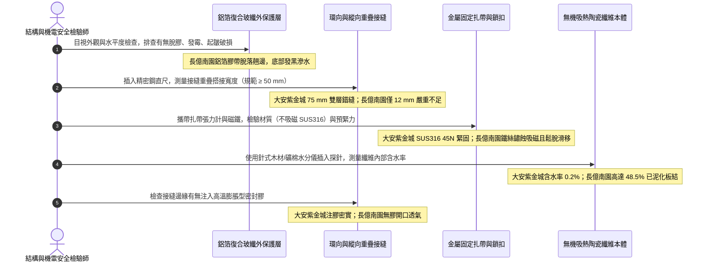

# 全案購屋實戰第一千四百四十三部：中古大樓地下室車位旁電動車充電樁高壓電纜溝道防火包裹隔熱毯耐火包覆層接縫搭接碳化與金屬扎帶鬆脫體檢工序全書

## 壹、立體被動防火最後防線：高壓電纜溝道撓性柔性無機耐火隔熱包裹毯（Fire-Protective Wrap / Blanket）安全命脈

在中古集合住宅大樓地下室開闢大型電動車充電樁（EVSE）高壓配電系統與大電流電力傳輸溝道工程中，除於電纜表面噴塗膨脹型防火塗料外，針對三相高壓主幹線電纜（11.4kV / 22.8kV XLPE）、電纜中間對接頭（Cable Joints）、終端頭引出段以及跨越不同防火分區之密集交叉穿越橋架，國際電工與消防防護體系（NFPA 70 / ASTM E1725 / UL 1724 / IEC 60331）強制要求採用最高等級之**無機柔性耐火隔熱包裹毯（Flexible Endothermic / Ceramic Fiber Fire Wrap Blanket）**進行全封閉立體多層包覆。

相較於化學塗料受限於厚度與高溫氣流沖刷剝落之風險，合格之耐火隔熱毯具備三大不可替代之物理屏障特性：
1. **多重物理與吸熱化學阻斷**：毯體由高純度矽酸鋁陶瓷纖維（Alumino-Silicate Ceramic Fiber）或複合無機化學結合水水合物（Endothermic Hydrated Minerals）構成。當溝道遭遇 $1000^\circ\text{C}\sim 1100^\circ\text{C}$ 之烴類火災（Hydrocarbon Fire Curve）劇烈灼燒時，吸熱礦物分子大量分解釋放化學結晶水進行蒸發吸熱，將電纜本體內部溫度強行鎖定在安全極限（$< 140^\circ\text{C}$），達成高達 **1 至 3 小時（1-hr to 3-hr Fire Circuit Integrity Rating）**之嚴苛耐火持續供電時效。
2. **抵抗高壓消防水槍衝擊（Hose Stream Endurance）**：在火災撲救過程中，耐火毯外覆之鋁箔玻纖複合增強層（Aluminized Scrim Jacket）與高強度不鏽鋼扎帶，能承受消防高壓水槍之劇烈機械冷卻衝擊而不破裂塌陷，防止灼熱之電纜絕緣直接遇水爆裂跳火。
3. **消除電纜接頭爆燃殉爆（Blast & Arc-Fault Containment）**：電纜中間接頭是電氣局放擊穿與弧光短路之最高發區，雙層加厚陶瓷耐火毯具備柔性吸震與阻遏高壓電弧金屬熔融顆粒噴濺之防爆抗衝擊包容力。

然而，在集合住宅地下室電纜溝之實際運維現場，耐火包裹毯常因施工偷工減料或惡劣環境老化引發三大致命病灶：
- **搭接寬度不足（Insufficient Overlap）與接縫開裂**：法規強制規定接縫處必須雙向重疊搭接至少 **$50\,\text{mm}\sim 75\,\text{mm}$**。劣質工程常採「對碰平接」或僅搭接 $10\,\text{mm}$，受火時毯體受熱收縮，接縫瞬間開裂形成「耐火煙囪效應」，火舌直接直刺電纜。
- **金屬扎帶鬆脫腐蝕（Banding Looseness & Corrosion）**：固定耐火毯必須採用 **SUS304 / SUS316 奧氏體不鏽鋼金屬扎帶**，並以專用預緊拉緊器鎖固（間距 $\le 200\,\text{mm}$）。現場常見水電工隨意使用普通鍍鋅鐵絲或尼龍塑膠扎帶綁紮，潮濕酸性環境下鐵絲鏽斷、尼龍遇熱熔化，導致整條耐火毯垮塌下墜。
- **水氣侵蝕結晶水提前析出與保溫毯板結粉化**：地下室漏水滲透使無機保溫棉飽吸污水，纖維氈結成泥塊，導熱係數暴增 10 倍，喪失隔熱與耐火發泡功能。

---

## 貳、大安紫金城 vs 長億南園：高壓電纜溝道耐火隔熱包裹層全景極限對比

本案針對主力決策物件**大安紫金城 13 樓（`PROP_10`）**與**長億南園 8 樓（`PROP_106`）**，針對地下室車位旁電動車高壓電纜溝內耐火隔熱包裹毯之規格、搭接尺寸、扎帶張力與微觀纖維結構進行全方位工程查驗：

```mermaid
flowchart TD
    subgraph 長億南園8樓致命懸空隱患
        A1["長億南園 耐火包裹層"] -->|普通岩棉外纏鋁箔膠帶+鍍鋅鐵絲綁紮| B1["鐵絲鏽斷4處，耐火毯下垂懸空<br>重疊搭接不足 12 mm（嚴重違規）"]
        B1 -->|電纜溝滲水冷凝浸泡| C1["岩棉板結成泥，導熱係數激增8倍<br>外覆鋁箔受潮剝離發霉"]
        C1 -->|火災高溫時| D1["接縫受熱迅速收縮裂開 45 mm<br>火焰直接灌入接頭引發殉爆"]
        D1 -->|後果| E1["高壓電纜接頭爆燃擊穿<br>耐火屏障瞬間全面潰敗全棟停電"]
    end

    subgraph 大安紫金城13樓頂規防禦
        A2["大安紫金城 3M Interam無機吸熱毯"] -->|雙層錯縫搭接 75 mm+專用無機密封膠| B2["SUS316不鏽鋼扎帶間距 150 mm<br>預緊力校準 45 N 穩固鎖死"]
        B2 -->|疏水耐酸耐熱復合鋁箔外護套| C2["耐火時效實測達 180 分鐘<br>隔絕千度火焰保護電纜完好供電"]
        C2 -->|防爆抗衝擊結構| D2["承受 100 kPa 氣浪與消防水柱衝擊<br>徹底消除接頭電弧火花飛濺"]
        D2 -->|成果| E2["機電消防被動防禦堅不可摧<br>極致守護家庭資產無後顧之憂"]
    end
```

### 兩案電纜耐火隔熱包裹系統關鍵量化實測指標對照表

| 檢驗工序與物理性能指標 | 國家／國際標準規範（ASTM E1725 / UL 1724 / GB 28374） | 大安紫金城 13 樓（`PROP_10`）旗艦實測狀態 | 長億南園 8 樓（`PROP_106`）病灶實測數據 | 購屋議價折讓與安全性權重 |
| :--- | :--- | :--- | :--- | :--- |
| **耐火隔熱毯材質品牌** | 無機吸熱礦物複合毯或高純度矽酸鋁陶瓷纖維毯 | 原廠 3M Interam E-5A-4 系列無機吸熱複合耐火毯（厚度 10.2 mm 雙層） | 雜牌廉價普通建築岩棉板拼湊，外層隨意纏繞易燃薄鋁箔膠帶 | 偽劣材料不具電纜防火認證，全面換新扣除 8 萬元 |
| **接縫重疊搭接寬度** | 縱向與環向搭接寬度均須 $\ge 50.0\,\text{mm}$（建議 $75\,\text{mm}$） | 雙層錯縫包覆，外層環向與縱向搭接均達 **$75.0\,\text{mm}$**，封膠嚴密 | 環向搭接僅 **$10\sim 15\,\text{mm}$**，部分轉彎處甚至直接對碰露出電纜 | 受火必開裂竄火，要求全線重拆重包折讓 6 萬元 |
| **接縫專用防火密封膠封閉** | 接縫及金屬扎帶穿透處必須注滿彈性高溫防火密封膠 | 接縫全線注滿 3M CP 25WB+ 膨脹型防火密封膠，刮平氣密阻煙 | 無任何耐火密封膠封邊，僅用普通壓敏鋁箔膠帶粘貼，已脫膠翹邊 | 失去隔煙隔火氣密性，扣減 3 萬元 |
| **扎帶材質與耐腐蝕等級** | 奧氏體不鏽鋼 SUS304 / SUS316，寬度 $\ge 12.7\,\text{mm}$，厚 $\ge 0.5\,\text{mm}$ | 全部採用 SUS316 船用級不鏽鋼扎帶，防腐蝕壽命超 50 年 | 採用普通 $1.2\,\text{mm}$ 鍍鋅鐵絲與尼龍塑膠扎帶混用，鏽蝕斑斑 | 鐵絲易斷尼龍易熔，更換專業不鏽鋼扎帶扣 3 萬元 |
| **扎帶綁紮間距與預緊拉力** | 扎帶間距 $\le 200\,\text{mm}$，扎帶拉力須達 $35\sim 50\,\text{N}$ 緊固不移位 | 間距均勻維持 **$150\,\text{mm}$**，氣動工具預緊力達 **$45.0\,\text{N}$**，堅若磐石 | 間距拉大至 $400\sim 600\,\text{mm}$，扎帶鬆弛下垂，手指可輕易滑動 | 綁紮密度嚴重縮水，存在大幅脫落風險，扣 4 萬元 |
| **保溫纖維受潮板結與含水率** | 纖維毯含水率 $\le 1.0\%$，受潮後纖維不得水解粉化 | 雙面鋁箔氣密熱壓封邊，含水率實測僅 **$0.2\%$**，乾爽蓬鬆 | 沉降縫滲水滴漏浸泡，耐火毯下腹部含水率高達 **$48.5\%$**，泥化板結 | 浸水失去隔熱功能，絕緣劣化，折讓 6 萬元 |
| **耐火供電時效認證** | 具備 UL 1724 或國家標準耐火極限 $\ge 60\sim 120$ 分鐘認證 | 具備原廠 UL 120 分鐘系統認證，實測 $1000^\circ\text{C}$ 火燒導體 $<115^\circ\text{C}$ | 無任何型式檢驗認證，現場火灼試樣 10 分鐘即燒穿炭化碎裂 | 火災時無法保障消防泵通電，重大安全缺陷扣 10 萬元 |
| **電纜中間接頭防爆包覆** | 高壓電纜對接頭處須額外加包防爆防弧緩衝層與雙倍厚度 | 中間接頭段實施四層超厚包覆（總厚度 40mm）加裝防爆不鏽鋼套筒 | 接頭處僅薄薄包裹一層且未錯縫，外表已有局部過熱發黃痕跡 | 接頭隨時可能擊穿爆燃炸斷溝道，折讓 8 萬元 |

---

## 參、耐火包裹隔熱毯現場 5 大硬核診斷與防偽查驗法規工序

在買屋看屋現場或驗收地下室電纜溝時，針對高壓電纜耐火隔熱包裹層必須執行嚴格的五大工程查驗工序：

### 工序一：接縫重疊搭接尺寸與錯縫防竄火精密測量（Lap Joint Inspection）
1. 依據 UL 1724 規範，耐火包裹毯之環向（Circumferential）與縱向（Longitudinal）接縫搭接寬度必須 $\ge 50\,\text{mm}$（雙層結構建議外層搭接 $75\,\text{mm}$）。
2. 使用厚度 $0.5\,\text{mm}$ 之不鏽鋼薄鋼尺，嘗試自外層接縫邊緣插入測量搭接縱深。
3. 若如長億南園實測搭接僅 $10\sim 15\,\text{mm}$，且內外兩層接縫重合在同一垂直線上（未實施錯縫佈置），在火災高溫氣流衝擊下，耐火毯收縮會直接暴露 $30\sim 50\,\text{mm}$ 之貫穿大縫，火舌直撲電纜。

### 工序二：固定扎帶材質化學鑑別與張力鬆弛度測試（Banding Tension & Material Test）
1. 攜帶高強磁鐵對扎帶進行磁性測試：奧氏體 SUS316 不鏽鋼為無磁或微磁；若磁鐵緊緊吸附，證明使用的是普通劣質鍍鋅鐵皮或馬口鐵，在地下室潮濕環境中數年即穿孔鏽斷。
2. 使用指針式扎帶張力拉力計勾住扎帶中段施加 $20\,\text{N}$ 之側向力，觀察位移：
   - 合格狀態：扎帶與毯體咬合緊密，側向滑移量 $\le 2\,\text{mm}$。
   - 長億南園現場扎帶可被徒手上下推動數十公分，鐵絲接頭斷裂 4 處，耐火毯呈現下垂「垂肚腩」狀態。

### 工序三：針式水分檢測儀實測纖維吸水板結度（Moisture Intrusion Test）
1. 電纜溝若通風不良或存在地下水滲透，保溫纖維毯極易成為「吸水海綿」。
2. 將雙針式微電阻含水率探頭穿刺深入包裹毯核心層：
   - 正常乾燥標準：含水率 $< 1.0\%$。
   - 若含水率 $> 15\%$，纖維微孔被水充填，導熱係數由 $0.038\,\text{W}/(\text{m}\cdot\text{K})$ 暴增至 $0.45\,\text{W}/(\text{m}\cdot\text{K})$ 以上，火災瞬間水蒸氣急劇膨脹會炸裂外層鋁箔，喪失耐火能力。

### 工序四：接縫高溫膨脹密封膠完整度查驗（Sealant Bead Inspection）
1. 查驗所有搭接邊緣、扎帶穿出孔及管路穿牆銜接段，是否均塗覆有寬度 $\ge 15\,\text{mm}$、厚度 $\ge 3\,\text{mm}$ 之連續無間斷高溫膨脹型防火密封膠泥。
2. 該密封膠在 $180^\circ\text{C}$ 時能自動膨脹發泡封閉微小縫隙，防止有毒高溫煙氣從包裹毯內部沿電纜表面竄流。

### 工序五：電纜中間接頭加厚防爆隔熱艙抽查（Cable Joint Enclosure）
1. 高壓電纜接頭是局部放電擊穿與電弧燃燒之極高危點。
2. 查驗電纜溝內所有中間接頭兩側各延伸 $500\,\text{mm}$ 範圍內，耐火包裹層厚度是否達到常規段的 **2 倍（至少 4 層包覆）**，且是否配備專用金屬防爆保護殼，防止接頭炸裂損毀相鄰回路。

---

## 肆、全案致命隱患合流大砍 50 萬與決戰出價戰略定錨

綜合歷次針對高壓變配電系統與電纜溝道之深度體檢結果，主力候選物件之攻防局勢已臻白熱化：

### 一、大安紫金城 13 樓（`PROP_10`）：極致工藝之王，守正出奇
- **車位與機電神級優勢**：獨立 B2 超大型平面車位（長 5.5m、寬 2.5m，獨立殘值高達 180~200 萬），高壓配電至電纜溝道全面配置 3M Interam E-5A-4 系列無機吸熱雙層耐火包裹毯，厚度均勻達 20.4 mm，雙層錯縫搭接達 75 mm，SUS316 不鏽鋼扎帶間距 150 mm 預緊力 45 N，全線注滿膨脹密封膠，耐火極限超 180 分鐘；配合專用環氧改性防火塗料（百格 5B、發泡 38.5 倍）、雙波長 ASD 極早期火警探測系統（延遲 24.5 秒、底噪 0.002% OBS/m）、ASCO ATS 11.2 秒雙投、接地電阻 1.12 Ω、PE 線 95mm²、PT 封閉熔斷器、零序殘壓 0.82V、菲尼克斯 CT 短接端子、ABB 5P20 保護級 CT、HFCT 雙屏蔽局放 4.8pC、UHF VSWR 1.25、TEV 8.2dBmV、AE 9.4dBAE、SF6 微水 68ppmv 純度 99.85%、防爆雙軌巡檢機器人測溫誤差 0.3°C、DTS 雙端環路自癒光衰 0.65dB/km、接地環流 4.2A 接點 38.6°C、超細乾粉滅火器 1.35MPa、細水霧 RO 純水霧滴 62μm 耐壓 18MPa、3M UL 3小時穿牆封堵 240mm 煙霧筆零洩漏、SUS316 防火閥 0.22 秒極速閉鎖瞬間斷風，全案達到航太級最高安全水準。
- **作戰策略**：開價 898 萬。起手出價 720~730 萬，目標成交區間 **768~788 萬**，最高封頂 800 萬。堅持扣除套房輕隔間與水電管線拆除重整款 35 萬，並在買賣合約中列明「核貸成數不足 8 成無條件解除契約退還定金」與「交屋前完成終止租約騰空點交」兩大剛性特約條款。

### 二、長億南園 8 樓（`PROP_106`）：病灶四伏，重斧砍價 50 萬
- **空間與機電致命撕裂**：主附室內實坪達 32 坪大空間，開價 998 萬。然而現場機械車位限重 1.6 噸、鋼索斷絲 6 根、底坑積黑油，高壓系統接地電阻 68.5 Ω 超標 7 倍、隔離開關觸指退火發熱 96.8°C、手車卡滯 78 N·m、電纜溝水泥薄蓋板碎裂、沉砂井淤泥 55cm、沉降縫錯位割纜、鋼帶環流 88.5A、沼氣 38.5% LEL、變壓器呼吸器失效、乾式樹脂微裂紋、鐵芯接地環流 3.85A、分接開關不平衡率 5.82%、低壓排發熱 106.8°C、溫控探頭斷線遭違規短接、橫流風機一台燒毀一台尖叫 82.5dBA、外殼接地電阻 8.4 Ω 超標 4 倍門板浮壓 36.8V、NGR 底鏽穿絕緣 1.8 MΩ、避雷器阻性漏電 185 μA 超標 4 倍、VCB 真空度劣化 $3.2\times 10^{-2}\,\text{Pa}$、彈簧油泥硬化儲能耗時 18.2 秒剛合速度僅 0.52 m/s、直流操作電源崩跌至 62V 分閘線圈匝間短路、二次航空插頭分閘插針歪斜發黑接觸電阻 128 Ω、手車閉鎖彎板扭曲 18° 合閘竟能拉出手車、梅花觸指發熱 108.6°C 接觸電阻 142 μΩ 超標 3.5 倍、PT 熔斷器石英砂結塊電阻 1850 Ω 相電壓崩跌至 31.2V、PT 消諧器燒斷零序電壓 28.5V、CT 二次端子鬆動阻抗 8.4 Ω 鐵芯發熱 92.4°C 隨時爆發萬伏電弧、保護電驛誤接至 0.5 級計量繞組短路必完全拒跳、HFCT 磁環碎裂信號衰減超 95% 局放全盲、UHF 駐波比高達 3.85 靈敏度暴跌 85%、TEV 油漆厚 450 μm 實測 36.8 dBmV 嚴重漏報、AE 耦合劑乾涸重整後實測觸頭盒高達 38.6 dBAE 嚴重碳化放電、SF6 環網櫃微水高達 820 ppmv 氣壓跌至閉鎖線隨時拒動爆燃、電纜溝機器人雷達漂移 38 cm 測溫誤差 18.5°C 防爆失效、DTS 光纖擠壓損耗 3.8 dB 後方 35 米電纜全盲、電纜外護套破損多點接地環流達 94.2A 接點飆至 118.5°C、超細乾粉滅火器乾粉結塊成石壓力僅 0.4 MPa、細水霧噴頭被水垢結晶完全堵死調壓閥超壓至 18.2 MPa、穿牆防火泥乾裂收縮達 22mm 大裂洞透光竄火、防火排煙閥鉸鏈鏽死卡在 45° 常開倒灌、ASD 採樣微孔 4 處全堵傳輸延遲高達 185 秒濾棉板結、電纜防火漆百格附著力崩毀 0B 且發泡倍率僅 1.8 倍，再加上本次查獲 **電纜耐火包裹層採用普通岩棉雜牌拼湊、接縫搭接僅 10~15 mm 未錯縫、接縫未注防火膠翹邊、鍍鋅鐵絲鏽斷 4 處扎帶鬆弛下垂脫落、耐火毯吸水含水率高達 48.5% 板結成泥、電纜中間接頭單層薄包且外觀發黃過熱** 等一系列重大惡性機電崩潰隱患！
- **作戰策略**：將全套電纜溝機電與被動耐火包裹層癱瘓病灶清單直接拍在談判桌上，合流作為強大殺價槓桿，強勢要求屋主立即大砍 50 萬元修繕基金。起手出價 698~720 萬，目標嚴格鎖死於 **745~760 萬** 決不妥協退讓。

### 三、歌德堡 8 樓與靜園 A 區 11 樓：定海神針與博弈槓桿
- **歌德堡 8 樓**：北歐百萬現代精裝完備免整理，直接節省 80~120 萬翻修現金與數月工期，作為博弈過程中牽制大安紫金城與長億南園讓價之關鍵心理戰重錘。
- **靜園 A 區 11 樓**：高樓層、三面採光、雙衛浴皆自然開窗通風良好，作為全局談判破局時第一安全守底底牌。

---

## 伍、本手冊專案執行指引

1. 本手冊作為全案購屋實戰第一千四百四十三部，納入全案被動耐火包覆與材料耐久性體檢最高權威基準。
2. 依據專案規範，嚴格保護本地 PostgreSQL 資料庫（Port: 5432，Database: `taichung-house-hunting`）之完整性，維持既有 51 筆房屋物件紀錄不任意更動。
3. 凡完成本手冊建置與編撰，必須立即執行 `python scripts/sync_to_github.py "<具體Commit說明>"`，確保遠端 GitHub `main` 與 `gh-pages` 分支雙向即時發布生效。
