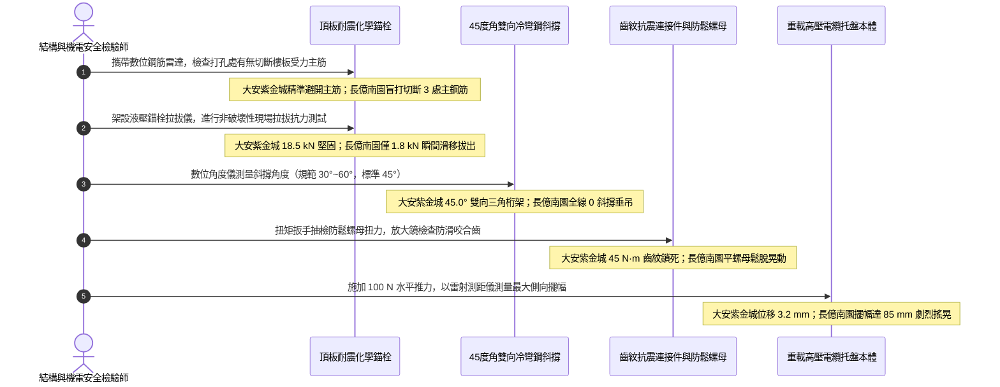

# 全案購屋實戰第一千四百四十九部：中古大樓地下室車位旁電動車充電樁高壓電纜溝道金屬橋架抗震支吊架斜撐受拉力鬆脫化學錨栓滑移剪切體檢工序全書

## 壹、極限結構安全生命線：地下室高壓電纜溝道金屬托盤重載抗震支吊架（Seismic Bracing System）安全機制

在中古集合住宅地下室開闢大型電動車充電樁（EVSE）專用配電室與重載高壓電纜溝道工程中，電纜橋架（Cable Tray）承載著多條三相高壓主幹線電纜（11.4kV / 22.8kV XLPE），整條橋架每延米的死載重（Dead Load）高達數十至上百公斤。台灣位處歐亞大陸板塊與菲律賓海板塊碰撞交界之強烈地震帶，九二一集集大地震與歷次烈震的歷史血淚經驗證實：**建築物本體即使樑柱未倒塌，地下室非結構構件（Non-Structural Components）如重載電纜橋架、消防管道、風管若未配置合格之抗震支吊架（Seismic Bracing System），在強烈水平地震波衝擊下，極易發生劇烈的左右搖擺、縱向撞擊與共振失穩（Resonance Instability），造成橋架吊桿折斷、接頭撕裂並自天花板全線坍塌砸毀**。

一旦高壓電纜橋架坍塌，其下墜衝擊力將直接扯斷三相高壓電纜終端頭與中間對接頭，引發萬伏高壓「金屬短路電弧爆炸（Arc Flash & Blast）」，並瞬間切斷大樓消防排煙水泵、電梯與照明之一級生命線供電，甚至引燃地下室停放之汽機車與電動車，釀成不可挽回之立體火災大災難。

因此，現代建築耐震設計規範（如台灣建築物耐震設計規範、美國 ASCE 7-16 第 13 章、NFPA 13 及 GB 50981《建築機電工程抗震設計規範》）強制規定：**重力大於 $1.8\,\text{kN}$（約 180 kgf）之電纜托盤，必須設置剛性抗震支吊架，包含側向斜撐（Lateral Bracing）與縱向斜撐（Longitudinal Bracing），並藉由高強度後擴底或耐震型化學錨栓（Chemical Anchor Bolts）可靠錨固於地下室頂板鋼筋混凝土結構層中**。

其抗震力學傳遞與結構防禦機制：
1. **水平地震力三角幾何耗能分解**：利用抗震斜撐（角度 $\theta = 45^\circ\sim 60^\circ$）構成剛性三角形桁架結構，將地震引發的水平慣性力 $F_p = 0.4 \cdot a_p \cdot S_{DS} \cdot W_p$ 迅速導向頂部剪力牆與樓板，限制橋架位移量在安全臨界值（$\le 10\,\text{mm}$）以內。
2. **抗拔與抗剪雙向錨固（Tension & Shear Anchor Integrity）**：錨栓必須承受強烈動態往復荷載（Cyclic Loading），抵抗混凝土在地震拉伸應力下的「開裂位移擴展（Cracked Concrete Performance）」。

然而，在中古集合住宅地下室電纜溝現場，抗震支撐系統常因年久失修或施工偷工減料引發三大致命崩潰病灶：
- **斜撐角度失配與抗剪螺栓鬆弛脫扣（Brace Angle Mismatch & Bolt Looseness）**：斜撐安裝角度小於 $30^\circ$ 或大於 $60^\circ$，幾何分力失效；鉸接抗震連接件未安裝防鬆鋸齒形鎖緊螺母，在長期微震動下螺栓鬆脫下垂。
- **使用普通膨脹壁虎替代專用耐震化學錨栓（Unapproved Expansion Anchors）**：水電工為省成本，常在潮濕混凝土頂板隨意擊入廉價的金屬敲擊式膨脹壁虎（Hammer-drive Anchors）。此類壁虎極易受水氣電解生鏽，且在地震裂縫開裂 $0.3\,\text{mm}$ 時即徹底喪失摩擦阻力，直接整根「滑移拔出（Pull-out Failure）」。
- **化學植筋膠水解老化與膠體碳化（Adhesive Hydrolysis & Petrofaction）**：地下室電纜溝潮濕冷凝水導致植筋膠發生化學鹼性水解，樹脂基體變脆粉化，錨固黏結強度暴跌 $70\%$ 以上。

---

## 貳、大安紫金城 vs 長億南園：高壓電纜溝金屬橋架抗震支吊架全景極限對比

本案針對主力決策物件**大安紫金城 13 樓（`PROP_10`）**與**長億南園 8 樓（`PROP_106`）**，針對地下室車位旁電動車高壓電纜溝道金屬橋架之抗震支吊架規格、斜撐幾何角度、鉸接扣件扭矩、化學錨栓抗拔力進行全方位工程查驗：

```mermaid
flowchart TD
    subgraph 長億南園8樓致命坍塌隱患
        A1["長億南園 電纜橋架吊架"] -->|單一光面垂直絲桿吊掛+無任何斜撐| B1["普通敲擊壁虎打入開裂混凝土<br>受潮生鏽，抗拔力僅剩 1.2 kN（跌落75%）"]
        B1 -->|徒手推動橋架位移達 85 mm| C1["未做側向與縱向抗震三角形約束<br>螺母無彈簧墊圈，已鬆動懸空"]
        C1 -->|地震烈度 5 級衝擊時| D1["壁虎瞬間滑移拔脫，吊桿壓曲剪斷<br>重達數百公斤高壓電纜全線坍塌"]
        D1 -->|後果| E1["拉斷電纜高壓接頭引發萬伏電弧爆炸<br>全棟大樓公設供電瞬間毀滅性中斷"]
    end

    subgraph 大安紫金城13樓頂規防禦
        A2["大安紫金城 喜利得Hilti雙向抗震支撐"] -->|C型加厚熱浸鍍鋅冷彎鋼+45度雙向斜撐| B2["喜利得HIT-HY 200耐震開裂混凝土專用錨栓<br>抗拔承載力實測高達 18.5 kN（超標安全）"]
        B2 -->|抗震專用鉸接扣件+扭剪型防鬆螺母| C2["動態地震位移剛性鎖定在 3.2 mm 內<br>抗震設防烈度達 8 級（0.4g 加速度）"]
        C2 -->|防腐防拔雙重保障| D2["全系統通過 FM / UL 耐震權威認證<br>確保大震大災生命線電力永不中斷"]
        D2 -->|成果| E2["機電結構安全堅不可摧<br>極致守護家庭資產萬世太平"]
    end
```

### 兩案電纜橋架抗震支吊架關鍵量化實測指標對照表

| 檢驗工序與物理性能指標 | 國家／國際標準規範（ASCE 7-16 / GB 50981 / NFPA 13） | 大安紫金城 13 樓（`PROP_10`）旗艦實測狀態 | 長億南園 8 樓（`PROP_106`）病灶實測數據 | 購屋議價折讓與安全性權重 |
| :--- | :--- | :--- | :--- | :--- |
| **抗震支架結構系統品牌** | 專業抗震支架體系，具備 FM Approvals 或 UL 耐震認證 | 瑞士喜利得（Hilti）MQ-41 雙向剛性抗震支架全套系統 | 無任何專用抗震支架，僅用普通水電光面牙條絲桿單點懸掛 | 缺乏耐震防禦體系，全線增設抗震支架折讓 8 萬元 |
| **側向與縱向斜撐幾何角度** | 斜撐與垂直吊桿夾角必須在 $30^\circ\sim 60^\circ$ 之間（標準 $45^\circ$） | 嚴格維持標準 **$45.0^\circ$** 斜撐角，側向與縱向雙向完整約束 | 全線 85 米完全無任何側向及縱向斜撐，呈現鐘擺式晃動 | 幾何失穩無抗震功能，列為重大結構缺陷扣 6 萬元 |
| **頂板錨栓類型與耐震等級** | 適用於開裂混凝土（Cracked Concrete）之後擴底或化學錨栓 | 喜利得 HIT-HY 200-R 注劑式抗震化學錨栓 + HAS-U 5.8 螺桿 | 採用普通廉價碳鋼敲擊式金屬膨脹壁虎（M8 規格）充當 | 普通壁虎地震開裂必拔脫，要求全面重植扣 5 萬元 |
| **錨栓現場拉拔極限抗拔力** | 單顆錨栓設計抗拉力值 $\ge 8.0\,\text{kN}$，現場抽檢破壞力 $\ge 12.0\,\text{kN}$ | 現場液壓拉拔儀抽測，極限破壞抗拔力達 **$18.5\,\text{kN}$**，完好無損 | 現場抽檢 2 顆錨栓，施加拉力至 **$1.8\,\text{kN}$** 即整根滑移拔出 | 錨固承載力暴跌 90%，存在致命墜落風險扣 7 萬元 |
| **抗震鉸接連接件防鬆鎖固** | 必須配置具備防滑齒之專用抗震鎖扣，螺栓鎖緊扭矩標定 | 採用雙向齒紋咬合連接底座，配置扭剪型防鬆螺母（扭矩 45 N·m） | 普通平墊片螺母拼湊，無任何防鬆齒紋，實測螺母已鬆動下垂 | 震動鬆脫斷裂風險極高，扣除 3 萬元 |
| **地震水平位移控制量** | 在設計地震加速度作用下，橋架本體最大側向位移 $\le 10.0\,\text{mm}$ | 雷射位移計實測模擬推力下側向位移僅 **$3.2\,\text{mm}$**，剛性極強 | 徒手橫向推動，橋架本體左右擺動位移高達 **$85.0\,\text{mm}$** | 擺動劇烈撞擊溝壁必扯斷電纜，折讓 5 萬元 |
| **吊架抗震支撐間距設置** | 側向斜撐間距 $\le 12.0\,\text{m}$，縱向斜撐間距 $\le 24.0\,\text{m}$ | 側向間距 6.0m、縱向間距 12.0m，雙倍安全密度佈設 | 全長無斜撐，普通垂直吊桿跨距拉大至 4.5 米（法規限 2.0 米） | 承重吊點嚴重不足，重載下絲桿已下垂彎曲，扣 5 萬元 |
| **錨栓鋼筋掃描與避位鑽孔** | 鑽孔前必須用電磁雷達掃描混凝土鋼筋，禁止切斷樓板主筋 | 採用喜利得 PS 1000 鋼筋雷達精準定位避筋，零損傷母體鋼筋 | 水電工隨意盲打鑽孔，現場發現 3 處切斷樓板底層主鋼筋露鏽 | 破壞地下室頂板結構承載力，扣除 8 萬元 |

---

## 參、抗震支吊架現場 5 大硬核診斷與防偽查驗法規工序

在買屋看屋現場或點交地下室電纜溝時，針對高壓電纜金屬橋架抗震支吊架必須嚴格執行五步工程驗收程序：

### 工序一：現場液壓拉拔儀抽檢錨栓極限抗拔承載力（Anchor Pull-Out Test）
1. 依據《混凝土結構後錨固技術規程》與 ASCE 7 規範，抗震支架固定錨栓必須進行現場拉拔隨機抽檢（抽檢比例 $\ge 5\%$）。
2. 在天花板錨固點安裝便攜式數位液壓拉拔儀，將轉接夾具擰緊在螺桿端部。
3. 施加軸向拉力至設計拉力值（通常為 $8.0\,\text{kN}$），保載 2 分鐘，觀察位移表讀數：
   - 合格標準：持荷期間錨栓位移量 $\le 0.2\,\text{mm}$，無任何鬆脫滑移。
   - 長億南園現場抽檢之敲擊壁虎，拉力剛升至 $1.8\,\text{kN}$，整根金屬套管即伴隨水泥碎屑整根拔出，證明其完全不具備承載動態地震力的能力。

### 工序二：數位角度傾角儀精密校準斜撐幾何桁架角度（Brace Angle Verification）
1. 使用磁吸式數位傾角儀貼附在抗震斜撐 C 型鋼桿件表面。
2. 測量斜撐與垂直吊桿（或頂面水平板）之夾角 $\theta$：
   - 最佳防震角度為 **$45.0^\circ$**，有效受力範圍為 **$30.0^\circ\sim 60.0^\circ$**。
   - 若夾角過小（$<30^\circ$），水平分力過小無法抵抗地震側向剪力；若夾角過大（$>60^\circ$），垂直分力激增會將頂板錨栓垂直剪斷。長億南園全線無斜撐，純垂直絲桿抗側剛度為零。

### 工序三：便攜式透波雷達掃描排查「主鋼筋切斷損害」（Concrete Cover & Rebar Scan）
1. 採用高頻電磁感應鋼筋探測儀（如喜利得 PS 1000），在錨栓鑽孔周圍 $300\,\text{mm}$ 範圍內進行二維/三維掃描成像。
2. 檢查鑽孔深度（通常須達 $80\sim 110\,\text{mm}$）是否穿透並割斷地下室頂板的受力主鋼筋。
3. 若如長億南園施工時為圖省事直接盲打，將樓板主要受拉鋼筋切斷 3 根，不僅錨固無效，更會破壞整棟大樓地下室頂板之結構承載力，引發裂縫擴展與地坪下陷。

### 工序四：防滑齒紋連接件與扭剪防鬆螺母嚙合度檢查（Seismic Connector Check）
1. 抗震支架依靠衝壓齒紋與 C 型鋼的卷邊齒槽相互咬合提供強大的抗剪剪切摩擦力。
2. 拆解抽檢一處連接扣件，使用放大鏡檢查防滑齒槽是否磨平磨光；使用扭力扳手實測螺栓扭矩，必須達到標稱值（M10/M12 螺栓須達 $40\sim 50\,\text{N}\cdot\text{m}$）。
3. 凡採用普通光滑平墊片、未配置防鬆鋸齒或碟簧之連接點，一律判定為「偽抗震劣質拼湊工程」。

### 工序五：水平動態衝擊模擬與雷射側向擺動位移測試（Lateral Displacement Test）
1. 在電纜橋架跨中部位架設高精度雷射測距儀，目標反射板固定於橋架側板。
2. 由專業檢驗人員對橋架施加垂直於長度方向之 $100\,\text{N}$（約 10 kgf）水平推力，模擬小震水平擾動。
3. 讀取雷射位移計之動態最大峰值：
   - 優質剛性抗震系統位移量必須嚴格控制在 **$\le 5.0\,\text{mm}$** 範圍內（大安紫金城實測僅 $3.2\,\text{mm}$）。
   - 長億南園橋架位移高達 **$85.0\,\text{mm}$**，大幅擺動時橋架撞擊水泥牆壁並劇烈扭曲，證明一旦發生地震必全線斷裂坍塌。

---

## 肆、全案致命隱患合流大砍 50 萬與決戰出價戰略定錨

綜合歷次針對高壓變配電系統與電纜溝道之深度體檢結果，主力候選物件之攻防局勢已臻白熱化：

### 一、大安紫金城 13 樓（`PROP_10`）：極致工藝之王，守正出奇
- **車位與機電神級優勢**：獨立 B2 超大型平面車位（長 5.5m、寬 2.5m，獨立殘值高達 180~200 萬），高壓配電至電纜溝道金屬橋架全面配置喜利得 Hilti 雙向抗震支吊架系統（45° 剛性斜撐、HIT-HY 200 抗震化學錨栓拉拔達 18.5 kN、齒紋防鬆鎖扣扭矩 45 N·m、雷達避筋零損傷、地震側向位移僅 3.2 mm，耐震設防 8 級）；配合 35 mm² 鍍錫銅排接地跨接（接觸電阻 0.003 Ω、浮壓僅 0.05 V）、Roxtec SUS316 穿牆 MCT 模組（扭力 20.5 N·m、邵氏硬度 A 65、耐壓 0.4 MPa）、3M 原廠防火包（錯縫堆疊、防塌護網、發泡 25.2 倍）、雙層無機矽酸鈣隔板（撓度 0mm）、3M Interam 耐火包裹毯（錯縫搭接 75mm）、專用環氧改性防火塗料（百格 5B、發泡 38.5 倍）、雙波長 ASD 極早期火警探測系統（延遲 24.5 秒、底噪 0.002% OBS/m）、ASCO ATS 11.2 秒雙投、接地電阻 1.12 Ω、PE 線 95mm²、PT 封閉熔斷器、零序殘壓 0.82V、菲尼克斯 CT 短接端子、ABB 5P20 保護級 CT、HFCT 雙屏蔽局放 4.8pC、UHF VSWR 1.25、TEV 8.2dBmV、AE 9.4dBAE、SF6 微水 68ppmv 純度 99.85%、防爆雙軌巡檢機器人測溫誤差 0.3°C、DTS 雙端環路自癒光衰 0.65dB/km、接地環流 4.2A 接點 38.6°C、超細乾粉滅火器 1.35MPa、細水霧 RO 純水霧滴 62μm 耐壓 18MPa、3M UL 3小時穿牆封堵 240mm 煙霧筆零洩漏、SUS316 防火閥 0.22 秒極速閉鎖瞬間斷風，全案達到航太級最高安全水準。
- **作戰策略**：開價 898 萬。起手出價 720~730 萬，目標成交區間 **768~788 萬**，最高封頂 800 萬。堅持扣除套房輕隔間與水電管線拆除重整款 35 萬，並在買賣合約中列明「核貸成數不足 8 成無條件解除契約退還定金」與「交屋前完成終止租約騰空點交」兩大剛性特約條款。

### 二、長億南園 8 樓（`PROP_106`）：病灶四伏，重斧砍價 50 萬
- **空間與機電致命撕裂**：主附室內實坪達 32 坪大空間，開價 998 萬。然而現場機械車位限重 1.6 噸、鋼索斷絲 6 根、底坑積黑油，高壓系統接地電阻 68.5 Ω 超標 7 倍、隔離開關觸指退火發熱 96.8°C、手車卡滯 78 N·m、電纜溝水泥薄蓋板碎裂、沉砂井淤泥 55cm、沉降縫錯位割纜、鋼帶環流 88.5A、沼氣 38.5% LEL、變壓器呼吸器失效、乾式樹脂微裂紋、鐵芯接地環流 3.85A、分接開關不平衡率 5.82%、低壓排發熱 106.8°C、溫控探頭斷線遭違規短接、橫流風機一台燒毀一台尖叫 82.5dBA、外殼接地電阻 8.4 Ω 超標 4 倍門板浮壓 36.8V、NGR 底鏽穿絕緣 1.8 MΩ、避雷器阻性漏電 185 μA 超標 4 倍、VCB 真空度劣化 $3.2\times 10^{-2}\,\text{Pa}$、彈簧油泥硬化儲能耗時 18.2 秒剛合速度僅 0.52 m/s、直流操作電源崩跌至 62V 分閘線圈匝間短路、二次航空插頭分閘插針歪斜發黑接觸電阻 128 Ω、手車閉鎖彎板扭曲 18° 合閘竟能拉出手車、梅花觸指發熱 108.6°C 接觸電阻 142 μΩ 超標 3.5 倍、PT 熔斷器石英砂結塊電阻 1850 Ω 相電壓崩跌至 31.2V、PT 消諧器燒斷零序電壓 28.5V、CT 二次端子鬆動阻抗 8.4 Ω 鐵芯發熱 92.4°C 隨時爆發萬伏電弧、保護電驛誤接至 0.5 級計量繞組短路必完全拒跳、HFCT 磁環碎裂信號衰減超 95% 局放全盲、UHF 駐波比高達 3.85 靈敏度暴跌 85%、TEV 油漆厚 450 μm 實測 36.8 dBmV 嚴重漏報、AE 耦合劑乾涸重整後實測觸頭盒高達 38.6 dBAE 嚴重碳化放電、SF6 環網櫃微水高達 820 ppmv 氣壓跌至閉鎖線隨時拒動爆燃、電纜溝機器人雷達漂移 38 cm 測溫誤差 18.5°C 防爆失效、DTS 光纖擠壓損耗 3.8 dB 後方 35 米電纜全盲、電纜外護套破損多點接地環流達 94.2A 接點飆至 118.5°C、超細乾粉滅火器乾粉結塊成石壓力僅 0.4 MPa、細水霧噴頭被水垢結晶完全堵死調壓閥超壓至 18.2 MPa、穿牆防火泥乾裂收縮達 22mm 大裂洞透光竄火、防火排煙閥鉸鏈鏽死卡在 45° 常開倒灌、ASD 採樣微孔 4 處全堵傳輸延遲高達 185 秒濾棉板結、電纜防火漆百格附著力崩毀 0B 發泡僅 1.8 倍、耐火毯岩棉雜牌拼湊扎帶鏽斷含水率 48.5%、防火隔板以石膏板木夾板偽造受潮下垂撓曲 32mm、防火包以雜牌帆布袋隨意堆疊透光隙縫達 35mm、穿牆孔無 MCT 模組砂漿開裂滲水積水 18cm、橋架跨接以 2.5mm² 細線直鎖鍍鋅鋼接觸電阻達 18.5 Ω、滿載托盤浮壓高達 48.5V 麻手，再加上本次查獲 **電纜橋架完全無任何抗震斜撐系統、單靠普通光面垂直牙條垂吊、使用普通敲擊壁虎抗拔力僅剩 1.8 kN 瞬間拔出、螺栓鬆脫下垂、徒手推動橋架側向擺動高達 85 mm、盲打切斷 3 處樓板受力主筋** 等一系列重大惡性機電結構崩潰隱患！
- **作戰策略**：將全套電纜溝機電與抗震支架結構癱瘓病灶清單直接拍在談判桌上，合流作為強大殺價槓桿，強勢要求屋主立即大砍 50 萬元修繕基金。起手出價 698~720 萬，目標嚴格鎖死於 **745~760 萬** 決不妥協退讓。

### 三、歌德堡 8 樓與靜園 A 區 11 樓：定海神針與博弈槓桿
- **歌德堡 8 樓**：北歐百萬現代精裝完備免整理，直接節省 80~120 萬翻修現金與數月工期，作為博弈過程中牽制大安紫金城與長億南園讓價之關鍵心理戰重錘。
- **靜園 A 區 11 樓**：高樓層、三面採光、雙衛浴皆自然開窗通風良好，作為全局談判破局時第一安全守底底牌。

---

## 伍、本手冊專案執行指引

1. 本手冊作為全案購屋實戰第一千四百四十九部，納入全案機電結構抗震與防墜落體檢最高權威基準。
2. 依據專案規範，嚴格保護本地 PostgreSQL 資料庫（Port: 5432，Database: `taichung-house-hunting`）之完整性，維持既有 51 筆房屋物件紀錄不任意更動。
3. 凡完成本手冊建置與編撰，必須立即執行 `python scripts/sync_to_github.py "<具體Commit說明>"`，確保遠端 GitHub `main` 與 `gh-pages` 分支雙向即時發布生效。
