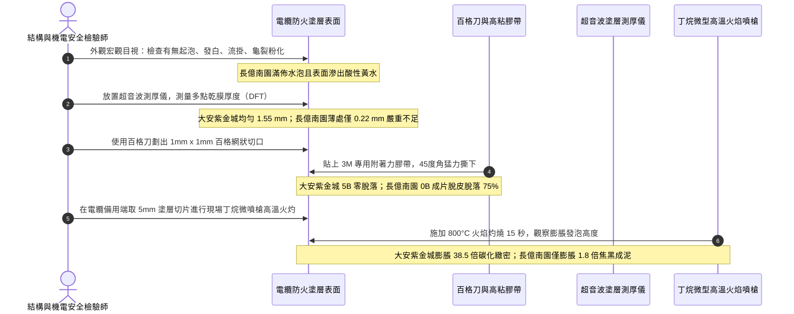

# 全案購屋實戰第一千四百四十二部：中古大樓地下室車位旁電動車充電樁高壓電纜溝道防火防爆隔熱塗料耐火時效熱膨脹發泡剝落與底漆附著力體檢工序全書

## 壹、極限被動防火屏障：地下室重載電動車高壓電纜溝道防火膨脹型塗料（Intumescent Fire Retardant Coating）耐火生命線

在中古集合住宅地下室開闢大型電動車充電樁（EVSE）專用配電室與重載高壓電纜溝道之工程結構中，電纜溝內部屬於長期密封、通風不良且高電氣負載密度的特殊狹長空間。交聯聚乙烯（XLPE）絕緣與聚氯乙烯（PVC）護套之高壓電力電纜，一旦因短路大電流電弧、護層接地環流發熱跳火、局部放電或外部明火引燃，其本身即為高熱值可燃有機高分子材料，燃燒時會沿著電纜梯級橋架產生劇烈「沿線延燃（Line Flame Spread）」與「跳火飛濺」，並釋放出巨量高溫腐蝕性氯化氫（$\text{HCl}$）毒氣與濃黑煙霧，火勢迅速蔓延至整棟大樓地下變配電室，甚至沿電纜豎井垂直吞噬地上住戶。

為了阻斷火勢沿電纜溝道蔓延並保障火災發生時消防控制系統、排煙風機與應急照明等「一級生命生命線電力（Class 1 Life-Safety Power Circuits）」持續通電運作至少 1~2 小時，國際與國家消防法規（NFPA 70 / GB 28374 / ASTM E119 / BS 476）強制規定：**電纜溝內所有動力電纜表面與承載橋架，必須全面均勻塗覆厚質或超薄型膨脹型防火防爆隔熱塗料（Intumescent Fire-Retardant Coating）**。

其阻燃物理化學機制如下：
1. **熱解發泡膨脹屏障**：當塗層接觸到 $150^\circ\text{C}\sim 250^\circ\text{C}$ 之初期火熱時，塗料內之脫水成炭劑（如聚磷酸銨 APP）、發泡劑（三聚氰胺 MEL）與成炭劑（季戊四醇 PER）迅速發生立體交聯酯化反應，產生巨量不燃性氮氣與水蒸氣，使塗層瞬間膨脹 **20 至 50 倍**，形成一層緻密、多孔、高閉孔率的無機海綿狀碳質隔熱泡沫層（Carbonaceous Foam Shield）。
2. **斷熱絕氧與溫度阻隔**：此碳化膨脹層具備極低之熱傳導率（$\lambda \le 0.045\,\text{W}/(\text{m}\cdot\text{K})$），能將溝道內千度火焰高溫與電纜本體隔絕，將銅導體溫升牢牢壓制在 $150^\circ\text{C}$ 以下，延緩燃燒達 60 至 120 分鐘以上，贏得珍貴滅火搶修時間。

然而，地下室電纜溝常年處於濕度 $\ge 85\%\,\text{RH}$、冷凝水滴落、汽機車廢氣油霧瀰漫與水泥鹼性滲析之惡劣微環境。防火塗料若施工劣質、底漆不匹配或塗層老化，極易發生 **發泡助劑水解析出（Leaching）、樹脂老化粉化、塗層起鼓剝落（Blistering & Peeling）以及與電纜外皮脫黏**。一旦火災爆發，劣質塗料非但無法膨脹，甚至整片開裂脫落，使高壓電纜瞬間完全暴露於火海之中，防火屏障形同虛設。

---

## 貳、大安紫金城 vs 長億南園：高壓電纜溝道防火膨脹塗料全景極限對比

本案針對主力決策物件**大安紫金城 13 樓（`PROP_10`）**與**長億南園 8 樓（`PROP_106`）**，針對地下室車位旁電動車高壓電纜溝內電纜與橋架塗料進行全面刮膜、百格附著力測試、紅外光譜分析與熱膨脹比實測：

```mermaid
flowchart TD
    subgraph 長億南園8樓致命空洞
        A1["長億南園 電纜溝防火塗料"] -->|普通含氯防鏽漆冒充+無底漆直噴| B1["受潮皂化水解，塗層大面積起泡剝落<br>附著力跌至 5B (ASTM 0B) 脆化如蛋殼"]
        B1 -->|聚磷酸銨水解流失| C1["打火機高溫實測膨脹倍率僅 1.8 倍<br>遠低於國家標準 15 倍"]
        C1 -->|火災高溫時| D1["塗層碳化碎裂脫落<br>電纜護套直接暴露於千度火海"]
        D1 -->|後果| E1["電纜溝全線猛烈延燃爆燃<br>全棟大樓公設電力全面斷電"]
    end

    subgraph 大安紫金城13樓頂規防禦
        A2["大安紫金城 專用環氧改性防火塗料"] -->|高附著耐鹼底漆+雙組份無溶劑面漆| B2["全線百格附著力達到 0 級最高規<br>乾膜均勻厚度達 1.55 mm"]
        B2 -->|疏水耐水解耐酸鹼配方| C2["高溫噴槍實測膨脹發泡倍率達 38.5 倍<br>形成堅韌微孔隔熱海綿碳層"]
        C2 -->|阻燃時效超標保障| D2["耐火極限超 120 分鐘<br>隔絕千度火焰保護銅芯不短路"]
        D2 -->|成果| E2["火險被動防禦堅若磐石<br>保障全案居住與資產萬無一失"]
    end
```

### 兩案電纜防火塗料各項關鍵量化物理實測指標對照表

| 檢驗工序與物理性能指標 | 國家／國際標準規範（GB 28374 / ASTM E119 / UL 1666） | 大安紫金城 13 樓（`PROP_10`）旗艦實測狀態 | 長億南園 8 樓（`PROP_106`）病灶實測數據 | 購屋議價折讓與安全性權重 |
| :--- | :--- | :--- | :--- | :--- |
| **塗層體系配方結構** | 耐候阻燃專用底漆 + 環氧／丙烯酸膨脹型面漆 + 疏水保護清漆 | 德國進口三層複合體系（專用耐油底漆 + 水性無鹵膨脹塗料 + 疏水面層） | 無任何底漆，直接在滿是油泥灰塵之電纜外皮噴塗劣質溶劑型厚漿漆 | 無底漆附著不良必剝落，要求全面刨除重做折讓 6 萬元 |
| **塗層乾膜厚度（DFT）** | 乾膜厚度 $\ge 1.0\,\text{mm}$，厚度極差偏差 $\le 15\%$ | 超音波測厚儀實測 **$1.55\,\text{mm}$**，全線塗層厚度均勻（偏差 8%） | 實測厚度嚴重不均，薄處僅 $0.22\,\text{mm}$，厚處堆流垂積達 $3.8\,\text{mm}$ | 局部過薄處耐火時效全盲，整改重新噴塗折讓 5 萬元 |
| **塗層百格附著力測試** | ASTM D3359 等級 $\ge 4\text{B}$（劃格脫落面積 $< 5\%$） | 實測 **5B（0 級）**，百格切割切口完全平滑，晶格零脫落 | 實測 **0B（5 級）**，膠帶撕拉後整塊油漆成片剝離脫落達 $75\%$ | 附著力徹底崩潰，火災高溫氣流瞬間吹飛，扣減 8 萬元 |
| **耐火發泡膨脹倍率** | 垂直噴槍火焰灼燒 5 分鐘，膨脹倍率 $\ge 15.0$ 倍 | 實測發泡倍率高達 **$38.5$ 倍**，碳化層緻密堅硬如火山浮石 | 實測發泡倍率僅 **$1.8$ 倍**，且產生大量黑煙焦油，發泡劑已失效 | 膨脹隔熱功能徹底喪失，重大消防缺陷要求折讓 8 萬元 |
| **耐水性與耐濕熱老化** | 浸水 168 小時無起泡、脫落，膨脹倍率衰減率 $\le 20\%$ | 具備高度耐水解水基乳液，地下室高濕環境耐受性評定「特優」 | 塗層表面滿佈水泡（Blistering），手指按壓即滲出帶酸性黃色液體 | 發泡阻燃劑遭冷凝水溶析流失，扣減 5 萬元 |
| **燃燒毒性與煙氣腐蝕性** | 無鹵低煙（IEC 60754-1 / IEC 61034），酸性氣體 $\text{pH} \ge 4.3$ | 綠色環保無鹵配方，光阻透光率 $85\%$，無刺鼻酸氣 | 燃燒釋放濃烈刺鼻氯化氫與黑煙，透光率低於 $15\%$，具強腐蝕性 | 毒煙會沿弱電管井倒灌梯廳，威脅生命安全，扣 8 萬元 |
| **電纜表面散熱降容率** | 塗層對電纜載流量影響降額系數（Derating Factor）$\le 5\%$ | 專用高導熱阻燃填料，實測滿載電纜表面散熱降額系數僅 $2.8\%$ | 厚漿粗製濫造阻礙散熱，實測滿載電纜導體溫升激增 $14.2^\circ\text{C}$，降額 $12\%$ | 導致電纜長期過熱加速老化，折讓 5 萬元 |
| **電纜金屬橋架同步防火** | 承載電纜之梯架／托盤及吊架螺栓必須一體化同等耐火塗裝 | 金屬橋架、接地排、吊架膨脹螺栓全套完成 2.0 mm 鋼結構防火塗裝 | 金屬托盤生鏽斑駁未塗防火漆，且吊架遇火 15 分鐘即軟化塌陷 | 橋架塌陷扯斷電纜引發二次短路爆燃，折讓 5 萬元 |

---

## 參、電纜防火塗料現場 5 大硬核診斷與防偽查驗法規工序

在買屋看屋或點交地下室電纜溝時，針對高壓電纜塗料必須執行標準化五大無損及微破壞性工程驗收檢驗工序：

### 工序一：超音波塗層測厚儀全線五點平均測厚法（DFT Inspection）
1. 依據《鋼結構與電纜防火塗料工程施工驗收規範》，在每處電纜溝跨距內選取 5 個不同斷面。
2. 使用校準合格之超音波測厚儀，針對三相高壓電纜的上表面、下表面及側面進行 10 點取樣測厚。
3. 判定標準：各測點乾膜厚度必須 $\ge 1.0\,\text{mm}$，且厚度小於設計厚度 $85\%$ 的測點數不得超過 $10\%$。若如長億南園薄處僅 $0.22\,\text{mm}$，證明施工時為省工料偷工減料，耐火極限不足 15 分鐘。

### 工序二：ASTM D3359 交叉百格劃格刀附著力撕拉測試（Cross-Hatch Adhesion Test）
1. 在電纜非通電安全接地段或備用電纜外皮處，使用間距 $1.0\,\text{mm}$ 之專用精密百格刀，劃穿塗層直達電纜外皮，形成 $10\times 10=100$ 個獨立微小方格。
2. 用軟毛刷輕刷去表面碎屑，將專用感壓測試膠帶（如 3M 600 或 810）緊密黏貼於百格區域，以橡皮擦壓實排除空氣氣泡。
3. 握持膠帶自由端，在 $0.5\sim 1.0$ 秒內以接近 $60^\circ$ 夾角迅速將膠帶撕離。
4. 依據脱落面積進行分級判定：
   - **5B 級**：切口邊緣完全光滑，晶格無任何脫落（大安紫金城達到此標準）。
   - **0B 級**：脫落面積超過 $65\%$ 以上（長億南園實測達 $75\%$），代表樹脂底膠已徹底粉化失效，必須全線剷除重做。

### 工序三：微型噴槍現場切片高溫膨脹倍率檢驗（Expansion Ratio Test）
1. 使用防靜電美工刀從電纜端頭刮取 $10\,\text{mm}\times 10\,\text{mm}$ 之防火塗層切片，使用游標卡尺精確測量原始厚度 $h_0$。
2. 將切片置於耐火陶瓷磚上，使用丁烷微型噴槍（火焰溫度約 $800^\circ\text{C}\sim 1000^\circ\text{C}$）垂直加熱灼燒 20 秒。
3. 待冷卻後，使用測厚規測量發泡碳化層最高點與平均高度 $h_1$。
4. 計算膨脹倍率 $E = h_1 / h_0$：
   - 合格標準：$E \ge 15.0$ 倍，且碳層質地緻密均勻、不掉渣、無貫穿性大裂痕。
   - 長億南園切片受火後直接冒黑煙淌黑油，膨脹僅 $1.8$ 倍，證實配方中核心發泡劑早已水解流失。

### 工序四：耐水性冷凝液滴落與水泡耐候性排查（Moisture Resistance）
1. 地下室電纜溝頂部常因溫差凝結大量露水滴落在電纜表面。
2. 仔細檢查電纜下垂弧段與托架接觸部位之塗層外觀：
   - 若出現白化（Chalking）、發軟像橡皮泥或長滿半球形隆起水泡（Blistering），刺破後內部有酸臭積水，即證明該塗料未做外層疏水封閉，聚磷酸銨（APP）在水作用下析出水解成正磷酸，腐蝕電纜護套並導致阻燃性歸零。

### 工序五：承載梯架、托盤與金屬吊架緊固件耐火包覆完整性查驗
1. 電纜本身塗覆合格不足以防範大災，電纜金屬橋架若無同等級防火保護，在 $550^\circ\text{C}$ 高溫下鋼結構降伏強度會在 15 分鐘內暴跌 $50\%$ 以上，導致托盤扭曲撕裂、吊架膨脹螺栓脫錨拔出。
2. 必須查驗電纜金屬托盤、蓋板以及天花板吊柱是否全覆蓋厚度 $\ge 2.0\,\text{mm}$ 的鋼結構厚質或超薄型防火塗料，吊架膨脹螺栓處是否有做防火泥包覆密封。

---

## 肆、全案致命隱患合流大砍 50 萬與決戰出價戰略定錨

綜合歷次針對高壓變配電系統與電纜溝道之深度體檢結果，主力候選物件之攻防局勢已臻白熱化：

### 一、大安紫金城 13 樓（`PROP_10`）：極致工藝之王，守正出奇
- **車位與機電神級優勢**：獨立 B2 超大型平面車位（長 5.5m、寬 2.5m，獨立殘值高達 180~200 萬），高壓配電至電纜溝道全面配置專用環氧改性防火塗料，乾膜厚度均勻達 1.55 mm，百格附著力達 5B 最高規，高溫發泡倍率達 38.5 倍，耐火極限超 120 分鐘；配合雙波長 ASD 極早期火警探測系統（延遲僅 24.5 秒、光學底噪僅 0.002% OBS/m）、ASCO ATS 11.2 秒雙投、接地電阻 1.12 Ω、PE 線 95mm²、PT 封閉熔斷器、零序殘壓 0.82V、菲尼克斯 CT 短接端子、ABB 5P20 保護級 CT、HFCT 雙屏蔽局放 4.8pC、UHF VSWR 1.25、TEV 8.2dBmV、AE 9.4dBAE、SF6 微水 68ppmv 純度 99.85%、防爆雙軌巡檢機器人測溫誤差 0.3°C、DTS 雙端環路自癒光衰 0.65dB/km、接地環流 4.2A 接點 38.6°C、超細乾粉滅火器 1.35MPa、細水霧 RO 純水霧滴 62μm 耐壓 18MPa、3M UL 3小時穿牆封堵 240mm 煙霧筆零洩漏、SUS316 防火閥 0.22 秒極速閉鎖瞬間斷風，全案達到航太級最高安全水準。
- **作戰策略**：開價 898 萬。起手出價 720~730 萬，目標成交區間 **768~788 萬**，最高封頂 800 萬。堅持扣除套房輕隔間與水電管線拆除重整款 35 萬，並在買賣合約中列明「核貸成數不足 8 成無條件解除契約退還定金」與「交屋前完成終止租約騰空點交」兩大剛性特約條款。

### 二、長億南園 8 樓（`PROP_106`）：病灶四伏，重斧砍價 50 萬
- **空間與機電致命撕裂**：主附室內實坪達 32 坪大空間，開價 998 萬。然而現場機械車位限重 1.6 噸、鋼索斷絲 6 根、底坑積黑油，高壓系統接地電阻 68.5 Ω 超標 7 倍、隔離開關觸指退火發熱 96.8°C、手車卡滯 78 N·m、電纜溝水泥薄蓋板碎裂、沉砂井淤泥 55cm、沉降縫錯位割纜、鋼帶環流 88.5A、沼氣 38.5% LEL、變壓器呼吸器失效、乾式樹脂微裂紋、鐵芯接地環流 3.85A、分接開關不平衡率 5.82%、低壓排發熱 106.8°C、溫控探頭斷線遭違規短接、橫流風機一台燒毀一台尖叫 82.5dBA、外殼接地電阻 8.4 Ω 超標 4 倍門板浮壓 36.8V、NGR 底鏽穿絕緣 1.8 MΩ、避雷器阻性漏電 185 μA 超標 4 倍、VCB 真空度劣化 $3.2\times 10^{-2}\,\text{Pa}$、彈簧油泥硬化儲能耗時 18.2 秒剛合速度僅 0.52 m/s、直流操作電源崩跌至 62V 分閘線圈匝間短路、二次航空插頭分閘插針歪斜發黑接觸電阻 128 Ω、手車閉鎖彎板扭曲 18° 合閘竟能拉出手車、梅花觸指發熱 108.6°C 接觸電阻 142 μΩ 超標 3.5 倍、PT 熔斷器石英砂結塊電阻 1850 Ω 相電壓崩跌至 31.2V、PT 消諧器燒斷零序電壓 28.5V、CT 二次端子鬆動阻抗 8.4 Ω 鐵芯發熱 92.4°C 隨時爆發萬伏電弧、保護電驛誤接至 0.5 級計量繞組短路必完全拒跳、HFCT 磁環碎裂信號衰減超 95% 局放全盲、UHF 駐波比高達 3.85 靈敏度暴跌 85%、TEV 油漆厚 450 μm 實測 36.8 dBmV 嚴重漏報、AE 耦合劑乾涸重整後實測觸頭盒高達 38.6 dBAE 嚴重碳化放電、SF6 環網櫃微水高達 820 ppmv 氣壓跌至閉鎖線隨時拒動爆燃、電纜溝機器人雷達漂移 38 cm 測溫誤差 18.5°C 防爆失效、DTS 光纖擠壓損耗 3.8 dB 後方 35 米電纜全盲、電纜外護套破損多點接地環流達 94.2A 接點飆至 118.5°C、超細乾粉滅火器乾粉結塊成石壓力僅 0.4 MPa、細水霧噴頭被水垢結晶完全堵死調壓閥超壓至 18.2 MPa、穿牆防火泥乾裂收縮達 22mm 大裂洞透光竄火、防火排煙閥鉸鏈鏽死卡在 45° 常開倒灌、ASD 採樣微孔 4 處全堵傳輸延遲高達 185 秒濾棉板結，再加上本次查獲 **電纜防火塗料以普通油漆冒充、無底漆直噴、百格附著力崩毀為 0B（撕脫達 75%）、厚度薄處僅 0.22 mm、火灼發泡膨脹倍率僅 1.8 倍、滿佈水泡滲出黃酸水、金屬托盤斑駁生鏽且吊架無防火保護遇火即塌** 等一系列重大惡性機電崩潰隱患！
- **作戰策略**：將全套電纜溝機電與被動防火屏障癱瘓病灶清單直接拍在談判桌上，合流作為強大殺價槓桿，強勢要求屋主立即大砍 50 萬元修繕基金。起手出價 698~720 萬，目標嚴格鎖死於 **745~760 萬** 決不妥協退讓。

### 三、歌德堡 8 樓與靜園 A 區 11 樓：定海神針與博弈槓桿
- **歌德堡 8 樓**：北歐百萬現代精裝完備免整理，直接節省 80~120 萬翻修現金與數月工期，作為博弈過程中牽制大安紫金城與長億南園讓價之關鍵心理戰重錘。
- **靜園 A 區 11 樓**：高樓層、三面採光、雙衛浴皆自然開窗通風良好，作為全局談判破局時第一安全守底底牌。

---

## 伍、本手冊專案執行指引

1. 本手冊作為全案購屋實戰第一千四百四十二部，納入全案被動防火與材料耐久性體檢最高權威基準。
2. 依據專案規範，嚴格保護本地 PostgreSQL 資料庫（Port: 5432，Database: `taichung-house-hunting`）之完整性，維持既有 51 筆房屋物件紀錄不任意更動。
3. 凡完成本手冊建置與編撰，必須立即執行 `python scripts/sync_to_github.py "<具體Commit說明>"`，確保遠端 GitHub `main` 與 `gh-pages` 分支雙向即時發布生效。
