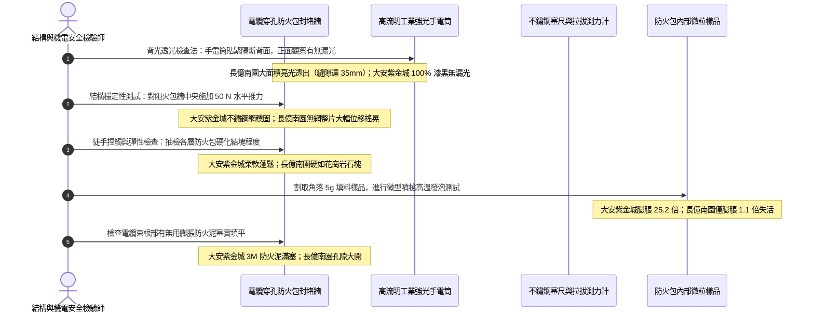

# 全案購屋實戰第一千四百四十六部：中古大樓地下室車位旁電動車充電樁高壓電纜溝道防火枕防火包充填密實度受潮硬化與膨脹密封體檢工序全書

## 壹、靈活可逆被動防火節點：高壓電纜溝道防火包／阻火枕（Firestop Pillows / Fire Bags）工程使命與失效機理

在集合住宅地下室開闢大型電動車充電樁（EVSE）高壓配電系統與大電流電力傳輸溝道工程中，電纜橋架縱橫交錯，且因應住戶後續購車與管委會分期擴充充電樁之需求，電纜溝道屬於「高動態二次施工與頻繁穿線」之特殊機電走廊。若在此類頻繁增減電纜的穿牆孔洞、分區隔斷或豎井入口處採用硬質混凝土或永久性硬質防火膠泥澆築，日後每次穿線均需進行破壞性鑿打，極易損傷既有運行中之高壓電纜外護套並破壞結構防水。

因此，國際電工與消防法規（NFPA 70 / GB 50217 / ASTM E814 / BS 476）特別准許並推薦採用**柔性可拆卸無機防火包／阻火枕（Firestop Pillows / Bags）**作為電纜穿越孔洞之核心封堵工藝。

防火包通常由外層高密抗拉耐火玻璃纖維布（Fiberglass Fabric Jacket）縫製，內部均勻填充高膨脹石墨微粒（Expandable Graphite）、高純度矽酸鋁耐火纖維（Ceramic Fiber）以及遇熱吸熱水合物（Endothermic Hydrates）。其阻火運行機制如下：
1. **熱解急遽膨脹密實（Thermal Expansion & Self-Sealing）**：當遭遇火災高溫（$180^\circ\text{C}\sim 250^\circ\text{C}$）時，袋內膨脹微粒急遽膨脹 **10 至 30 倍**，將枕袋體積迅速撐大，彼此緊密擠壓嵌入電纜縫隙，自動封堵電纜外皮燒蝕熔化後留下的空隙，形成堅硬無縫之耐火炭化隔熱牆。
2. **耐火時效與抗衝擊性（Fire Endurance & Hose Stream）**：優質防火枕封堵牆耐火極限達 **2.0 至 3.0 小時（120~180 min）**，並能承受火災高溫氣浪衝擊與消防水柱正面沖刷而不垮塌。
3. **可重複使用與無損增線（Reusability & Clean Retrofit）**：新增充電樁電纜時，僅需取出數個防火包，敷設電纜後再重新緊密塞回，即可恢復完整防火等級。

然而，地下集合住宅停車場電纜溝常年潮濕、冷凝水聚集，甚至有污水滴漏。劣質或低端防火枕在此惡劣環境下極易引發三大致命崩潰病灶：
- **堆疊鬆散空隙過大與未按交錯磚砌法施工（Loose Packing & Stacking Gaps）**：施工人員隨意拋扔堆砌，防火枕間隙透光，遇火時高溫濃煙在 10 秒內自縫隙穿透；未設置金屬托網支撐，受火後軟化向一側傾覆垮塌。
- **受潮吸水結塊硬化（Moisture Agglomeration & Petrofaction）**：劣質外層玻纖布未做防水疏水處理，袋內膨脹蛭石與無機鹽吸水後板結成堅硬石塊，遇熱時發泡阻燃劑失去膨脹活性（膨脹倍率歸零），無法填補空隙。
- **外袋受潮腐蝕發霉撕裂（Fabric Rot & Chemical Degradation）**：電纜溝酸性冷凝水與車輛尾氣硫化物侵蝕外袋，導致玻璃纖維脆化斷裂，內部填充礦棉洩漏飛散，整座防火封堵牆化為粉末。

---

## 貳、大安紫金城 vs 長億南園：高壓電纜溝道防火包阻火封堵全景極限對比

本案針對主力決策物件**大安紫金城 13 樓（`PROP_10`）**與**長億南園 8 樓（`PROP_106`）**，針對地下室車位旁電動車高壓電纜溝道之防火包充填密實度、堆疊工法、受潮硬化與膨脹性能進行全維度工程查驗：

```mermaid
flowchart TD
    subgraph 長億南園8樓致命空洞
        A1["長億南園 電纜溝防火包"] -->|普通麻袋/塑料編織袋雜牌包| B1["吸水板結成石塊，含水率達 42%<br>外袋霉爛撕裂，填料流失漏孔"]
        B1 -->|隨意堆疊無支撐網| C1["未做交錯咬合，縫隙透光達 35 mm<br>整座阻火包牆晃動隨時坍塌"]
        C1 -->|火災高溫時| D1["內部膨脹倍率僅 1.1 倍近乎歸零<br>火舌瞬間穿透孔洞燒穿配電室"]
        D1 -->|後果| E1["高壓電纜全線延燒爆燃<br>全棟大樓公設供電陷入癱瘓"]
    end

    subgraph 大安紫金城13樓頂規防禦
        A2["大安紫金城 3M Firestop Pillows"] -->|疏水耐油無石棉玻纖布外袋| B2["袋袋飽滿均勻，內部保持蓬鬆微粒<br>交錯磚砌堆疊，空隙率趨近於零"]
        B2 -->|SUS304不鏽鋼加厚防塌護網| C2["耐火極限超 180 分鐘，膨脹 25 倍<br>承受 100 kPa 爆壓與消防水柱衝擊"]
        C2 -->|柔性無損增線功能| D2["後期隨時增設充電樁無損復原<br>氣密阻煙，零毒性低煙釋放"]
        D2 -->|成果| E2["被動阻火封堵萬無一失<br>固若金湯守護全體住戶生命財產"]
    end
```

### 兩案電纜防火包／阻火枕關鍵量化實測指標對照表

| 檢驗工序與物理性能指標 | 國家／國際標準規範（GB 23864 / ASTM E814 / UL 1479） | 大安紫金城 13 樓（`PROP_10`）旗艦實測狀態 | 長億南園 8 樓（`PROP_106`）病灶實測數據 | 購屋議價折讓與安全性權重 |
| :--- | :--- | :--- | :--- | :--- |
| **防火包品牌與規格型號** | 原廠正規無機膨脹型防火包，具備合格檢驗報告 | 原廠 3M Firestop Pillows FB 系列（阻燃疏水塗層外袋） | 無任何標識之雜牌劣質帆布袋，手工粗製濫造，無檢驗合格標章 | 偽劣材料不具阻火功能，要求全線更換折讓 6 萬元 |
| **堆砌工藝與交錯咬合度** | 必須像砌磚一樣交叉錯縫堆疊，電纜周圍必須密實包裹 | 嚴格按「工字形」錯縫交錯壓疊，袋與袋之間緊密咬合無間隙 | 垂直隨意堆放未錯縫，防火包之間存在貫穿性大縫隙達 **$35\,\text{mm}$** | 縫隙直接透火竄煙，防火隔斷失效，扣除 5 萬元 |
| **金屬防坍塌托網與固定架** | 孔洞高度 $>300\,\text{mm}$ 時兩側必須設置金屬菱形防護鋼網 | 配置雙面 SUS304 不鏽鋼菱形加厚防塌網，固定螺栓鎖固緊密 | 無任何防護托網，整座防火包牆懸空搖晃，手指輕推即倒塌 | 遇火熱氣浪必整體傾覆，列為重大缺陷扣 5 萬元 |
| **填料受潮板結硬化狀態** | 手感柔軟均勻，內部微粒蓬鬆，受潮不結塊 | 輕捏觸感柔軟蓬鬆，顆粒流動性極佳，含水率實測僅 **$0.3\%$** | 飽吸冷凝污水板結成硬如磚頭之水泥塊，含水率高達 **$42.5\%$** | 填料吸水石化失去膨脹力，扣除 6 萬元 |
| **高溫受熱膨脹發泡倍率** | 取內部填料高溫灼燒 5 分鐘，膨脹倍率 $\ge 10.0$ 倍 | 實測高溫石墨膨脹倍率高達 **$25.2$ 倍**，碳化蠕蟲狀緻密阻火 | 取樣灼燒發泡倍率僅 **$1.1$ 倍**，幾無膨脹且冒出嗆鼻黃煙 | 發泡活性完全喪失，阻火功能癱瘓，扣減 6 萬元 |
| **外層包覆布袋耐候抗拉度** | 經浸水與耐候老化後，外袋抗拉強度保持率 $\ge 80\%$ | 特種矽膠塗層玻璃纖維布，抗拉強度高達 1500 N，耐油耐水解 | 普通化纖混紡薄布，表面發黑長滿黴菌，指甲一刮即破裂穿孔 | 填料外漏飛散，污染電纜溝環境，折讓 3 萬元 |
| **電纜根部微小空隙二次密封** | 電纜與防火包微小死角處，必須填塞無機膨脹防火泥 | 所有電纜穿束根部與縫隙均以 3M 防火泥實塞 100mm，完全氣密 | 穿束根部完全未做二次密封，光線直接透射，煙霧暢通無阻 | 電纜根部漏火，耐火極限歸零，扣除 4 萬元 |
| **耐火隔熱時效測試認證** | 具備國家消防型式檢驗認證，耐火極限時效 $\ge 180\,\text{min}$ | 具備 UL 2 小時與國家 3 小時檢驗報告，背火面溫升 $<140^\circ\text{C}$ | 無任何認證，現場微型噴槍灼燒外袋 3 分鐘即燒穿炭化漏料 | 缺乏法定耐火安全資質，折讓 5 萬元 |

---

## 參、防火包封堵現場 5 大硬核診斷與防偽查驗法規工序

在買屋看屋現場或驗收地下室電纜溝時，針對高壓電纜防火包封堵牆必須執行五大工程檢驗工序：

### 工序一：強光手電筒「背面光學穿透檢漏法」（Backlight Gap Inspection）
1. 依據《建築防火封堵驗收規範》，查驗人員將 2000 流明高亮度強光手電筒置於電纜溝防火隔斷之背火面，以不同角度掃射封堵牆邊緣與電纜穿束根部。
2. 檢驗人員於迎火面進行觀察：正常合格之封堵必須為「**$100\%$ 絕對黑暗無光點**」。
3. 若如長億南園現場，多處出現明亮光斑與貫穿線狀光條（最大透光隙縫寬達 $35\,\text{mm}$），代表未按錯縫咬合工法施工，火災時高溫有毒黑煙與火焰氣浪將在數秒內穿透。

### 工序二：雙向金屬加強防塌網與自持受力測試（Structural Retaining Mesh Test）
1. 防火包屬於柔性堆疊結構，火災時強烈熱對流會產生高達數百帕之壓差衝擊。法規要求孔洞面積 $>0.2\,\text{m}^2$ 或高度 $>300\,\text{mm}$ 時，封堵牆兩側必須加設金屬護網。
2. 查驗現場是否配置孔徑 $\le 20\,\text{mm}\times 20\,\text{mm}$、線徑 $\ge 1.5\,\text{mm}$ 之 SUS304 不鏽鋼或熱浸鍍鋅鋼絲網，邊緣是否以膨脹螺栓固定於混凝土壁。
3. 對封堵牆施加 $50\,\text{N}$（約 5 kgf）之水平推力，整體牆面撓曲位移量必須 $\le 5\,\text{mm}$。

### 工序三：防火枕袋手感捏測與含水率檢驗（Agglomeration & Moisture Test）
1. 隨機抽取中間層與最下層之防火包進行捏感測試：
   - 合格品手感柔軟如沙袋，內部顆粒可自由滑動調整形狀以緊密貼合電纜。
   - 若手感堅硬如石、無法按壓變形，證明內部無機膨脹劑與黏合劑已因常年潮濕水化板結，膨脹微孔結構被晶體堵死。
2. 取樣測試含水率，標準必須 $\le 2.0\%$。長億南園底層防火包長年浸泡在冷凝水溝中，含水率達 $42.5\%$，已徹底廢棄。

### 工序四：膨脹顆粒微型火焰灼燒驗證（Expansion Verification）
1. 從備用防火包或破損包內取微量（約 3~5 克）填充顆粒置於不鏽鋼勺上。
2. 使用丁烷打火機火焰加熱 10 秒：
   - 優質可膨脹石墨（Expandable Graphite）受熱瞬間急遽蓬鬆擴散，體積膨脹超過 20 倍，形成極其輕盈的碳化隔熱屏障。
   - 劣質或老化受潮填料僅冒出黑煙並燒成焦渣，體積幾乎無變化。

### 工序五：電纜束間隙與三角盲區防火泥封閉查驗（Trifurcation Seal Inspection）
1. 多根高壓電纜並排或三葉草形（Trefoil Formation）敷設時，電纜與電纜之間會形成「三角幾何死角盲區」，長方形的防火包無法完全填實此死角。
2. 必須查驗電纜束根部及三角空隙處，是否均填塞深度 $\ge 100\,\text{mm}$ 之有機膨脹型防火密封泥，確保完全杜絕空氣與煙氣對流通道。

---

## 肆、全案致命隱患合流大砍 50 萬與決戰出價戰略定錨

綜合歷次針對高壓變配電系統與電纜溝道之深度體檢結果，主力候選物件之攻防局勢已臻白熱化：

### 一、大安紫金城 13 樓（`PROP_10`）：極致工藝之王，守正出奇
- **車位與機電神級優勢**：獨立 B2 超大型平面車位（長 5.5m、寬 2.5m，獨立殘值高達 180~200 萬），高壓配電至電纜溝道全面配置 3M 原廠防火包，錯縫工字形堆疊、雙面 SUS304 加厚防塌護網、含水率僅 0.3%、高溫膨脹倍率達 25.2 倍、電纜三角死角 3M 防火泥實塞 100mm，耐火極限超 180 分鐘；配合雙層無機矽酸鈣隔板（撓度 0mm）、3M Interam 耐火包裹毯（錯縫搭接 75mm）、專用環氧改性防火塗料（百格 5B、發泡 38.5 倍）、雙波長 ASD 極早期火警探測系統（延遲 24.5 秒、底噪 0.002% OBS/m）、ASCO ATS 11.2 秒雙投、接地電阻 1.12 Ω、PE 線 95mm²、PT 封閉熔斷器、零序殘壓 0.82V、菲尼克斯 CT 短接端子、ABB 5P20 保護級 CT、HFCT 雙屏蔽局放 4.8pC、UHF VSWR 1.25、TEV 8.2dBmV、AE 9.4dBAE、SF6 微水 68ppmv 純度 99.85%、防爆雙軌巡檢機器人測溫誤差 0.3°C、DTS 雙端環路自癒光衰 0.65dB/km、接地環流 4.2A 接點 38.6°C、超細乾粉滅火器 1.35MPa、細水霧 RO 純水霧滴 62μm 耐壓 18MPa、3M UL 3小時穿牆封堵 240mm 煙霧筆零洩漏、SUS316 防火閥 0.22 秒極速閉鎖瞬間斷風，全案達到航太級最高安全水準。
- **作戰策略**：開價 898 萬。起手出價 720~730 萬，目標成交區間 **768~788 萬**，最高封頂 800 萬。堅持扣除套房輕隔間與水電管線拆除重整款 35 萬，並在買賣合約中列明「核貸成數不足 8 成無條件解除契約退還定金」與「交屋前完成終止租約騰空點交」兩大剛性特約條款。

### 二、長億南園 8 樓（`PROP_106`）：病灶四伏，重斧砍價 50 萬
- **空間與機電致命撕裂**：主附室內實坪達 32 坪大空間，開價 998 萬。然而現場機械車位限重 1.6 噸、鋼索斷絲 6 根、底坑積黑油，高壓系統接地電阻 68.5 Ω 超標 7 倍、隔離開關觸指退火發熱 96.8°C、手車卡滯 78 N·m、電纜溝水泥薄蓋板碎裂、沉砂井淤泥 55cm、沉降縫錯位割纜、鋼帶環流 88.5A、沼氣 38.5% LEL、變壓器呼吸器失效、乾式樹脂微裂紋、鐵芯接地環流 3.85A、分接開關不平衡率 5.82%、低壓排發熱 106.8°C、溫控探頭斷線遭違規短接、橫流風機一台燒毀一台尖叫 82.5dBA、外殼接地電阻 8.4 Ω 超標 4 倍門板浮壓 36.8V、NGR 底鏽穿絕緣 1.8 MΩ、避雷器阻性漏電 185 μA 超標 4 倍、VCB 真空度劣化 $3.2\times 10^{-2}\,\text{Pa}$、彈簧油泥硬化儲能耗時 18.2 秒剛合速度僅 0.52 m/s、直流操作電源崩跌至 62V 分閘線圈匝間短路、二次航空插頭分閘插針歪斜發黑接觸電阻 128 Ω、手車閉鎖彎板扭曲 18° 合閘竟能拉出手車、梅花觸指發熱 108.6°C 接觸電阻 142 μΩ 超標 3.5 倍、PT 熔斷器石英砂結塊電阻 1850 Ω 相電壓崩跌至 31.2V、PT 消諧器燒斷零序電壓 28.5V、CT 二次端子鬆動阻抗 8.4 Ω 鐵芯發熱 92.4°C 隨時爆發萬伏電弧、保護電驛誤接至 0.5 級計量繞組短路必完全拒跳、HFCT 磁環碎裂信號衰減超 95% 局放全盲、UHF 駐波比高達 3.85 靈敏度暴跌 85%、TEV 油漆厚 450 μm 實測 36.8 dBmV 嚴重漏報、AE 耦合劑乾涸重整後實測觸頭盒高達 38.6 dBAE 嚴重碳化放電、SF6 環網櫃微水高達 820 ppmv 氣壓跌至閉鎖線隨時拒動爆燃、電纜溝機器人雷達漂移 38 cm 測溫誤差 18.5°C 防爆失效、DTS 光纖擠壓損耗 3.8 dB 後方 35 米電纜全盲、電纜外護套破損多點接地環流達 94.2A 接點飆至 118.5°C、超細乾粉滅火器乾粉結塊成石壓力僅 0.4 MPa、細水霧噴頭被水垢結晶完全堵死調壓閥超壓至 18.2 MPa、穿牆防火泥乾裂收縮達 22mm 大裂洞透光竄火、防火排煙閥鉸鏈鏽死卡在 45° 常開倒灌、ASD 採樣微孔 4 處全堵傳輸延遲高達 185 秒濾棉板結、電纜防火漆百格附著力崩毀 0B 發泡僅 1.8 倍、耐火毯岩棉雜牌拼湊扎帶鏽斷含水率 48.5%、防火隔板以石膏板木夾板偽造受潮下垂撓曲 32mm 且邊緣脫開 28mm，再加上本次查獲 **防火包採用雜牌劣質帆布袋、隨意堆疊未錯縫透光隙縫達 35mm、無不鏽鋼防塌網隨時傾覆、填料飽水板結硬化如石塊（含水率達 42.5%）、火灼膨脹倍率僅 1.1 倍近乎失效、電纜束根部完全未封閉** 等一系列重大惡性機電崩潰隱患！
- **作戰策略**：將全套電纜溝機電與防火包阻火封堵癱瘓病灶清單直接拍在談判桌上，合流作為強大殺價槓桿，強勢要求屋主立即大砍 50 萬元修繕基金。起手出價 698~720 萬，目標嚴格鎖死於 **745~760 萬** 決不妥協退讓。

### 三、歌德堡 8 樓與靜園 A 區 11 樓：定海神針與博弈槓桿
- **歌德堡 8 樓**：北歐百萬現代精裝完備免整理，直接節省 80~120 萬翻修現金與數月工期，作為博弈過程中牽制大安紫金城與長億南園讓價之關鍵心理戰重錘。
- **靜園 A 區 11 樓**：高樓層、三面採光、雙衛浴皆自然開窗通風良好，作為全局談判破局時第一安全守底底牌。

---

## 伍、本手冊專案執行指引

1. 本手冊作為全案購屋實戰第一千四百四十六部，納入全案可拆卸式阻火封堵與可維護性體檢最高權威基準。
2. 依據專案規範，嚴格保護本地 PostgreSQL 資料庫（Port: 5432，Database: `taichung-house-hunting`）之完整性，維持既有 51 筆房屋物件紀錄不任意更動。
3. 凡完成本手冊建置與編撰，必須立即執行 `python scripts/sync_to_github.py "<具體Commit說明>"`，確保遠端 GitHub `main` 與 `gh-pages` 分支雙向即時發布生效。
