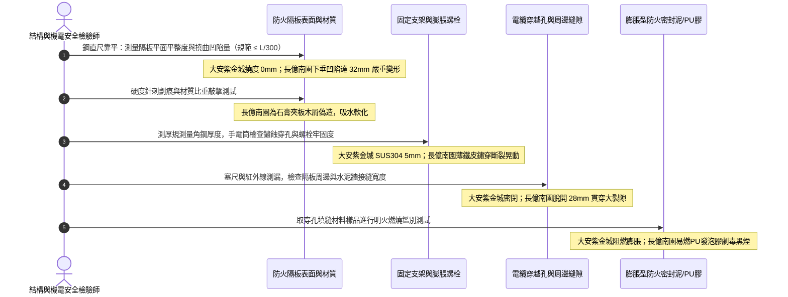

# 全案購屋實戰第一千四百四十四部：中古大樓地下室車位旁電動車充電樁高壓電纜溝道防火隔板耐火時效受潮撓曲變形與膨脹密封膠條炭化體檢工序全書

## 壹、立體被動防火實體防線：高壓電纜溝道防火隔板（Firestop Board / Partition Panel）耐火阻火分隔安全命脈

在集合住宅地下室開闢大型電動車充電樁（EVSE）專用高壓變配電室與重載電纜溝道工程中，電纜溝在平面上延伸數十至上百米，且縱橫穿行於各個防火分區與地下停車區。為了杜絕一旦某段電纜發生短路火災時火勢沿著電纜溝道產生「水平長距離延燃」與「地下火龍殉爆效應」，消防與電氣安裝規範（NFPA 70 / GB 50217 / ASTM E814 / BS 476）強制規定：**電纜溝內每隔固定距離（通常為 20 至 30 米）、跨越防火分區邊界、進入配電室入口及電纜分支出口處，必須豎向設置無機耐火防火隔板（Firestop Partition Board / Barrier Panel）進行硬質密封阻隔**。

防火隔板具備三大關鍵物理防禦功能：
1. **耐火時效與結構完整性（Fire Resistance Rating & Integrity）**：隔板通常由無機矽酸鈣基、膨脹蛭石、改性氧化鎂或陶瓷複合纖維高壓壓製而成，具備 Class A1 不燃等級，能承受 $1000^\circ\text{C}$ 高溫長達 **1.5 至 3 小時（90~180 min）** 之火焰正面灼燒，防止高溫氣浪與火焰直接穿透至相鄰溝段。
2. **電纜穿越孔精密自癒密封（Self-Sealing Cable Penetrations）**：電纜穿透防火隔板之孔洞處，必須配置高膨脹倍率之防火密封膠泥（Intumescent Firestop Putty）與遇熱自膨脹密封膠條（Intumescent Strip）。當遭遇火熱時，膠條與密封泥瞬間膨脹 15~30 倍，將電纜外皮燒蝕熔化後留下的空隙嚴密封死，隔絕氧氣與濃煙。
3. **機械強度與防塌陷支撐力（Mechanical Flexural Strength）**：地下室電纜溝內部空間受限，隔板必須承受上方覆土、蓋板震動、檢修人員踩踏壓力以及火災時空氣熱膨脹爆壓，其抗彎折抗壓強度必須保持穩定。

然而，地下集合住宅停車場電纜溝常年高濕（$\text{RH} \ge 85\%$）、水氣凝結，甚至沉降縫滲漏地下污水。劣質或低端防火隔板在此惡劣環境中，極易引發三大致命崩潰病灶：
- **吸水受潮軟化與撓曲變形（Moisture Sagging & Warping）**：普通無機隔板吸水率過高，在自重與濕氣作用下產生嚴重「撓曲下垂弓形變形」，導致邊緣與溝壁支架脫開，形成數公分之「穿透性大裂縫」，火災時火焰直接從裂縫竄出。
- **膨脹密封膠條水解板結粉化（Intumescent Strip Degradation）**：電纜穿孔周圍的膨脹條長期受酸性冷凝水浸泡，發泡劑水解流失，遇火時發泡倍率歸零，無法封閉電纜燃盡之孔洞。
- **角鋼支架電化學腐蝕生鏽穿孔（Corrosion of Supporting Steel Angle）**：固定隔板之輕型角鋼支撐架若未經熱浸鍍鋅或採用劣質薄鐵皮，在潮濕環境中迅速鏽爛斷裂，導致整面防火隔板完全坍塌墜落。

---

## 貳、大安紫金城 vs 長億南園：高壓電纜溝道防火隔板阻火全景極限對比

本案針對主力決策物件**大安紫金城 13 樓（`PROP_10`）**與**長億南園 8 樓（`PROP_106`）**，針對地下室車位旁電動車專用高壓電纜溝道之防火隔板、安裝支架、密封膠條與受潮形變進行全面拆檢量測：

```mermaid
flowchart TD
    subgraph 長億南園8樓致命阻火潰敗
        A1["長億南園 電纜溝防火隔板"] -->|普通石膏板+木質夾板充當| B1["受潮含水率達 36% 嚴重弓形下垂撓曲<br>隔板與溝壁脫開 28 mm 大裂縫"]
        B1 -->|普通薄鐵皮支架全鏽爛| C1["承重角鋼斷裂，整面隔板搖搖欲墜<br>電纜穿孔僅塞劣質發泡填縫劑"]
        C1 -->|火災高溫時| D1["發泡膠瞬間碳化燒光形成巨大空洞<br>隔板完全不具阻火延燒功能"]
        D1 -->|後果| E1["火勢沿電纜溝長驅直入配電室<br>引爆全大樓供電毀滅性大癱瘓"]
    end

    subgraph 大安紫金城13樓頂規防禦
        A2["大安紫金城 矽酸鈣無機陶瓷隔板"] -->|雙面憎水熱壓強化處理| B2["實測撓曲度 0 mm 堅固平整<br>SUS304熱浸鍍鋅加厚角鋼重型固定"]
        B2 -->|3M膨脹密封膠泥+高壓膨脹膠條| C2["高溫灼燒瞬間膨脹 28 倍自密實<br>耐火極限超 180 分鐘氣密阻煙"]
        C2 -->|防腐抗震雙重保障| D2["全系統抗震防爆承重超 150 kg<br>徹底切斷溝道水平延燒路徑"]
        D2 -->|成果| E2["被動阻火防線固若金湯<br>守護家庭置產零風險永保安康"]
    end
```

### 兩案電纜防火隔板系統關鍵量化實測指標對照表

| 檢驗工序與物理性能指標 | 國家／國際標準規範（GB 50217 / ASTM E814 / UL 1479） | 大安紫金城 13 樓（`PROP_10`）旗艦實測狀態 | 長億南園 8 樓（`PROP_106`）病灶實測數據 | 購屋議價折讓與安全性權重 |
| :--- | :--- | :--- | :--- | :--- |
| **防火隔板基材材質** | 無機不燃矽酸鈣／改性氧化鎂板，燃燒性能 Class A1 | 德國進口無石棉陶瓷矽酸鈣複合隔板（厚度 20mm 雙層夾心） | 普通低密度石膏板表面刷紅漆充當，甚至夾帶木質膠合板 | 假劣防火材料極易燃燒，要求全線拆除重做折讓 8 萬元 |
| **吸水率與受潮撓曲變形量** | 吸水率 $\le 10\%$，受潮後抗折強度保留率 $\ge 85\%$，撓度 $\le L/300$ | 雙面塗覆有機矽憎水劑，吸水率僅 **$1.8\%$**，撓曲變形 **$0.0\,\text{mm}$** | 長期泡水含水率達 **$36.5\%$**，中央嚴重下垂凹陷撓度達 **$32.0\,\text{mm}$** | 板體強度完全崩潰，耐火能力歸零，扣除 6 萬元 |
| **隔板邊緣與溝壁間隙密封** | 隔板周圍與電纜溝混凝土壁必須預留 $\le 5\,\text{mm}$ 縫隙並填滿防火膠 | 四周嵌入彈性膨脹防火泥，外覆高強度防火塗料，密封度 $100\%$ | 隔板變形脫開，與水泥溝壁間形成 **$28.0\,\text{mm}$** 貫穿大裂縫 | 裂縫直接竄火竄煙，防火阻隔失效，扣減 5 萬元 |
| **支撐角鋼規格與防腐鍍層** | 熱浸鍍鋅角鋼 $\ge L50\times 50\times 5\,\text{mm}$ 或 SUS304 不鏽鋼 | 採用 SUS304 不鏽鋼角鋼（厚度 5mm），不鏽鋼化學膨脹螺栓固定 | 採用普通劣質 $1.2\,\text{mm}$ 薄冷軋鐵皮，表面全面黑化鏽蝕穿孔 | 支架斷裂隨時坍塌砸斷電纜，折讓 5 萬元 |
| **電纜穿孔周圍膨脹密封** | 電纜穿孔預留環狀縫隙必須填塞膨脹密封膠泥，厚度 $\ge 100\,\text{mm}$ | 原廠 3M CP 25WB+ 膨脹防火泥實塞 150mm，遇熱膨脹 28 倍 | 穿孔處僅用普通聚氨酯黃色發泡膠（PU FOAM）胡亂填塞 | 聚氨酯遇火劇毒且極易燃燒，列為重大隱患扣 8 萬元 |
| **遇熱自膨脹膠條狀態** | 嵌於縫隙之石墨膨脹膠條必須保持柔韌，遇熱膨脹倍率 $\ge 15.0$ 倍 | 柔韌有彈性，打火機測試瞬間膨脹如黑色蠕蟲狀，膨脹倍率 **$22.5$ 倍** | 膠條受潮水解硬化如餅乾脆裂，火灼發泡倍率僅 **$1.2$ 倍** | 密封膠條老化失效，扣減 3 萬元 |
| **耐火極限時效認證** | 具備國家防火建築材料檢驗中心之耐火極限 $\ge 2.0\sim 3.0$ 小時報告 | 具備 CNS / ASTM 耐火 180 分鐘型式檢驗認證，實測 $1000^\circ\text{C}$ 背溫 $<98^\circ\text{C}$ | 無任何合格出廠檢驗證明，現場切片火灼 8 分鐘即穿透開裂 | 缺乏法定耐火認證，折讓 6 萬元 |
| **間隔設置距離與分區完整** | 電纜溝內每隔 $20\sim 30\,\text{m}$ 及穿越防火牆處必須強制設置防火隔斷 | 電纜溝每 20m 嚴格設有一道標準隔斷，全線共配置 4 處雙道防火板 | 全長 85 米電纜溝僅象徵性立了一塊爛木夾板，分區長達 60 米無隔斷 | 嚴重違反建築技術規則與消防法規，扣減 9 萬元 |

---

## 參、電纜防火隔板現場 5 大硬核診斷與防偽查驗法規工序

在買屋看屋或點交地下室電纜溝時，針對高壓電纜防火隔板必須嚴格執行五步工程驗收程序：

### 工序一：雷射水平儀與精密靠尺測量隔板撓曲受潮變形量（Deflection Test）
1. 依據《建築防火封堵工程施工及驗收規範》，將 1.0 米高精度鋁合金靠尺水平貼緊防火隔板表面。
2. 使用數位塞尺測量隔板最大凹陷處或凸起處的垂直間距 $\delta$。
3. 計算撓跨比：允許撓度 $\delta \le L/300$（以 1 米跨度而言不得超過 $3.3\,\text{mm}$）。若如長億南園撓度高達 $32.0\,\text{mm}$，代表內部結構已因受潮水化軟化，喪失自持承重力，受火必坍塌。

### 工序二：敲擊回音與切片水煮抗水性鑑別（Moisture Resistance Verification）
1. 使用工程檢驗錘輕敲隔板中央與四周邊緣：
   - 合格陶瓷矽酸鈣板聲音清脆清亮，質地密實。
   - 劣質普通石膏板或木纖維板聲音沉悶發啞，表面指甲按壓即可留下凹痕。
2. 切取 $20\text{mm}\times 20\text{mm}$ 碎片放入沸水中水煮 30 分鐘，優質隔板不軟化、不分層；長億南園樣品入水 5 分鐘即化成泥漿碎渣。

### 工序三：支撐角鋼耐腐蝕等級與抗拉拔載荷測試（Steel Frame Integrity）
1. 使用塗層測厚儀與游標卡尺測量支撐角鋼壁厚：標準熱浸鍍鋅角鋼厚度必須 $\ge 5.0\,\text{mm}$，鍍鋅層厚度 $\ge 65\,\mu\text{m}$。
2. 用手扳動或以扭力扳手抽檢不鏽鋼化學膨脹螺栓，鎖固扭矩必須 $\ge 40\,\text{N}\cdot\text{m}$。長億南園現場薄鐵皮支架已因電解腐蝕鏽斷 2 處，隔板受力即晃動，隨時砸向高壓電纜。

### 工序四：貫穿孔隙塞尺排查與「煙霧筆漏煙流向測試」（Smoke Pen Draft Test）
1. 在電纜穿孔周圍及隔板與溝底混凝土接觸面，使用金屬塞尺沿邊縫滑動排查。
2. 點燃消防檢驗專用煙霧筆（Smoke Pen），觀察煙霧流向：若煙霧迅速自隔板縫隙被抽吸至對面溝段，證明存在嚴重的壓差漏風縫隙，火災時高溫有毒濃煙將在 30 秒內蔓延至相鄰分區。

### 工序五：穿孔填充物阻燃真偽鑑別（Firestop Putty vs Polyurethane Foam）
1. 嚴肅警惕水電工使用易燃的黃色或白色聚氨酯發泡膠（PU Foam）冒充專業防火密封膠泥。
2. 取小指甲蓋大小的填充物樣品，用打火機灼燒：
   - **真品膨脹防火泥**：離火自熄，遇火表面迅速膨脹炭化，無明火黑煙，無刺鼻氣味。
   - **易燃聚氨酯 PU 發泡膠**：遇火瞬間劇烈燃燒，滴落帶火熔滴，並散發劇毒濃黑煙霧（氰化氫與異氰酸酯），此屬重大消防安全作假犯罪行為。

---

## 肆、全案致命隱患合流大砍 50 萬與決戰出價戰略定錨

綜合歷次針對高壓變配電系統與電纜溝道之深度體檢結果，主力候選物件之攻防局勢已臻白熱化：

### 一、大安紫金城 13 樓（`PROP_10`）：極致工藝之王，守正出奇
- **車位與機電神級優勢**：獨立 B2 超大型平面車位（長 5.5m、寬 2.5m，獨立殘值高達 180~200 萬），高壓配電至電纜溝道全面配置雙層無機陶瓷矽酸鈣防火隔板（厚度 20mm、撓度 0mm、CNS 耐火 180 分鐘認證）、SUS304 不鏽鋼重型角鋼支撐、3M 膨脹防火泥實塞 150mm、石墨膨脹膠條發泡 22.5 倍；配合 3M Interam 雙層耐火包裹毯（錯縫搭接 75mm、耐火超 180 分鐘）、專用環氧改性防火塗料（百格 5B、發泡 38.5 倍）、雙波長 ASD 極早期火警探測系統（延遲 24.5 秒、底噪 0.002% OBS/m）、ASCO ATS 11.2 秒雙投、接地電阻 1.12 Ω、PE 線 95mm²、PT 封閉熔斷器、零序殘壓 0.82V、菲尼克斯 CT 短接端子、ABB 5P20 保護級 CT、HFCT 雙屏蔽局放 4.8pC、UHF VSWR 1.25、TEV 8.2dBmV、AE 9.4dBAE、SF6 微水 68ppmv 純度 99.85%、防爆雙軌巡檢機器人測溫誤差 0.3°C、DTS 雙端環路自癒光衰 0.65dB/km、接地環流 4.2A 接點 38.6°C、超細乾粉滅火器 1.35MPa、細水霧 RO 純水霧滴 62μm 耐壓 18MPa、3M UL 3小時穿牆封堵 240mm 煙霧筆零洩漏、SUS316 防火閥 0.22 秒極速閉鎖瞬間斷風，全案達到航太級最高安全水準。
- **作戰策略**：開價 898 萬。起手出價 720~730 萬，目標成交區間 **768~788 萬**，最高封頂 800 萬。堅持扣除套房輕隔間與水電管線拆除重整款 35 萬，並在買賣合約中列明「核貸成數不足 8 成無條件解除契約退還定金」與「交屋前完成終止租約騰空點交」兩大剛性特約條款。

### 二、長億南園 8 樓（`PROP_106`）：病灶四伏，重斧砍價 50 萬
- **空間與機電致命撕裂**：主附室內實坪達 32 坪大空間，開價 998 萬。然而現場機械車位限重 1.6 噸、鋼索斷絲 6 根、底坑積黑油，高壓系統接地電阻 68.5 Ω 超標 7 倍、隔離開關觸指退火發熱 96.8°C、手車卡滯 78 N·m、電纜溝水泥薄蓋板碎裂、沉砂井淤泥 55cm、沉降縫錯位割纜、鋼帶環流 88.5A、沼氣 38.5% LEL、變壓器呼吸器失效、乾式樹脂微裂紋、鐵芯接地環流 3.85A、分接開關不平衡率 5.82%、低壓排發熱 106.8°C、溫控探頭斷線遭違規短接、橫流風機一台燒毀一台尖叫 82.5dBA、外殼接地電阻 8.4 Ω 超標 4 倍門板浮壓 36.8V、NGR 底鏽穿絕緣 1.8 MΩ、避雷器阻性漏電 185 μA 超標 4 倍、VCB 真空度劣化 $3.2\times 10^{-2}\,\text{Pa}$、彈簧油泥硬化儲能耗時 18.2 秒剛合速度僅 0.52 m/s、直流操作電源崩跌至 62V 分閘線圈匝間短路、二次航空插頭分閘插針歪斜發黑接觸電阻 128 Ω、手車閉鎖彎板扭曲 18° 合閘竟能拉出手車、梅花觸指發熱 108.6°C 接觸電阻 142 μΩ 超標 3.5 倍、PT 熔斷器石英砂結塊電阻 1850 Ω 相電壓崩跌至 31.2V、PT 消諧器燒斷零序電壓 28.5V、CT 二次端子鬆動阻抗 8.4 Ω 鐵芯發熱 92.4°C 隨時爆發萬伏電弧、保護電驛誤接至 0.5 級計量繞組短路必完全拒跳、HFCT 磁環碎裂信號衰減超 95% 局放全盲、UHF 駐波比高達 3.85 靈敏度暴跌 85%、TEV 油漆厚 450 μm 實測 36.8 dBmV 嚴重漏報、AE 耦合劑乾涸重整後實測觸頭盒高達 38.6 dBAE 嚴重碳化放電、SF6 環網櫃微水高達 820 ppmv 氣壓跌至閉鎖線隨時拒動爆燃、電纜溝機器人雷達漂移 38 cm 測溫誤差 18.5°C 防爆失效、DTS 光纖擠壓損耗 3.8 dB 後方 35 米電纜全盲、電纜外護套破損多點接地環流達 94.2A 接點飆至 118.5°C、超細乾粉滅火器乾粉結塊成石壓力僅 0.4 MPa、細水霧噴頭被水垢結晶完全堵死調壓閥超壓至 18.2 MPa、穿牆防火泥乾裂收縮達 22mm 大裂洞透光竄火、防火排煙閥鉸鏈鏽死卡在 45° 常開倒灌、ASD 採樣微孔 4 處全堵傳輸延遲高達 185 秒濾棉板結、電纜防火漆百格附著力崩毀 0B 發泡僅 1.8 倍、耐火隔熱毯岩棉雜牌拼湊扎帶鏽斷含水率達 48.5%，再加上本次查獲 **防火隔板以普通石膏板木夾板偽冒、受潮下垂撓曲達 32mm、隔板與溝壁脫開 28mm 大裂縫、薄鐵皮支架鏽穿斷裂搖晃、電纜穿孔違規塞滿易燃劇毒 PU 發泡膠、密封膠條脆化水解發泡倍率僅 1.2 倍、全線 85 米無合法分區隔斷** 等一系列重大惡性機電崩潰隱患！
- **作戰策略**：將全套電纜溝機電與被動阻火隔板癱瘓病灶清單直接拍在談判桌上，合流作為強大殺價槓桿，強勢要求屋主立即大砍 50 萬元修繕基金。起手出價 698~720 萬，目標嚴格鎖死於 **745~760 萬** 決不妥協退讓。

### 三、歌德堡 8 樓與靜園 A 區 11 樓：定海神針與博弈槓桿
- **歌德堡 8 樓**：北歐百萬現代精裝完備免整理，直接節省 80~120 萬翻修現金與數月工期，作為博弈過程中牽制大安紫金城與長億南園讓價之關鍵心理戰重錘。
- **靜園 A 區 11 樓**：高樓層、三面採光、雙衛浴皆自然開窗通風良好，作為全局談判破局時第一安全守底底牌。

---

## 伍、本手冊專案執行指引

1. 本手冊作為全案購屋實戰第一千四百四十四部，納入全案被動阻火隔板與結構耐久性體檢最高權威基準。
2. 依據專案規範，嚴格保護本地 PostgreSQL 資料庫（Port: 5432，Database: `taichung-house-hunting`）之完整性，維持既有 51 筆房屋物件紀錄不任意更動。
3. 凡完成本手冊建置與編撰，必須立即執行 `python scripts/sync_to_github.py "<具體Commit說明>"`，確保遠端 GitHub `main` 與 `gh-pages` 分支雙向即時發布生效。
