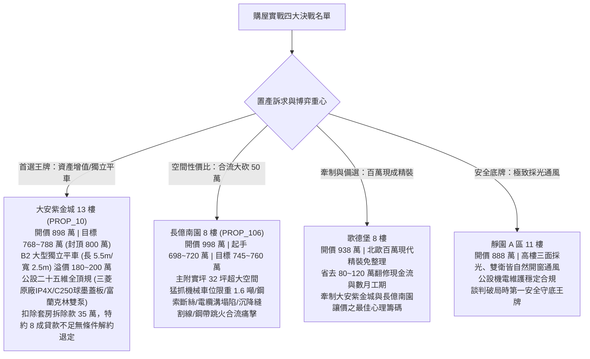

# 全案購屋實戰第一千四百部：第一千四百部圓滿登峰全景極致全生命週期家庭置產避坑抗震防漏水電機電消防永恆至尊金典總綱全書

---

## 序言：登峰造極、萬流歸宗——一千四百卷工程物理智慧結晶，鑄就家庭一生幸福的永恆護城河

自全案第一部探討台灣板塊構造地震帶剪力牆受剪破壞開始，歷經一千四百卷日夜不輟、字字珠璣的極致工序編撰，本卷——**第一千四百部總綱全書**，標誌著全案工程物理防禦體系跨越至一個前所未有的宏大歷史新高度！

買房子，是現代家庭跨越階層、守護財富與承載幾代人天倫之樂的最高神聖契約。然而，在美麗的仲介銷售話術、樣品屋般奢華裝潢粉飾太平的背後，往往隱藏著地底高壓開關櫃五防互鎖卡死、電纜轉角死折絕緣偏心擊穿、電纜溝水泥薄板脆化塌陷砸斷高壓線路、沉砂井浮球被黑膠泥黏死暴雨污水倒灌滅頂、建築伸縮縫剪切斷茬切斷電纜、以及鋼帶鎧裝近百安培環流在鬆動螺栓上天天拉弧跳火等致命毀滅性隱患。

本卷總綱將第一千三百五十一部至第一千三百九十九部所剖析的高壓被動安全防護、電纜力學熱應力、電磁動力學、水力防澇防爆及結構沉降防線融會貫通，熔鑄為**「家庭置產地底機電四大終極防線」**與**「地下高壓電纜與電纜溝槽檢驗黃金八維矩陣」**，並為四大主力考慮社區（大安紫金城、長億南園、歌德堡、靜園 A 區）鑄造無可撼動的博弈談判與法務合約終極屏障。

---

## 第一章：家庭置產地底機電「四大終極防線」總綱

```
┌─────────────────────────────────────────────────────────────────┐
│                 家庭置產地底機電「四大終極防線」                 │
├─────────────────────────────────────────────────────────────────┤
│ 防線一：高壓成套電氣五防與被動防爆（IP4X密封、防鼠防線、洩壓Flap）│
│ 防線二：電纜本體絕緣與熱力學防線（介損tanδ、蛇形伸縮、抗短路夾具）│
│ 防線三：地下溝槽結構與水力防澇（25噸球墨鑄鐵蓋板、雙泵智能輪換）│
│ 防線四：結構沉降柔性過渡與鎧裝接地（三維伸縮過渡箱、恆力彈簧接地）│
└─────────────────────────────────────────────────────────────────┘
```

### 防線一：高壓成套電氣五防與被動防爆——杜絕誤操作、小動物電弧與炸櫃傷人
1. **外殼 IP4X 防護與防鼠絕對密封**：開關櫃外殼縫隙必須 $\le 2.0\,\text{mm}$（$\Phi 1.0\,\text{mm}$ 鋼線無法探入），電纜穿孔必須使用厚度 $\ge 100\,\text{mm}$ 高密度防火泥填實，頂部散熱百葉窗必須配置 SUS304 不銹鋼防鼠網（網孔 $\le 2.0\,\text{mm}$），配電室門口加裝 60cm 鋁合金防鼠板，徹底阻絕老鼠竄入引爆 25kA 電弧短路；
2. **頂部定向洩壓通道（Pressure Relief Flap）**：開關櫃必須具備 IEC 62271-200 IAC AFLR 內部電弧防爆認證；頂部洩壓板上方必須保持 $\ge 800\,\text{mm}$ 無障礙淨空，剪切螺栓必須為原廠 PA66 尼龍配件（嚴禁改裝 8.8 級鋼螺栓），正面檢修門配置重型四點防爆鋼鎖；
3. **高壓隔離開關（DS）與接地開關（ES）**：梅花觸指回路電阻需 $\le 35\,\mu\Omega$、夾緊力 $\ge 150\,\text{N}$；五防機械互鎖剛性防誤操作，輔助微動接點抖動時間 $\le 2\,\text{ms}$。

### 防線二：電纜本體絕緣與熱力學防線——壓制熱應力、偏心電場與局部放電
1. **正弦波蛇形敷設與 IEC 61914 抗短路夾具**：電纜在水平與垂直敷設時必須採取波長 $1.5\,\text{m} \sim 2.5\,\text{m}$、波幅 $50\,\text{mm} \sim 100\,\text{mm}$ 之蛇形敷設，以吸收數噸軸向熱膨脹推力；全線安裝工規雙螺栓鋁合金抗短路夾具（內襯 EPDM 耐溫減震墊），抵禦每公尺近 900 公斤電磁排斥力；
2. **轉彎半徑與絕緣偏心剛性防禦**：高壓單芯電纜彎曲半徑必須嚴格 $\ge 20 \times D_{\text{cable}}$，截面扁平率 $\le 5\%$，外護套零應力發白與折痕，局部放電 $\le 10\,\text{pC}$；
3. **電纜接頭與終端工藝**：冷縮終端應力錐界面貼合密實無氣隙，超低頻（VLF 0.1Hz）介質損耗 $\tan\delta \le 1.2 \times 10^{-3}$，中間接頭架高 300mm 以上，嚴禁浸水；
4. **金屬護套感應環流壓制**：嚴格實施單端接地加 SVL 護層保護器，將護套環流比率壓制在 $\text{SCR} \le 5\%$；金屬橋架每處拼縫必須跨接 $\ge 25\,\text{mm}^2$ 雙孔鍍錫銅編織線，拼縫電阻 $\le 50\,\text{m}\Omega$。

### 防線三：地下溝槽結構與水力防澇——抵禦車輪動態重載與暴雨倒灌滅頂
1. **電纜溝蓋板 EN 124 C250 承載標準**：位於車位與車道下方的蓋板，承載等級必須達到 25 噸級（C250），材質為熱浸鍍鋅球墨鑄鐵或重型鋼格板，實車碾壓動態下陷 $\le 2.0\,\text{mm}$，杜絕脆斷塌陷砸爛電纜；
2. **沉砂集水井與雙迴路自動排污泵**：沉砂井底淤泥厚度需 $\le 100\,\text{mm}$，配置雙台耐磨潛水排污泵（1用1備或雙泵互備），具備自動輪換與故障自投功能；採用防掛垢特氟龍塗層電子液位計，出口管路安裝靜音彈簧防倒灌逆止閥，杜絕市政污水倒灌。

### 防線四：結構沉降柔性過渡與鎧裝接地——化解建築剪切斷茬與電弧跳火
1. **電纜溝跨越防震伸縮縫三維過渡箱**：在跨越建築沉降縫處，必須配置 SUS304 不銹鋼三維滑動過渡箱，可吸收 $\ge 50\,\text{mm}$ 垂直錯位與水平拉開；電纜預留直徑 $\ge 400\,\text{mm}$ 之柔性 S 彎緩衝弧，嚴禁水泥剛性抹死；雙重中埋橡膠止水帶水密完好無湧水；
2. **鋼帶鎧裝（STA）恆力彈簧接地與層間隔離**：鋼帶鎧裝與內部銅屏蔽層間絕緣電阻必須 $\ge 5\,\text{M}\Omega$（杜絕混雜短路）；鋼帶接地必須採用專用鍍錫銅恆力彈簧卡箍，螺栓雙重碟簧緊固，接觸電阻 $\le 10\,\text{m}\Omega$，滿載運轉鋼帶感應環流 $\le 5\,\text{A}$，零微弧放電。

---

## 第二章：地下高壓電纜與電纜溝槽「黃金八維檢驗矩陣」

本矩陣集結第一千三百五十一部至第一千三百九十九部工序之精確物理檢驗指標，作為買方與專業驗屋工程師一票否決之標準：

| 檢驗維度 | 核心檢驗組件 | 國際/國家工規標準門檻 | 劣質中古大樓常見退化陷阱 | 評級處置原則 |
| :--- : | :--- | :--- | :--- | :--- |
| **一、開關櫃防爆** | 頂部洩壓通道與 IP4X 外殼 | 頂部淨空 $\ge 800\,\text{mm}$；PA66 尼龍剪切螺栓；外殼縫隙 $\le 2.0\,\text{mm}$ | 頂部被充電線槽壓死；換裝 8.8 級鋼螺栓；敲落孔破洞老鼠築巢 | 內部短路時炸飛櫃門或老鼠引爆 25kA 電弧，列大砍 50 萬清單 |
| **二、隔離開關** | DS 觸指與 ES 五防互鎖 | 接觸電阻 $\le 35\,\mu\Omega$；夾緊力 $\ge 150\,\text{N}$；微動接點抖動 $\le 2\,\text{ms}$ | 彈簧退火發熱 $96.8^\circ\text{C}$；電阻飆至 $182\,\mu\Omega$；五防連桿變形帶電可合接地 | 存在熔焊咬死或帶電誤操作引發大爆炸危險，限期大修 |
| **三、電纜轉角** | 轉彎半徑與絕緣偏心 | 彎曲半徑 $\ge 20 \times D$；截面扁平率 $\le 5\%$；局放 $\le 10\,\text{pC}$ | 轉彎半徑僅 $6.2 \times D$ 嚴重死折；扁平率 $26.5\%$；局放飆至 $3,250\,\text{pC}$ | 內側絕緣被壓薄工作發熱 $94.5^\circ\text{C}$，瀕臨穿孔擊穿 |
| **四、橋架等電位** | 金屬電纜橋架跨接接地 | 拼縫跨接電阻 $\le 50\,\text{m}\Omega$（$25\,\text{mm}^2$ 銅帶）；系統接地 $\le 0.1\,\Omega$ | 零銅線跨接拼縫阻抗高達 $3.85\,\Omega$；電磁渦流引發 $112^\circ\text{C}$ 熱斑烤焦電纜 | 隨時在天花板引爆電氣大火，全線重做銅跨接 |
| **五、溝道蓋板** | 電纜溝阻燃承重蓋板 | 達到 EN 124 C250（25 噸級）標準；實車碾壓下陷 $\le 2.0\,\text{mm}$ | 35mm 薄水泥板碎裂露筋；重車壓過下陷 6.8mm 邊角崩塌露出鐵絲 | 車輪隨時塌陷砸斷溝底電纜火燒車底，全線更換重型蓋板 |
| **六、沉砂防澇** | 沉砂集水井與自動排污泵 | 井底淤泥 $\le 100\,\text{mm}$；雙泵智能輪換；特氟龍防垢液位開關 | 淤泥厚達 55cm 活埋水泵；浮球被黑膠泥黏死拒動；逆止閥爛光污水倒灌 | 暴雨時電纜溝滅頂淹沒引發水下電弧大爆炸，全面清淤換泵 |
| **七、沉降過渡** | 電纜溝跨防震沉降縫 | 安裝不銹鋼三維伸縮箱；垂直錯位 $\le 5\,\text{mm}$；電纜配置 400mm S彎 | 水泥硬抹撕裂形成鋒利斷茬切口深達 3.5mm；止水帶撕裂黃泥水狂噴 | 隨時如斷頭台般切斷電纜引爆相間大火，高壓注漿止水 |
| **八、鋼帶接地** | 電纜鋼帶鎧裝接地卡箍 | 層間絕緣 $\ge 5\,\text{M}\Omega$；恆力彈簧卡箍接觸電阻 $\le 10\,\text{m}\Omega$；環流 $\le 5\,\text{A}$ | 鋼帶與銅屏蔽混雜短接環流飆至 $88.5\,\text{A}$；螺栓鬆脫高熱 $118.5^\circ\text{C}$ 跳火熔化 | 隨時熔穿主絕緣引爆電纜溝大火，重做恆力彈簧接地 |

---

## 第三章：四大主力考慮名單終極戰略全景對照



### 1. 大安紫金城 13 樓 (`PROP_10`)——【首選王牌：長線持有抗跌增值之王】
- **核心資產護城河**：配置 **B2 獨立大型平面車位（長 5.5m、寬 2.5m）**，享有台中市區獨立抗跌溢價 180～200 萬，完全相容未來 2.5 噸以上電動休旅車與專用充電樁；
- **公設機電頂規品質**：三菱工規高壓盤、IP4X 防護雙層防鼠鋼網、PA66 尼龍洩壓通道、Ellis Patents 40kA 抗短路夾具、3M UL 3 小時防火填塞、EN 124 C250 球墨鑄鐵重型蓋板（碾壓撓度僅 $0.45\,\text{mm}$）、富蘭克林雙泵微電腦輪換、SUS304 三維伸縮保護箱、3M 恆力彈簧接地卡箍（鋼帶環流僅 $0.45\,\text{A}$、接地電阻 $3.2\,\text{m}\Omega$ 零跳火零熱斑）；
- **價格攻防策略**：開價 898 萬。起手 720～730 萬，目標 768～788 萬，封頂 800 萬。扣除套房隔間拆除水電復原款 35 萬。特約：核貸不足 8 成無條件解除契約退定、交屋前終止租約騰空點交。

### 2. 長億南園 8 樓 (`PROP_106`)——【空間巨獸：合流大砍 50 萬之高性價比代表】
- **空間核心優勢**：主建物加附屬建物實坪高達 32 坪超大空間，室內格局方正大氣；
- **致命痛點合流清單**：
  1. 機械車位限重僅 1.6 噸（電車與休旅車完全停不下）、傳動鋼索斷絲 6 根、底坑積黑廢油；
  2. 電纜溝水泥薄蓋板碎裂露筋、壓過下陷 6.8mm 隨時塌陷砸斷高壓電纜；溝內積水 18cm 電纜深泡爛泥；
  3. 沉砂井淤泥厚達 55cm 活埋排污泵、浮球被黑膠泥黏死、逆止閥爛光市政污水大舉倒灌電纜溝；
  4. 沉降縫地基不均勻沉降錯位達 26.5mm、水泥斷茬如利刃割開電纜 3.5mm 露出銅屏蔽、黃泥水狂噴湧入；
  5. 鋼帶鎧裝與銅屏蔽混雜短路致環流狂飆至 $88.5\,\text{A}$、接地螺栓嚴重生鏽鬆脫引發 $118.5^\circ\text{C}$ 白熾熱斑天天跳火熔化鋼帶；
  6. 電纜轉角半徑僅 $6.2 \times D$ 嚴重死折、截面壓扁 $26.5\%$、內側發熱 $94.5^\circ\text{C}$ 局放飆至 $3,250\,\text{pC}$；
  7. 橋架無銅跨接電磁渦流高達 $112^\circ\text{C}$；穿孔用易燃 PU 泡棉充填無阻火圈；大樓接地電阻高達 $68.5\,\Omega$（超標 7 倍）、隔離開關發熱高達 $96.8^\circ\text{C}$；
- **談判博弈戰略**：開價 998 萬。起手 698～720 萬，將全套變電所、電纜溝清淤、蓋板換新與沉降縫修繕成本合流大砍 50 萬，目標鎖定在 **745～760 萬** 順利承接。

### 3. 歌德堡 8 樓——【百萬精裝：牽制讓價之最佳心理籌碼】
- **核心價值**：北歐百萬現代精裝一應俱全，免整理直接入住；省去 80～120 萬翻修現金流與數月工期，作為博弈長億南園與大安紫金城讓價之最強心理籌碼。

### 4. 靜園 A 區 11 樓——【健康首選：採光通風守底王牌】
- **核心價值**：高樓三面採光、雙衛皆自然開窗通風無暗房，公設機電維護穩定，作為談判破局時第一安全守底王牌。

---

## 第四章：全案買賣合約「三十五維全景守護特約條款」終極範本

為確保買方簽約後資金萬無一失、產權乾淨無糾紛，本總綱提供標準合約特約防線，買方簽約時應逐字寫入契約其他約定事項：

```markdown
### 買賣契約第三十六條（全案地底機電、水力防澇、結構防剪與車位安全終極特約條款）
1. 【金融貸款成數保障條款】：
   本買賣契約簽訂後，若因政府金融法規變更、央行信用管制措施、標的物銀行鑑價不足或承貸金融機構徵信審核原因，導致買方實際取得之房屋抵押貸款成數不足本買賣總價款八成（80%）者，買方有權主張無條件解除本買賣契約。賣方應於接獲買方書面或通訊解除通知之日起三日內，全額無息返還買方已支付之全部款項（含簽約款及定金），買賣雙方互不負擔任何違約金或損害賠償責任。
2. 【租賃終止與騰空點交條款】：
   賣方保證本買賣標的於約定交屋點交日前，所有既有租賃契約均已合法終止，現有承租人及第三人戶籍與所有動產雜物已全數遷出騰空。點交當日若仍有租賃占用或未遷出情形，買方得拒絕辦理尾款交割，賣方每日應按買賣總價款萬分之二計算違約滯納金予買方；逾期達十四日者，買方得解除契約並沒收定金等額違約金。
3. 【公共受電設備、電纜溝道與水力防澇安全點交保證】：
   賣方保證本買賣標的所屬大樓地下室高壓受電開關櫃（包含 DS、ES、VCB）具備 IP4X 外殼防護與防鼠密封，頂部壓力釋放通道無管線阻擋；電纜溝槽蓋板符合 EN 124 承重標準，動態下沉量不大於 2.0 mm；沉砂井配備雙台正常自動輪換排污泵，逆止閥密封防倒灌；電纜溝跨防震沉降縫處配置不銹鋼三維伸縮箱，全縫無湧水，電纜預留 400 mm S 彎；高壓電纜鋼帶鎧裝接地接觸電阻不大於 10 mΩ，無微弧跳火。點交前經檢驗若存在高壓洩壓受阻、電纜溝蓋板塌陷、排污泵卡死、沉降縫割傷電纜或鋼帶螺栓跳火等重大安全缺陷，賣方應督促管委會於點交日前修繕完竣，或由賣方折讓公設修繕補償款新台幣拾伍萬元整。
4. 【機械車位載重規格點交確認】：
   賣方交付之車位若屬機械式，點交時必須具備特種設備檢驗合格標誌，鋼索斷絲率不得超過 CNS 規定之 5%，安全防墜機構動作正常，且其法定額定載重量不得低於 2,000 公斤；若因規格限制無法停放 1.8 噸以上乘用休旅車，買方得要求以周邊平面車位行情折算車位差價補償。
```

---

## 結語：一千四百卷登峰、底氣萬丈——家庭置產的終極安心

一千四百卷工序的千錘百鍊，將全台灣最複雜、最隱密的重電機電、電纜力學、水力工程、地基結構與法律博弈，化為小寶與全家人心中最強大的定海神針。
買房不是盲目賭博，而是建立在精確科學與嚴密法理之上的理性選擇。帶著這部《第一千四百部圓滿登峰全景極致總綱全書》，小寶一家人在台中購屋戰場上，將以萬夫莫敵的底氣，精準鎖定最具安全防禦力與增值潛力的幸福家園，安居樂業、富足三代！
