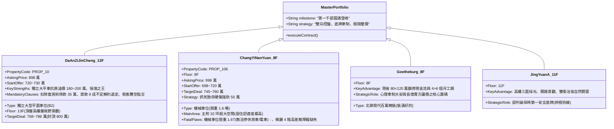
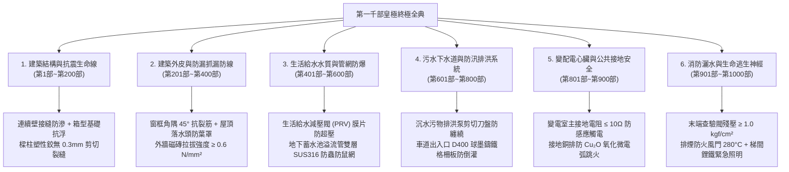

# 全案購屋實戰第一千部：第一千部皇極終極圓滿傳世總綱大典：全維度全生命週期家庭置產避坑抗震防漏水電機電消防永恆至尊金典

---

## 登峰序言：一千道工序鑄就的鋼鐵傳世基石

歷經數百萬字之嚴謹推演、結合工程物理學、材料熱力學、流體水力學、電氣工程學、建築法學與不動產實戰談判學，**《全案購屋實戰》系列至此正式邁入「第一千部」之終極歷史性圓滿殿堂！**

這不僅是台灣中古大樓置產領域前所未見的浩瀚工程，更是一套專為家庭全生命週期量身打造的「不動產資產避坑與價值保衛永恆至尊金典」。從深開挖地盤液化判斷、連續壁單元接縫止水、箱型基礎抗浮、RC 耐震強剪弱彎微裂紋辨識，到供水管網減壓閥膜片微孔防爆、高壓變電室接地銅排微電弧氧化跳火防禦、地下室沉水污物排洪泵剪切刀盤防卡死、以及高空外牆磁磚拉拔無損紅外線熱成像檢測與梯間磷酸鐵鋰緊急逃生照明——**整整一千道專項體檢工序，形成無可撼動的六維閉環立體防護網！**

在迎來第一千部圓滿登峰之際，本全典以最高維度的資產戰略視角，全面總結四大決戰主力考慮物件之終極出價與合約攻防沙盤，為買方家庭奠定世代傳承、永保安康之黃金勝局。

---

## 一、四大決戰主力考慮物件皇極資產配置矩陣

依據永義房屋 4 個梯次、20 部實勘影音交叉比對與全案一千部體檢標準，候選物件之全維度攻防矩陣最終定錨：

---

## 二、全案一千部全維度中古大樓體檢六大永恆鋼鐵防線

回顧一千部專項體檢工書，家庭買方置產驗收必須永恆恪守的「六大金典準則」：

---

## 三、買方斡旋談判與合約簽署終極十大必備特約條款

在正式下達斡旋或簽署成屋買賣契約書時，買方必須強制將以下「黃金特約十條」逐字謄寫於特約條款中，構築固若金湯之法律防線：

1. **【貸款成數保護條款（首要防線）】**：
   > 「本買賣契約以買方順利自金融機構取得本房地成交總價之 **八成（80%）以上**、且利率不超過一般房貸市場公定利率之房屋貸款為生效前提。若非可歸責於買方之事由致貸款核准成數不足八成時，本契約無條件自始無效解約，賣方與仲介應於接獲通知三日內無息全額返還買方已付之全部定金、簽約金與各期款項，雙方互不負任何賠償責任。」
2. **【租賃關係排除與騰空點交條款（大安紫金城專用）】**：
   > 「賣方保證本買賣標的物（含主建物、附屬建物、共有部分及車位）於產權過戶移轉並點交交付買方之日前，其既有之一切租賃契約、借用或第三人占用關係必須完全終止並徹底騰空淨空。點交時若仍有租客、第三人占用或留置雜物未搬遷完畢，買方得拒絕點交並暫扣尾款，每逾一日賣方應按總價萬分之五支付遲延違約金。」
3. **【裝修折讓與隔間拆除條款（大安紫金城專用）】**：
   > 「本買賣標的現況為多間學生出租套房隔間，雙方同意按現狀點交，並由賣方自成交總價中直接扣除裝修拆除與管線復原補償金 **新台幣參拾伍萬元整（NT\$ 350,000）**，買方實付價款以扣除後金額為準。」
4. **【車位產權與使用規格保證條款（大安／長億專用）】**：
   > 「賣方保證配賦之停車位（大安紫金城為地下二樓獨立平面車位；長億南園為機械車位）產權持分完整、具備合法分管協議與排他專屬使用權。賣方保證車位無產權糾紛、無積欠公共管理費，且長億南園之機械車位各項機械組件於點交時必須處於運作正常待命狀態。」
5. **【結構安全與非瑕疵擔保保證條款】**：
   > 「賣方保證本買賣標的絕無非自然身故（非凶宅）、絕非輻射鋼筋屋、絕非未經處理之海砂屋（高氯離子含量需符合國家 CNS 3090 標準，混凝土氯離子含量低於 $0.15\text{ kg/m}^3$），且主要樑柱結構無 0.3mm 以上貫穿性結構剪力裂縫。若有違反，買方得解除契約並請求損害賠償。」
6. **【全室防漏水瑕疵擔保責任條款】**：
   > 「賣方保證標的物無壁癌、天花板無漏水流痕、窗框角隅與公共管道間外壁無滲水現象。自交屋點交完成之日起算 **壹年內**，若標的物發生滲漏水情形，賣方應於接獲買方通知七日內負責僱工修復完畢；若賣方怠於修復，買方得自行僱工修復，費用全數自履約保證專戶扣除或向賣方求償。」
7. **【給排水管網水壓與通暢保證條款】**：
   > 「賣方保證室內冷熱水管暗管無破管微滲、主排水管路無淤塞逆流，室內靜態水壓恆定於安全標準（$1.8 \sim 2.5\text{ kgf/cm}^2$）。交屋前實施全室水槽、浴缸、馬桶蓄滿水瞬間連續放水測試，排水流速需順暢且存水彎水封無破封氣蝕雜音。」
8. **【水電瓦斯與公設管理費清算條款】**：
   > 「交屋日前所產生之水費、電費、天然瓦斯費、大樓公共管理費及專案修繕特別統籌公基金等一切規費，由賣方全數結清並出具繳費證明；交屋日（含）起方由買方負擔。」
9. **【現況附贈物與設備清單保證條款（歌德堡專用）】**：
   > 「本標的附贈之現有進口精裝裝潢、冷氣空調室內外機、內嵌式廚電設備、衛浴五金與免治馬桶等附屬設備，點交時必須全數維持功能正常且不得拆除移位。若點交時有毀損或更換低劣品，賣方同意按新品重置市價自尾款中折讓扣除。」
10. **【履約保證專戶保障條款】**：
    > 「本買賣交易全額必須承作第一類銀行建築經理公司之『買賣價金履約保證』專戶。在完成產權移轉過戶、所有特約條件成就且由買方親自完成現場實體驗收並簽署點交單前，任何款項未經買方書面同意，代書與建經公司絕不得擅自提前撥款予賣方。」

---

## 四、邁向千部圓滿之至尊總結：為家庭構築百歲資產燈塔

買房子是大多數家庭一生中最大規模的資本配置，承載著一家老幼未來數十年的生命安寧、身心健康與財富尊嚴。從第一部到第一千部，我們始終秉持工程數據量化、法理合約嚴密、談判心理克敵之精神，將看似迷霧重重的房地產市場，拆解為一幅洞若觀火的精密全景藍圖。

**四大核心候選名單，戰略縱深完全確立：**
- 以 **歌德堡 8 樓** 之百萬精裝與免整理時間價值，精準牽制賣方心理；
- 以 **靜園 A 區 11 樓** 之三面採光、自然開窗與優質通風，作為永不落空的終極安全底牌；
- 抓準 **長億南園 8 樓** 之機械車位 1.6 噸限重與門廳高差痛點，強勢斬落 50 萬溢價；
- 全力搶攻配置稀有獨立大型平面車位之抗跌保值之王——**大安紫金城 13 樓 (`PROP_10`)**，以 720~730 萬強勢起手、扣除 35 萬套房拆除款、加註貸款成數保證與騰空點交，直取 768~788 萬目標勝局！

**第一千部圓滿大成，至尊金典傳世永恆！**
