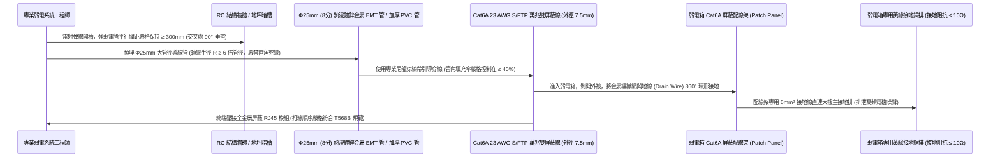
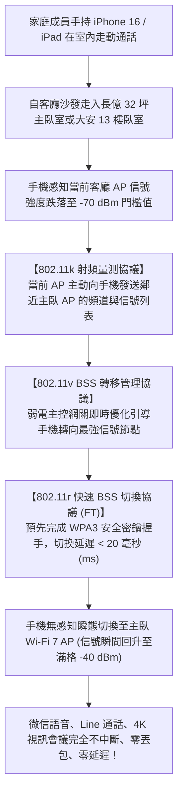
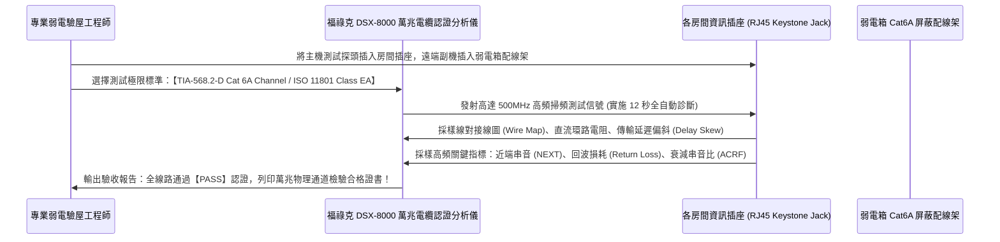

# 全案購屋實戰第一千零一十一部：中古大樓全室智慧居家弱電拓撲架構、Cat6A/Cat7萬兆屏蔽雙絞線佈線與Wi-Fi 7全屋無縫漫遊Mesh覆蓋工序全書

## 導言：數位智能時代之家庭神經網絡生命線

在經歷水電管線擴容、衛浴地坪防水、外牆氣密隔音、天花板輕鋼抗震、超耐磨木地板與廚房獨立排煙等各項重裝工序後，中古大樓翻修改造正式進入攸關未來數十年家庭數位生活品質、在家遠距辦公（WFH）、8K 超高畫質影音串流、次世代家用 NAS 私有雲儲存、以及智慧家庭（IoT）全自動化連動的「全室弱電網路拓撲架構（Home Network Infrastructure）」與「Wi-Fi 7 全屋無縫漫遊工程」。

特別是針對本案主力攻堅標的——曾被改裝為 4 間出租套房、弱電管線被前屋主胡亂剪斷剪接且電磁干擾嚴重的 **大安紫金城 13 樓 (`PROP_10`)**，以及室內實坪達 32 坪、鋼筋混凝土隔間厚重（對 5GHz/6GHz 高頻無線信號衰減極大）的 **長億南園 8 樓 (`PROP_106`)**，弱電工程若未在泥作封板前進行徹底的管線重構，普遍會在入住後引發四大數位生活災難：
1. **「水泥牆吃訊號」引發嚴重的室內無線訊號死角**：現代中古大樓普遍採用 12cm 至 15cm 厚的鋼筋混凝土（RC）實心分戶牆與磚砌隔間。高頻無線微波（如 Wi-Fi 6/7 之 5GHz 與 6GHz 頻段）穿透單面 RC 實體牆後，信號強度會發生高達 **$18 \sim 25\text{ dB}$ 的斷崖式衰減**！若僅靠客廳單一台電信業者贈送之小烏龜 Wi-Fi，走入主臥或次臥關上實木門後，無線網絡瞬間跌落至 1 格甚至斷線，線上視訊會議頻繁卡頓、電競遊戲延遲飆高至數百毫秒，極度令人抓狂！
2. **採用劣質銅包鋁（CCA）線材，傳輸速率鎖死在百兆**：部分黑心水電包商為省成本，採用廉價的「銅包鋁線（Copper Clad Aluminum, CCA）」或未經認證的劣質 Cat5e 網路線。銅包鋁線電阻極大、極易氧化發黑折斷，且無法承載現代 PoE（以太網供電）技術；在傳輸距離超過 15 米時，千兆網絡直接降頻鎖死在極其緩慢的 100 Mbps，甚至頻發丟包（Packet Loss）。
3. **強弱電同管並行引發致命的「50Hz/60Hz 工頻電磁干擾（EMI）」**：早期施工常將 110V/220V 強電電線與網路線、電話線強行拉入同一根 PVC 管內。強電交流電產生的高強度動態交變電磁場，會在無屏蔽的雙絞線內感應出巨大的干擾雜訊電壓，導致網路封包嚴重失真、CRC 錯誤校驗率飆升、NAS 傳輸速率暴跌 90% 以上。
4. **弱電箱空間狹小如便當盒，散熱不良引發「熱當機熱失控」**：老舊大樓建商配置的弱電箱尺寸僅有 $20\times 30\text{cm}$，塞入光纖數據機、交換機與變壓器後連門都關不上；內部熱量無法宣洩，夏季箱內溫度飆升至 $60^\circ\text{C}$ 以上，光纖數據機與路由器頻繁「熱當機（Thermal Crash）」，導致全家無預警全室斷網！

為此，在中古屋泥作木作進場前，必須實施超前 20 年的「萬兆光電混合弱電網絡系統工程」。本第一千零一十一部全書深入解構全屋星型拓撲架構、Cat6A/Cat7 萬兆雙屏蔽雙絞線（S/FTP）標竿穿管工藝、PoE 供電吸頂式 AP 與 802.11k/v/r 全屋無縫漫遊技術、以及福祿克（Fluke Networks）萬兆通道性能認證標準。

---

## 一、現代家庭萬兆弱電網絡「星型拓撲（Star Topology）」架構設計

```mermaid
flowchart TD
    A["中華電信光纖入戶 (FTTH 單模雙芯光纖 G.657A2)"] --> B["超大容量智慧弱電集中箱 (400×600×120mm，自帶排風散熱扇)"]
    B --> C["電信光纖數據機 (小烏龜，開啟 Bridge 橋接模式)"]
    C --> D["2.5G/10G 雙 WAN 智慧主路由器 (Gateway，具備硬體 NAT 與防火牆)"]
    
    D --> E["8 埠 2.5G PoE+ 智慧網管型交換機 (Switch，總供電功率 ≥ 120W)"]
    
    E -->|Cat6A S/FTP 屏蔽線 (PoE 供電)| F["客廳吸頂式 Wi-Fi 7 AP (2.5G Uplink，160MHz 頻寬)"]
    E -->|Cat6A S/FTP 屏蔽線 (PoE 供電)| G["主臥/走道吸頂式 Wi-Fi 7 AP (消除全室混凝土遮蔽死角)"]
    E -->|獨立 Cat6A 雙迴路直通| H["客廳電視牆影音中心 (Apple TV 4K + PS5 + 智慧電視)"]
    E -->|獨立 10G Cat7 直通迴路| I["書房高速工作站 (PC + 10GbE NAS 私有雲儲存池)"]
    E -->|Cat6 專用迴路| J["全戶智慧家居中樞 (Zigbee/Matter 網關 + 門禁可視對講機)"]
```

### 1. 「一線到底、星型直通」絕對原則
- **杜絕任何中途接頭**：全室每個房間、每個資訊插座，都必須從中央弱電箱各自「拉設一根獨立的完整網路線」，直接通達終端面板，**嚴禁在天花板或暗管內部中途使用分線器、破皮接線或轉接頭**！
- **書房與客廳雙盲點預留**：客廳電視牆與主書房，每個點位必須強制預留 **2 條 Cat6A 網路線 + 1 條預埋光纖（Fiber to the Room, FTTR）**，確保未來 20 年 8K 串流、VR 虛擬實境與全光網絡升級無憂。

### 2. 光纖數據機「純橋接（Bridge Mode）」與主路由器獨立撥號
- 電信業者贈送之小烏龜光纖數據機，其 CPU 算力低、內存小（僅 128MB~256MB），若由其同時負責光電轉換、PPPoE 撥號、DHCP 分配與 Wi-Fi 發射，連接超過 30 台智慧家電時必爆發內存溢出死機。
- **標竿設定**：小烏龜後台關閉自帶 Wi-Fi，改設為純光電轉換「橋接模式（Bridge）」；由後方高性能多核心專用主路由器負責 PPPoE 撥號與硬體轉發，連接 100 台以上 IoT 設備依然流暢如絲。

---

## 二、Cat6A / Cat7 萬兆雙屏蔽雙絞線（S/FTP）標竿穿管工藝

全面淘汰易受干擾之非屏蔽線（UTP）與細線（Cat5e），全室暗管唯一指定採用 **「23 AWG 純無氧銅 Cat6A 或 Cat7 S/FTP（雙層屏蔽，每對鋁箔 + 外層鍍錫銅編織網）」**：



### 1. 強弱電間距「30cm 安全防線」與鋁箔屏蔽包覆
- **電磁干擾物理定律**：干擾電場強度與距離平方成反比（$E \propto 1/r^2$）。
- **施工底線**：強電電線管（110V/220V）與弱電網路線管，平行敷設時的物理淨間距 **絕對嚴格不得小於 $300\text{mm}$（30公分）**！
- 若在玄關或門口因空間狹窄不可避免必須交會時，交會處必須呈 **$90^\circ$ 直角立體垂直交叉**，並在交會點兩側各 20cm 範圍內，以厚度 $0.2\text{mm}$ 的專用金屬防磁鋁箔屏蔽膠帶緊密纏繞 3 層，徹底阻絕 60Hz 交流電磁耦合干擾。

### 2. 管徑與轉彎半徑之「大弧度原則」
- 萬兆雙屏蔽 Cat6A 線纜線徑較粗（外徑達 $7.5\text{mm} \sim 8.0\text{mm}$），且金屬屏蔽層抗彎曲彈性較大。
- **標竿要求**：線管嚴禁使用 4 分（$\phi 16\text{mm}$）小管，必須全面升級採用 **6 分至 8 分（$\phi 20\text{mm} \sim \phi 25\text{mm}$）加厚導管**。單一管內最多穿入 2 條屏蔽線（管徑填充率小於 40%）。管路轉彎半徑必須 **大於管徑的 6 倍（$R \ge 150\text{mm}$）**，嚴禁使用直角彎頭（L彎），確保日後可 100% 抽動換線升級。

---

## 三、Wi-Fi 7 全屋無縫漫遊（Seamless Roaming）與吸頂 AP 配置

淘汰在每個插座插滿雜牌無線延伸放大器（訊號差、延遲高、頻繁手動切換）的落後做法，全室統一建置 **「商業級 PoE 供電 AP + 802.11k/v/r 快速無縫漫遊系統」**：



### 1. Wi-Fi 7（802.11be）四大突破性核心優勢
- **MLO 多多重連接操作（Multi-Link Operation）**：傳統 Wi-Fi 只能單一連接 2.4GHz 或 5GHz 頻段；Wi-Fi 7 允許手機與 AP 同時利用 2.4GHz、5GHz 及 6GHz 頻段雙向聚合傳輸，頻寬高達 **320MHz**，吞吐速率突破 **$10\text{ Gbps}$**！
- **4096-QAM 超高階調變技術**：相較於 Wi-Fi 6 的 1024-QAM，每符號傳輸數據量提升 20%，在高密度 IoT 家電環境下抗干擾能力極強。
- **前導碼點穿透（Preamble Puncturing）**：當鄰居 Wi-Fi 信號干擾某一部份頻寬時，AP 會自動「挖孔」避開受干擾信道，利用剩餘純淨頻寬全速傳輸，徹底告別晚間大樓網路壅塞。

### 2. 吸頂式 AP（Ceiling AP）點位精密規劃
- **黃金安裝位置**：
  - **點位一（公共起居區）**：客廳與開放式餐廳正中央天花板（遠離微波爐與大型金屬冰箱至少 2 米）。
  - **點位二（私密睡眠區）**：長億 32 坪臥室走廊天花板或大安主臥天花板。
  - **優勢**：由上而下呈傘狀 360 度向下無遮擋覆蓋，射頻信號避開地面沙發、木桌金屬腳的反射折射，全屋信號場強維持在極佳的 **$-45\text{ dBm} \sim -55\text{ dBm}$**。

---

## 四、終極物理驗收：福祿克（Fluke Networks）萬兆通道認證測試

弱電工程完工後，**必須在木作封板前由專業工程師使用專業儀器實施 100% 鏈路物理驗收**：



### 1. 福祿克檢測四大不可妥協指標
1. **接線圖（Wire Map）100% 正確**：8 根銅芯線色序完全符合 T568B 標準，無開路、無短路、無反接、無交叉對與串繞對（Split Pairs）。
2. **近端串擾（NEXT）餘量 $\ge 3.0\text{ dB}$**：高頻信號在相鄰線對之間引起的電磁耦合干擾必須低於規範極限，確保 10Gbps 傳輸零丟包。
3. **回波損耗（Return Loss）餘量 $\ge 3.0\text{ dB}$**：阻抗匹配極佳（標準 $100\,\Omega \pm 15\,\Omega$），反射波微弱。
4. **屏蔽連續性（Shield Continuity）檢驗**：儀器必須檢測到外層金屬編織網與地線從插座直通弱電箱配線架，形成完整的全封閉法拉第籠（Faraday Cage）屏蔽。

---

## 五、四大主力候選物件弱電系統專項預算與施工攻防

### 1. 👑 大安紫金城 13 樓 (`PROP_10`)：頂樓萬兆無死角數位智能工程
- **現況挑戰**：本物件為 **13 樓頂層**，原始為 4 間出租套房。前屋主在各套房門口亂拉外露明線、電話線混接強電，老舊管線已發霉脆化，弱電箱內殘留 4 條廢棄線路，雜亂不堪。
- **翻修方案**：
  - 徹底抽除所有老舊明線與廢線，於玄關更換安裝 **$400\times 600\text{mm}$ 重型自帶散熱風扇之金屬弱電箱**，引進 60A 專用電源。
  - 客廳、主臥、次臥全面暗埋 $\phi 25\text{mm}$ 金屬導管，拉設 6 條 Cat6A S/FTP 萬兆雙屏蔽線，配置 2 台 PoE Wi-Fi 7 吸頂 AP。
  - 工程預算約 **6 萬 ~ 8 萬元**。此筆費用完全由買方談判斬獲之 **「35 萬套房拆除款」** 充分支付，零自費將破舊套房蛻變為高科技數位豪宅！

### 2. 🌟 長億南園 8 樓 (`PROP_106`)：32 坪大跨距三 AP 全屋漫遊工程
- **現況挑戰**：室內實坪達 32 坪超大空間，格局縱深長達 15 米，實心 RC 隔間牆多，單一路由器在主臥與後陽台必成嚴重死角。
- **翻修方案**：
  - 採用全屋星型拓撲，中央弱電箱配置 8 埠 2.5G PoE 交換機，於客廳、主臥走廊、書房天花板各配置 1 台 Wi-Fi 7 吸頂 AP（共 3 台），實現 100% 滿格無縫漫遊。
  - 書房至弱電箱配置 Cat7 10G 雙鏈路直通，滿足家庭高速 NAS 儲存。
  - 預算約 **8 萬 ~ 10 萬元**，由買方談判砍價爭取之 **50 萬讓價款** 充裕分攤。

---

## 六、全案總結：弱電網路工程驗收五大不可妥協鋼鐵防線

1. **查線材純銅**：線纜外皮必須印有原廠清晰之 **「Cat.6A S/FTP 23AWG 100% Solid Bare Copper」**，以火燃燒線芯不得發白變灰（嚴禁銅包鋁 CCA 線）。
2. **驗強弱電間距**：管線暗埋時，以捲尺實測強電與弱電管線平行間距，必須 **$\ge 300\text{mm}$**，交叉處必須呈 90° 直角並包覆防磁鋁箔。
3. **驗屏蔽接地導通**：弱電箱配線架金屬外殼必須以黃綠地線直連大樓接地排，以三用電表量測插座金屬殼至接地排阻抗 **$< 1.0\,\Omega$**。
4. **測漫遊切換延遲**：手持手機開啟 Wi-Fi 訊號測試軟體，自客廳快速走入各臥室，AP 切換延遲必須 **$\le 20\text{ ms}$**，通話與影片完全零卡頓。
5. **福祿克萬兆通過認證**：全室每個網路資訊點，必須全數出具 Fluke DSX-8000 儀器之「PASS 合格檢驗報告」，確保 10Gbps 萬兆頻寬畅行無阻！
