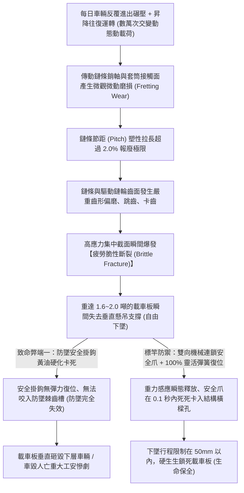
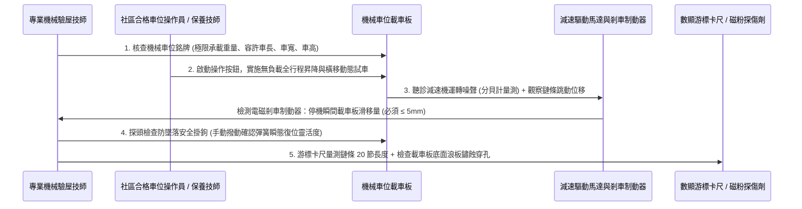

# 全案購屋實戰第一千零一十七部：中古大樓社區地下室機械停車設備鏈條鋼索金屬疲勞磨損極限開關失靈與防墜落安全裝置體檢工序全書

## 導言：機械立體車庫之重力陷阱與機械安全極限防線

在台灣都會區地狹人稠的客觀環境下，1990 年代至 2010 年代興建的集合住宅中古大樓，為符合法規法定停車位配比要求，大量在地下室採用了「機械式立體停車設備（Mechanical Parking Lift System，包含二層昇降橫移式、二層昇降式與地下坑式等）」。

然而，隨著大樓屋齡跨越 15 年至 30 年以上，整座機械車位系統處於長年高頻往復昇降、重載車輛反覆碾壓衝擊、以及地下室潮濕水氣與地盤微沉降的極限嚴酷工作環境下。特別是針對本案四大決戰主力考慮物件之一——室內實坪達 32 坪大空間，但**配賦機械車位（且銘牌嚴格限重 1.6 噸）的 長億南園 8 樓 (`PROP_106`)**，機械車位若缺乏專業嚴謹的保養維護，普遍存在四大隨時可能引發車毀人亡的致命隱蔽陷阱：
1. **起升雙排滾子鏈條（Roller Chain）或鋼索金屬疲勞斷裂**：承載重達數噸載車板的起重鏈條或高碳鋼鍍鋅鋼索，在數萬次交變拉伸彎曲應力下，鏈板銷軸發生微觀微動磨損（Fretting Wear），節距伸長超標；或鋼索內部麻芯潤滑脂乾涸、鋼絲表面發生疲勞斷絲。一旦在車輛停放或昇降途中鏈條突發脆性斷裂，數噸重的上層載車板將在重力加速度下如同斷頭台般瞬間「自由落體砸落」，直接將下層車輛壓成鐵餅，若車內有人更將當場被壓成肉醬！
2. **行程極限開關（Limit Switch）接點氧化卡阻失靈**：控制載車板精準停靠在地面或坑底的上下極限開關，長年遭受油泥與潮氣侵蝕，內部雙金屬彈片疲勞彈力衰竭或微動開關觸點氧化熔焊。當載車板已到達最高點時，極限開關未能即時斷電切斷馬達，減速馬達在盲抽超載下將鋼索拉斷，或將頂部滑輪架連根拔起！
3. **機械防墜落安全裝置（Anti-falling Safety Catch）鏽死失效**：依國家標準 CNS 14353 規範，機械車位必須配置獨立於傳動系統之外的「機械自鎖式防墜落掛鉤（Safety Hook）」。然而許多老舊社區因省錢採用廉價黃油塗抹，黃油混合灰塵硬化成黏稠油垢，防墜掛鉤的復位彈簧鏽蝕無力，掛鉤卡死在開啟位置。在鏈條斷裂瞬間，防墜裝置根本「無法及時彈出咬合鎖定」，防墜防線徹底形同虛設！
4. **載車板底盤鍍鋅浪板嚴重鏽蝕穿孔與下陷塌陷**：載車板長年承受車輛輪胎帶入的雨水、融雪鹽分與底盤機油滴漏，底部熱浸鍍鋅層在電化學酸蝕下完全剝落。薄鋼板自下而上發生「蜂窩狀鏽蝕穿孔」，車輛開上車台時，輪胎下方鋼板瞬間塌陷撕裂，輪胎陷入機械縫隙動彈不得，甚至引發車體側翻。

為此，在看屋、談判與交屋點交時，針對配有機械車位的物件，必須實施徹底的「機械車位結構與動力機電專項體檢」。本第一千零一十七部全書深入解構機械車位破壞力學、CNS 14353 國家檢驗標準、鏈條節距伸長量規測量工序、防墜安全爪動態跌落測試標準、以及買方在面對機械車位時的談判殺價硬核操作指引。

---

## 一、機械車位昇降傳動機構破壞力學與防墜失效機制

### 1. 鏈條節距伸長量（Chain Elongation）磨損報廢極限
- **規格依據**：CNS 14353「機械式停車設備安全標準」與 ISO 606 規範：
  - 機械車位通常採用 **100 號（20A）或 120 號（24A）重型雙排或單排起重滾子鏈條**。
  - 標準新鏈條節距為 $P = 31.75\text{mm}$（100號）或 $P = 38.10\text{mm}$（120號）。
- **極限伸長量計算**：
  $$\Delta L\% = \frac{L_{\text{measured}} - L_{\text{nominal}}}{L_{\text{nominal}}} \times 100\%$$
- **判定標準**：
  - 使用專用鏈條游標卡尺量測連續 20 個鏈節長度：
  - **優良（綠燈）**：節距伸長量 **$< 0.5\%$**（磨損輕微）。
  - **警戒（黃燈）**：伸長量 **$0.5\% \sim 1.5\%$**（需加強潤滑與月度監控）。
  - **強制報廢（紅燈）**：節距伸長量 **$\ge 2.0\%$**！此時鏈條抗拉強度喪失逾 50%，隨時會在重載下爆發疲勞斷裂，必須立即停機全線更換新鏈條！

### 2. 行程極限開關（Limit Switch）雙重保護失效
- 合規機械車位必須配置 **「工作極限開關」與「極限越程超程開關（Over-travel Switch）」雙重迴路**。
- 當工作開關卡死時，越程開關應在載車板超出正常停止位置 **$50\text{mm}$ 內** 強制切斷主接觸器電源並煞車。然而老舊社區常年未實施越程測試，越程開關內部接點早已氧化黏死，形同虛設。

---

## 二、現場機械車位動力機電標準現勘體檢五步 SOP

在陪同買方前往長億南園等配置機械車位的候選大樓現場時，必須落實以下標準五步物理檢驗：

### 1. 銘牌規格與主流電動車型適配性核實
- **銘牌必查四大參數**：
  - **最大容許載重（Max Load）**：長億南園等老舊社區普遍標示 **$1600\text{ kg}$（1.6 噸）** 或 $1800\text{ kg}$。
  - **容許車長、車寬、車高**：長度通常限 5000mm、寬度限 1850mm、高度限 1550mm（轎車型）。
- **電動車與休旅車對照致命硬傷**：
  - 現代中大型休旅車（如 Toyota RAV4、Lexus NX、CR-V）車高達 $1680 \sim 1700\text{mm}$，**直接撞擊天花板樑柱無法停入**。
  - 主流純電動車（Tesla Model Y 車重 1997kg、BMW iX 車重 2500kg）**超重 25%~50% 以上，強行停放直接引發結構塌陷**。

### 2. 電磁制動煞車器（Brake）制動下滑量檢測
- 當載車板上升至中途突然按下「緊急停止按鈕（E-Stop）」：
  - 減速馬達尾部的直流電磁制動煞車器必須在 **小於 0.2 秒內抱死制動**。
  - 載車板在慣性作用下的下滑滑移量 **必須 $\le 5\text{mm}$**。
  - 若滑移量超過 **$20\text{mm}$ 以上** 且伴隨金屬摩擦尖叫聲，證實煞車來令片已磨損殆盡或沾染潤滑油，重載時載車板將在停機狀態下滑落！

### 3. 防墜落安全掛鉤（Safety Hook）動作靈活度驗收
- 以金屬工具手動將防墜掛鉤扳開，然後瞬間鬆手：
  - 掛鉤必須在 **小於 0.1 秒內在復位彈簧拉力下清脆彈回** 鎖定位置。
  - 觀察掛鉤銷軸處：嚴禁有厚度超過 2mm 的黑硬油泥固化塊；彈簧嚴禁有生鏽斷裂或彈力衰退。

---

## 三、故障修復、標竿傳動鏈條更新工藝與材料規範

一旦查明機械車位鏈條磨損超標或防墜機構卡死，管委會必須依據國家標準實施徹底大修：

| 工程階段 | 標竿工程規範與材料要求 | 廉價劣質短命工法之後遺症 |
| :--- | :--- | :--- |
| **鏈條選型與更換** | 全面更換為 **日本原裝 Tsubaki（椿本）或 DID 專用重型合金鋼起重鏈條（20A-2 雙排）**，整條一次性更換，嚴禁局部拼接。 | 僅切除拉長鏈節並加裝接頭鏈節（Offset Link），破壞應力平衡導致接頭處突發斷裂。 |
| **鏈輪（Sprocket）同步更換** | 更換鏈條時必須 **同步更換主被動鏈輪**。鏈輪齒面經高頻淬火處理（硬度達 HRC 50~55）。 | 舊鏈輪齒面已嚴重磨損，搭配新鏈條產生「齒合不均」，數週內將新鏈條齒損拉壞。 |
| **專用鏈條潤滑脂** | 採用 **含二硫化鉬（MoS₂）之高黏附性合成鏈條潤滑噴劑**，具備高滲透性（深入銷軸內部）且不甩油、不吸附灰塵。 | 隨意塗抹普通黑機油或黃油，灰塵砂粒迅速黏附形成「研磨膏」，加速鏈條銷軸磨損。 |
| **防墜安全爪翻修** | 拆卸安全掛鉤，以除垢劑徹底清洗銷軸，更換為 **SUS316 不銹鋼高疲勞壽命拉伸彈簧**，咬合深度保證 $\ge 25\text{mm}$。 | 用鐵絲隨意綁住彈簧湊合，遇到衝擊瞬間彈簧彈飛，防墜徹底失效。 |
| **全載荷動態跌落測試** | 完成後以 **1.25 倍額定載重（2.0 噸鑄鐵法碼）** 實施全行程連續 10 次負載試車，並進行人為切斷電源的模擬跌落鎖定驗收。 | 僅空車運轉看一眼即簽收，重載時隱蔽缺陷爆發引發崩塌事故。 |

---

## 四、四大主力候選物件車位資產價值與談判殺價攻防矩陣

車位型態直接決定中古大樓的長遠轉手速度與資產溢價幅度：

### 1. 👑 大安紫金城 13 樓 (`PROP_10`)：B2 獨立大平車之帝王級護城河
- **資產定位**：配備地下二樓（B2）專屬獨立大型平面車位（長 5.5m、寬 2.5m），無任何機械零件、無昇降故障風險、無保養維修月費分攤，且可自由停放大中型休旅車、商務車及新能源電動車！
- **價值評估**：在台中市南區及成熟商圈，中古大樓「獨立坡道平面車位」市場行情溢價達 **180 萬 ~ 200 萬元**，且呈現「有錢買不到」的極度惜售狀態。
- **談判策略**：大安開價 898 萬，買方以「出租套房拆除 35 萬」為由，起手開 720~730 萬、鎖定 768~788 萬（封頂 800 萬含平車）。此價格一旦談成，扣除平車 180 萬價值後，房屋本體實質每坪單價極低，具備無懈可擊的保值抗跌防禦力！

### 2. 🌟 長億南園 8 樓 (`PROP_106`)：機械車位（限重 1.6 噸）之致命死穴痛擊
- **資產定位**：配備機械車位（限重 1.6 噸），為典型「高風險、高維護成本、低使用價值」之劣勢車位。
- **致命痛點打擊清單**：
  1. **主流休旅車與電動車 100% 停不進去**（超重超高），若家中有 Tesla 或 RAV4，買下後每月必須額外自費 2500~3500 元向周邊鄰里租用平面車位，30 年累計額外租金損失高達 **90 萬 ~ 120 萬元**！
  2. **機械車位每月需繳交機械保養費（500~800元/月）**，且屋齡老舊，未來若馬達、鏈條、控制板大修，每戶需專案攤提數萬元。
  3. **機械故障停電卡車風險**：上班趕時間時若遇機械卡死，全家車輛被困在地下室動彈不得。
- **談判殺價核武器操作**：
  - 在談判桌上，買方直接向仲介周小姐與賣方亮出殺手鐧：
    > 「長億南園雖然室內有 32 坪大空間，但其機械車位限重僅 1.6 噸，我家的車根本停不進去，未來轉手極度困難，等同於沒有車位！我們必須把未來 30 年在外租車位的租金損失（100萬）直接折讓在房價中！」
  - 協同「梯廳 4 階高差無障礙缺失」雙重重擊，**強勢大砍 50 萬元，堅決將開價 998 萬徹底打落至 745~760 萬目標成交防線**！

---

## 五、全案總結：機械車位體檢五大不可妥協鋼鐵防線

1. **查銘牌限重**：銘牌載重必須明確標示，嚴禁超重停放；若限重僅 1.6 噸，必須視為重大資產折價痛點。
2. **量鏈條伸長量**：以游標卡尺量測 20 節鏈條節距，伸長量必須 **$< 1.0\%$**，超過 2.0% 判定為高空斷裂危急隱患。
3. **驗防墜掛鉤彈性**：手動撥動防墜鉤，必須在 **0.1 秒內清脆強力彈回鎖定**，嚴禁有黑硬油泥卡死現象。
4. **測電磁煞車滑移**：急停試車時，載車板下滑滑移量必須 **$\le 5\text{mm}$**，無金屬尖叫異音。
5. **查載車底板鏽蝕**：鑽入載車板底部，波浪鋼板嚴禁有穿透性鏽蝕穿孔或嚴重變形塌陷，確保行車進出絕對安全！
