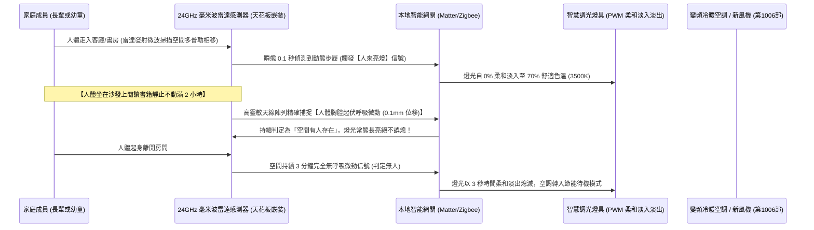
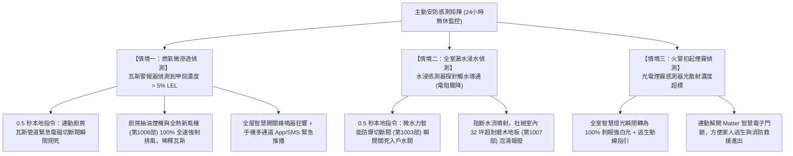
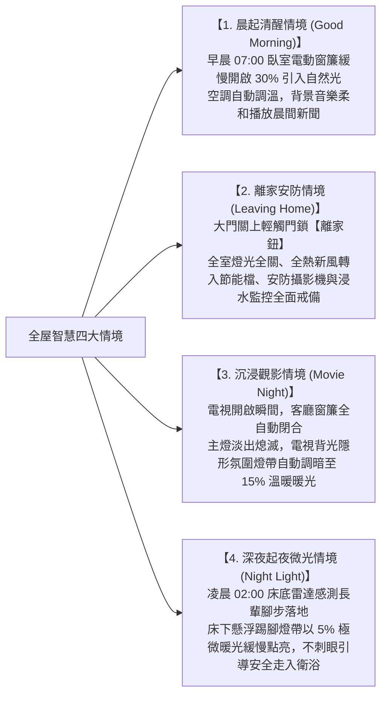

# 全案購屋實戰第一千零一十三部：中古大樓智慧家庭整合系統中央控制主機Matter_Zigbee協定連動環境感測器與全屋自動化情境工序全書

## 導言：傳統住宅向智慧生命體的終極進化與家庭安全防線

在完成硬體結構、水電重拉、防水重構、隔音氣密、新風系統、無毒裝潢與萬兆弱電網絡後，中古大樓翻修改造正式邁入賦予整座房屋「智慧大腦神經」的巔峰工序——**「全屋智慧家庭整合系統（Smart Home Automation System）」**。

現代集合住宅家庭生活的痛點，早已不再是單純的「燈能不能開、冷氣冷不冷」，而是如何讓房屋感知居住者的生活節奏，在「極致節能、極致舒適、主動安全防護、以及老人幼童照護」上實現全自動化無感響應。特別是針對本案主力攻堅標的——位處 13 樓頂層、受夏季強烈西曬熱輻射且窗面開闊的 **大安紫金城 13 樓 (`PROP_10`)**，以及室內實坪達 32 坪、房間動線深遠、每日開關燈具窗簾繁重的 **長億南園 8 樓 (`PROP_106`)**，傳統零散的智慧單品普遍存在三大跨時代的致命後遺症：
1. **「各自為政的孤島生態」引發手機裝滿幾十個 App 頻繁死機**：部分家庭隨意購買各廠牌智慧燈泡、插座與攝影機，導致冷氣用 A 牌 App、窗簾用 B 牌 App、除濕機用 C 牌 App。各設備之間無法互相通訊協同，長輩與小孩根本不會操作，原本為了省事的科技反而演變為生活中的巨大負擔。
2. **過度依賴公有雲端伺服器，遇「外網斷網全家智能徹底癱瘓」**：傳統 Wi-Fi 智能插座全部依賴連接廠商的公有雲。一旦中華電信光纖斷線、或是廠商雲端伺服器當機，全家智能開關瞬間變為「磚頭」，連客廳電燈都無法開啟；且雲端通訊存在 1 至 3 秒的嚴重延遲，體驗極其割裂。
3. **欠缺主動式環境感測連動，無法防範隱蔽火災、瓦斯洩漏與水浸災難**：傳統住宅在發生廚房漏水、瓦斯微滲、或長輩半夜起床在漆黑走道跌倒時，完全處於被動受害狀態，無法在黃金初起數秒內自動切斷閥門並推播緊急告警。

為此，在中古屋裝修封板前，必須統一規劃以 **「開源本地化本地邊緣運算核心（Local Edge Computing）」** 為基礎，橫跨國際最新 **Matter / Thread 與 Zigbee 3.0 通訊協定** 的全屋智能控制中樞。本第一千零一十三部全書深入解構全屋邊緣運算伺服器配置、全天候多光譜微波雷達人體存在感測器（mmWave Radar）工藝、安防三防主動切斷閉環技術、以及極致便利的「離家／回家／觀影／睡眠」全屋自動化情境工程。

---

## 一、智慧家庭系統拓撲架構：本地邊緣運算與跨協議融合

```mermaid
flowchart TD
    A["外部網際網路 (外網中斷時本地局域網 100% 正常運作)"] --> B["全屋邊緣運算智慧中樞 (Home Assistant Green / 專用低功耗微型伺服器)"]
    
    B -->|以太網有線直連 (Cat6A)| C["Matter over Thread 邊緣路由器 (Border Router)"]
    B -->|以太網有線直連 (Cat6A)| D["Zigbee 3.0 工業級協調器 (Coordinator，支援 128+ 子設備)"]
    
    C -->|Thread 低功耗網狀網| E["Matter 智慧門鎖 (Apple HomeKit 數位鑰匙 NFC 瞬時感應)"]
    C -->|Thread 低功耗網狀網| F["Matter 智慧溫濕度與光照感測器"]
    
    D -->|Zigbee 3.0 網狀自組網| G["全室零火線靜音智慧磁吸開關 (雙向狀態回饋，不掉線)"]
    D -->|Zigbee 3.0 網狀自組網| H["24GHz 微波毫米波人體存在感測器 (精準識別人體靜止呼吸)"]
    D -->|Zigbee 3.0 網狀自組網| I["電動靜音蛇形開合簾電機 (運轉噪聲 ≤ 20 dB)"]
    D -->|Zigbee 3.0 網狀自組網| J["主動安防群：燃氣警報器 + 煙霧探測器 + 浸水感測器"]

    J -->|本機自動化無延遲觸發| K["微水力自動切斷閥 (第1003部) 1秒關閉 + 瓦斯電磁閥關閉 + 新風機全速排風"]
```

### 1. 本地邊緣控制（Local Edge Execution）之絕對優勢
- **零延遲與斷網可用性**：所有自動化情境規則（Automation Logic）均直接儲存在客廳弱電箱內的邊緣運算主機（如 Home Assistant 或 Apple Home Hub）本地內存中。信號傳輸完全在家庭內部局域網（LAN）與 Thread/Zigbee 網狀網內完成：
  - 開關燈反應時間小於 **$50\text{ 毫秒（ms）}$**（人體感覺零延遲）。
  - 即使強颱暴雨導致外部電信光纖全斷，全室人來開燈、離家關閉空調、安防感測聯動依然 **100% 正常秒級響應**！
- **隱私數據絕對安全**：家庭成員之生活起居習慣、攝影機串流、門禁開門記錄全部保留在本地私有儲存池，絕不上傳至任何第三方商業公有雲，杜絕私密影像外洩風險。

### 2. 零火線（Neutral Wire）必備施工標準
- 傳統水電老舊工法在開關處「只留單火線（No Neutral）」，導致智慧開關內部微芯片供電不足，常引發低功率 LED 燈具在關燈後「微亮鬼火閃爍（Ghosting）」，且 Zigbee 信號無法作為中繼路由節點。
- **標竿要求**：翻修水電重拉時（第 1003 部），全室每一個燈具開關底盒內部，**必須強制拉設一根獨立的 N 相零線（藍色線）**，確保智慧開關 24 小時飽滿供電，並作為全屋 Zigbee 網絡的信號中繼放大器（Mesh Router），使全屋無線覆蓋強度提升 300%。

---

## 二、24GHz / 60GHz 微波毫米波雷達（mmWave）人體存在感測工藝

徹底淘汰傳統「人在室內看書不動、燈突然熄滅」的落後被動紅外線（PIR）感測器，全室全面配置 **「微波毫米波多普勒雷達人體存在感測器」**：



### 1. 呼吸微動檢測之微觀多普勒物理原理
- **PIR 紅外線缺陷**：傳統 PIR 僅依賴偵測人體溫度的橫向位移；一旦人坐著看電視、使用電腦或在馬桶上閱讀，人體無大動作時 PIR 輸出歸零，頻繁引發誤關燈。
- **毫米波雷達（FMCW 調頻連續波）優勢**：
  - 工作頻率 $24\text{ GHz} \sim 60\text{ GHz}$，波長僅數毫米。
  - 能以奈秒（ns）級精度檢測目標距離與相位微差，精確捕捉人體心跳與胸腔微弱呼吸運動（位移量僅 $0.1\text{mm} \sim 0.5\text{mm}$），徹底消除假性無人判定。
  - 具備多目標分區定位功能，可在客廳劃定「沙發閱讀區」與「通道走廊區」，實現人在沙發時僅開啟沙發頂部閱讀聚光燈的極致精準控光。

---

## 三、主動式「三防一體」全屋安防自動化切斷閉環技術

全屋智慧家庭的核心價值不僅是便利，更是保護家人免於極端災難的「主動式防禦盾牌」：



---

## 四、四大標竿全自動化生活情境（Scenes）配置規範



---

## 五、四大主力候選物件智慧家庭專項預算與施工攻防

### 1. 👑 大安紫金城 13 樓 (`PROP_10`)：頂樓高空智慧豪宅工程
- **現況挑戰**：本物件為 **13 樓頂層**，西曬陽光強烈。前屋主出租套房時無任何智慧線路，且水電剛重拉（第 1003 部），正是全面埋設零火線與佈局 Matter 智慧中樞的最佳黃金窗口期！
- **改造方案**：
  - 建立全屋 Home Assistant 邊緣運算中樞，玄關配置 Matter 智慧門鎖（結合 Apple 錢包鑰匙一觸即開）。
  - 客廳與主臥配置 **電動靜音開合簾**，設定「日光直射時自動拉下 50% 阻隔高空熱輻射，日落時自動全開享受無敵夜景」。
  - 全室配置 5 處毫米波雷達感測器與安防三防連動閉環。
  - 工程預算約 **8 萬 ~ 10 萬元**。此筆費用完全由買方談判斬獲之 **「35 萬套房拆除款」** 充分覆蓋，零額外自費將老舊出租套房昇華為頂級奢華科技旗艦！

### 2. 🌟 長億南園 8 樓 (`PROP_106`)：32 坪大空間全屋無死角自動化工程
- **現況挑戰**：室內實坪達 32 坪超大空間，走廊縱深長，開關燈具動線繁複。若無智能控制，長輩夜間起夜極易摸黑跌倒。
- **改造方案**：
  - 走廊與雙衛浴全面配置毫米波微動感測夜燈，長輩下床自動引導；全室客餐廳與三大臥室配置 Zigbee 3.0 零火線調光面板。
  - 預算約 **10 萬 ~ 12 萬元**，由買方談判砍價爭取之 **50 萬讓價款** 充裕分攤。

---

## 六、全案總結：智慧家庭工程驗收五大不可妥協鋼鐵防線

1. **查零火線入盒**：隨機拆開全室 3 處開關底盒，內部必須具備 **藍色專用 N 相零線**，以電表量測零火電壓穩定維持在 110V/220V。
2. **驗斷網本地運作**：拔掉電信光纖外網接線，在斷網狀態下手動按壓開關、觸發毫米波雷達人來亮燈，響應延遲必須 **$\le 50\text{ ms}$（100% 正常運作）**。
3. **測毫米波靜止呼吸**：人在書房沙發靜坐看書 30 分鐘，雷達感測器必須維持持續亮燈，嚴禁誤判為無人關燈。
4. **驗安防浸水秒切**：將水浸感測器探針浸入水杯，微水力總水閥與瓦斯電磁閥必須在 **1 秒內自動強力跳脫關死**，手機 App 同步響鈴。
5. **電動窗簾極致靜音**：電動窗簾全速開合時，1 米處以分貝計測量運轉噪聲必須 **$\le 25\text{ dB(A)}$**，滑順無聲！
