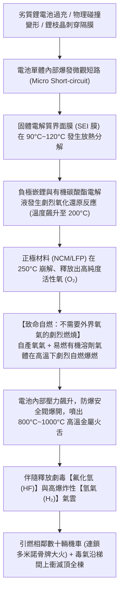
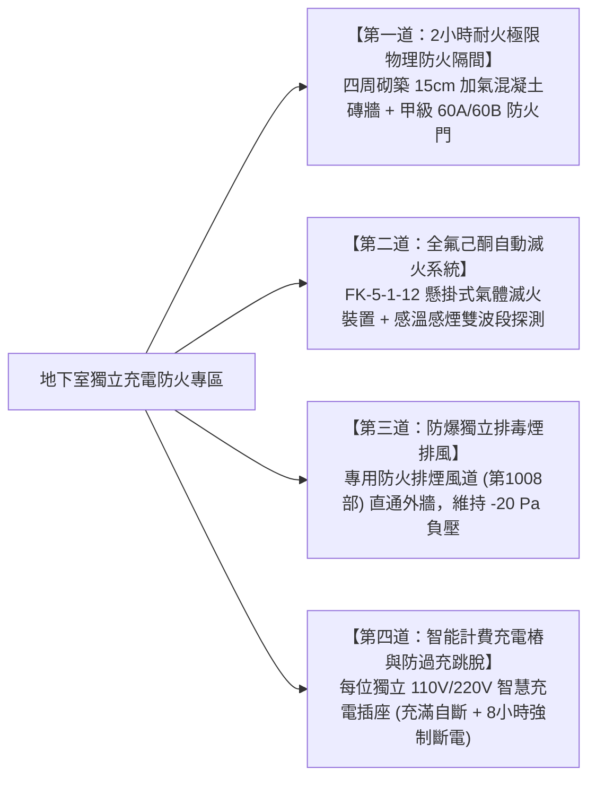
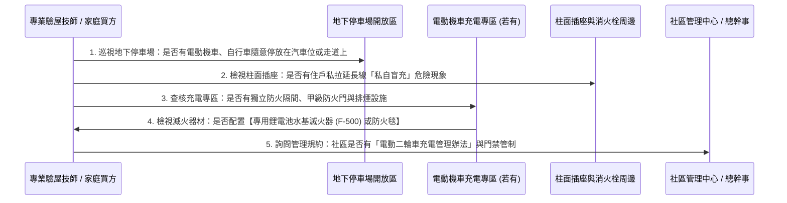

# 全案購屋實戰第一千零一十九部：中古大樓社區地下室電動機車與自行車鋰電池充電防火防爆專區、熱失控全氟己酮自動滅火與排煙防毒隔離工序全書

## 導言：新能源微出行工具之鋰電池熱失控隱形火藥庫

在當代集合住宅中古大樓之立體交通與日常生活中，電動機車（Gogoro、光陽 Ionex 等換電／充電型電動機車）、微型電動二輪車、電動輔助自行車（E-Bike）以及電動滑板車，以其極致的靈活性與經濟性，已成為全台數百萬家庭不可或缺的通勤代步工具。在每座擁有數十戶至上百戶的社區地下室停車場中，往往停放了數十輛甚至上百輛各型鋰電池微出行運具。

然而，與大型電動汽車（第 1016 部）具備高度規範的原廠電池管理系統（BMS）不同，小型電動機車、自行車與滑板車之鋰離子電池組（Lithium-ion Battery Pack，普遍採用三元鋰 NCM 或磷酸鐵鋰 LFP，工作電壓 48V 至 72V），在地下室長年停放與充電過程中，隱藏著極其恐怖且致命的「熱失控（Thermal Runaway）自燃爆炸」風險！

老舊中古大樓在微出行工具的停放與充電管理上，普遍存在三大致命安全盲區：
1. **住戶私拉延長線「盲充」引發電線短路過載**：住戶為圖方便，私自從地下室照明插座、消防栓箱旁插座或柱邊維修插座，私拉廉價未防雨的普通延長線至車位充電。充電器長年處於潮濕地面，缺乏過充過流保護，散熱不良引發內部開關電源炸裂引燃周邊雜物！
2. **副廠改裝鋰電池內部晶枝生長（Dendrites）與微短路熱失控**：部分外送員或改裝車主為追求長續航與極速，使用劣質淘寶副廠大容量鋰電池或私自改裝 BMS。電池內部隔膜在快充衝擊下被金屬鋰枝晶刺穿，在短短數秒內爆發不可逆的「連鎖化學放熱反應」，溫度在幾秒內自 $60^\circ\text{C}$ 飆升至 **$800^\circ\text{C} \sim 1000^\circ\text{C}$**！鋰電池劇烈爆裂噴射出數米長的高溫電漿火舌，伴隨噴發出成千上萬立方公尺劇毒的氟化氫（HF）、一氧化碳（CO）與氰化氫（HCN）毒氣！
3. **欠缺獨立物理防火區劃，引發「地下室多米諾骨牌連環大火」**：老舊大樓將電動機車、自行車與昂貴燃油汽車、甚至發電機油箱混雜停放在同一開放式空間。一旦一輛電動滑板車鋰電池熱失控爆炸，其四處飛濺的金屬熔滴會在數秒內引燃相鄰的幾十輛機車塑膠車殼，火勢迅速失控蔓延，黑煙毒氣順著電梯井直衝 8 樓、13 樓頂樓等高樓層住宅，引發全棟住戶於睡夢中窒息傷亡的慘絕人寰慘劇！

特別是針對本案主力攻堅標的——配備地下二樓（B2）專屬大型平面車位的 **大安紫金城 13 樓 (`PROP_10`)**，地下停車場的整體消防安全直接決定了名貴豪車與全家人夜間睡眠的生命安全！

為此，在中古大樓公設管理評估中，**「地下室是否劃定獨立的電動機車鋰電池防火防爆充電專區、並配備專用自動滅火與排毒煙設施」**，是衡量社區生命安全底線的最高級別防線。

本第一千零一十九部全書深入解構鋰電池熱失控電化學動力學、新型全氟己酮（FK-5-1-12）氣體滅火技術、獨立排煙防毒負壓防火防爆隔離室規範、以及買方在看屋時的公設公共安全評估與議價攻防策略。

---

## 一、微出行工具鋰離子電池「熱失控（Thermal Runaway）」化學動力學機制

### 1. 鋰電池火災之四大反常物理特性
1. **自帶氧化劑（Self-sustaining Oxygen）**：鋰電池正極分解會自行釋放氧氣，因此傳統窒息法（如覆蓋乾粉滅火器或一般防火毯）**完全無法撲滅鋰電池內部化學反應**，它在無氧真空環境下依然瘋狂燃燒！
2. **極高燃燒溫度與噴射火舌**：燃燒中心溫度高達 **$900^\circ\text{C} \sim 1200^\circ\text{C}$**，足以熔化鋁合金車架與鋼板。
3. **伴隨劇毒氟化氫（HF）酸霧**：電解質六氟磷酸鋰（LiPF₆）高溫遇水分解產生劇毒強腐蝕性的氟化氫氣體。人體吸入數口即引發肺水腫窒息，滲透皮膚引發低血鈣症心臟驟停！
4. **極高復燃率（Re-ignition）**：若未實施持續深度降溫冷卻至常溫，已撲滅外表的電池組在數小時甚至數天後會再次爆發二次甚至三次自燃復燃！

---

## 二、標竿社區地下室「電動機車充電防火防爆專區」工程規範

現代標竿中古大樓必須在地下室開闢獨立的「電動機車與自行車專屬防火防爆充電停放專區」：

### 1. 獨立防火分區（Fire Compartment）物理隔離
- **位置選定**：充電專區必須設置於地下停車場靠外牆或進排風井旁之獨立區域，**嚴禁緊鄰大樓主變電室、柴油發電機油箱、生活蓄水池或唯一的主安全逃生樓梯口**！
- **隔牆要求**：四周必須砌築耐火極限 **$\ge 2.0\text{ 小時}$ 之防火牆（如 15cm 加厚 RC 牆或白磚牆）**，出入口安裝標準 **甲級防火門（配備常閉式自動閉門器與防煙密封條）**，徹底阻斷火勢與黑煙向汽車停車區漫延。

### 2. 全氟己酮（FK-5-1-12 / Novec 1230）懸掛式自動滅火裝置
- 針對鋰電池火災，普通乾粉與二氧化碳滅火器效果極差。
- **標竿滅火介質**：全面配置 **全氟己酮（FK-5-1-12）自動滅火裝置**：
  - **超強吸熱降溫**：全氟己酮常溫為液態，噴出瞬間完全汽化，其汽化吸熱能力是水的數倍，能在 **10 秒內將燃燒區溫度自 800°C 驟降至 100°C 以下**，中斷熱失控鏈式反應。
  - **化學抑制自由基**：微觀氣相分子捕獲燃燒自由基，阻斷化學反應。
  - **綠色環保無毒**：臭氧消耗潛能值 ODP = 0，溫室效應潛能值 GWP = 1，噴放後無任何粉塵殘留，不損壞周邊精密電氣設備。

### 3. 獨立防爆機械排毒排煙風道
- 專區天花板必須配置專用 **防爆型排煙風機與不銹鋼排風管道（維持負壓 -20 Pa）**。
- 一旦煙感探測器動作，排風機瞬間以 **每小時 20 次以上換氣率（ACH）** 全速啟動，將有毒的氟化氫（HF）與高溫煙氣直接強制抽排至室外高空安全地帶，**絕對嚴禁煙氣灌入車道或電梯井道**！

### 4. 智能定時充電插座與過載過溫雙重保護
- 專區內每個充電車位配置專用 **智慧定時充電插座（帶充電計費晶片）**：
  - **充滿自斷電**：偵測到充電電流下降至 0.1A 持續 30 分鐘，自動切斷電源，杜絕電池過充。
  - **最大時間強制箝制**：單次充電時間最長強制限制為 **8 小時**，時間一到自動斷電，防止夜間無人看管長期通電。
  - **過溫過流保護**：插座內部配置 70°C 感溫保險絲，一旦插頭發熱接觸不良，立即跳脫斷電。

---

## 三、現場電動機車停放與充電安全體檢五步 SOP

家庭買方在看屋時，進入社區地下室，必須實施以下五步關鍵公共安全體檢：

### 1. 私拉電線「盲充」致命隱患排查
- 走訪地下室各角落柱子與牆邊，若發現：
  - 柱面插座插滿多條發黃老舊延長線；
  - 延長線拖曳在潮濕地面、甚至被進出車輛反覆碾壓；
  - 充電器直接放在機車踏板上發燙充電。
  - **判定標準**：直接判定該社區公設管理存在「極度危急公共安全隱患（紅燈）」，隨時面臨深夜火燒連環車的滅頂之災！

### 2. 鋰電池專用滅火器材驗證
- 檢查充電區域周邊配置的滅火器：
  - 若僅放置普通 ABC 乾粉滅火器，其對鋰電池內部火災完全無效。
  - **合格標準**：必須配置標有 **「鋰電池專用（Lithium Battery Fire Extinguisher）」之水基微滴滅火器（如 F-500 封裝阻燃技術）**，或車位上方配置 **專業純玻璃纖維高溫防火毯（耐溫 1000°C，尺寸 $\ge 2\times 2\text{m}$）**。

---

## 四、四大主力候選物件電動二輪車安全公設評估與談判攻防

地下室電動機車的防火管理，直接決定全棟高樓層住戶的生命安全防線：

### 1. 👑 大安紫金城 13 樓 (`PROP_10`)
- **實地重點**：
  - 大安紫金城本物件為 **13 樓頂層**，且配置專屬 B2 獨立大型平面車位！
  - 買方價值連城的 B2 平車豪車，最怕「相鄰車位停放了改裝電動滑板車或劣質電動機車，一旦夜間自燃，豪車將一同遭殃被燒成廢鐵」！
  - 同時，地下室大火產生的劇毒濃煙在煙囪效應下直衝 13 樓頂樓，威脅全家生命。
- **談判攻防部署**：
  - 走訪大安紫金城地下停車場：
    - 若社區管理嚴明，電動機車集中於特定通風專區充電，且嚴禁在汽車位私充，印證管理品質極高，堅定買方下定決心；
    - 反之，若發現地下二樓隨處可見私拉延長線充電、管理鬆散，立即向房仲指出：「地下室電動車充電管理存在重大火災漏洞，威脅專屬平面車位與頂樓逃生安全，管委會需專案編列消防整改款！」以此作為強大心理壓迫籌碼，堅決抵扣 35 萬套房拆除款，鎖定 768~788 萬目標價。

### 2. 🌟 長億南園 8 樓 (`PROP_106`)
- **實地重點**：長億南園機械車位旁若混雜停放電動機車充電，一旦起火，機械車坑的液壓油與鏈條將迅速被引燃，後果不堪設想。
- **殺價攻防**：結合機械車位限重 1.6 噸、門廳 4 階高差無障礙缺失、垃圾房無冷藏，再補上一記「地下室電動機車充電無防護專區、私充火災隱患大」之重大公設缺失，**強勢大砍 50 萬元，死死鎖定 745~760 萬成交防線**！

### 3. 歌德堡 8 樓 與 靜園 A 區 11 樓
- **歌德堡 8 樓**：北歐百萬精裝，需確認其地下室機車充電管理是否規範，確保百萬裝潢不受地下室火災威脅。
- **靜園 A 區 11 樓**：作為談判破局第一安全底牌，其地下室消防若管理嚴密、配置獨立充電區，更加奠定其最安心底牌的崇高地位。

---

## 五、全案總結：電動機車充電公設體檢五大不可妥協鋼鐵防線

1. **嚴禁私拉延長線**：地下室柱邊插座嚴禁住戶私接延長線充電，一旦發現必須全面強制拔除。
2. **獨立防火分區隔離**：電動機車充電專區必須具備 **2 小時耐火極限隔牆與甲級防火門**，嚴禁與汽車停車區混雜開放。
3. **配備全氟己酮自動滅火**：充電專區天花板必須配置 **FK-5-1-12 懸掛式自動滅火裝置**，能在 10 秒內撲滅鋰電池熱失控。
4. **獨立防爆排毒煙風道**：充電區必須維持 **微負壓（-20 Pa）**，配置防爆排煙機直通室外，嚴禁毒氣灌入電梯井。
5. **充電插座定時自斷電**：充電插座必須具備 **充滿自斷與 8 小時強制跳脫功能**，並配置 70°C 過溫保護，守護全社區百年平安！
