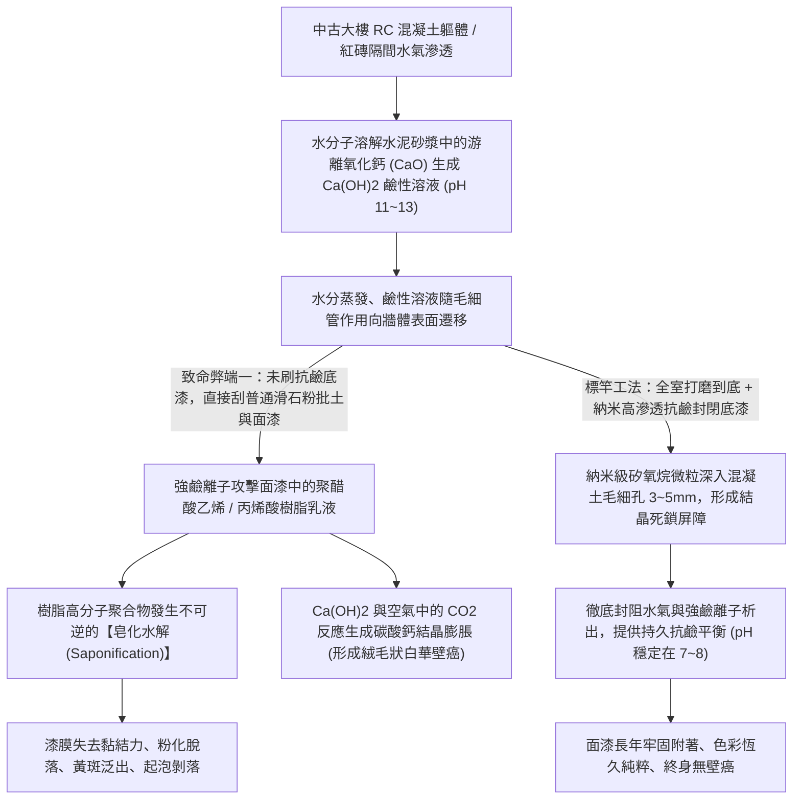
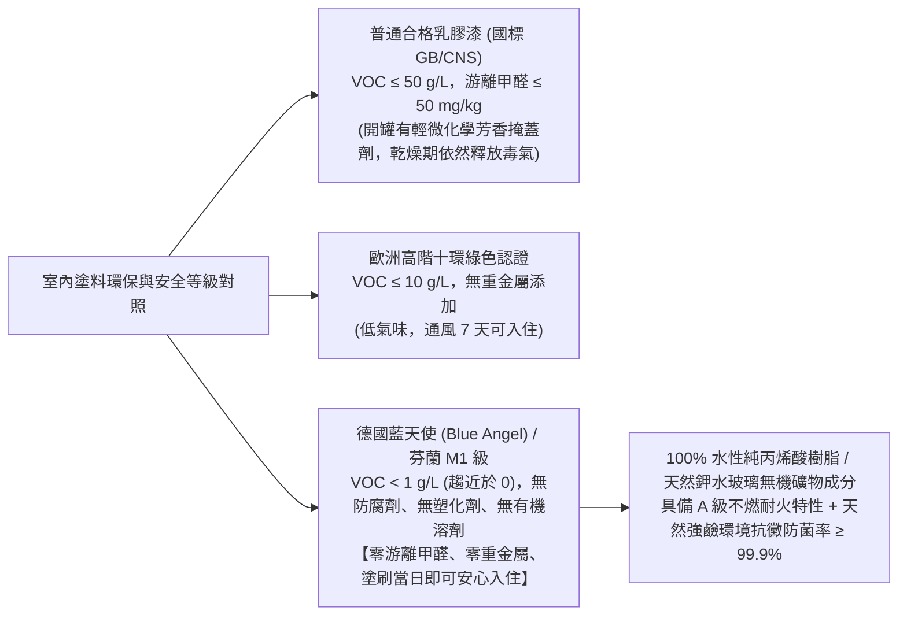
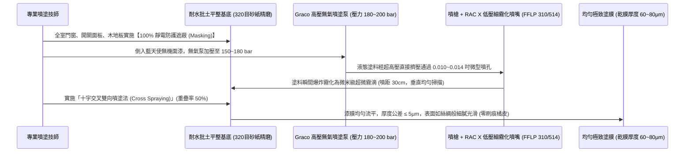
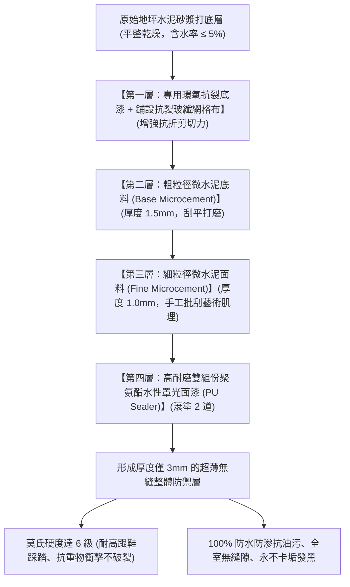

# 全案購屋實戰第一千零一十二部：中古大樓室內零甲醛環保塗料噴塗工藝、抗鹼封閉底漆抗壁癌與微水泥無縫藝術地坪工序全書

## 導言：居室立面美學之視覺靈魂與全生命週期呼吸健康

在經歷水電擴容、防水重構、氣密隔音、輕鋼天花板、超耐磨地板、排煙獨立化、系統櫃抗震與萬兆弱電網絡等一系列骨架與機能改造後，中古大樓翻修工程正式邁入決定全屋第一眼視覺質感、觸覺溫潤度與全室呼吸健康的「室內牆面塗裝工程（Wall Coating & Painting）」與「微水泥無縫藝術地坪工程（Microcement Flooring）」。

牆面與天花板是室內接觸面積最大的物理表面（通常為室內地板面積的 2.5 至 3.5 倍）。在屋齡 15 年至 30 年以上之中古大樓中（特別是曾被隔為 4 間出租套房、牆面被無數次劣質油漆反覆塗刷覆蓋、牆角伴隨陳年水漬與壁癌白華的 **大安紫金城 13 樓 (`PROP_10`)**，以及客餐廳連通立面長達數十米、採光開闊極度考驗牆面平整度的 **長億南園 8 樓 (`PROP_106`)**），傳統油漆工藝普遍存在三大跨時代的致命後遺症：
1. **劣質油漆釋放高濃度 VOCs、苯系物與重金屬，長期毒害呼吸道**：部分工班為求快省錢，使用劣質水性漆或含有甲醛釋放劑的白膠調配石膏粉批土。塗裝後在封閉室內持續釋放游離甲醛、苯、甲苯、二甲苯與乙二醇醚類等揮發性有機物（TVOC）。即使通風數月，揮發性毒素依然長期殘留，誘發長幼呼吸道過敏、慢性氣喘、偏頭痛，甚至引發造血系統病變。
2. **基底未塗刷高滲透抗鹼封閉底漆，導致「牆面粉化、脫皮與壁癌復發」**：中古大樓磚牆與混凝土常年吸收水氣，內部鹼性游離鈣離子（$\text{OH}^-$）濃度極高（$\text{pH} \ge 10 \sim 12$）。若油漆師傅未徹底刮除舊漆、未塗刷耐鹼封閉底漆，強鹼性鹽類會與乳膠漆中的樹脂乳液發生「皂化水解反應（Saponification）」，導致面漆大面積粉化、起泡、發黃變黑，形成難看刺眼的「毛絨狀白華壁癌」！
3. **手工滾筒刷痕粗糙、對光「波浪波紋陰影」破壞裝潢質感**：高檔現代簡約極簡風或侘寂風裝潢，對大面積牆面的平整度與光影質感要求極高。若採用傳統毛刷或粗孔滾筒施工，在側光或日光直射下，牆面呈現凹凸不平的橘皮紋（Orange Peel）與刷痕流掛，徹底毀掉整間房屋的奢華感。

為此，在中古屋塗裝翻修時，必須實施徹底的「無機抗鹼基底固化」、「高壓無氣噴塗（Airless Spraying）」與「零 VOC 頂級環保塗料工程」。本第一千零一十二部全書深入解構基層酸鹼化學中和機制、德國藍天使（Blue Angel）與芬蘭 M1 認證無機礦物塗料標準、高壓無氣噴塗精微霧化標竿工藝、以及玄關衛浴「微水泥（Microcement）」無縫一體化施工技術。

---

## 一、牆面微觀化學反應：混凝土泛鹼白華（Efflorescence）與漆膜皂化崩解

### 1. 納米級矽酸鹽抗鹼底漆之微觀深層滲透固化
- **傳統樹脂底漆之缺陷**：普通聚合物底漆分子量大（分子粒徑 $> 100\text{ nm}$），僅能漂浮在牆體表面，無法穿透密實的混凝土，在強鹼高濕衝擊下數年即脆化脫膠。
- **納米矽丙微乳液（Nano-silica Acrylic Emulsion）**：
  - 粒徑極小（僅 $10 \sim 30\text{ nm}$），具備超強毛細吸附滲透力，能穿透混凝土表層深達 **$3\text{mm} \sim 5\text{mm}$**。
  - 與混凝土中的游離鈣進行二次水化反應，生成不溶於水的高強度水化矽酸鈣（C-S-H 凝膠），將鬆散粉化的舊水泥沙粒牢牢「石化膠結」為堅硬緻密的無機屏障，完全封死強鹼向外遷移的路徑。

---

## 二、零 VOC / 德國藍天使（Blue Angel）與芬蘭 M1 級頂級塗料認證標準

全室室內塗料唯一指定採用符合 **德國「藍天使（Der Blaue Engel, RAL-UZ 102）」** 或 **芬蘭「M1 極致低釋放（Clean Air Certification）」** 認證之原裝進口水性純丙烯酸乳膠漆或無機礦物塗料（Inorganic Silicate Paint）：

### 1. 無機礦物塗料（Potassium Silicate Paint）之天然長效優勢
- **石化微觀交聯反應**：以天然矽酸鉀（水玻璃）為黏結劑，塗刷在無機水泥牆面上後，能與基底產生永久性的「石化矽化反應（Silicification）」，塗層與牆體融為一體，永遠不脫落、不鼓包。
- **無機成分永不發霉**：由於塗層完全不含任何有機聚合物，沒有任何營養物質可供黴菌孢子寄生滋生，天然具備抵抗黑黴菌（Aspergillus niger）長達 20 年以上的無毒防黴能力。

---

## 三、高壓無氣噴塗（Airless Spraying）極致細膩霧化標竿工藝

徹底淘汰手工滾筒之刷痕瑕疵，全室牆面與天花板全面指定採用 **「美國 Graco 原裝進口高壓無氣噴塗機（壓力 2000~3000 psi）」搭配精密反向自清洗噴嘴**：

### 1. 表面平整度「側光無陰影」驗收標準
- 在自然光直射或晚間開啟 1000 流明強光投光燈以 **$15^\circ$ 低角度側向照射牆面**：
  - **傳統滾筒瑕疵**：表面充滿密集凹凸小麻點與深淺交錯的波浪陰影。
  - **高壓無氣噴塗標竿標準**：整面牆體呈現均勻啞光或蛋殼光澤，表面粗糙度 $Ra < 1.0\mu\text{m}$，觸感如嬰兒肌膚般溫潤滑順，無論光線如何變化，完全無任何接刀痕或陰影瑕疵。

---

## 四、玄關與衛浴：西班牙微水泥（Microcement）無縫一體化施工工藝

在玄關落塵區、廚房地坪或主衛浴乾區，若追求極致極簡空間美學，全面導入現代頂級豪宅標配——**「進口雙組份微水泥無縫藝術地坪系統」**：

### 1. 微水泥之卓越力學與物理性能
- **超高抗折與抗壓強度**：以高標號超細水泥、水性高分子樹脂與石英微粒複合而成，抗壓強度達 **$\ge 35\text{ MPa}$**，抗折強度 **$\ge 12\text{ MPa}$**。具備微彈性（Flexibility），能有效吸收地熱微脹與樓板微振而不開裂。
- **終結磁磚溝縫發黑**：磁磚地坪最大的痛點就是長年積水導致填縫劑發霉發黑。微水泥形成連貫全室的一體化無縫表面，油污醬油咖啡滴落 24 小時內以濕抹布輕輕一擦即可完全淨除。

---

## 五、四大主力候選物件塗裝與微水泥專項預算與施工攻防

### 1. 👑 大安紫金城 13 樓 (`PROP_10`)：頂樓除舊生新極致塗裝工程
- **現況挑戰**：本物件為 **13 樓頂層**，原始為 4 間出租套房，隔間牆體多處有前租客釘孔、殘膠、局部受潮發黑發黃，且室內採光極佳，任何牆面瑕疵在日光下無所遁形。
- **翻修方案**：
  - 全室舊漆徹底打磨除舊，全面滾塗 **納米滲透抗鹼封閉底漆 2 道**，徹底中和磚牆強鹼，封死壁癌隱患。
  - 耐水耐裂批土精磨 3 道（320目砂紙全自動打磨機無塵吸塵打磨）。
  - 全室天花板與立面採用 **美國 Graco 無氣噴塗機噴塗德國藍天使頂級乳膠漆 2 道**。
  - 玄關落塵區施作西班牙進口無縫微水泥地坪（面積約 2 坪）。
  - 工程預算約 **12 萬 ~ 15 萬元**。此筆費用完全可由買方談判斬獲之 **「35 萬套房拆除款」** 充裕支出，零額外自費將破舊出租套房徹底蛻變為高貴典雅、零甲醛零 VOC 的五星級健康藝術宅！

### 2. 🌟 長億南園 8 樓 (`PROP_106`)：32 坪大跨距超大立面無氣噴塗工程
- **現況挑戰**：室內實坪達 32 坪超大空間，客餐廳連通立面長達數十米，施工面積大（總塗裝面積超過 85 坪），手工滾塗極易產生色差與滾筒橘皮刷痕。
- **翻修方案**：
  - 全室全封閉保護後實施大型高壓無氣噴塗，確保 85 坪大立面色澤與光影絕對均勻一致。
  - 預算約 **15 萬 ~ 18 萬元**，由買方談判砍價爭取之 **50 萬讓價款** 充裕分攤。

---

## 六、全案總結：塗裝工程驗收五大不可妥協鋼鐵防線

1. **查底漆封閉性**：批土進場前，水泥基底必須 100% 塗刷抗鹼底漆，以 pH 試紙測試表面濕度，酸鹼度必須 **$\le 8$（中性至微鹼）**，嚴禁鹼性超標。
2. **驗環保原廠漆桶**：現場油漆桶必須為原裝未開封進口桶，明確印有 **「Blue Angel 藍天使」或「M1 認證」**，開罐後湊近聞絕無任何刺鼻溶劑或香精異味。
3. **測側光平整度**：以 1000 流明強光工作燈貼牆 15° 側射，整面牆體無波浪起伏、無砂紙劃痕、無流掛凸起，平整均勻如絹絲。
4. **驗漆膜附著力（百格刀測試）**：以專用百格刀在非顯眼處劃出 $1\times 1\text{mm}$ 網格，貼上 3M 膠帶撕下，漆膜脫落率必須 **為 0%（ASTM D3359 5B 級最高附著力）**。
5. **微水泥耐磨防滲**：玄關微水泥地坪以水潑灑測試，水滴呈荷葉珍珠狀滾動（接觸角 $\ge 110^\circ$），用硬幣用力刮劃表面完全無任何白色擦痕，尊享百年藝術質感！
