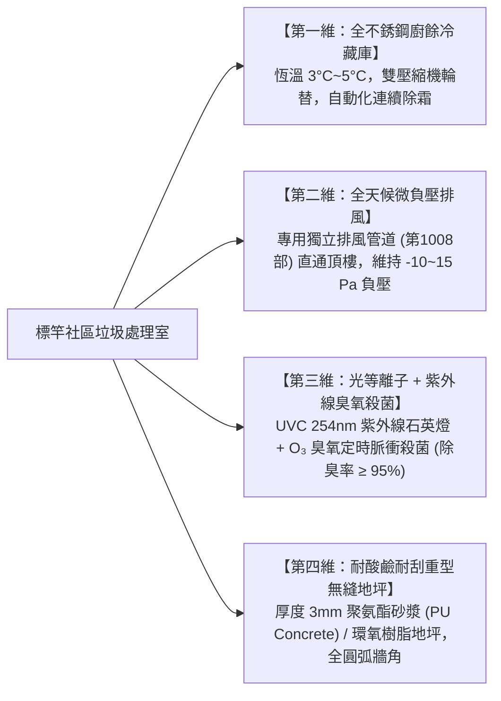
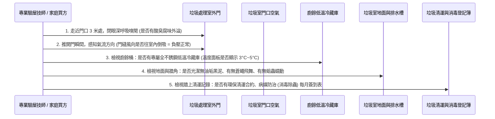

# 全案購屋實戰第一千零一十八部：中古大樓社區垃圾冷藏處理室紫外線臭氧殺菌負壓抽風與廚餘冷藏除臭防蟲工序全書

## 導言：公共起居衛生之隱形門面與疾病蟲害阻絕防線

在集合住宅中古大樓之全天候公共生活品質與衛生防禦體系中，位於地下室或一樓後方中庭的「社區垃圾集中處理室（Central Waste Collection Room）與廚餘冷藏設備」，是每一位家庭成員每日丟棄生活垃圾、處理餐廚剩菜、進行資源回收必經的公設動線。

然而，在屋齡 15 年至 30 年以上之中古大樓中（特別是全社區總戶數較多、垃圾量龐大、且地下室通風不易的社區），垃圾處理公設普遍存在四大令人作嘔且威脅公共衛生的致命惡疾：
1. **欠缺獨立低溫冷藏（Cold Storage）設備，廚餘高溫發酵腐敗惡臭**：在台灣夏季氣溫常態高達 32°C~36°C 的環境下，未經冷藏的廚餘桶在短短數小時內即會爆發劇烈的厭氧發酵腐敗，產生高濃度的硫化氫（H₂S，臭雞蛋味）、氨氣（NH₃，阿摩尼亞尿騷味）、屍胺（Cadaverine）與腐胺。整座地下室甚至電梯井道長年瀰漫著令人作嘔的腐爛餿水惡臭，開車進出地下室成為每日痛苦的嗅覺折磨！
2. **蒼蠅、美洲蟑螂（Periplaneta americana）與老鼠群體大滋生**：高溫高濕的廚餘垃圾是病媒生物的天堂。成群的蒼蠅在垃圾桶周邊產卵，蛆蟲在地面蠕動；成百上千隻大蟑螂在垃圾桶縫隙築巢，老鼠沿著天花板管線亂竄，並順著管道間縫隙（第 998 部）爬入全棟各戶室內與蓄水池，引發痢疾、霍亂與鉤端螺旋體傳播！
3. **欠缺負壓排風系統（Negative Pressure Ventilation），臭氣沿電梯井直衝高樓層住戶**：許多老舊社區垃圾房僅開一扇普通鐵門，內部未安裝全天候排風機。當電梯在地下室開門時，電梯井強大的「活塞抽吸效應（Piston Effect）」會將垃圾房溢出的惡臭氣體瞬間吸入電梯車廂與電梯井道，一路沿著井道直衝 8 樓、13 樓頂樓等高樓層梯廳，嚴重摧毀頂樓住戶的生活尊嚴！
4. **垃圾污水（Leachate）沿地面漫流滲透，腐蝕 RC 樓板與鋼筋**：垃圾袋破損滲出的高酸性高鹽分垃圾滲濾液，在地面形成黑褐色黏稠油污，若地面未做耐酸鹼環氧樹脂（Epoxy）無縫防腐地坪，酸性腐蝕液會滲入混凝土內部，引發樓板鋼筋鏽蝕膨脹爆裂，並順著車道縫隙流向地下深層。

為此，在看屋與評估中古大樓管委會管理水準時，**「社區垃圾集中處理室的整潔度、低溫冷藏與排風防臭等級」是檢驗社區管理良窳最誠實、最無法作假的一面照妖鏡！**

本第一千零一十八部全書深入解構廚餘生物化學發酵動力學、低溫冷藏庫（3°C~5°C）恆溫冷鏈標準、工業級紫外線（UVC）與高濃度臭氧（O₃）脈衝殺菌除臭技術、垃圾房全天候微負壓排風工藝、以及買方在看屋時的公設管理評估與議價攻防策略。

---

## 一、生活垃圾與餐廚廢棄物生物化學發酵動力學與惡臭機制

```mermaid
flowchart TD
    A["住戶丟棄餐廚廚餘廢棄物 (蛋白質、脂肪、澱粉、高水分 70%~80%)"] --> B["夏季常溫 30°C~35°C + 密閉垃圾桶 (缺氧厭氧環境)"]
    B --> C["腐敗菌與厭氧菌 (Clostridium 梭菌屬等) 呈指數級瘋狂倍增"]
    
    C --> D["蛋白質與氨基酸脫氨脫羧分解：釋放高濃度硫化氫 (H₂S) + 甲硫醇 + 屍胺"]
    C --> E["脂肪酸水解：產生刺鼻丁酸 (Butyric Acid，嘔吐物酸臭味)"]
    
    D --> F["【致命弊端一：惡臭擴散】<br/>氣壓積聚，臭氣順著地下室車道與電梯井活塞效應直衝 13 樓梯廳"]
    E --> G["【致命弊端二：病媒狂繁殖】<br/>蒼蠅 24 小時內產卵化蛆、蟑螂老鼠成群築巢爬入各戶"]

    C -->|標竿防禦：低溫冷藏庫 (3°C~5°C) 恆溫阻斷| H["低溫抑制細菌體內酵素活性，微生物代謝速率暴跌 95% 以上"]
    H --> I["發酵徹底停滯、氣體釋放量歸零、無酸臭、無蛆蟲、無蒼蠅！"]
```

### 1. 廚餘腐敗微生物學之溫度敏感曲線
- **細菌生長極限溫度**：多數腐敗菌（如大腸桿菌、假單胞菌、沙門氏菌）的最佳生長溫度為 **$25^\circ\text{C} \sim 40^\circ\text{C}$**。在此區間內，細菌每 20 分鐘分裂一次，4 小時內單一菌落可增殖數萬倍。
- **低溫冷藏的生化阻斷效應**：
  - 依照食品衛生與廢棄物管理標準，當環境溫度降至 **$3^\circ\text{C} \sim 5^\circ\text{C}$（冷藏溫層）** 時，水分表面張力增大，細菌細胞膜流動性喪失，消化水解酶活性完全休眠，生化產氣反應徹底歸零，廚餘可存放 7 天依然無酸臭味！

---

## 二、標竿社區垃圾冷藏室「四維一體」衛生防禦系統架構

現代頂級中古大樓管委會必須將垃圾處理室打造成標準的「醫療級衛生防禦體系」：



### 1. 全不銹鋼商用低溫廚餘冷藏庫（Food Waste Chiller）
- **設備規格**：
  - 庫體材質必須為 **內外全 SUS304 食品級不銹鋼板（發泡保溫層厚度 $\ge 60\text{mm}$ 高密度聚氨酯）**。
  - 溫度控制：數位微電腦精準溫控於 **$3^\circ\text{C} \sim 5^\circ\text{C}$**，具備開門防冷氣外洩風幕機（Air Curtain）。
  - 配置自動化電熱除霜循環與冷凝水專用排水管，徹底根絕結冰與地面漏水。

### 2. 全天候獨立「微負壓（Negative Pressure）」抽風系統
- **防外溢空氣動力學原理**：
  - 垃圾室內部空氣氣壓必須長年維持相對於地下停車場 **$-10\text{ Pa} \sim -15\text{ Pa}$ 的微負壓狀態**。
  - **排風量計算**：垃圾室換氣次數必須達到 **每小時 $12 \sim 15\text{ 次（ACH）}$**。
  - 即使住戶推開垃圾房大門，外部新鮮空氣在負壓作用下會自動「向垃圾室內部倒吸流動」，**室內的污濁惡臭氣體 100% 絕無可能反向溢出至地下停車場或電梯口**！
  - 排風管必須為獨立專用管道直通大樓頂樓高空排放，嚴禁排入車道或公共管道間。

### 3. 紫外線（UVC 254nm）與臭氧（O₃）自動化定時消毒消殺
- 每天凌晨 02:00~04:00 無人出入時段，智慧控制系統自動啟動 **高強度 UVC 紫外線石英殺菌燈與高頻臭氧發生器**：
  - 臭氧氣體（濃度控制在 $0.1 \sim 0.2\text{ ppm}$）能迅速滲透至垃圾房所有牆角、垃圾桶背後的微觀死角，強效氧化分解硫化氫與氨氣分子，破壞病毒與細菌 DNA，殺菌率高達 **$99.9\%$**；
  - 臭氧在半小時內自動還原為氧氣，白天住戶進入時空氣清爽無毒。

### 4. 重型無縫聚氨酯砂漿（PU Concrete）抗酸鹼地坪
- 垃圾房地面嚴禁鋪設普通磁磚或打水泥光面（填縫劑會被酸水腐蝕發黑粉化）。
- **標竿要求**：全面鋪設 **厚度 $3\text{mm} \sim 4\text{mm}$ 重型水性聚氨酯砂漿地坪（耐強酸強鹼、耐高壓水槍沖洗、耐拖曳垃圾桶重度磨損）**，牆地交界面全數施作半徑 $R = 50\text{mm}$ 的平滑無縫圓弧倒角，配置專用高壓熱水清洗水龍頭與防臭防渣不銹鋼沉泥排水槽。

---

## 三、現場垃圾處理公設標準看屋體檢五步 SOP

家庭買方在看屋時，必須主動要求房仲帶路前往大樓垃圾集中場，實施以下五步關鍵體檢：



### 1. 氣味與負壓「門縫一張紙」檢測法
- 隨身攜帶一張薄型面紙，將面紙貼近垃圾房門縫底端：
  - **優良（綠燈）**：面紙被強烈氣流 **「牢牢死死吸向門縫內部」**，證明內部排風機運轉強勁，室內呈現完美負壓；門外聞不到任何異味。
  - **危急（紅燈）**：面紙被向外吹起，或門口 5 米外即可聞到撲鼻刺鼻惡臭，證明內部完全無排風或排風機早已燒毀停擺，臭氣正日夜向地下室擴散！

### 2. 廚餘冷藏庫實體驗證
- 打開廚餘冷藏庫外門，一股冷冽乾爽的冷氣撲面而來，溫度顯示器必須在 **$0^\circ\text{C} \sim 5^\circ\text{C}$** 之間。
- 桶內廚餘被冰凍凝固，無酸臭發酵氣味，無任何蒼蠅飛舞。若社區僅放置普通橘色塑膠桶任由廚餘在大熱天下腐爛，直接判定該社區公設衛生管理為不及格下等水準！

---

## 四、四大主力候選物件垃圾公設實戰關聯評估與議價攻防

社區垃圾公設的管理水準，直接折射出管委會的公基金財務實力與住戶素質：

### 1. 👑 大安紫金城 13 樓 (`PROP_10`)
- **實地重點**：
  - 大安紫金城本物件為 **13 樓頂層**，且配置專屬 B2 獨立大平車！
  - 買方每日下班將車輛停在 B2 平車位後，或每日清晨出門倒垃圾時，均會途經地下室垃圾集中動線。若地下室垃圾房有全套低溫冷藏與負壓抽風，地下停車場空氣清爽無味，豪車車內絕不沾染餿水惡臭，更加奠定其抗跌保值之王的高貴身價！
  - 更重要的是，頂樓戶最怕「地下室垃圾臭氣沿著電梯井道煙囪效應抽吸至 13 樓梯廳」。
- **談判攻防部署**：
  - 實地走訪大安紫金城垃圾集中場：
    - 若發現垃圾房乾淨清爽、配備冷藏設備與定時消毒，印證管委會極具水準，堅定買方出價決心；
    - 反之，若發現垃圾房異味撲鼻、管理鬆散，立即拍照存證向賣方指出：「社區地下室公共衛生管理有重大死角，臭氣沿電梯井上揚至頂樓，需編列公設衛生改善專款！」以此進一步鞏固 720~730 萬起手出價，鎖定 768~788 萬目標價。

### 2. 🌟 長億南園 8 樓 (`PROP_106`)
- **實地重點**：長億南園社區戶數較多，若垃圾處理室未做低溫冷藏與負壓抽風，在夏季龐大的垃圾量會迅速使地下室演變為「臭氣熏天的大型垃圾場」，蚊蟲老鼠猖獗。
- **殺價攻防**：結合其機械車位限重 1.6 噸、門廳 4 階高差無障礙缺失，再補上一記「公設垃圾處理設施老舊無冷藏、地下室瀰漫廚餘酸腐臭味」之公設重大缺陷，在談判桌上給予賣方致命一擊，**強勢大砍 50 萬元，堅決將 998 萬打落至 745~760 萬**！

### 3. 歌德堡 8 樓 與 靜園 A 區 11 樓
- **歌德堡 8 樓**：北歐百萬現代精裝，實勘需確認其公共垃圾間是否與其高檔裝潢水準一致，若垃圾房維持五星級乾淨冷藏，證明社區住戶素質高，百萬裝潢物有所值。
- **靜園 A 區 11 樓**：作為談判破局第一安全底牌，其公設垃圾處理若乾淨無味、管理嚴明，更加彰顯其作為終身安心置產的非凡價值。

---

## 五、全案總結：垃圾集中場體檢五大不可妥協鋼鐵防線

1. **門口聞無腐臭**：站在垃圾處理室門口 3 米處，深呼吸絕不能聞到絲毫廚餘發酵酸臭或尿騷阿摩尼亞味。
2. **門縫紙條必內吸**：門縫底端放置紙條，紙條必須被強烈氣流向內吸附，證明全天候微負壓抽風系統運作正常。
3. **廚餘 100% 設冷藏庫**：廚餘廢棄物必須存放於 **全不銹鋼低溫冷藏庫（3°C~5°C）** 內部，嚴禁在常溫下敞口暴曬放置。
4. **地面無黑泥蛆蟲**：地面必須為聚氨酯/環氧樹脂無縫防腐地坪，乾淨清爽無黏稠油污漫流，牆角無蛆蟲蟑螂。
5. **月度消殺紀錄完整**：牆面必須張貼合法專業病媒防治公司之 **「月度定期病媒防治（除蟲滅鼠）施作簽到紀錄表」**，確保全社區公設衛生達最高水準！
