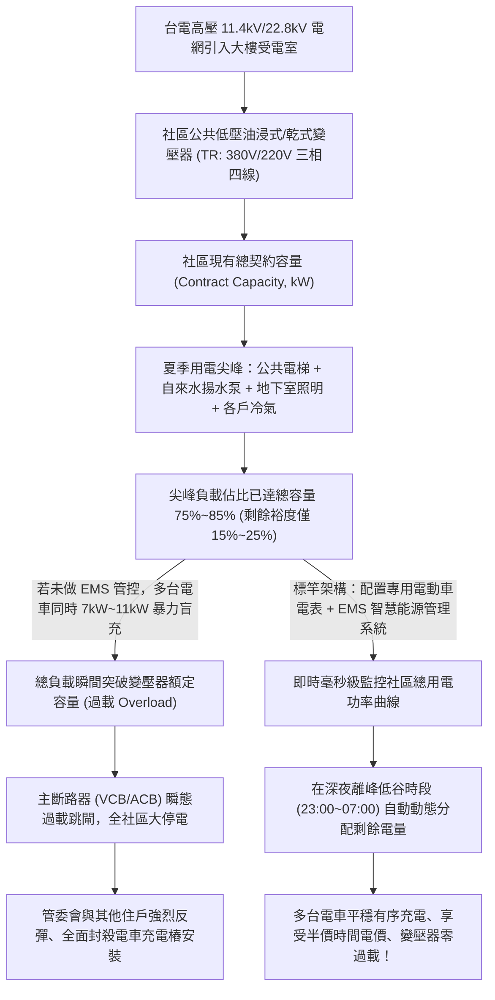
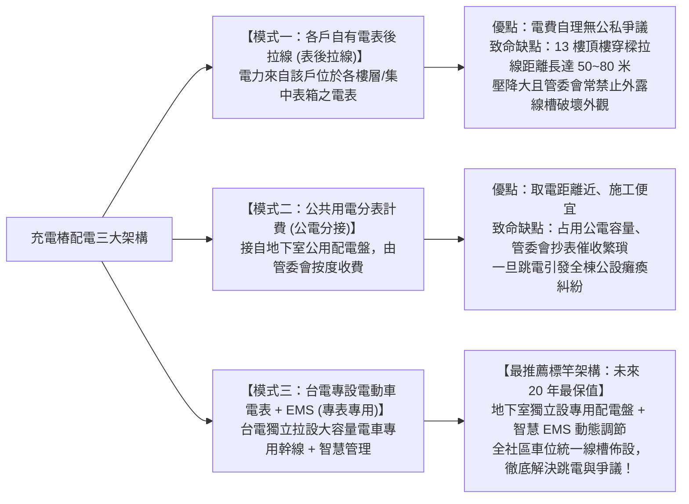
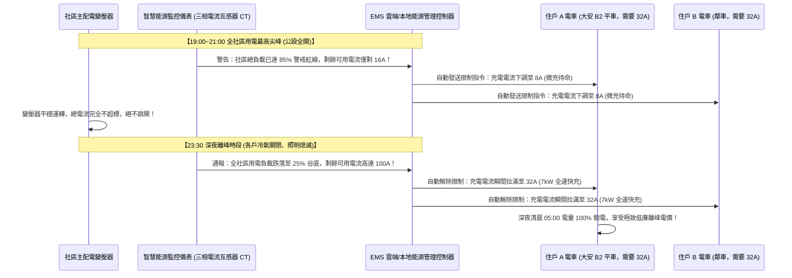
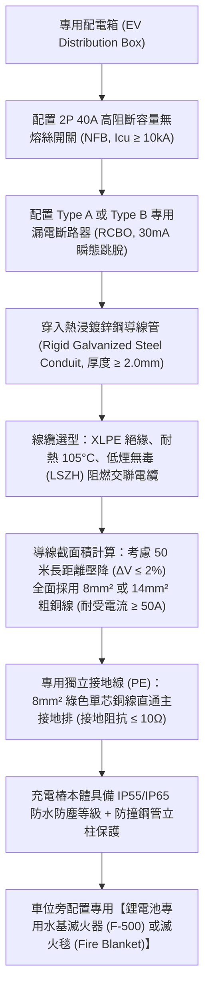

# 全案購屋實戰第一千零一十六部：中古大樓地下室停車位家用電動車（EV）充電樁安裝評估、社區電力容量分算、EMS 能源管理系統與配線施工工序全書

## 導言：新能源運具浪潮下的車位保值與電力基建之戰

在當代都會區家庭置產的長期價值評估體系中，「車位」早已不再只是單純停放傳統燃油車輛的附屬空間，而是直接決定未來 10 至 30 年不動產流動性、轉手溢價幅度與生活便利性的「核心科技基建設施」。隨著台灣乃至全球新能源電動車（BEV / PHEV）滲透率以每年雙位數的速度暴增，家庭在購置中古大樓時，**「該車位能否合法、安全、充足地安裝家用電動車交流充電樁（EVSE, Electric Vehicle Supply Equipment，功率 7kW 至 11kW）」**，已成為與地段、學區並駕齊驅的關鍵決策指標！

特別是針對本案四大決戰主力考慮物件之首——擁有全案最核心抗跌護城河、配置珍貴地下二樓（B2）專屬車位的 **大安紫金城 13 樓 (`PROP_10`)**，以及配備機械車位（限重 1.6 噸）的 **長億南園 8 樓 (`PROP_106`)**，兩者在電動車時代的資產命運呈現出斷崖式的兩極分化：
1. **大安紫金城 13 樓之「獨立大型平面車位」**：為標準獨立長寬（寬度 2.5m、長度 5.5m）平面車位，後方緊鄰建築 RC 結構柱或牆面，且淨高充足（超過 2.2 米），具備安裝壁掛式或立柱式家用充電樁的完美物理條件；然而，作為屋齡約 20 多年之中古大樓，其地下室公共變電室容量、台電計量電表至地下二樓的穿樑配線動線、以及管委會對於充電樁防火安全之規約限制，是簽約前必須嚴格核實的關鍵防線！
2. **長億南園 8 樓之「機械車位（限重 1.6 噸）」**：陷入了雙重致命死穴——其一，主流電動車（如 Tesla Model Y 車重約 2.0 噸、Model 3 約 1.8 噸、BMW i4 約 2.1 噸）由於配備沉重的大容量鋰電池底盤，**車重普遍突破 1.8 至 2.2 噸，直接超過長億機械車位 1.6 噸的極限承重**，強行停入隨時面臨鋼索拉斷、鏈條崩解、台車塌陷墜毀之滅頂災難；其二，機械車位上下升降與橫移往復運動，強電電纜長年隨之扭曲擺動，極易引發電纜疲勞折斷、短路爆火，因此绝大多數社區規約均「明文嚴禁機械車位安裝充電樁」！

本第一千零一十六部全書深入解構中古大樓電力容量餘裕計算、社區充電樁安裝三種主流配線架構、智能充放電管理系統（EMS, Energy Management System）動態負載平衡技術、台電電動車專用時間電價申請SOP、以及管委會規約協商爭取指引。

---

## 一、家用充電樁電力負載力學與社區總變壓器容量餘裕評估

### 1. 單一充電樁之大功率電氣參數
- **主流家用單相 220V 交流充電樁（AC Level 2 EVSE）**：
  - 額定電壓：**單相 AC 220V**（或三相 380V/220V）。
  - 額定電流：**32A**（功率 $P = V \times I = 220\text{V} \times 32\text{A} \approx \mathbf{7.04\text{ kW}}$）或 **48A**（功率達 **$10.56\text{ kW}$**）。
- **電力衝擊對比**：一台 7kW 充電樁連續全速運轉 6 至 8 小時之耗電量，相當於同時開啟 **4 台一對一變頻冷氣機** 的最大負載！若地下停車場有 10 戶住戶同時充電，瞬間增加的用電功率高達 **$70\text{ kW} \sim 100\text{ kW}$**，極易灌爆老舊社區公共變壓器的容量餘裕。

### 2. 社區既有變壓器（Transformer）容量核算公式
- 變壓器剩餘可用容量評估公式：
  $$P_{\text{available}} = S_{\text{rated}} \times \cos\phi \times \eta - P_{\text{peak\_measured}}$$
  其中 $S_{\text{rated}}$ 為變壓器額定容量（kVA），$\cos\phi \approx 0.85$（功率因數），$P_{\text{peak\_measured}}$ 為近 2 年夏季台電最高用電尖峰需量。
- **合格安裝門檻**：若計算出 $P_{\text{available}} \ge 30\text{ kW}$，則社區具備初期安裝 4 至 6 支充電樁之基礎容量；若餘裕不足 10 kW，則必須向台電申請增加契約容量或安裝 EMS 系統進行動態負載箝制。

---

## 二、中古大樓充電樁配電「三大技術架構」全維度對比與選型

在中古大樓地下停車場佈設充電管線，依電力來源與計量方式分為三種架構：

| 比較項目 | 模式一：表後拉線（私人表後） | 模式二：公用配電盤分接（公電分表） | 模式三：專表專用 + EMS（標竿推薦） |
| :--- | :--- | :--- | :--- |
| **電力來源** | 住戶自家電表（13 樓電表箱或集中表室） | 地下室公共低壓配電盤 | 台電新設電動車專用變壓器/低壓專表 |
| **拉線距離** | 極長（50 至 100 公尺以上，需穿跨樓層） | 極短（15 至 30 公尺） | 中等（統一沿專用線槽佈設） |
| **施工成本** | 約 6 萬 ~ 10 萬元（長距離穿線與壓降線徑加大） | 約 3 萬 ~ 5 萬元（短距離施工） | 前期公用線槽約 2 萬，每戶樁位約 3~4 萬元 |
| **電費計價** | 併入自家累進電價（度數高易落入最高級距） | 併入公電後由管委會按固定費率結算 | **享台電專用時間電價（深夜離峰每度約 2.0~2.5 元）** |
| **管委會阻力** | 極大（常以破壞公設外觀、管道間壅塞為由否決） | 中等（常擔憂公電超載與電費呆帳） | **最小（符合政府綠能推廣政策與大樓整體增值）** |
| **擴充性** | 極差（幾戶拉滿後管道間完全塞死） | 差（公電變壓器迅速過載） | **極佳（支援數十台車位平穩擴充）** |

---

## 二、EMS 智能能源管理系統（Energy Management System）動態負載平衡技術

為了徹底消除「充電引發全社區跳電」的恐懼，標竿社區必須導入 EMS 動態負載平衡（DLB, Dynamic Load Balancing）系統：

---

## 三、充電樁專用線路施工工藝與消防防護標竿標準

地下停車場為相對密閉空間，強電電纜施工必須達到最高工業安全規範：

### 1. 穿線管材與防外力破壞
- 地下停車場車輛進出頻繁，嚴禁使用易受撞擊壓破之普通 PVC 塑膠管！
- **標竿要求**：全程必須使用 **熱浸鍍鋅厚鋼導線管（RSG 管）或熱浸鍍鋅鋼製金屬線槽（Cable Tray）**。管路轉角處配置鋁合金防水分線盒，並牢固以金屬管束固定於樑側，抗車輛擦撞與強烈微振。

### 2. 接地系統之安全底線
- 電動車充電樁具備高頻脈衝寬度調變（PWM）通信晶片，對接地阻抗極為敏感。
- 若接地電阻大於 $10\,\Omega$（第 989 部工序），充電樁保護晶片會自動判定為「地絡異常」而拒絕開機送電；更致命的是，一旦車輛絕緣不良漏電，未達標的接地會使車體金屬外殼帶電，引發人身觸電傷亡！

---

## 四、四大主力候選物件電動車充電樁評估攻防矩陣

### 1. 👑 大安紫金城 13 樓 (`PROP_10`)：獨立大平車之電車終極霸主
- **車位條件**：配備地下二樓（B2）專屬獨立大型平面車位（長 5.5m、寬 2.5m），車位正後方為 RC 承重剪力牆，無管道阻礙，安裝壁掛式充電樁空間極其充裕。
- **電力評估與談判攻防**：
  - **看屋體檢要點**：
    - 走訪地下二樓配電室，檢查變電室至 B2 平車的走線動線，測量管線長度（約 35 米）。
    - 向管委會調閱規約，確認是否已通過「住戶自費安裝充電樁管理辦法」；若社區已有鄰居安裝，證實管委會態度友善、電力路徑通暢。
    - 若社區尚未通過，買方於談判時即可向賣方指出：「該車位目前尚未配備充電設施，未來需自行出資進行長距離穿樑配線與申請台電專表（預算約 6~8 萬元）！」
  - 結合 35 萬套房拆除款，堅決死守 720~730 萬起手出價，鎖定 768~788 萬目標價，以無可匹敵的平車優勢贏得終身電車充電自由！

### 2. 🌟 長億南園 8 樓 (`PROP_106`)：機械車位（限重 1.6 噸）之電車死穴
- **車位條件**：配備機械車位（昇降或橫移式），銘牌標示**「極限限重 1.6 噸（1600 kg）」**。
- **致命痛點打擊**：
  - **重量超載 100% 拒載**：主流純電動車（Tesla、保時捷 Taycan、比亞迪、現代 Ioniq）車重普遍在 1.8 至 2.2 噸以上。長億機械車位**終身無法停放任何主流電動車**！
  - **充電安裝 100% 封死**：機械台車上下位移，消防法規與保險公司合約全面禁止在機械車台上拉設 220V/32A 強電電纜。
  - **談判殺價核武器**：在談判桌上直接出示主流電動車型重量表與機械車位銘牌，向賣方嚴厲指出：「在新能源車全面普及的未來，該機械車位已完全喪失現代家庭用車價值，等同於半廢車位，資產折價至少 80 萬！」以此硬傷為核心支點，強勢大砍 50 萬，將 998 萬開價死死壓制在 745~760 萬！

---

## 五、全案總結：充電樁評估五大不可妥協鋼鐵防線

1. **查車位規格**：車位必須為 **獨立平面車位（長 $\ge 5.5\text{m}$、寬 $\ge 2.5\text{m}$，淨高 $\ge 2.1\text{m}$）**，嚴禁購買限重 1.6 噸的機械車位用於停放電動車。
2. **驗變電容量**：向管委會查核社區近 2 年夏季最高用電需量，變壓器剩餘容量必須 **$\ge 30\text{ kW}$** 或社區已規劃導入 EMS 系統。
3. **查管委會規約**：確認規約無「全面禁止安裝充電設備」之歧視性條文，依《公寓大廈管理條例》第 11 條正當爭取施工權利。
4. **管線全金屬防護**：地下停車場配線必須全程採用 **熱浸鍍鋅厚鋼導線管（RSG 管）**，導線採用 8mm² 以上純銅線，嚴禁明線外露。
5. **獨立接地阻抗 $\le 10\,\Omega$**：充電樁專用接地線必須直通大樓主接地銅排，實測阻抗合格，確保全天候 100% 絕緣防觸電安全！
