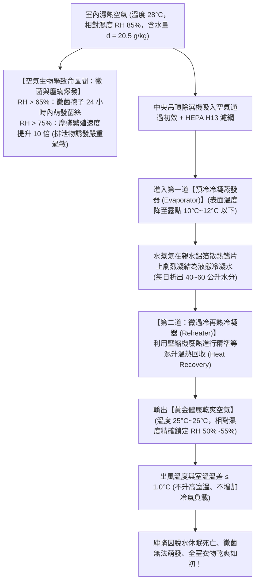
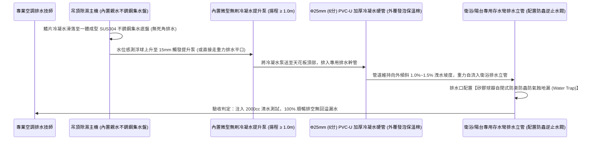
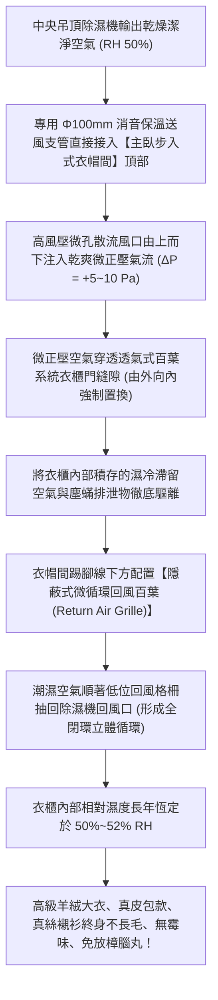
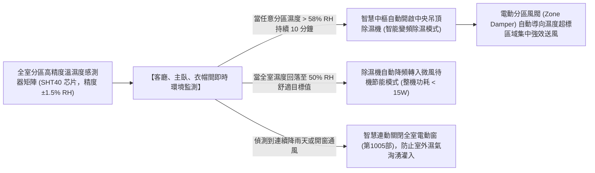

# 全案購屋實戰第一千零一十四部：中古大樓全室收納空間除濕防霉熱泵冷凝式除濕新風一體機暗管排水與衣帽間微正壓循環工序全書

## 導言：亞熱帶海島型氣候之家庭防潮防霉抗敏生死防線

在經歷硬體結構、水電重拉、衛浴防水、外牆氣密、天花板輕鋼、超耐磨地板、排煙獨立化、系統櫃抗震、萬兆弱電與全屋智慧中樞的全面建構後，中古大樓翻修改造迎來了保障全家衣物皮件不發霉、昂貴鋼琴不走音、以及徹底消除塵蟎過敏原的「全天候濕度控制工程」——**「全室嵌入式熱泵冷凝除濕新風一體機（Ducted Dehumidifier & ERV System）」與「步入式衣帽間微正壓除濕循環系統」**。

台灣地處亞熱帶海島氣候區，四面環海，全年平均相對濕度（RH）常年高達 **$75\% \sim 85\%$**；在春季「反潮南風天（回南天）」與夏季午後雷陣雨時，室內濕度甚至可飆升至 **$90\% \sim 95\%$**！特別是針對本案主力攻堅標的——位處 13 樓頂層、水氣熱壓積聚且日照蒸發強烈的 **大安紫金城 13 樓 (`PROP_10`)**，以及室內實坪達 32 坪、收納動線長達數十米、主臥衣帽間位於背陽深處的 **長億南園 8 樓 (`PROP_106`)**，傳統依賴移動式除濕機的生活模式普遍存在四大令人崩潰的致命痛點：
1. **「每日倒水地獄」與水箱滿水自動停機罷工**：普通移動式除濕機水箱容積僅有 3 至 5 公升，在潮濕梅雨季，運轉短短 4 至 6 小時水箱即告蓄滿；一旦滿水浮球跳起，機器便強制斷電停機。白天全家出門上班上學，除濕機在上午 10 點就停擺，下午全室濕度迅速回升至 85% 以上，昂貴的名牌皮包、真皮大衣、絲綢西裝依然逃不過發霉長毛的厄運！
2. **高溫廢熱排放使室內演變為「燥熱烤箱」**：傳統轉輪式或小型壓縮機除濕機，出風溫度通常比室溫高出 **$3^\circ\text{C} \sim 5^\circ\text{C}$**。夏季開除濕機，室內又悶又熱，逼得家庭必須同時開啟冷氣，造成電費暴增數倍，且冷氣低溫運轉與除濕機高溫排氣形成熱力學無效對耗。
3. **運轉低頻噪音（$50 \sim 60\text{ dB}$）嚴重摧毀臥室睡眠品質**：臥室若放置移動除濕機，壓縮機的高頻微振與風扇旋轉轟鳴在夜間死寂環境中被無限放大，家庭成員長年遭受神經衰弱與睡眠剝奪之苦。
4. **衣櫃密閉死角內部空氣滯留，滋生萬億級塵蟎（Dust Mites）與黑黴菌**：衣櫃門一旦關閉，櫃內與外界空氣完全隔絕；在相對濕度超過 70% 的微環境下，塵蟎繁殖速度呈幾何級數暴增，排泄物與黴菌孢子誘發全家幼童嚴重的異位性皮膚炎、過敏性鼻炎與夜間劇烈咳嗽！

為此，在中古屋木作吊頂施工前，必須統一規劃 **「中央吊頂嵌入式熱泵微冷凝連續排水除濕系統」**。本第一千零一十四部全書深入解構濕空氣焓濕圖（Psychrometric Chart）除濕熱力學、恆溫恆濕暗管連續重力自流排水工藝、步入式衣帽間「微正壓循環風道（Micro-positive Pressure Circulation）」技術、以及全自動濕度精確維持在 **$50\% \sim 55\%\text{ RH}$** 的抗敏金典工序。

---

## 一、濕空氣焓濕圖（Psychrometric Chart）除濕熱力學與黴菌塵蟎滋生臨界極限

### 1. 露點溫度（Dew Point）與相對濕度黃金控制區間
- **環境醫學與材料學公認黃金濕度**：**$50\% \sim 55\%\text{ RH}$**。
  - 當濕度小於 40% 時，人體呼吸道黏膜乾燥易受病毒侵襲；
  - 當濕度超過 60% 時，黴菌孢子開始活躍繁殖；
  - 當濕度超過 70% 且室溫在 20°C~30°C 時，衣服皮件在 48 小時內即可長出白色毛絨菌絲，塵蟎以人體皮屑為食並呈指數級倍增。
- **等溫除濕（Isothermal Dehumidification）**：標竿吊頂除濕機透過雙冷凝器熱回收技術，將除濕後的乾冷空氣再熱回升至接近原室溫（溫差 $\Delta T \le 1.0^\circ\text{C}$），徹底終結傳統除濕機「越除越熱」的物理弊端。

---

## 二、中央嵌入式除濕系統「暗管連續排水」防漏工藝

徹底消除人工倒水負擔，全室中央除濕機必須配置 **「雙重安全排水系統（重力自流排水 + 內置提升水泵）」**：

### 1. 冷凝水管全線防結露保溫披覆（Anti-condensation Insulation）
- 冷凝水溫度通常僅為 $10^\circ\text{C} \sim 15^\circ\text{C}$，而夏季天花板內部空氣溫度常高達 $30^\circ\text{C}$（相對濕度 80%）。
- 若排水管使用裸露 PVC 塑膠管，管外壁在 10 分鐘內即會凝結密密麻麻的「冷凝露珠」，水滴滴落在石膏天花板上引發發霉腐爛！
- **標竿要求**：冷凝水管全線外層必須緊密包裹 **厚度 $\ge 9\text{mm}$ 難燃 B1 級閉孔橡塑保溫管套（Rubber Foam Insulation）**，接縫處以專用保溫膠水與鋁箔膠帶 100% 密封，徹底杜絕高溫結露。

### 2. 雙重溢水斷電保護（Overflow Shut-off Sensor）
- 除濕機內部必須配置高低雙水位電極感測器。
- 一旦排水暗管遭水垢或灰塵堵塞導致水位上升至警戒線（高出正常水位 10mm），機板在 **小於 1 秒內強制關閉壓縮機**，並向手機 App 推播「排水受阻警報」，絕不允許冷凝水溢出淹沒天花板木作！

---

## 三、步入式衣帽間與主臥系統櫃「微正壓循環除濕風道（Micro-positive Pressure）」工藝

傳統除濕機只能抽吸大空間空氣，封閉的衣櫃內部依然潮濕如昔。標竿工程在衣帽間設計專用的「微正壓氣流循環導流系統」：

---

## 四、全室中央除濕系統智能感測連動控制矩陣

結合第一千零十三部之 Matter / Zigbee 智慧家庭中樞，除濕系統實現完全自動化無感響應：

---

## 五、四大主力候選物件中央除濕專項預算與施工攻防

### 1. 👑 大安紫金城 13 樓 (`PROP_10`)：頂樓高空防潮與衣帽間奢華升級
- **現況挑戰**：本物件為 **13 樓頂層**，原始為 4 間出租套房，前租客在室內晾曬衣物，牆角與天花板暗藏陳年黴菌斑點；且頂樓盛夏水氣受高溫烘烤，室內濕熱感極重。
- **翻修方案**：
  - 於客餐廳與主臥走廊天花板內部，嵌入安裝 **日立（Hitachi）或三菱電機（Mitsubishi Electric）大容量中央除濕機（每日除濕量 $\ge 40\text{ 公升/日}$）**。
  - 冷凝水暗管直接以 6 分保溫管連通主衛浴排水立管，全自動連續重力自流排水，終生免倒水！
  - 主臥步入式更衣室配置微正壓除濕循環送風管路。
  - 工程預算約 **8 萬 ~ 10 萬元**。此筆費用直接自買方談判斬獲之 **「35 萬套房拆除款」** 充分支出，零自掏腰包將破舊套房蛻變為抗敏乾爽頂級高空豪宅！

### 2. 🌟 長億南園 8 樓 (`PROP_106`)：32 坪大跨距超大除濕容量工程
- **現況挑戰**：室內實坪達 32 坪超大空間，格局深遠，主臥與後陽台通風死角多，梅雨季全屋反潮面積大。
- **翻修方案**：
  - 配置一體化熱泵除濕新風一體機（除濕量 $60\text{ 公升/日}$，風量 $350\text{ m}^3/\text{hr}$），分區風閥獨立覆蓋客餐廳、主臥大衣帽間與兩間次臥。
  - 預算約 **10 萬 ~ 12 萬元**，由買方談判砍價爭取之 **50 萬讓價款** 充裕分攤。

---

## 六、全案總結：中央除濕工程驗收五大不可妥協鋼鐵防線

1. **查冷凝管保證洩水坡度**：吊頂封板前，以水平尺檢測冷凝水硬管，必須維持 **$\ge 1.0\%$（每米下沉 10mm）向下傾斜**，嚴禁有任何水平段或向上倒坡。
2. **驗管道保溫無縫隙**：冷凝水管外層 9mm 橡塑保溫套必須全線包裹，轉彎接頭處以保溫膠水黏死，通冷水 2 小時外表面無任何結露水滴。
3. **測排水暢通與溢水自停**：向除濕機集水盤持續注入 3000cc 清水，水流必須在 30 秒內由重力完全排空；人工托起高水位浮球，主機必須在 **1 秒內自動斷電並報警**。
4. **驗全天候濕度恆定**：全室門窗關閉開啟除濕 4 小時後，數位高精度溫濕度計實測室內相對濕度必須 **精準穩定在 $50\% \sim 55\%\text{ RH}$**，出風口溫差 $\le 1.0^\circ\text{C}$。
5. **測臥室極致靜音**：除濕機全速運轉時，主臥床頭 1 米處實測噪聲必須 **$\le 28\text{ dB(A)}$**，安享整夜乾爽無聲深睡眠！
