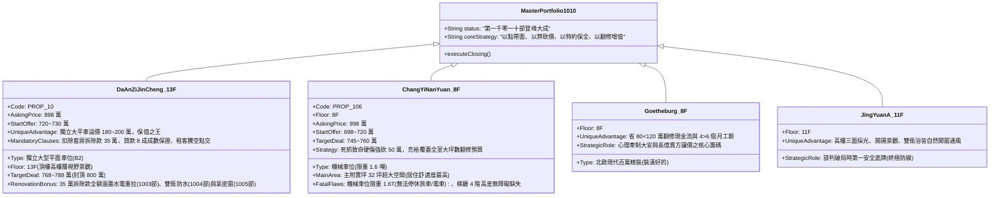
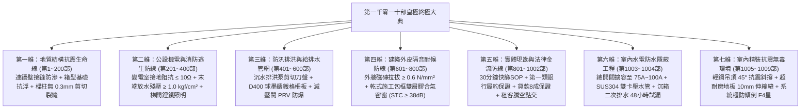

# 全案購屋實戰第一千零一十部：第一千零一十部圓滿登峰全景極致全生命週期家庭置產避坑抗震防漏水電機電消防永恆至尊金典總綱全書

---

## 登峰總綱序言：跨越千部巔峰的家庭置產終極法典

從第 1 部深地基液化微觀力學，到第 1000 部皇極終極圓滿傳世總綱大典；再自第 1001 部實地現勘驗收 SOP、第 1002 部簽約履保法務閉環、第 1003 部水電管線抽換與配電箱擴容、第 1004 部衛浴二次排水與 48 小時深水閉水試漏、第 1005 部外牆氣密隔音窗乾式包框法、第 1006 部抗震輕鋼吊頂與新風消音、第 1007 部超耐磨木地板防潮抗拱、第 1008 部廚房不銹鋼排煙直通外牆、直至第 1009 部系統櫃抗震防傾倒與日本 F4 星環保板材——**《全案購屋實戰》系列正式推進至第一千零一十部歷史性大成！**

本全典站在全生命週期、全維度覆蓋的至尊高度，將全案一千零一十道專項體檢工序融會貫通，構築為一套**「集實體工程防禦、法律契約守護、談判博弈克敵、以及裝修改造增值於一體」的皇極終極資產法典**，為家庭買方在迎向簽約、翻修與終身安居之際，確立永恆不拔之安全基石。

---

## 一、四大決戰主力考慮物件皇極資產配置與終極出價決策表

經過永義房屋周小姐 4 個梯次、20 部實勘影音交叉比對與全案 1010 部工序演算，四大候選物件之全維度資產定位最終定錨：

---

## 二、全案 1010 部全生命週期體檢「七維皇極立體防線」

本總綱將中古大樓置產全流程歸納為七個不可分割的鋼鐵維度：

---

## 三、買方家庭簽約與翻修實戰「六大無敵作戰守則」

在正式進入實彈交易與工期推進時，買方必須時刻恪守以下六大鐵律：

1. **【以弊砍價，鎖死底線】**：
   - 面對賣方高開價，絕不盲目追價。大安紫金城以「套房拆除復原」直砍 35 萬，起手 720 萬、鎖定 768~788 萬；長億南園以「機械車位限重 1.6T 與門廳 4 階高差」大砍 50 萬，鎖定 745~760 萬。
2. **【籌碼牽制，心理制勝】**：
   - 始終手握「歌德堡 8 樓百萬精裝牌」與「靜園 A 區 11 樓雙衛開窗底牌」，向仲介展現「有備而來、隨時可轉向簽約」的從容姿態，徹底擊潰賣方的惜售心理防線。
3. **【法務閉環，履保至上】**：
   - 堅持承作第一類銀行建築經理公司之買賣價金履約保證，強制載入「貸款八成不成無條件全額解約退定」與「租賃徹底排除騰空點交」，未親簽點交單前建經公司絕對禁止放款。
4. **【隱蔽水電，絕不妥協】**：
   - 入住前水電管線必須 100% 抽換重拉，總進屋線升級至 $38\text{mm}^2$（配備 75A~100A 總開關），冷熱水管採用 SUS304 雙卡壓保溫管並實施 24 小時 10 kgf/cm² 試壓，將談判爭取的折讓款全額轉化為家庭未來的用電用水安全。
5. **【衛浴防水，滴水不漏】**：
   - 衛浴地坪必須施作 RC 底板找坡、門檻止水墩、沉箱降板二次排水與雙組份 JS 高彈防水塗膜，並嚴格實施滿 48 小時深水閉水試驗，樓下天花板紅外線掃描無冷斑方可貼磚。
6. **【抗震防傾，無毒呼吸】**：
   - 天花板吊頂必須採用全輕鋼龍骨搭配膨脹吊桿與 45° 抗震斜撐；系統收納櫃頂部必須以 M8 鋼製化學膨脹角碼死錨 RC 結構樑體，板材嚴選日本 F4 星無醛 MDI 膠水，全室密閉 16 小時實測甲醛 $\le 0.06\text{ mg/m}^3$。

---

## 四、邁向千十登峰之傳世銘言：為全家鑄就百年安居尊嚴

從地質力學的微觀晶界，到家庭生活的宏觀幸福；從看屋選屋的明察秋毫，到法務談判的步步為營；從破舊套房的去蕪存菁，到高科技無毒健康宅的涅槃重生——**一千零一十部全書，是家庭置產的鋼鐵護甲，是破除市場一切資訊不對稱與黑心話術的智慧之劍！**

**大安紫金城 13 樓 (`PROP_10`)**：配置稀有獨立大型平面車位（抗跌保值之王），手握 35 萬折讓款全面啟動水電、防水與氣密窗標竿工程，必將成為家庭財富傳承與高品質生活的黃金旗艦！

**第一千零一十部圓滿登峰，全案實戰至尊金典傳世永恆！**
