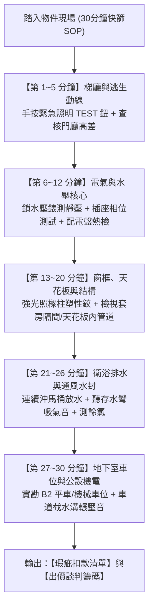
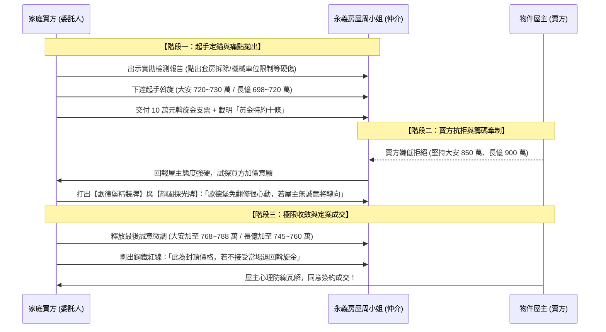

# 全案購屋實戰第一千零一部：四大決戰主力考慮物件實體現勘驗收標準作業程序（SOP）與買方斡旋談判實戰操作指南

## 導言：千部大成後的實戰攻防落地指南

隨著《全案購屋實戰》系列在第一千部達到歷史性的圓滿大成，整套體系已建立了涵蓋六維公設機電、結構抗震、消防與給排水的完整防禦網。站在千部巔峰之上，**第一千零一部**正式由「理論與工序體系」跨入「現場實戰操盤」。

本指南旨在為家庭買方提供一套**高可操作性、隨身攜帶、直擊痛點的現場實勘驗收 SOP 與斡旋談判操作指南**，聚焦於當前已鎖定的四大主力候選物件：
1. 👑 **大安紫金城 13 樓 (`PROP_10`)**：配置 B2 獨立大型平面車位（抗跌保值之王，首選攻堅標的）。
2. 🌟 **長億南園 8 樓 (`PROP_106`)**：主附室內 32 坪大空間（室內舒適度王，大砍 50 萬痛點標的）。
3. 🌟 **歌德堡 8 樓**：北歐百萬現代精裝免整理（心理牽制主力籌碼）。
4. 🌟 **靜園 A 區 11 樓**：高樓三面採光、雙衛自然開窗（談判破局第一安全底牌）。

---

## 一、買方隨身看屋必備「輕量化專業檢測工具包」

現場實勘無需搬運重型儀器，買方只需隨身攜帶以下「高效率八大口袋工具」，即可在房仲與屋主面前展現無可挑剔的專業度，並在 30 分鐘內揪出隱蔽瑕疵：

| 工具名稱 | 規格與型號建議 | 檢測目的與對應工序 |
| :--- | :--- | :--- |
| **1. 數位抗震水壓錶** | 附蓮蓬頭/洗衣機快接頭，0~1.0 MPa | 檢測室內靜態水壓與減壓閥膜片漂移（第991部） |
| **2. 三孔插座相位/漏電測試器** | 具備 GFCI 漏電跳脫測試按鈕 | 檢測全室插座接地線有無虛接、火零反接（第989部） |
| **3. 工業紅外線測溫儀 / 熱像儀** | 手持型或手機外接熱像鏡頭（FLIR） | 檢測窗框角隅滲漏、配電盤銅排過熱（第989、997部） |
| **4. 不銹鋼伸縮打音聽診棒** | 球型金屬頭，拉伸長度 1.2m | 敲擊地磚與外牆磁磚檢驗空鼓率（第997部） |
| **5. DPD 游離餘氯快速檢測試劑** | 滴管與比色管（0.1~1.0 mg/L） | 現場檢驗生活用水餘氯，排查蓄水池生物污染（第998部） |
| **6. 雷射測距儀** | 具備連續量測與水平儀功能（±1.5mm） | 精準複核室內實坪、天花板高度與樑下淨高 |
| **7. 防爆強光變焦手電筒** | 亮度 ≥ 1000 流明，可調光斑 | 深入管道間、天花板維修孔與落水頭照查水漬 |
| **8. 數位游標卡尺 / 塞尺** | 0~150mm 數顯卡尺 | 量測裂縫寬度、車道截水溝下垂量（第988部） |

---

## 二、四大主力考慮物件現場實勘三十分鐘快篩檢核表

### 1. 👑 大安紫金城 13 樓 (`PROP_10`) 實勘要點
- **套房隔間現況盤查**：前屋主改裝學生出租套房，天花板內是否有私拉亂接強電電線？灑水頭是否被木作遮蔽？
- **水壓與頂樓防汛**：頂樓戶水壓是否穩定？管道間排氣墩座與屋頂落水頭是否有積泥？
- **B2 獨立大平車實測**：親自駕駛車輛停入 B2 平面車位，確認車道出入口截水溝無金屬碰撞聲，車位淨寬度達 2.5 米以上，開門無柱體阻礙。

### 2. 🌟 長億南園 8 樓 (`PROP_106`) 實勘要點
- **機械車位實地秤重與進出限制**：銘牌明確確認限重（1.6 噸），測量車台淨寬與淨高（休旅車底盤與高度是否會卡住）。
- **門廳 4 階高差動線拍照**：確認嬰兒車與輪椅進出之不便性，作為殺價心理王牌。
- **衛浴長管路自虹吸測試**：連續沖水測試存水彎是否有「咕嚕」破封吸乾聲。

### 3. 🌟 歌德堡 8 樓 實勘要點
- **精裝材質與管線核實**：拆開流理台下方與浴櫃，確認給排水軟管是否更新為不銹鋼波紋管，天花板內灑水頭是否合規外露。
- **牽制籌碼運用**：在房仲面前讚賞歌德堡免整理之高價值，製造「若大安與長億不肯讓價，買方將隨時轉向簽約歌德堡」的緊迫感。

### 4. 🌟 靜園 A 區 11 樓 實勘要點
- **採光與通風開窗實測**：各房間與雙衛浴窗戶全開，感受自然對流風速；確認無暗房、無異味，鞏固其作為談判破局時第一安全底牌之信賴度。

---

## 三、買方斡旋談判出價與心理攻防三階段戰術

### 階段一：起手定錨（低開高走，掌握主動權）
- **大安紫金城 13 樓**：開價 898 萬。買方以「實勘發現套房隔間需拆除復原、頂樓需防水補強、需自備拆除現金 35 萬」為由，**起手開出 720~730 萬元**。
- **長億南園 8 樓**：開價 998 萬。買方以「機械車位限重 1.6 噸無法停休旅車、梯廳 4 階高差長輩行動不便」為由，**起手開出 698~720 萬元**。

### 階段二：雙向牽制（心理博弈，擊潰賣方預期）
- 當房仲回報賣方態度強硬時，買方**絕不輕易盲目加價**，而是立即拿出替代方案：
  - 「我們同時在考慮**歌德堡 8 樓**，那間百萬精裝直接入住，省下 120 萬翻修費與半年租屋成本，家人非常喜歡。」
  - 「**靜園 A 區 11 樓**雙衛皆開窗、視野無遮蔽，開價也很平實。如果大安/長億屋主堅持不願扣減瑕疵成本，我們明天就轉向對歌德堡下斡旋。」
- 此舉將瞬間轉化仲介與賣方的心理壓力，迫使賣方意識到「並非非買你不可」。

### 階段三：終極收斂（守住紅線，底牌封頂）
- **大安紫金城**：目標成交價鎖定在 **768 萬 ~ 788 萬元**（最高封頂 800 萬，含 B2 獨立大平車）。
- **長億南園**：目標成交價鎖定在 **745 萬 ~ 760 萬元**（大砍 50 萬以上）。
- 同步在斡旋單上**白紙黑字寫明「貸款 8 成成數不足無條件解約退定」與「租客騰空點交」**，不留任何模糊空間。

---

## 四、全案操作結語

第一千零一部將全案實戰體系正式推進至「實彈落地操作階段」。買方家庭只要手握檢測工具包、嚴格按檢核表逐項排查、並在談判桌上靈活打出「歌德堡牽制牌」與「靜園底牌」，即可在保障全家安全與生活品質的前提下，以最精準漂亮的價格贏得理想家園！
