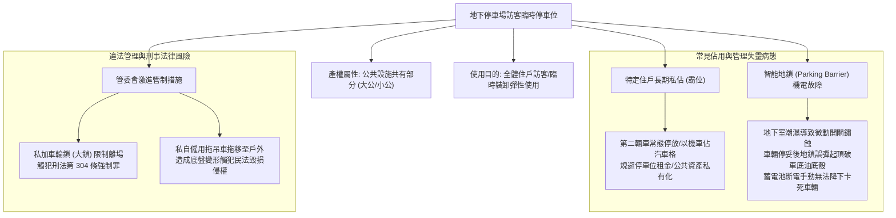
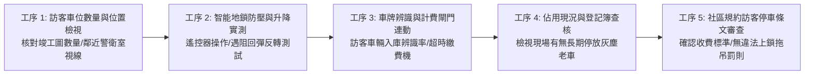
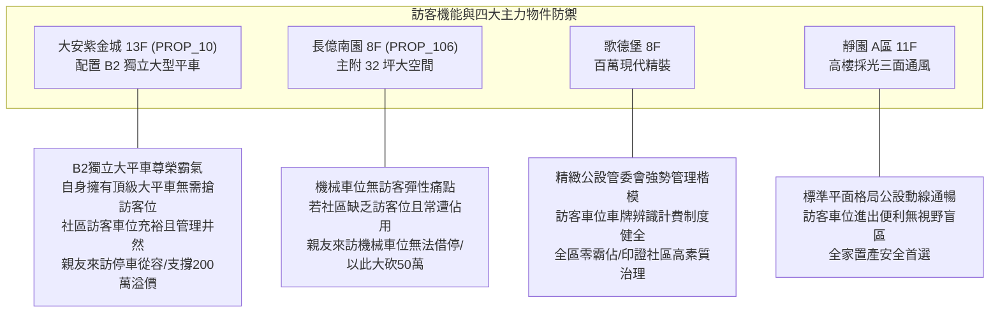

# 全案購屋實戰第一千零七十一部：中古大樓地下室車位訪客臨停車位違規佔用管理系統車牌辨識地鎖故障與管委會拖吊上鎖爭議體檢工序全書

## 前言：寸土必爭的停車秩序——地下室訪客車位、地鎖機電、車牌辨識與防佔用法律極致體檢

在中古大樓地下停車場的管理實務中，社區規劃的「訪客臨時停車位（Visitor Parking Space / Guest Parking）」是維繫親友探訪、裝修工班進出、外送物流與臨時裝卸貨物的**關鍵彈性公共設施**。然而，多數屋齡 15~30 年的中古社區，因地下車位配比不足、部分住戶持有多輛汽車，導致訪客車位常年遭特定住戶「長期霸佔、私自轉租或停放報廢車輛」；社區管委會為遏止私佔亂象，往往在地面加裝「智能遙控升降地鎖（Automatic Parking Barrier）」或「超時自動計費投幣系統」，卻因地下室潮濕造成地鎖齒輪卡死、電池漏液、車牌辨識攝影機逆光反光失靈；更嚴重的是，管委會若採取「私自上大鎖（車輪鎖）、強行拖吊或斷電限制進出」，往往直接踩踏《刑法》第 304 條強制罪與民法侵權賠償之**法律紅線**，引發住戶與管委會對簿公堂。

本手冊為《全案購屋實戰》系列第 1071 部，深入解析中古大樓地下訪客車位之法規產權屬性（法定防空避難室兼停車空間 vs 公共持分專用）、智能升降地鎖機電防壓保護、智慧車牌辨識與計費系統聯動、管委會合法制止佔用之 SOP（定型化契約告示/清潔費收取/民事不當得利求償），並精準對接永義房屋周小姐實勘帶看之四大決戰考慮物件。

---

## 第一章 訪客車位產權架構、佔用糾紛與違法拖吊法律機理

### 1.1 訪客車位產權本質與約定專用之界線
- **法定防空避難兼停車空間之公有性**：依《公寓大廈管理條例》第 7 條規定，大樓之防空避難設備、主要走道與公共動線不得為約定專用。訪客車位通常登記為「全體共有人按應有部分共有之公共設施（大公）」，全體區分所有權人均享有依通常使用方法利用之權利。
- **擅自佔用之法律責任**：
  - 住戶若未經全體同意或未依規約登記，常態性霸佔訪客車位，已構成《民法》第 179 條之「不當得利」，管委會或全體住戶得向其追討相當於當地停車位租金之不當得利收益（通常為每月 2,500 ~ 4,000 元）。
  - 若在車位上堆放雜物，亦觸犯《公寓大廈管理條例》第 16 條，得由主管機關處以 4 萬至 20 萬元之連續罰鍰。

### 1.2 管委會私自上鎖與拖吊之刑事犯罪邊界
- **刑法強制罪之構成（最高法院權威見解）**：管委會縱使在車道入口張貼「違規停車一律上鎖罰款 1,000 元」之告示，但管委會並無司法警察權。一旦管理員逕行對違規車輛施加車輪鎖（Wheel Clamp）致使車主無法駕車離去，即構成以強暴、脅迫手段「妨害人行使權利」，直接成立**刑法第 304 條第 1 項強制罪**，處三年以下有期徒刑、拘役或九千元以下罰金。
- **合規處理合法途徑**：
  1. 依區權會授權之規約，開立「超時臨時停車清潔管理費通知單」（具契約性質）；
  2. 依《民法》第 767 條提起「返還共有物與排除侵害」民事訴訟；
  3. 拍照錄影存證後，報請警方依社會秩序維護法或聲請法院假處分處理。

---

## 第二章 現場實地查驗訪客車位與防佔用系統五大工序

### 2.1 車位配置與現場佔用實勘（工序 1 & 4）
- **核對法定配置數量**：調閱大樓建物測量成果圖與使用執照，確認社區是否有規劃「合規訪客停車格（通常每 30~50 戶配置 1~2 格）」；若訪客車位全數遭管委會私下轉租給特定住戶當固定車位牟利，一般住戶親友來訪將無處可停。
- **排查霸位殭屍車**：實勘訪客車位時，檢視停放車輛外觀：
  - 輪胎是否嚴重缺氣下陷、車身是否布滿厚重灰塵未清洗；
  - 翻閱警衛室「訪客車輛登記簿」，比對車號是否為社區住戶所有，清查有無特權常態佔用。

### 2.2 智能地鎖機電防壓與手動釋放實測（工序 2）
- **遇阻回彈防夾測試（Auto-Reverse）**：在地鎖上方 10 cm 處放置彈性阻擋物，按下遙控器升起地鎖：
  - 合格之智能地鎖在感應阻力超過 5~10 kgf 時，必須在 **0.5 秒內立即停止並自動降下**；
  - 若地鎖強行頂升不退，車輛停入底盤極易遭地鎖頂破變速箱油底殼或油箱。
- **手動機械鎖匙應急降下**：切斷地鎖電源，使用專用六角或機械鑰匙旋轉釋放閥，確認地鎖能順暢壓平，防止電池沒電時卡死訪客車輛引發糾紛。

### 2.3 車牌辨識與超時收費閘門（工序 3 & 5）
- **訪客專用 QR Code / eTag 預約登記**：優質社區應配備手機 App 訪客車牌預先登記系統；當親友開車抵達車道時，車牌辨識攝影機能即時放行並指定停入編號訪客格，停留時間自動計時。
- **合法階梯式收費規約**：規約應訂定合情合理之收費標準（如：前 2 小時免費，第 3 小時起每小時 30~50 元，每日上限 200~300 元），以使用者付費抑制長期霸位，而非以非法上鎖手段管理。

---

## 第三章 永義房屋實勘主力考慮物件車位訪客機能適配與談判籌碼

### 3.1 大安紫金城 13 樓 (`PROP_10`) —— 頂級大平車與充裕訪客公設的尊榮生活
- **資產保護焦點**：配置專屬 B2 獨立大型平面車位（資產溢價高達 180~200 萬）。
- **實地查驗重點**：
  1. 買方自身已擁有一格完美的獨立大型平面車位，平日用車毫無懸念；實勘重點聚焦大樓 B1 是否設有專用訪客車位，且由警衛室落實登記換證管理。
  2. 訪客車位環境整潔、無特定鄰居長期霸位，親友或商務訪客前來拜訪時能優雅停入，進一步彰顯大安紫金城作為南區名邸之居住尊榮感與資產保值性。

### 3.2 長億南園 8 樓 (`PROP_106`) —— 機械車位缺乏彈性與訪客無處可停大砍價
- **機械車位對外來車輛之絕殺限制**：長億南園配置之機械車位限重 1.6 噸且操作繁複，外來親友之較大休旅車根本無法停入自用車位；若社區公有訪客車位數量極少（甚至常年遭特定住戶第二輛車佔用不退），親友來訪每次均需在周邊大慶商圈繞行找尋收費停車場。
- **談判籌碼運用**：在現場向賣方痛陳「自用車位為機械式已極為不便，社區公有訪客車位又缺乏有效管理常年癱瘓，生活招待抗性極高」，合流機械車位限重 1.6 噸與梯廳 4 階高差無障礙缺失，狠砍 998 萬開價 50 萬，直推至 745~760 萬之合理成交區間。

---

## 第四章 買方購屋特約防護與管委會訪客規約查核

1. **社區公共停車設施權利完整保證特約**：
   > 「賣方保證本買賣標的所屬社區之公共設施（含法定訪客停車位、裝卸貨專用車位），全體區分所有權人均享有合法依規約登記使用之權益，無遭特定住戶長期非法霸佔、私設地鎖阻礙或管委會私自違法轉租之情事；交屋前若有訪客車位產權或使用權糾紛，賣方應促請管委會妥適排除。」
2. **看屋與簽約前訪客停車查驗三要點**：
   - 第一點：向警衛室詢問「親朋好友若開車來訪，社區是否有訪客車位可停？每次能停多久？如何收費？」
   - 第二點：親自前往訪客車位現場，檢查地面地鎖是否正常作動，車格內有無停放無牌廢車。
   - 第三點：翻閱社區最新規約，確認對違規佔用車輛之處置條文是否符合法令，無非法上鎖拖吊之違法條款。

---

## 結語

地下停車場的訪客車位，看似僅是招待親友的輔助設施，實則是檢驗整個社區公共資產是否遭少數人私吞、管委會公權力是否健全有度的最真實照妖鏡。買方以專業工序檢驗訪客車位數量、地鎖機電安全、車牌辨識系統與規約適法性，不僅能確保全家人長遠待客的從容體面，更能以公設治理的深層瑕疵精準壓制不合理開價，在買房置產的博弈中穩操勝券！
