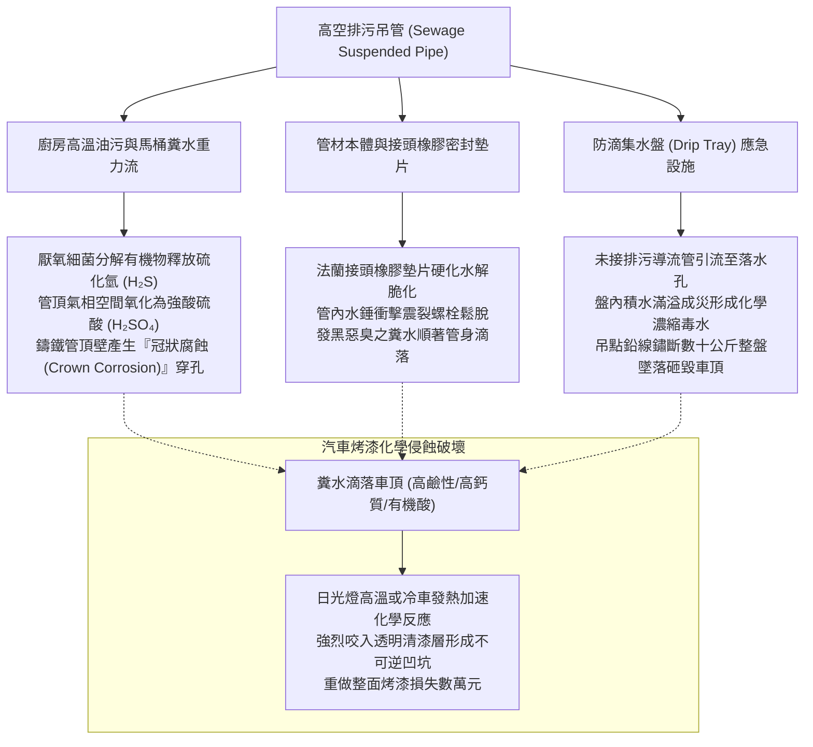
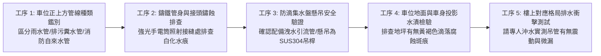
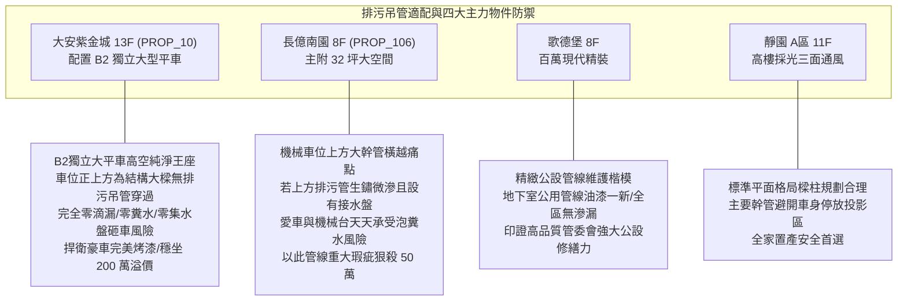

# 全案購屋實戰第一千零七十七部：中古大樓地下室車位上方排污鑄鐵管吊管鏽蝕穿孔滴漏糞水結晶重金屬腐蝕車漆與防滴集水盤體檢工序全書

## 前言：懸在頭頂的黃金之災——車位高空排污吊管、糞水滴漏與防滴接水盤極致體檢

在中古大樓地下停車場的立體管線配置中，懸吊於一樓地坪下方、橫越於地下車位正上方的「公共排污排水吊管（Suspended Sewage & Drainage Piping）」，承載了整棟大樓所有住戶廚房油水、馬桶糞水與浴室廢水的**重力流轉運重任**。然而，多數屋齡 15~30 年的中古社區，早期採用之傳統瀝青塗裝鑄鐵管（Cast Iron Soil Pipe / CIP）或厚壁 PVC 管，因長年受管內硫化氫（H₂S）、氨氣及高濃度油脂酸蝕，導致管壁由內而外鏽蝕爛穿、法蘭橡膠墊片老化水解；懸吊於車位上方的排污管開始「滲漏發黑惡臭之黃金糞水」，在車頂烤漆上形成難以清除的白色碳酸鈣硬垢與重金屬腐蝕斑，嚴重咬死清漆層（Clear Coat）甚至蝕穿鈑金底漆；更危險的是，部分管委會治標不治本，僅在管線下方懸掛廉價的「金屬或壓克力接水盤（Drip Pan / Drain Tray）」，日久接水盤滿溢、固定鐵線鏽斷，數十公斤滿載糞水的集水盤瞬間墜落砸扁車頂，引發極度惡劣之車損糾紛。

本手冊為《全案購屋實戰》系列第 1077 部，深入解析中古大樓地下排污吊管之內外腐蝕力學、法蘭接頭不銹鋼喉箍（No-Hub Coupling）緊固扭力、汽車烤漆受糞水化學酸鹼侵蝕修復工藝、防滴集水盤安全懸吊載重標準與明管改道工法，並精準對接永義房屋周小姐實勘帶看之四大決戰考慮物件。

---

## 第一章 車位上方排污吊管結構、化學腐蝕與滴漏機理

### 1.1 鑄鐵管「冠狀腐蝕（Crown Corrosion）」與滴漏原理
- **氣相硫酸腐蝕機理**：排污吊管並非長態滿管流水，管內上方常留有 1/3 ~ 1/2 的氣相空間。糞便污水中的硫酸鹽在厭氧環境下轉化為硫化氫氣體，逸出至管頂空間；管頂潮濕凝結水中的硫桿菌（Thiobacillus）將硫化氫進一步氧化為**強腐蝕性硫酸（H₂SO₄）**。
- **外觀完好、頂部穿孔之陷阱**：傳統鑄鐵管管底常年有流水沖刷未爛，但「管頂與接頭法蘭」早已被酸蝕成薄如紙片的蜂窩鐵鏽。一旦樓上住戶深夜沖馬桶產生重力水流衝擊，頂部孔洞立即滲漏出滴滴黃金污水。

### 1.2 糞水對車漆清漆層之化學破壞力
- **高活性化學咬痕（Chemical Etching）**：馬桶水富含尿酸、氨水、碳酸鈣結晶與微量鐵鏽。滴落於汽車金屬車頂、引擎蓋或擋風玻璃上，水分蒸發後形成高濃度鹼性鹽結晶。在地下室 30°C 悶熱環境下，數小時內即穿透 30~50 微米的聚氨酯清漆層，形成無法拋光消除的白濁火山口狀凹坑，唯一修復途徑為整件板金刨除重烤。
- **壓克力接水盤之致命二次災害**：許多社區因更換吊管費用高昂，遂在漏水管線下方吊掛白鐵或透明壓克力水盤接水。若水盤未接設 PVC 軟管將積水引流至排水溝，盤內積滿數十公升腐敗死水；懸吊水盤之鍍鋅鐵絲在潮濕硫化氫環境中快速生鏽爛斷，整盤污水連同重達 30 公斤鐵盤直接砸毀下方車輛天窗與擋風玻璃。

---

## 第二章 現場實地查驗車位上方排污設施五大工序

### 2.1 吊管種類辨識與外觀腐蝕（工序 1 & 2）
- **管身標籤與顏色塗裝**：
  - 消防管：紅色塗裝；
  - 自來水管：藍色或灰色；
  - **排污管／廢水管**：通常為橘色 PVC 管、黑色防音管、或外塗黑漆之重型鑄鐵管，口徑通常為 **4 吋（100mm）至 6 吋（150mm）**。
- **法蘭與不銹鋼喉箍（No-Hub Coupling）檢查**：手電筒直射每兩根管線的接合處與 90 度彎頭：
  - 橡膠套圈外緣若出現黑色發霉油泥、黃褐色結晶鐘乳石垂流，證實接口處正處於「慢性微滲漏」狀態；
  - 螺栓表面若已生鏽成酥脆片狀，表示隨時有崩脫爆管之險。

### 2.2 防滴集水盤之合規性核查（工序 3）
- **嚴查懸吊固定材質**：嚴禁使用細鐵絲、束帶或塑膠繩懸吊集水盤；合規之集水盤必須使用 **SUS304 不銹鋼全牙吊桿（M8 以上）** 與專用角鐵托架固定於 RC 天花板。
- **排水引流管（Drain Hose）**：水盤底部最低點必須開孔接駁 3/4 吋以上耐候軟管，將水流持續引導至最近的結構柱雨水落水管或排水明溝；若發現集水盤為「無排水孔之死盆」，盆內積滿黃水，此為極高風險之危險車位。

### 2.3 地坪滴痕與衝擊測試（工序 4 & 5）
- **地面白化腐蝕痕跡**：蹲下檢視目標車位中央與後保桿投影地坪：
  - Epoxy 耐磨地坪表面若有一圈圈「白色、黃褐色圓形斑痕」或地坪油漆起泡脫落，即為上方常態滴落糞水之無可辯駁的鐵證；
- **重力沖水測試**：若條件許可，請屋主在樓上住家連續沖馬桶兩次並開啟浴缸全速放水，買方站在地下車位下方靜心聆聽，確認管身有無劇烈水錘震動，接口處有無細微水霧滲出。

---

## 第三章 永義房屋實勘主力考慮物件排污吊管適配與談判籌碼

### 3.1 大安紫金城 13 樓 (`PROP_10`) —— 頂級獨立大平車的天空純淨無瑕
- **資產保護焦點**：配置專屬 B2 獨立大型平面車位（資產溢價高達 180~200 萬）。
- **實地查驗重點**：
  1. 大安紫金城地下室樓高充裕、管線工藝規整，B2 獨立大平車正上方為整齊平順之結構大樑與消防撒水管，**完全沒有任何公共排污排水大幹管橫越於車位正上方**。
  2. 車位地面環氧樹脂光潔均勻，無任何黃褐色糞水滴痕或臨時接水盤；百萬座駕停放其下，完全無需擔憂天花板滴落腐蝕性髒水，徹底維繫頂級大平車的至尊抗跌品質。

### 3.2 長億南園 8 樓 (`PROP_106`) —— 機械車位上方管線交錯與漏水痛點大砍價
- **機械車位遇管線滴漏之雙重滅頂災難**：長億南園若其機械車位正上方恰好橫跨整棟大樓之廚衛排污鑄鐵總管，管齡已達數十年且接頭有鐵鏽結晶白華。
- **致命硬傷**：
  1. 糞水若滴落，停放在上層載台之車輛車頂直接遭殃，烤漆金屬嚴重腐蝕；
  2. 污水若滲入下層機械底坑，酸性糞水將直接腐蝕機械鏈條、傳動軸承與馬達電線，造成整組機械車台頻繁卡死故障；
  3. 若管委會僅在管下拉設簡陋鐵絲接水盤，隨時有斷裂砸毀車輛之危險。
- **談判籌碼運用**：在現場指認「車位正上方排污幹管老舊滲漏、設有危險集水盤、隨時有腐蝕愛車漆面之重大隱患」，將此管線瑕疵合流機械車位限重 1.6 噸與無障礙缺失，痛陳日常停車提心吊膽，狠殺 998 萬開價 50 萬，直推至 745~760 萬之合理成交區間。

---

## 第四章 買方購屋特約防護與交屋驗收確認條款

1. **車位上方設施無滲漏與車漆防護保證特約**：
   > 「賣方保證本契約所附停車位（編號：B2-XX）正上方之公共排污管、雨水管及給排水管線結構完整牢固，無滲漏糞水、滴落鐵鏽污水或私設危險集水盤之情事；點交日前若有任何管線滴漏瑕疵，賣方應負責促請管委會修繕更換完成；若交屋驗收時發現地坪或車位上方有未修復之滴水漏水，買方得順延尾款支付並要求折讓修復費用。」
2. **交屋前車位高空排污檢查三要項**：
   - 第一項：攜帶強光手電筒仰頭逐段檢查車位投影天花板，確認無排污鑄鐵管法蘭滲水黑垢。
   - 第二項：檢查天花板是否有懸掛搖搖欲墜之臨時塑膠或白鐵接水盤。
   - 第三項：蹲下仔細撫摸車位地面，確認無酸性液體腐蝕產生之地坪粗糙凹坑。

---

## 結語

抬頭審視車位上方的每一根管道，是保護家庭百萬汽車資產最冷靜而決定性的動作。買方以專業工序檢驗排污管冠狀腐蝕、法蘭接頭氣密性、接水盤危險性與地面滴痕，不僅能徹底避免「愛車剛洗完、返家被淋滿頭糞水」的崩潰慘劇，更能從管線工法中看穿整棟大樓的維護體質，在價格談判中牢牢鎖定勝局！
