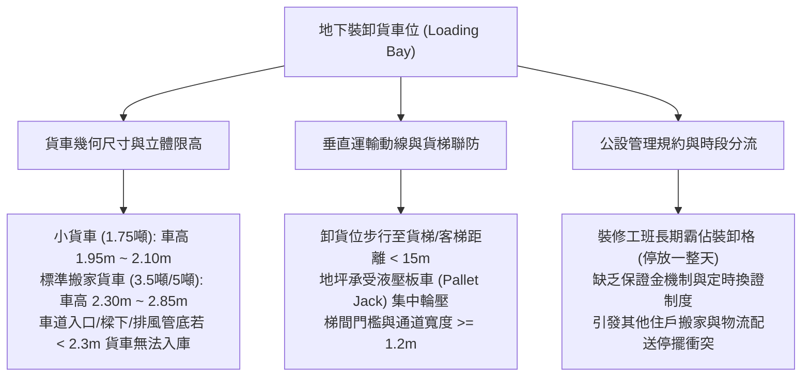
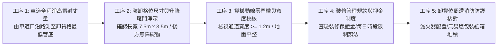
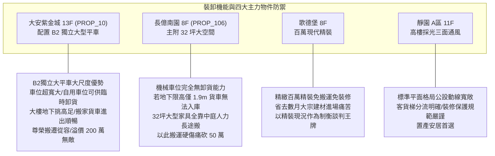

# 全案購屋實戰第一千零七十三部：中古大樓地下室車位卸貨專用暫停車位裝修搬家車輛限高通行衝突與時段登記管理體檢工序全書

## 前言：生活物資的垂直轉運樞紐——地下室卸貨車位、搬家限高與時段登記管理極致體檢

在集合住宅的日常營運與全生命週期流轉中，地下停車場規劃之「專用裝卸貨暫停車位（Loading / Unloading Parking Bay）」是全體住戶新居裝潢材料搬運、大型家電家具進出、搬家貨車停靠以及物流宅配大宗配送的**核心垂直物資轉運生命線**。然而，多數屋齡 15~30 年的中古社區，因早期車道入口與樑下限高僅設計為 1.9~2.0 公尺，導致標準 3.5 噸箱型搬家貨車（車高通常達 2.3~2.8 公尺）根本無法駛入地下室，被迫在社區大門紅線違停卸貨並長途人力推搬，大幅增加搬運工資與磨損中庭石材；更常見的是社區缺乏公正嚴謹的「裝卸時段預約登記制度」，卸貨車位常年遭特定裝修工班之小貨車「全日霸佔」，引發其他裝修住戶、快遞物流與管委會之間的激烈肢體衝突與公攤爭議。

本手冊為《全案購屋實戰》系列第 1073 部，深入解析中古大樓地下卸貨車位之幾何規格（車位長度 7.0~8.0 米 / 淨寬 3.0~3.5 米）、車道全線立體動線限高量測（防風管/消防管削頂）、大樓電梯保護工程規範、押金時段分流預約機制，並精準對接永義房屋周小姐實勘帶看之四大決戰考慮物件。

---

## 第一章 裝卸貨車位幾何力學、車輛限高與動線衝突機理

### 1.1 貨車立體高度與地下室限高極限
- **貨車級距與高度斷層**：
  - **一般小型發財車（1.75 噸以下）**：空車高度約 1.85 ~ 2.05 公尺。
  - **主流標準搬家貨車（3.5 噸 ~ 5 噸箱型車）**：空車高度普遍高達 **2.30 ~ 2.85 公尺**。
- **高空管線削頂危機**：中古大樓車道入口門楣可能標示「限高 2.1M」，但進入地下室轉彎處，往往受後天追加之大型鐵皮排風風管、消防自動撒水主管或排污立管橫越，實質最低點淨高僅剩 **1.95 公尺**。若搬家司機貿然駛入，箱型貨車頂部將直接撞斷消防主管或排風風管，造成瞬間爆管狂噴黑水淹沒地下室之慘禍。

### 1.2 裝卸車位規格與地坪集中載重
- **標準裝卸格位規格**：合規之卸貨車位，長度必須達到 **7.0 ~ 8.0 公尺**（以容納車長與後升降尾門全開伸展），寬度需達 **3.0 ~ 3.5 公尺**（預留兩側人員搬運大型沙發床墊動線）。
- **液壓油壓板車（Pallet Jack）輪壓破壞**：裝潢搬運磁磚水泥時，油壓板車承載 1~2 噸重物，其微小之尼龍或鐵質滾輪對地坪產生高達 **數百 kgf/cm² 之極端點壓強**。若車位地坪環氧樹脂未經耐衝擊加厚處理，地坪將被壓出深坑溝槽。

---

## 第二章 現場實地查驗卸貨車位設施五大工序

### 2.1 車道進出動線全線淨高掃描（工序 1 & 2）
- **動線最低點雷射實測**：買方應親自持雷射測距儀，自一樓車道鐵捲門入口開始，沿著行車坡道、轉角剪力牆、天花板大樑、消防管與排風風管底部逐點測量：
  - 若全程最低淨高大於 **2.30 公尺**，代表標準箱型搬家車能直達地下室卸貨；
  - 若中途有任何管線低於 **2.10 公尺**，交屋後搬家必須僱用昂貴之「低頂特殊搬家車」或在大門外人力接駁，搬家工資將暴增 5,000 ~ 15,000 元。
- **尾門伸展長度檢測**：卸貨車位長度實測需大於 7.0 米；車位正後方牆面不得有凸出之瓦斯排氣管或消防放水閥，防止貨車後尾門下降時擊碎管件。

### 2.2 垂直搬運通道與貨梯連通性（工序 3）
- **搬運動線暢通度**：自卸貨格位至地下昇降機廳門口：
  - 走道淨寬度至少需達 **1.20 公尺** 以上（方便雙人抬運特大雙人床墊與大型冰箱）；
  - 全程地坪不得有階梯高差或凸起門檻，轉角處應加裝「不銹鋼或橡膠防撞包角」，防止推車撞崩結構柱角水泥。

### 2.3 裝修搬家規約與預約機制（工序 4 & 5）
- **分流機制與保證金審查**：管委會是否訂定明確之《住戶裝潢施工及搬遷管理辦法》：
  - 卸貨車位每次使用上限為 **2~4 小時**，嚴禁停放過夜；
  - 裝修工班進場前必須繳納「裝修保證金（通常為 3 萬至 5 萬元）」；
  - 施工期間電梯車廂與走道必須強制鋪設「三重防護板（瓦楞板+夾板+防塵膜）」，違者扣抵保證金。

---

## 第三章 永義房屋實勘主力考慮物件裝卸機能適配與談判籌碼

### 3.1 大安紫金城 13 樓 (`PROP_10`) —— 頂級大平車與大尺度地下動線的搬遷尊榮
- **資產保護焦點**：配置專屬 B2 獨立大型平面車位（資產溢價高達 180~200 萬）。
- **實地查驗重點**：
  1. 大安紫金城地下室整體挑高充裕，車道淨高實測達 2.25 公尺以上，標準小型貨車可直接駛入 B2，且地下室規劃有專屬卸貨暫停空間。
  2. 即使卸貨位偶有佔用，買方自身之 B2 獨立大平車面寬達 2.50 米且靠柱，搬家當天自用大平車即可作為專屬卸貨腹地，出電梯僅需數步之遙，展現大格局平車無可取代之實用尊榮。

### 3.2 長億南園 8 樓 (`PROP_106`) —— 32 坪超大空間裝修搬家之致命痛點大砍價
- **空間與搬運之極端矛盾**：長億南園主建物高達 32 坪，室內空間大，買方接手後若需進行全戶水電重拉與系統櫃重作，建材與家具進出量高達數十噸。
- **致命硬傷合流**：
  1. 自用車位為機械式，機械載台限重 1.6 噸且尺寸窄小，**任何裝潢小貨車均無法停入自用車位卸料**；
  2. 若地下室車道樑下高度不足導致貨車無法入庫，所有重型板材、磁磚水泥全需在一樓大門外卸貨，加上一樓梯廳存在「4 階高差無障礙缺失」，搬運工人推車卡死在階梯前，每趟搬運均是一場災難。
- **談判籌碼運用**：在現場向賣方痛陳「室內雖大，但裝修搬運動線極端惡劣、工資運費暴增，且機械車位毫無裝卸彈性」，將此痛點合流機械車位限重 1.6 噸，狠殺 998 萬開價 50 萬，直推至 745~760 萬之合理成交區間。

### 3.3 歌德堡 8 樓 —— 百萬精裝免大宗建材搬運之極致籌碼
- **精裝優勢對比**：歌德堡具備現代百萬精緻裝潢，買方「一卡皮箱即可入住」，完全免去長億南園動輒數十噸重型建材搬運、排風管削頂與電梯碰撞刮傷之痛苦，作為制衡大安與長億讓價之最佳心理籌碼。

---

## 第四章 買方購屋特約防護與交屋裝潢搬家確認條款

1. **社區公共卸貨動線與裝修權益保證特約**：
   > 「賣方保證本買賣標的所屬社區，享有合法依規約使用地下室或地面公共裝卸貨暫停空間及貨梯搬運之權益；且買方交屋後依規申請室內裝修時，管委會不得無端藉故阻撓裝潢工班車輛合規進入卸貨；交屋日前若有原住戶裝潢糾紛或欠繳之裝修保證金，由賣方全額結清負責。」
2. **看屋現場裝卸動線實測三步驟**：
   - 第一步：使用雷射測距儀測量自車道入口至地下卸貨點全程之最低管線高度，確認貨車能否通行。
   - 第二步：步行實測卸貨車位至貨梯大門距離，確認走道寬度 >= 1.2 米且無階梯阻礙。
   - 第三步：調閱管委會裝潢施工規約，確認裝修保證金退還標準與每日施工卸貨時段限制。

---

## 結語

地下室的卸貨車位與進出限高，雖非每日高頻使用，卻在人生交屋入厝、全室裝修與添購大型家具的最關鍵時刻，決定了家庭生活的從容度與荷包支出。買方以專業工序檢驗全線限高、卸貨格位尺度、貨梯無障礙動線與社區裝修規約，不僅能免除搬家爆管與工資暴增的無妄之災，更能從大樓對重型搬運動線的規劃深度中，精準洞悉社區資產的真正成色，在房價博弈中立於不敗之地！
