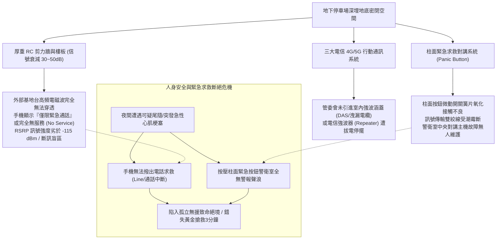
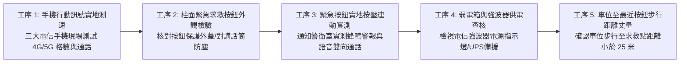
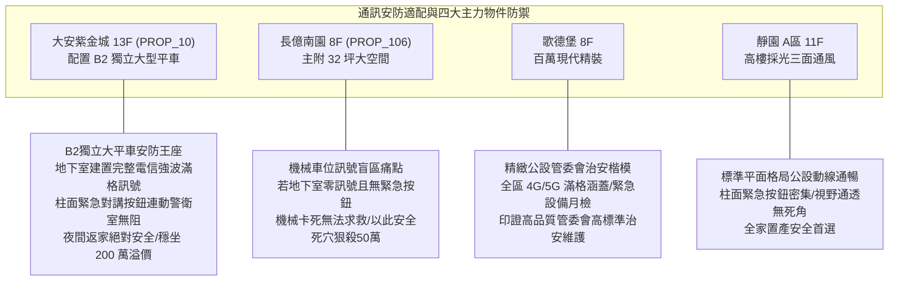

# 全案購屋實戰第一千零七十九部：中古大樓地下室車位旁弱電信號放大器4G5G行動通訊微弱盲區與社區對講機緊急求救按鈕斷線體檢工序全書

## 前言：暗黑密室的信號孤島——車位行動通訊涵蓋、緊急對講求救與人身治安防衛極致體檢

在現代都會住宅生活與地下人身安全防護中，深埋於地底 5~15 公尺深的地下停車場空間，厚重 RC 剪力牆與覆土層對無線電高頻電磁波產生嚴重的「穿透衰減（Penetration Loss，衰減達 30~50 dB）」，使得地下停車場極易淪為「行動電話零格訊號、4G/5G 網絡全斷」的**數位訊號死角孤島**。然而，多數屋齡 15~30 年的中古社區，管委會因節省公設維護費或與電信業者協調不良，地下室未建置「同軸洩漏電纜（Leaky Coaxial Cable / Radiax）」或「小型室內強波天線（DAS / Distributed Antenna System）」；更致命的是，設置於地下車位旁結構柱面上的「社區緊急求救對講按鈕（Emergency Panic Button）」因長年潮濕、微動開關接點氧化或傳輸芯線斷線，在住戶突遇心血管急症、夜間遭遇歹徒尾隨、倒車意外擦碰或火災濃煙受困時，按下求救按鈕警衛室受訊盤全無反應，拿出手機又完全打不出「110 / 119」緊急報案電話，使地下停車場瞬間化身為呼救無門的人身安全絕境。

本手冊為《全案購屋實戰》系列第 1079 部，深入解析中古大樓地下室電信室內涵蓋系統工藝（三大電信 4G/5G 洩漏電纜與主動式微細胞基站）、信號接收強度指示（RSRP / RSRQ 標準）、緊急求救對講盤乾接點電壓量測（常閉 NC / 常開 NO 迴路監控）、後備不斷電蓄電池自持力，並精準對接永義房屋周小姐實勘帶看之四大決戰考慮物件。

---

## 第一章 地下車位行動通訊遮蔽、信號盲區與緊急對講失效機理

### 1.1 混凝土電磁波衰減與電信室內涵蓋工法
- **穿透損耗物理學**：
  - 一般 4G/5G 所使用之高頻段（1800MHz / 2100MHz / 3.5GHz），波長極短、繞射能力極差；
  - 穿透一層厚度 20~25 cm 之鋼筋混凝土樓板，信號強度直接衰減 **20 ~ 30 dB**；穿越地下兩層（B2）時，信號強度衰減超過 **50 dB（能量衰減 10 萬倍）**，戶外電波在地下室幾乎完全歸零。
- **三大室內涵蓋工法對比**：
  1. **同軸洩漏電纜（Leaky Feeder Cable）**：沿車道天花板鋪設開孔同軸電纜，電波由纜線開槽均勻向兩側洩漏，信號覆蓋最均勻無死角。
  2. **分散式天線系統（DAS）**：每隔 15~20 公尺安裝一具吸頂全向型天線（Ceiling Antenna），由電信機房強波器主動放大發射。
  3. **完全無建置**：全依賴室外微弱繞射，車位深處完全斷訊。

### 1.2 緊急求救按鈕（Panic Station）迴路監控標準
- **閉路監視常閉型回路（Normally Closed Loop）**：合規之緊急求救系統，平時線路應維持弱電導通電流；一旦按鈕被按下（迴路斷開）或電線遭老鼠咬斷，警衛室主機必須「立即發出線路故障或緊急報警聲響」。
- **劣質常開型（Normally Open）陷阱**：多數中古社區採用便宜常開開關，電線斷線時警衛室毫無察覺；直到住戶遇險按下時，訊號根本無法傳回主機，形同虛設的「裝飾品按鈕」。

---

## 第二章 現場實地查驗車位通訊與緊急按鈕五大工序

### 2.1 行動通訊覆蓋強度實測（工序 1 & 4）
- **專業信號強度檢測**：手持智慧型手機進入工程模式（iOS 輸入 `*3001#12345#*` 進入 Field Test；Android 使用 NetMonster App）：
  - 檢視接收信號參考功率（RSRP / Reference Signal Received Power）：
    - 優良：**大於 -90 dBm**（滿格，通話上網順暢）；
    - 普通：**-90 至 -105 dBm**（2~3 格）；
    - 嚴重不良：**劣於 -115 dBm**（無服務，隨時斷線）。
- **實地語音通話測試**：買方坐在車位駕駛座內關閉車窗，實地撥打一通行動電話與語音通話維持 60 秒，確認無雜音、無斷音、無延遲，且通訊軟體訊息能秒發秒收。

### 2.2 緊急按鈕動作與雙向對講測試（工序 2 & 3）
- **雙向清晰通話測試**：在仲介或管理員陪同下，親自按下目標車位旁結構柱上的緊急求救按鈕：
  - 柱面上方之警示閃燈（Strobe Light）必須同步爆閃；
  - 警衛室受訊台必須在 **3 秒內** 響起高分貝警報，管理員透過對講機與現場通話，語音必須清晰無電流雜音；
  - 若按壓後全無反應，現場即可記錄為「重大公設安防失能瑕疵」。

### 2.3 求救設施距離與盲區排查（工序 5）
- **黃金救援距離**：自車位駕駛座下車位置步行至最近的緊急按鈕，步行距離原則上不得超過 **25 ~ 30 公尺**；若一整層地下二樓僅在最遠角落的樓梯口設有一具按鈕，車位區域即屬「安防真空地帶」。

---

## 第三章 永義房屋實勘主力考慮物件通訊與安防適配及談判籌碼

### 3.1 大安紫金城 13 樓 (`PROP_10`) —— 頂級獨立大平車的數位通訊與人身安防王座
- **資產保護焦點**：配置專屬 B2 獨立大型平面車位（資產溢價高達 180~200 萬）。
- **實地查驗重點**：
  1. 大安紫金城地下室經三大電信業者共同會勘，建置有完善之室內天線強波系統，B2 獨立大平車處手機 4G/5G 訊號實測達 **滿格（RSRP > -85 dBm）**，通話上網秒通，返家完全不漏接重要電話。
  2. 車位鄰近結構柱上配備獨立之緊急求救對講按鈕與高畫質監視鏡頭，直通 24 小時迎賓警衛室，女性家人或長輩夜間獨自停車返家享有最高級別之人身安全防護，充分奠定頂級名邸之尊榮身價。

### 3.2 長億南園 8 樓 (`PROP_106`) —— 機械車位訊號斷絕與受困求救無門大砍價
- **機械車位遇通訊斷絕之極限恐怖**：長億南園若地下室未建置強波器，手機訊號進入地下二層即降至「零格（No Service）」。
- **致命安全硬傷**：
  1. 住戶在操作機械車位時，若遇機械故障載台卡在半空中、或人員不慎受困於車內，手機完全無法撥出求救；
  2. 若車位周邊結構柱缺乏緊急求救對講機，住戶將在陰暗密室中陷入孤立無援之巨大恐慌。
- **談判籌碼運用**：在現場指認「地下室行動通訊全斷、缺乏緊急求救對講連動、存在重大受困治安盲區」，將此人身安全致命缺陷合流機械車位限重 1.6 噸與無障礙缺失，痛陳大樓公設安防嚴重脫節，狠殺 998 萬開價 50 萬，直推至 745~760 萬之合理成交區間。

---

## 第四章 買方購屋特約防護與交屋安防驗收確認條款

1. **地下室公共通訊與緊急救助系統保證特約**：
   > 「賣方保證本契約所屬社區之地下停車場，具備正常之行動電話訊號接收環境與公共緊急求救通報系統；車位周邊設置之緊急對講按鈕功能正常，能即時連通警衛室受訊台；若交屋前管委會發現緊急通報系統線路故障，賣方應促請管委會改善修復完成。」
2. **交屋前車位通訊與治安實測三步驟**：
   - 第一步：站在目標車位駕駛座旁，拿出手機實測三大電信訊號強度，確認通話與行動網絡秒通。
   - 第二步：試按車位最近之柱面緊急求救按鈕，確認警報蜂鳴響起且與警衛室雙向語音清晰對講。
   - 第三步：檢視大樓緊急發電機迴路，確認停電時電信強波器與緊急對講主機均具備 UPS 與發電機備援供電。

---

## 結語

深埋地底的車位，不該是與世隔絕的信號荒漠，更不能成為人身遇險時的呼救黑洞。買方以專業工序檢驗地下室 4G/5G 通訊電波覆蓋、緊急求救按鈕連動反應與備援供電能力，不僅能為全家人築起最堅固的日常通訊與生命安全防線，更能以深層的治安公設缺失在價格談判中精準施壓，牢牢捍衛家庭資產的最大權益！
