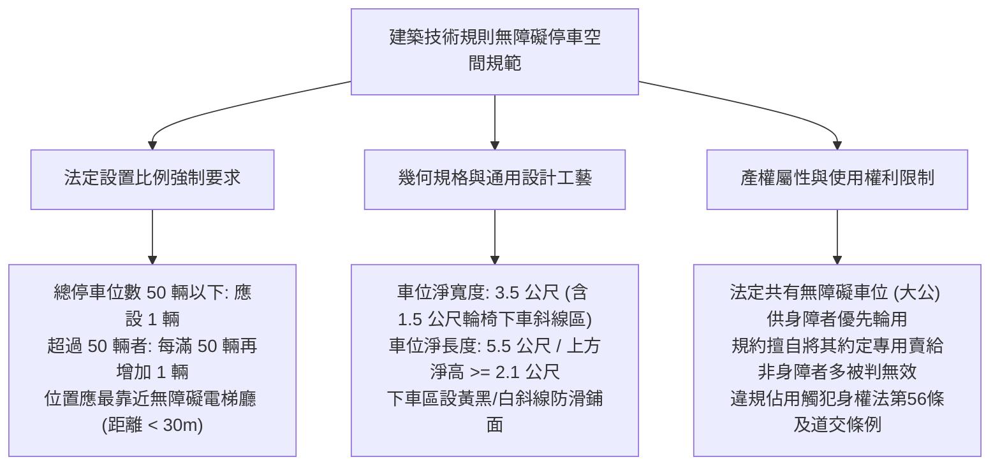
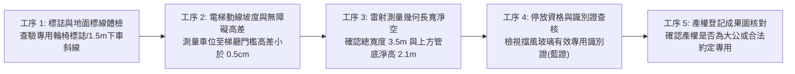
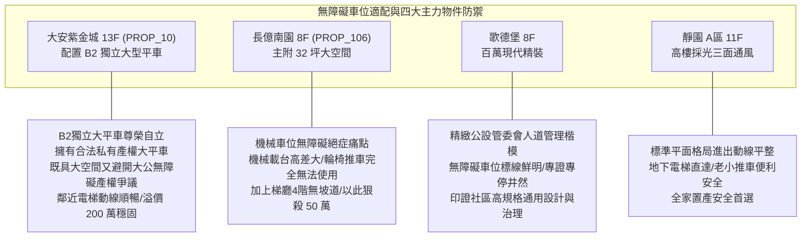

# 全案購屋實戰第一千零七十二部：中古大樓地下室車位無障礙專用汽車位設置比例合法性與非身心障礙者違規佔用罰則體檢工序全書

## 前言：人道關懷與法規紅線——無障礙專用停車位、通用設計規格與違規佔用極致體檢

在現代集合住宅全生命週期設計與法定公共設施規範中，設置於地下停車場最靠近無障礙昇降機廳出入口的「無障礙專用汽車停車位（Accessible Parking Space）」，是保障行動不便者、身心障礙家庭、高齡長者與輪椅推車進出家門的**核心人道通用設計防線**。然而，多數屋齡 15~30 年的中古社區，在興建之初未達現行法定設置比例（每 50 格汽車位應設 1 格無障礙車位），或在劃設時嚴重「縮水偷工」，導致下車輪椅無障礙通道（寬度至少需 1.5 公尺）遭結構柱或牆壁擠壓消失；更常見的是社區缺乏嚴謹門禁管理，無障礙車位常年遭一般非身心障礙住戶「任意霸佔、私自轉租或停放名車」，甚至引發身心障礙住戶向直轄市政府主管機關（台中市都發局或社會局）檢舉開罰；買方在看屋時若誤買或約定專用了「法定共有無障礙車位」，交屋後將面臨遭管委會強制收回供身障者輪用之巨大法律風險。

本手冊為《全案購屋實戰》系列第 1072 部，深入解析《身心障礙者權益保障法》第 56 條、《建築技術規則建築設計施工編》第 167 條之 6 無障礙車位法定規格（寬 3.5 公尺含 1.5 公尺下車區）、專用識別證查核工序、共有專用權利限制與違規佔用排除機制，並精準對接永義房屋周小姐實勘帶看之四大決戰考慮物件。

---

## 第一章 無障礙專用車位法規架構、規格力學與產權爭議機理

### 1.1 法定設置比例與空間幾何極限
- **強制設置比例（建築技術規則第 167 條之 6）**：
  - 供公眾使用建築物及集合住宅停車空間，總停車位數在 **50 輛以下者，應設置 1 輛無障礙停車位**；超過 50 輛者，每增加 50 輛應增設 1 輛。
  - **位置鄰近性要求**：無障礙車位必須設置於最靠近「無障礙昇降機門廳或無障礙走道出入口」處，水平步行距離原則上不得超過 **30 公尺**，且沿途動線不得有任何門檻、階梯或小於 90 cm 之瓶頸。
- **黃金 3.5 公尺寬度幾何學**：
  - 標準車位淨寬通常為 2.5 公尺，而無障礙車位總寬度必須達 **3.50 公尺**（包含停車區寬 2.0~2.5 公尺，加上 **1.50 公尺寬之專屬輪椅下車斜線緩衝區**）；
  - 斜線緩衝區係提供輪椅展開、斜坡板伸展及照護者攙扶上下車之絕對安全空間，嚴禁在該斜線上劃設機車格或停放腳踏車。

### 1.2 產權登記與約定專用之司法效力爭端
- **大公性質與身障優先權**：多數中古大樓之無障礙車位在產權上登記為全體住戶共有之「公共設施（大公）」。若建商或早期管委會擅自將此法定無障礙車位「單獨作價賣斷」或簽訂「約定專用」給非身障住戶，法院判決實務（如最高法院多起民事判決）多認定此舉違反保護弱勢之強制規定，認定該約定專用「自始無效」，管委會得隨時收回供領有身心障礙證明之住戶優先申請使用。
- **身心障礙者專用停車位識別證（藍證）法規門檻**：停放於無障礙專用車位之車輛，前擋風玻璃內必須明確放置直轄市主管機關核發且在有效期限內之「身心障礙者專用停車位識別證」或專用車牌，非身障者即使臨停 5 分鐘亦屬違法。

---

## 第二章 現場實地查驗無障礙車位設施五大工序

### 2.1 標線圖誌與空間幾何丈量（工序 1 & 3）
- **國際輪椅標誌塗裝**：車位地面中央應漆繪白色輪椅圖樣（寬度至少 100 cm），並於旁邊柱面或牆面懸掛高度 1.5 米之「無障礙專用停車位標誌牌」，標示違規佔用檢舉專線與罰則。
- **實地雷射測距**：使用雷射測距儀測量車位全寬：
  - 停車格寬度是否達到 2.0~2.5 公尺；
  - 輪椅下車緩衝區是否確實具備 **1.50 公尺以上淨寬**，且無排水明溝、無結構柱遮擋；
  - 車位正上方消防撒水管底、排風風管底之淨高，必須大於 **2.10 公尺**（防止高頂福祉車頂擦撞）。

### 2.2 通往電梯廳之無障礙連續動線（工序 2）
- **零門檻與防滑坡道**：自車位下車區步行推輪椅至無障礙電梯廳門口：
  - 地面絕對不得有超過 **0.5 公分（5 mm）** 之垂直銳角階梯高差；
  - 若有斜坡，其坡度不得陡於 **1/12（8.3%）**，且斜坡兩側應設有防墜緣石與扶手，杜絕輪椅翻覆。

### 2.3 產權謄本與使用權利釐清（工序 4 & 5）
- **核對建物登記謄本與成果圖**：買方若欲購買之車位恰為無障礙車位，必須詳查：
  - 該車位是否有獨立建號（專有部分）；
  - 若僅為大公持分，核對社區規約是否有「身障者優先輪用」條款；若買方全家均非身障者，切勿高價接手此類車位，防止未來產權糾紛爆發被全體住戶強制逐出。

---

## 第三章 永義房屋實勘主力考慮物件無障礙適配與談判籌碼

### 3.1 大安紫金城 13 樓 (`PROP_10`) —— 獨立大平車的產權純淨與動線優勢
- **資產保護焦點**：配置專屬 B2 獨立大型平面車位（資產溢價高達 180~200 萬）。
- **實地查驗重點**：
  1. 大安紫金城 B2 獨立大平車為合法獨立編號之專用平面車位，非公共身障輪用車位，產權純淨無任何爭議，買方享有永久專用權利。
  2. 該車位面寬達 2.50 米以上，一側靠大柱，下車動線寬敞平整；從車位步行至 B2 電梯廳沿途地坪平整無高差階梯，即便家中有長輩或推嬰兒推車，亦能享受如無障礙車位般之寬裕便利，展現頂級資產之成熟魅力。

### 3.2 長億南園 8 樓 (`PROP_106`) —— 機械車位無障礙絕症與梯廳高差大砍價
- **通用設計致命死穴**：長億南園配置之機械車位，載台四周有升降鋼架、踏板金屬斜坡陡峭，身障人士、輪椅使用者或行動不便之長輩**根本完全無法在機械載台上上下車**；更致命的是，大樓一樓梯廳存在「4 階高差無障礙缺失（無緩坡道）」。
- **談判籌碼運用**：在現場向賣方痛陳「家中有高齡長輩，機械車位完全無障礙失能，大樓進出動線充滿階梯阻礙，家庭長期照護抗性極高」，將此通用設計重大缺陷合流機械車位限重 1.6 噸，對 998 萬開價痛下殺手，狠砍 50 萬，直壓至 745~760 萬之合理成交區間。

---

## 第四章 買方購屋特約防護與交屋驗收確認條款

1. **車位產權性質與專用權利保證特約**：
   > 「賣方保證本契約所附停車位（編號：B2-XX）為合法之私有約定專用車位，非屬依法應由全體區分所有權人身心障礙者優先輪流使用之公共無障礙停車位，無遭管委會撤銷專用權或強制收回之法律爭議；若交屋後該車位因屬性爭議遭管委會認定無效，賣方應負瑕疵擔保責任並退還車位全部買賣價金。」
2. **看屋與簽約前無障礙設施查驗三要項**：
   - 第一項：核對目標車位地面塗裝，確認非漆有「國際輪椅圖樣」之法定身障車位。
   - 第二項：實測自車位至地下昇降機廳門口之動線，確認全程地面平整無階梯阻礙。
   - 第三項：巡視社區公有無障礙車位，確認停放車輛均放置有效識別證，無特權非法霸佔。

---

## 結語

無障礙停車位是集合住宅文明程度與人道尊嚴的縮影，更是產權界限中最容易踩雷的法律險灘。買方以專業工序檢驗車位產權屬性、通用動線規格與防霸佔管理機制，不僅能確保全家人長遠進出的平順安康，更能徹底避開「買錯共有車位遭強制作廢」的巨大資產陷阱，在置產博弈中永遠立於不敗之地！
