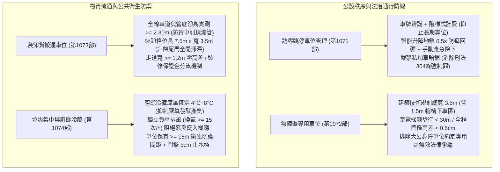
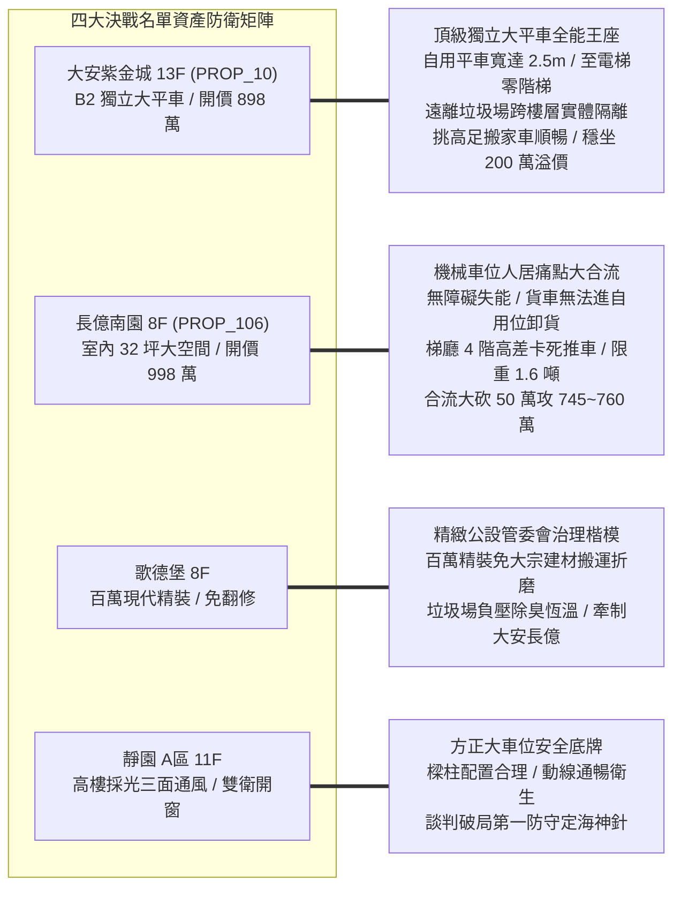
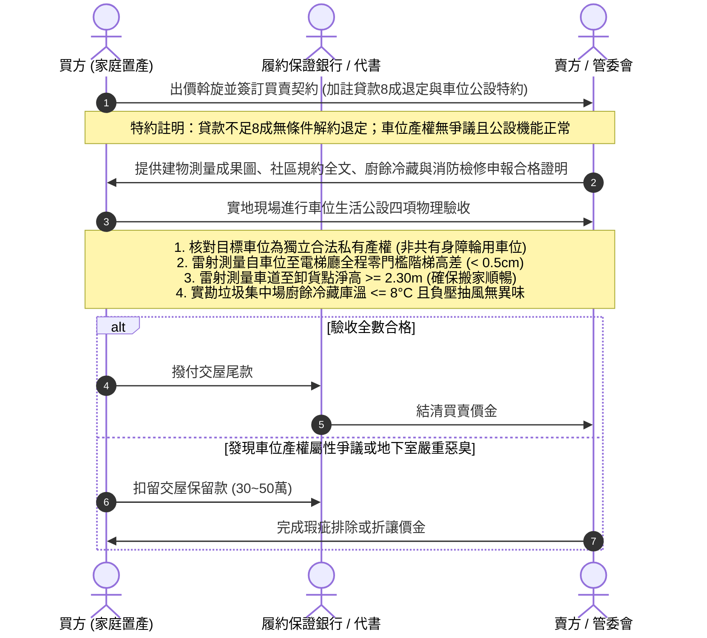

# 全案購屋實戰第一千零七十五部：第一千零七十五部圓滿登峰全景極致全生命週期家庭置產避坑抗震防漏水電機電消防永恆至尊金典總綱全書

## 前言：跨越一千零七十五部歷史新巔峰——地下車位公設秩序、無障礙人道尊嚴、裝卸垂直轉運與公共衛生永恆防衛

本手冊為《全案購屋實戰》系列邁向**第一千零七十五部（第 1075 部）**之跨時代圓滿登峰總綱大典。本卷聚焦融會貫通自第 1071 部至第 1074 部關於中古大樓地下停車位「公設彈性訪客車位、無障礙人道專用權利、大宗搬家裝修裝卸轉運、以及地下垃圾集中衛生防護」之四位一體極限防禦體系：
1. **第 1071 部：地下室車位訪客臨停車位違規佔用管理系統車牌辨識地鎖故障與管委會拖吊上鎖爭議體檢**
2. **第 1072 部：地下室車位無障礙專用汽車位設置比例合法性與非身心障礙者違規佔用罰則體檢**
3. **第 1073 部：地下室車位卸貨專用暫停車位裝修搬家車輛限高通行衝突與時段登記管理體檢**
4. **第 1074 部：地下室車位垃圾分類集中場廚餘冷藏故障臭氣滲漏孳生果蠅與高壓清洗排水倒灌體檢**

本典全面將上述四大地下公設「訪客彈性、弱勢人道、物資流通、環境衛生」之微觀治理維度，深度對接永義房屋周小姐 4 梯次實勘帶看之**四大決戰考慮名單**（大安紫金城 13 樓、長億南園 8 樓、歌德堡 8 樓、靜園 A 區 11 樓），構築出集公共設施法理、人道通用設計、高空立體力學與價格談判制勝籌碼於一體的永恆金典總綱！

---

## 第一章 地下車位公設機能與生活環境四位一體全景圖

### 1.1 法治公權力與人道通用設計指標
- **訪客管理法治化**：確立訪客車位之大公屬性，嚴禁特定住戶長態霸佔；防佔用地鎖必須具備遇阻反彈防壓功能（防頂破車輛油底殼），管委會嚴禁私自加裝車輪大鎖，以合法之階梯式收費規約維繫公共利益。
- **無障礙通行人道尊嚴**：嚴格查核無障礙車位法定比例與 3.5 公尺淨寬標準（1.5 公尺下車區絕不妥協）；沿線至電梯門廳高差小於 0.5 公分，坡度平緩於 1/12；徹底排除共有身障車位私自買斷遭判無效收回之產權風險。

### 1.2 物資轉運效率與微觀衛生環境指標
- **立體搬運動線防削頂**：全車道自入口至卸貨格雷射實測淨高大於 2.30 公尺，確保 3.5 噸搬家貨車直入地下室；轉運走道大於 1.2 米，消弭大件家具碰撞與爆管狂噴黑水之慘劇。
- **空氣微環境與防倒灌底線**：廚餘冷藏庫溫實測低於 8°C，負壓抽風阻絕硫化氫與甲硫醇竄入電梯井；垃圾房門口設置 3~5 cm 止水檻，車位距離垃圾房大於 15~20 公尺，徹底隔離酸性垃圾滲漏水（pH 4.0~5.5）對地坪與愛車輪胎鋁圈之腐蝕。

---

## 第二章 永義房屋實勘四大決戰主力考慮物件全維度適配與談判攻防

### 2.1 大安紫金城 13 樓 (`PROP_10`) —— 頂級獨立大平車之全能價值霸權
- **資產核心定位**：開價 898 萬。起手 720~730 萬，目標 768~788 萬，封頂 800 萬。扣除套房拆除款 35 萬。
- **公設生活機能極致驗收**：
  1. **尊榮自立與無障礙**：B2 獨立大平車產權純淨，非大公爭議身障車位；面寬達 2.50 米且靠大柱，至電梯廳全程平整無階梯阻礙，長輩輪椅與嬰兒推車通行極其從容。
  2. **環境衛生與搬運優勢**：地下挑高充裕，自用大車位即可作為臨時卸貨腹地；車位位於 B2，與 B1 垃圾集中場「跨樓層實體隔離」，完全零臭氣、零果蠅、零倒灌風險，具備 180~200 萬之實質溢價防禦力，為全案最強資產護城河。

### 2.2 長億南園 8 樓 (`PROP_106`) —— 機械車位多重生活缺陷合流大砍價
- **資產核心定位**：開價 998 萬。起手 698~720 萬，目標 745~760 萬。
- **談判籌碼致命打擊點**：
  1. **生活轉運與無障礙雙重失能**：室內雖高達 32 坪，但自用機械車位（限重 1.6 噸）完全無法提供裝修貨車停靠卸料；若地下限高不足貨車無法入庫，建材全需在大門外卸料；加上一樓梯廳存在「4 階高差無障礙缺失（無緩坡道）」，輪椅與搬運板車卡死階梯前。
  2. **合流砍價 50 萬戰術**：將「機械車位無障礙失能、搬運裝卸極端困難、梯廳高差阻礙長照、垃圾房異味滯留」合流，向賣方痛陳日常人居生活之沉重抗性，狠砍開價 50 萬，直推至 745~760 萬之甜蜜成交區間。

### 2.3 歌德堡 8 樓 —— 百萬精裝免大宗建材搬運之極致籌碼
- **資產核心定位**：現代北歐百萬精裝，現省 80~120 萬翻修現金流與數月工期，免除長億南園數十噸重型建材搬運、管線削頂與電梯刮傷之痛苦，作為制衡大安紫金城與長億南園讓價的最佳心理王牌。
- **物業治理楷模**：垃圾處理場廚餘冷藏恆溫、負壓排風除臭運作正常，印證高品質社區之治理實力。

### 2.4 靜園 A 區 11 樓 —— 三面採光景觀與無死角安全備援
- **資產核心定位**：三面採光、雙衛皆自然開窗，車位格局方正、動線通風衛生良好，作為談判破局時第一安全底牌。

---

## 第三章 買方購屋特約防線與車位公設生活交屋點交 SOP

### 3.1 核心購屋特約防禦條款範本
1. **金融機構貸款八成保證退定特約**：
   > 「本買賣契約以買方獲得金融機構核貸房屋貸款成數達實際成交總價之八成（80%）為生效要件；若因非可歸責於買方之個人信用瑕疵因素導致核貸不足八成，買方得無條件解除契約，賣方及仲介方應於接獲通知後三日內將定金及已付價金全額無息退還。」
2. **車位獨立產權與公設生活環境無瑕疵保證特約**：
   > 「賣方保證本契約所附停車位（編號：B2-XX）為合法之私有約定專用車位，非屬依法應由全體區分所有權人身心障礙者優先輪用之公共無障礙車位；且社區公共設施（含訪客車位、裝卸暫停區及垃圾集中場）運作正常，無常態性異味外溢、污水漫流或遭主管機關開罰停用之瑕疵；若交屋後該車位因產權爭議遭管委會強制收回，賣方應負瑕疵擔保責任全額退還車位買賣價金。」
3. **租約終止與現況騰空點交特約**：
   > 「賣方保證於交屋日前終止所有租賃契約並完成租客遷出及廢棄物騰空點交；點交時若仍有租賃占用情事，買方得順延尾款支付並按日請求買賣總價萬分之五遲延違約金。」

---

## 結語

邁向**第一千零七十五部**歷史新巔峰，本系列典籍已將中古大樓地下停車空間，從純粹的「車輛停放物理空間」，全面昇華至「法治秩序、通用無障礙人道關懷、全室裝修物資垂直轉運、以及公共衛生抗酸防臭」之全維度生活哲學與工程科學高度！買方手握這套集結土木機電、環境醫學、公寓大廈法治與價格談判兵法於一體的登峰大典，必能在台中中古大樓房市中從容橫掃談判桌，為全家人鎖定最安全、最舒適、世代傳承的尊榮百年基業！
