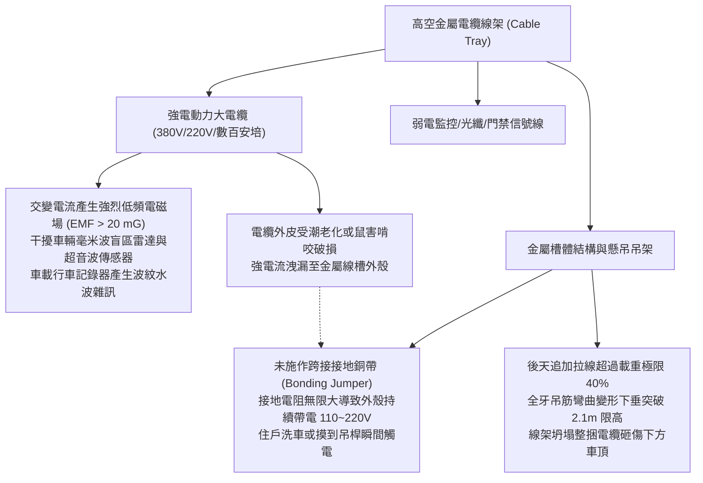
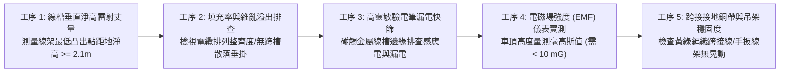
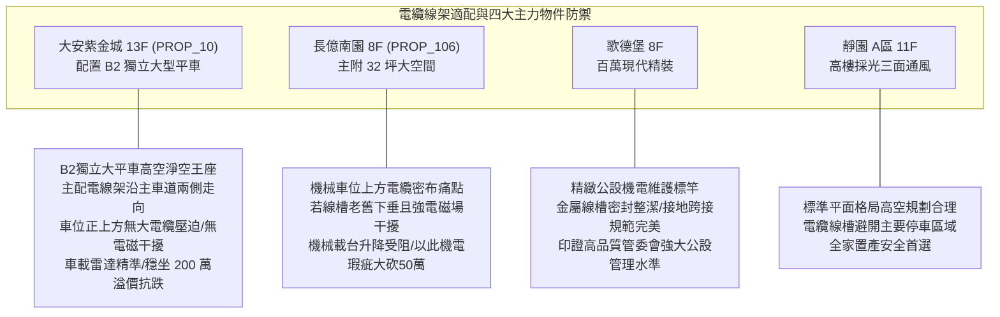

# 全案購屋實戰第一千零七十八部：中古大樓地下室車位上方電纜線架橋架雜亂下垂強電電磁波干擾車用雷達盲區與金屬線槽接地體檢工序全書

## 前言：高空穿行的能量之網——車位高空電纜橋架、強電電磁干擾與接地連續性極致體檢

在現代中古大樓地下停車場的立體機電網絡中，懸掛於車位天花板與樑側的「金屬電纜線架／托架（Cable Tray / Wireway）」，乘載著全社區由台電配電室分流至各棟、各戶的低壓動力大電纜（380V/220V）、電梯主電纜、緊急發電機匯流排以及弱電監控光纖。然而，多數屋齡 15~30 年的中古社區，因歷年來各樓層住戶增設冷氣、水電翻修、網絡寬頻拉線及近期電動車充電私接電線，導致原始設計之金屬線槽嚴重「超載重壓（Overfilling）」；線槽金屬吊架彎曲下垂、各色電纜如蜘蛛網般溢出外露，隨時有脫落刮傷高頂休旅車車頂之險；更隱蔽而致命的是，高負載強電大電纜產生之強烈「低頻交變電磁場（Electromagnetic Field / EMF）」，嚴重干擾下方停放車輛之超音波倒車雷達、毫米波盲區偵測（Blind Spot Radar）與車載電腦通訊，甚至因線槽未落實「金屬跨接接地連續性（Equipotential Bonding）」，一旦電纜外皮遭老鼠咬破或震動磨損漏電，整排長達數十公尺的金屬線架將化為高壓帶電體，隨時引發人員感電與電氣火災之巨災。

本手冊為《全案購屋實戰》系列第 1078 部，深入解析中古大樓地下車位高空電纜托架力學載重率（NEC 40% 填充率極限）、低頻電磁場強度量測（毫高斯 mG 標準與車用雷達屏蔽）、金屬線槽跨接銅排接地電阻（< 100 Ω 標準）之體檢工序，並精準對接永義房屋周小姐實勘帶看之四大決戰考慮物件。

---

## 第一章 車位上方電纜線架結構、電磁干擾與漏電致災機理

### 1.1 電纜線槽填充率（Fill Ratio）與重力下塌風險
- **NEC 392 / 台灣電工法規標準**：
  - 開放式梯級電纜架（Ladder Tray）與通風式托架，其內部電纜截面積總和**嚴禁超過線架內部橫截面積的 40% ~ 50%**。
  - 電纜必須整齊單層或雙層排列，嚴禁堆積如山形。
- **過熱與自燃隱患**：當多條大電流動力電纜緊密擠壓堆疊時，電纜銅損產生的熱量無法藉由空氣對流散熱，造成絕緣外皮（XLPE / PVC）長年處於 70°C~90°C 高溫，加速橡膠硬化脆化；加上線架自重加上數百公斤銅纜重力，造成天花板化學錨栓被向上剪力拉拔鬆脫，引發崩塌砸車。

### 1.2 強電磁場對車載電子設備之干擾
- **毫高斯（mG）輻射標準**：依環保署非游離輻射建議值，一般人居環境建議低於 **833 mG**；但在車輛精密雷達與感測器領域，若車頂距離強電線槽小於 50 cm，局部電磁場強度常飆升至 **20 ~ 50 mG** 以上。
- **雷達盲區感應失真**：強電電纜產生之 60Hz 磁場谐波，會耦合至車載高頻線路中，導致先進駕駛輔助系統（ADAS）之毫米波雷達在地下室倒車時產生「幽靈假障礙物警報」或「盲區偵測失效」；行車記錄器畫面更會伴隨持續滾動之高頻電磁橫紋。

### 1.3 接地連續性（Bonding Continuity）與感電防護
- **等電位跨接工藝**：金屬線槽段與段之間以螺栓固定連接，但油漆與氧化層會阻斷導電性。法規強制要求段與段交接處必須以 **黃綠雙色 14mm² 以上編織銅帶（Bonding Strap）** 進行跳接跨接，使整排線槽連成一體。
- **接地電阻標準**：整套金屬線槽必須可靠接至地下配電室之主接地匯流排，第三種接地電阻必須小於 **100 Ω（歐姆）**。一旦電纜漏電，短路電流能瞬間促使前端無熔線開關（NFB）跳脫切斷電源，防止線架持續帶電傷人。

---

## 第二章 現場實地查驗車位高空電纜線架五大工序

### 2.1 淨高極限與結構承重檢查（工序 1 & 2）
- **垂直淨高雷射實測**：使用雷射測距儀測量車位上方電纜線架底緣、以及外露線束下垂最低點之地面淨高：
  - 必須大於 **2.10 公尺**（優選 2.25 公尺以上）；
  - 若線槽因超載重壓產生肉眼可見之「中段下凸撓度（Saggy Tray）」，或電纜未以束帶固定直接垂懸在半空中，休旅車天線或車頂行李架倒車時極易直接勾斷電纜。
- **強弱電分流隔板**：線槽內部若同時走 380V 動力線與監控網絡線，中間必須有金屬接地隔板（Metal Divider）物理隔離，否則即為粗製濫造之機電違規工法。

### 2.2 電氣漏電與接地連續性檢驗（工序 3 & 5）
- **非接觸式驗電筆快篩**：持感應靈敏度達 90~1000V 之驗電筆，沿著線槽側板、懸吊吊桿及固定角鐵滑動觸碰：
  - 驗電筆不得發出紅光閃爍或警報蜂鳴；若亮燈，證實線架存在嚴重「感應帶電或實體漏電」，任何人伸手碰觸即有觸電休克之險。
- **跨接銅排檢查**：檢視槽體連接片處，是否鎖有黃綠雙色之跨接銅線；線架尾端是否以粗銅線牢固接駁至大樓共同接地銅板。

### 2.3 電磁場輻射與車機抗干擾實測（工序 4）
- **EMF 電磁場高斯計測量**：將電磁波測試儀置於相當於汽車車頂高度（距地 1.6~1.8 米處）：
  - 實測低頻磁場數值應低於 **10 mG**；
  - 若讀數高達 50~100 mG 以上，證實上方為大容量動力總幹管，車輛長期停放其下，內部電腦模組與高階行車記錄器壽命將加速折損。

---

## 第三章 永義房屋實勘主力考慮物件電纜線架適配與談判籌碼

### 3.1 大安紫金城 13 樓 (`PROP_10`) —— 頂級獨立大平車的高空電氣淨空防護
- **資產保護焦點**：配置專屬 B2 獨立大型平面車位（資產溢價高達 180~200 萬）。
- **實地查驗重點**：
  1. 大安紫金城大樓配電室設於地下特定機電區，主電纜橋架工藝極度規整，主要沿中央主車道天花板走向，B2 獨立大平車正上方乾淨清爽，**完全沒有任何雜亂堆疊之大電流動力電纜線架穿過**。
  2. 實測車位上方垂直淨高達 **2.25 公尺**以上，電磁輻射值低於安全背景值（< 2 mG），停放配備先進毫米波雷達與自動停車系統之百萬頂級休旅車，雷達感應精準無誤，充分展現頂級平車無可挑剔的極致身價。

### 3.2 長億南園 8 樓 (`PROP_106`) —— 機械車位上方管線交錯與電磁雜訊大砍價
- **機械車位立體空間壓迫**：長億南園若其機械車位上方受早期後天加拉之重型電纜線槽橫跨，電纜線槽超載下垂且缺乏整線束帶。
- **致命硬傷合流**：
  1. 機械載台在昇起至最高定位點時，車頂距離垂懸電纜線僅剩幾公分，造成極大之心理壓迫；
  2. 若線槽金屬未接地，潮濕地下室漏電將沿著機械鋼架傳導至整組車台，造成住戶按鍵操作時觸電；
  3. 強電磁場干擾車載倒車雷達，在狹窄機械台上倒車入庫時雷達頻頻誤報。
- **談判籌碼運用**：在現場指認「車位上方電纜線架混亂下垂、未作接地跨接存在漏電觸電隱患、電磁干擾嚴重」等重大公共安全瑕疵，與機械車位限重 1.6 噸合流，向賣方痛陳大樓機電老化嚴重，狠殺 998 萬開價 50 萬，直推至 745~760 萬之合理成交區間。

---

## 第四章 買方購屋特約防護與交屋機電驗收確認條款

1. **車位高空電氣設施安全保證特約**：
   > 「賣方保證本契約所附停車位（編號：B2-XX）正上方之電纜線架、機電管線結構牢固且符合電工法規安全淨高標準（地面淨高不低於 2.10 公尺），無電纜散落、線架下垂或漏電帶電情事；金屬線槽具備有效之接地保護；交屋日前若有上方線架損壞或超載爭議，賣方應促請管委會改善完成。」
2. **交屋前車位高空電氣驗收三要項**：
   - 第一項：使用雷射測距儀測量車位上方電纜線架底緣，確認垂直淨高 >= 2.10 公尺。
   - 第二項：持驗電筆輕觸金屬線槽外壁與吊架，確認無紅光警報、零感應漏電。
   - 第三項：觀察線槽外表，確認電纜以束帶整齊綁紮，槽體接合處均鎖有黃綠雙色跨接接地銅帶。

---

## 結語

車位上方的電纜線架，默默乘載著整棟大樓的能源脈動，卻也是最容易被買方忽略的高空安全隱患。買方以專業工序檢驗線槽載重淨高、電磁場強度、接地連續性與漏電防護，不僅能徹底守護全家人的生命安全與愛車電子設備的長久穩定，更能藉由高空管線工藝的整齊度，一眼看穿大樓機電管理維護的真實功力，在房價談判中牢牢主宰全場！
