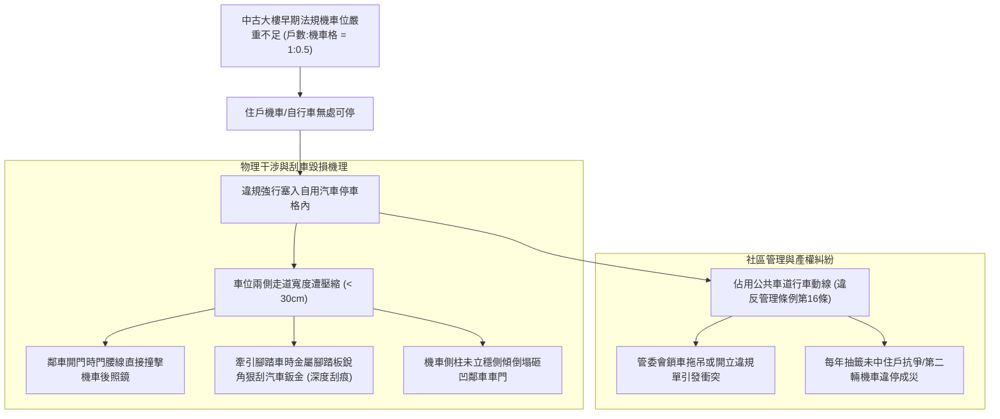
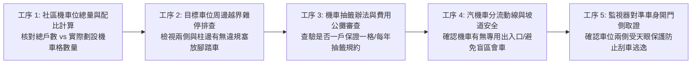
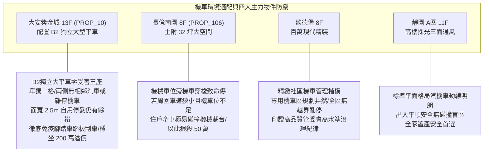

# 全案購屋實戰第一千零七十六部：中古大樓地下室車位自行車機車腳踏車越界亂停刮傷車門與專用機車位配比嚴重不足體檢工序全書

## 前言：微型交通工具的圍城困局——車位周圍機慢車越界、開門刮傷與機車位配比失衡極致體檢

在台灣都會區集合住宅的真實生活日常中，機車與自行車（含微型電動二輪車、公路車、兒童腳踏車）是普及率最高、短途代步最頻繁的家庭交通工具。然而，在屋齡 15~30 年的中古社區中，早期建照法規對「機車停車位配比（Motorcycle Parking Ratio）」要求極低，普遍僅達「一戶 0.5 格」甚至「全棟未規劃獨立機車格」，導致社區機車位供需嚴重失衡；住戶在無處可停的焦慮下，往往將機車、腳踏車硬塞進汽車車位兩側畸零空隙、甚至直接越界霸佔公共車道；更致命的是，腳踏車金屬腳踏板（Pedal）、機車握把後照鏡在牽車推擠時，極易狠刮相鄰百萬汽車車門鈑金（產生深度見底漆之刮痕），引發全社區無休止的鄰里調解、刮車糾紛與毀損提告。

本手冊為《全案購屋實戰》系列第 1076 部，深入解析中古大樓地下室機車位法定配比演進、機慢車越界物理刮傷機理（金屬踏板與車門防撞條幾何學）、專用機車格位劃設工法（長 2.0 米 / 寬 1.0 米標準）、社區抽籤收費機制與民事侵權求償工序，並精準對接永義房屋周小姐實勘帶看之四大決戰考慮物件。

---

## 第一章 機車位配比失衡、空間擠壓與物理刮車機理

### 1.1 法定機車位配比演進與中古大樓先天失調
1. **民國 90 年以前早期建照**：
   - 建築技術規則早期對集合住宅機車位幾乎「零強制規範」，建商為極大化汽車位銷售利潤，往往將地下室空間全數劃滿汽車格，完全未預留機車停車區。
   - 現代家庭普遍擁有「一戶 1~2 輛機車 + 數輛自行車」，配比嚴重倒掛，導致地下停車場淪為「機慢車隨意插隊、四處流竄」的無政府狀態。
2. **現代標準配置（每戶至少 1 車位）**：
   - 合格健全之現代社區，機車位與戶數比至少需達 **1:1 至 1:1.2**，且具備獨立的機車專用進出坡道或感應閘門，實現「人車分流、汽機車動線分道」。

### 1.2 物理刮傷幾何學與微型載具毀損力
- **腳踏車踏板的「刺刀效應」**：自行車兩側金屬腳踏板（Pedal）高度通常距地 **30 ~ 38 公分**，踏板邊緣多帶有防滑金屬銳利鋸齒。當騎士在車位狹窄縫隙中牽引腳踏車穿行時，金屬踏板如同刺刀般劃過相鄰汽車之下門檻與車門下緣，直接刮破防鏽底漆露出金屬裸鋼，下雨數週即生鏽發黃。
- **機車把手與後照鏡干涉**：機車龍頭把手高度約 **100 ~ 110 公分**，恰好與中大型休旅車（SUV）之「車門腰線與車門把手」高度完全重合。開門時稍有不慎即與機車橡膠手柄或硬質後照鏡猛烈對撞，造成板金凹折。

---

## 第二章 現場實地查驗機慢車停車秩序五大工序

### 2.1 機車格數量與抽籤制度調閱（工序 1 & 3）
- **總格數與戶數比精算**：向管委會調閱「全社區機車停車位清冊」，以總機車位數除以總戶數：
  - 若比值小於 **0.8**，代表社區每逢換約必爆發「機車搶位大戰」，部分住戶勢必將機車違停至汽車格旁；
  - 若社區採「一戶保證配發一格（固定號碼）」或「具備足夠專用機車格自由停放」，生活秩序最為穩定。
- **抽籤與租金管理辦法**：查核規約：
  - 機車位每月清潔費是否合理（通常為 100~200 元）；
  - 是否禁止「一人持有多籤」或特定委員長期霸佔優良車位。

### 2.2 目標車位周遭微觀擠壓實勘（工序 2 & 5）
- **兩側淨空度檢查**：實地站在目標汽車停車格前，觀察相鄰兩側車位：
  - 鄰居是否在汽車格靠柱處硬塞了 1~2 輛機車或腳踏車；
  - 車輛開門側是否被機車踏板緊逼，導致開門寬度小於 **45 公分**；
  - 檢視地面有無機車中柱反覆撞擊破壞地坪 Epoxy 形成的深坑。
- **CCTV 刮車死角防護**：確認該車位開門側是否有高解析度監視器直射，防止牽車擦撞後肇事者逃之夭夭無從求償。

### 2.3 汽機車動線分流與坡道防滑（工序 4）
- **坡道會車盲點**：地下室若為「汽機車共用單一陡坡道」，下坡轉角處極易發生汽車推撞慢速機車之重大事故；優質社區應於坡道中央設有實體防撞軟性警示桿，或具備紅綠燈單向號誌管制。

---

## 第三章 永義房屋實勘主力考慮物件機車環境適配與談判籌碼

### 3.1 大安紫金城 13 樓 (`PROP_10`) —— 頂級獨立大平車的免刮傷尊榮特權
- **資產保護焦點**：配置專屬 B2 獨立大型平面車位（資產溢價高達 180~200 萬）。
- **實地查驗重點**：
  1. 大安紫金城 B2 獨立大平車為**單獨一格獨立配置**，兩側完全「沒有相鄰的汽車位」，因此絕無鄰居在旁邊車格偷塞機車、腳踏車進而刮傷愛車車門的噩夢。
  2. 車位面寬達 2.50 米以上，自身若停放一輛進口豪華休旅車，進出開門動線完全獨立尊貴；大樓地下一層規劃有合規機車專用停車區，制度健全，愛車在此享有最高級別的防刮防撞保護，是支撐本案抗跌保值的鋼鐵基石。

### 3.2 長億南園 8 樓 (`PROP_106`) —— 機械車位周圍機車亂停與空間壓迫大砍價
- **機械車位遇機慢車之雙重痛點**：長億南園若其地下室機車位數量嚴重不足，住戶極易將機車或公路車違規停靠在機械車位周邊結構柱或走道旁。
- **致命干涉硬傷**：
  1. 機械載台在昇降或橫移運轉時，若下方有違停腳踏車把手越界，將直接遭機械鋼架重重夾碎並卡死機械鏈條，造成整組機械車位停擺癱瘓；
  2. 買方在操作機械車位按鈕時，動線遭機車圍堵，極端不便。
- **談判籌碼運用**：在現場指認「社區機車位配比失衡、地下室機車腳踏車違規亂停嚴重、隨時有刮傷車體及卡死機械設備之高風險」，將此混亂管理通病合流機械車位限重 1.6 噸，對 998 萬開價進行沉重打擊，狠殺 50 萬，直壓至 745~760 萬之合理成交區間。

---

## 第四章 買方購屋特約防護與交屋驗收確認條款

1. **專用車位獨立完整性與無機車侵占保證特約**：
   > 「賣方保證本契約所附汽車停車位（編號：B2-XX）享有合法獨立使用權，兩側及後方公共動線無遭鄰戶機車、自行車長期違規佔用或阻礙通行之情事；賣方應向管委會確認本戶所屬之合法專用機車停車位配額（編號：機-XX）權益完整無虞，隨同本買賣標的一併完整點交移轉；交屋前若有機車位欠費或侵占爭議，賣方應全額結清負責。」
2. **交屋前車位防刮環境驗收三步驟**：
   - 第一步：親自站在車位駕駛座開門側，全開車門至最大角度，確認半徑 1.0 米內無任何機車後照鏡或腳踏車踏板阻礙。
   - 第二步：巡視地下室機車專用區，確認分配之機車格位置明亮、動線平整且無遭他人佔用。
   - 第三步：檢視大樓規約中關於「私自將機慢車停入汽車格」之取締條款，確認管委會具備常態稽查與維護秩序之公信力。

---

## 結語

機車與自行車雖體積輕巧，但若管理失序，往往會成為百萬汽車車門上難以抹滅的傷痕。買方以專業工序檢驗社區機車位配比、汽車格開門淨距、汽機車分流動線與抽籤規約，不僅能徹底守護全家愛車的完美鈑金，更能從微型載具的管理細節中，看穿管委會真正的治理智慧，在價格談判中牢牢主導大局！
