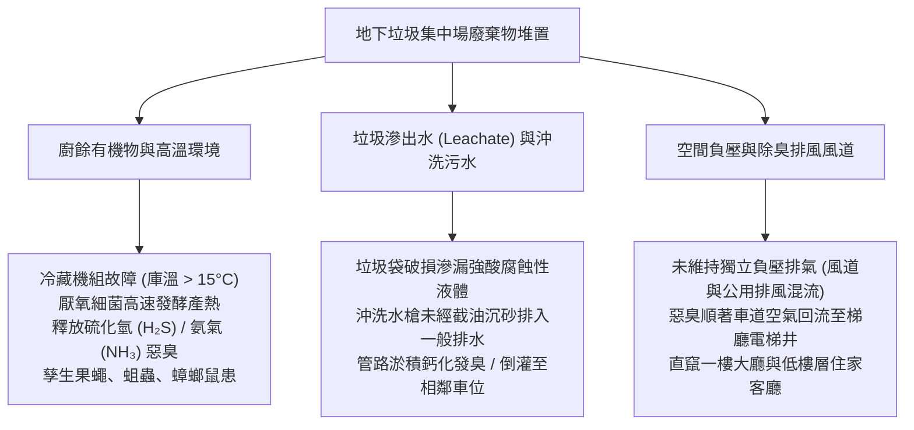
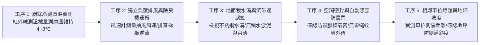
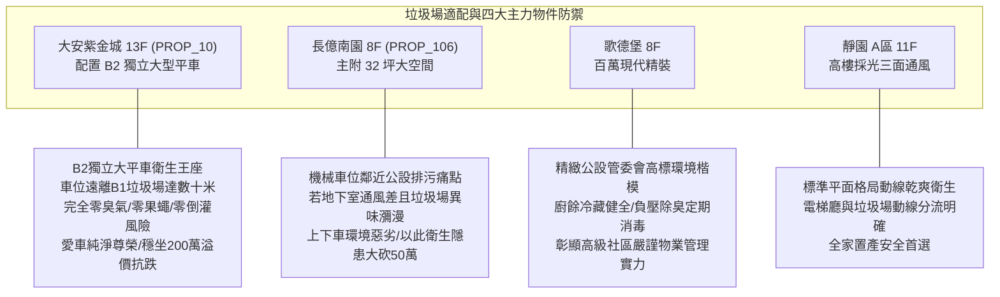

# 全案購屋實戰第一千零七十四部：中古大樓地下室車位垃圾分類集中場廚餘冷藏故障臭氣滲漏孳生果蠅與高壓清洗排水倒灌體檢工序全書

## 前言：暗處隱蔽的衛生炸彈——地下垃圾處理場、廚餘冷藏除臭與清洗排污極致體檢

在中古大樓地下停車場的公設配置與日常物業運作中，通常規劃於地下某個角隅或鄰近車位旁之「社區垃圾集中處理場與資源回收區（Garbage Disposal & Recycling Center）」，是維繫全棟數十至數百戶住戶每日生活廢棄物清運的**核心公共衛生樞紐**。然而，多數屋齡 15~30 年的中古社區，因節省公設電費或設備老舊，其專用「廚餘冷藏冰庫（Food Waste Chiller）」壓縮機故障停擺、溫度無法恆定在 4°C~8°C，導致廚餘在悶熱的地下室迅速腐爛發酵，釋放高濃度硫化氫（H₂S）、甲硫醇等惡臭毒氣，並大量孳生果蠅、蛆蟲與蟑螂老鼠；更致命的是，垃圾集中場每日以高壓水槍沖洗地面時，若專用截污沉砂井（Catch Basin）遭菜葉塑膠袋堵死、無防臭存水彎，清洗污水將夾帶油污與細菌直接「逆向倒灌漫流」至相鄰車位，嚴重腐蝕愛車輪胎與底盤，甚至沿車位地坪冷縫滲漏至下層機電室，引發嚴重的鄰里抗爭與資產折損。

本手冊為《全案購屋實戰》系列第 1074 部，深入解析中古大樓地下垃圾場廚餘冷藏機組熱力學原理、光觸媒/臭氧（Ozone）負壓排風除臭系統換氣量計算（換氣次數 >= 15 次/小時）、地面防腐抗酸蝕不銹鋼落水溝體工藝、截油泥沉澱池清淤檢驗，並精準對接永義房屋周小姐實勘帶看之四大決戰考慮物件。

---

## 第一章 地下垃圾場系統架構、發酵產氣與污水倒灌機理

### 1.1 廚餘冷藏熱力學與惡臭化學反應
- **低溫抑制發酵極限**：廚餘中富含蛋白質、油脂與碳水化合物。在一般地下室常溫（25°C~32°C）下，厭氧菌在數小時內即可完成指數級繁殖，將含硫氨基酸分解為惡臭的**硫化氫（H₂S，具劇烈臭雞蛋味）**與**甲硫醇（CH₃SH）**。
- **冷藏庫低溫標準（CNS 標準）**：合規之廚餘冷藏冰庫，內部庫溫必須常時維持在 **4°C ~ 8°C**。在此溫度區間內，微生物繁殖代謝被完全抑制，揮發性惡臭氣體產量暴跌 90% 以上；若壓縮機冷媒外洩或溫控開關故障，庫溫飆升至 15°C 以上，冷藏冰庫將化身為「生化發酵壓力箱」。

### 1.2 垃圾滲漏水（Leachate）之腐蝕性與排水倒灌
- **滲出水之強烈腐蝕力**：垃圾壓縮堆積產生的滲出水（Leachate）pH 值通常呈 **弱酸性（pH 4.0 ~ 5.5）**，含有高濃度重金屬與氯化物。若漫流至相鄰車位，將迅速腐蝕破壞環氧樹脂 Epoxy 地坪塗層，使地坪起泡脫層，並腐蝕汽車鋁圈烤漆與排氣管。
- **專屬隔油沉砂排水系統**：垃圾房內部排水絕對**嚴禁直接接入地下室雨水集水坑**；其排水必須經過 SUS304 雙道可抽取式過濾提籃（攔截固體殘渣）及小型隔油截污槽，再以專用耐酸鹼管路引流至大樓污水處理池。

---

## 第二章 現場實地查驗地下垃圾場環境五大工序

### 2.1 廚餘冷藏機與溫控面板實測（工序 1 & 2）
- **溫控液晶表核對**：檢視廚餘冷藏設備外殼之數位溫度顯示表，並持紅外線測溫槍實測冰庫內部冷排與內壁溫度：
  - 讀數必須低於 **8.0°C**；
  - 若冰庫壓縮機未運轉、外殼散熱排積滿厚重油垢、或內部冷凝水盤滿溢發臭，證實設備長期帶病運轉或已被管委會為省電而擅自拔插頭停用。
- **負壓排風氣流流向測試**：微開垃圾房大門約 5 cm，持測試煙霧筆置於門縫處：
  - 煙霧應被**迅速向室內強烈吸入**（證實室內呈負壓，換氣次數達標）；
  - 若煙霧被向外推吹，代表排風機風壓不足或逆向灌風，垃圾房臭氣正全天候向地下室車道與電梯廳擴散。

### 2.2 排水落水與截污清淤檢驗（工序 3）
- **防臭存水彎與防逆流閥**：掀開垃圾房地面排水孔之不銹鋼蓋板，檢視是否有深水封防臭存水彎（Water Trap，水封深度需 >= 50 mm），防止化糞池惡臭回竄；
- **沉砂提籃清潔現況**：提籃內是否常態清空；若提籃已鏽穿、底部沉積發黑發臭之黏稠泥狀殘渣，一旦高壓水槍沖洗，污水將無法下洩並順著車道坡度倒灌至車位。

### 2.3 車位與垃圾場相對間距與地坪斜度（工序 4 & 5）
- **衛生防護安全間距（Buffer Zone）**：
  - 優質住宅規劃中，目標車位距離垃圾集中場門口至少需保有 **15 ~ 20 公尺以上** 之物理防護間距，且動線應處於下風處或不同防火區劃；
  - 若車位緊鄰垃圾房隔壁（距離小於 5 米），每日上下車必受廚餘酸臭與果蠅騷擾，該車位在中古市場上將面臨嚴重的折價懲罰（折價 10%~15%）。
- **防倒灌地面檻高實測**：垃圾房大門門檻處，地面必須做有高度至少 **3 ~ 5 cm 之防溢止水檻（Water Curb）**，杜絕洗地水外溢至車道。

---

## 第三章 永義房屋實勘主力考慮物件垃圾場機能適配與談判籌碼

### 3.1 大安紫金城 13 樓 (`PROP_10`) —— 頂級大平車的純淨衛生環境防護
- **資產保護焦點**：配置專屬 B2 獨立大型平面車位（資產溢價高達 180~200 萬）。
- **實地查驗重點**：
  1. 大安紫金城垃圾處理場設於地下特定獨立隔間（通常位於 B1 角落或通風天井旁），且配備專屬密封自動門與負壓除臭系統。
  2. B2 獨立大平車位於地下二層核心優質區域，與垃圾集中場完全「跨樓層實體隔離」，上下車環境乾爽芳香，絕無任何酸腐臭味、果蠅或污水倒灌波及之疑慮，徹底捍衛頂級獨立大平車之資產純潔度。

### 3.2 長億南園 8 樓 (`PROP_106`) —— 機械車位旁通風不良與異味公害大砍價
- **通風與衛生致命缺陷**：長億南園若地下室垃圾處理區之廚餘冷藏機老舊失修，且機械車位區域因載台鐵件林立、空氣對流受阻，廚餘酸腐臭氣將長期滯留在地下室底層。
- **談判籌碼運用**：在現場指認「地下室空氣品質差、垃圾處理區除臭不良、車道地坪偶有沖洗污水漫流痕跡」等重大公共衛生瑕疵，與機械車位限重 1.6 噸合流，向賣方痛陳居住品質受到嚴重折損，狠殺 998 萬開價 50 萬，直推至 745~760 萬之合理成交區間。

---

## 第四章 買方購屋特約防護與交屋衛生驗收確認條款

1. **社區垃圾處理設施衛生環境保證特約**：
   > 「賣方保證本契約所屬社區之地下室垃圾集中處理場與資源回收設施，具備正常運作之廚餘低溫冷藏與通風除臭設備，且排污管路通暢，無常態性異味外溢或污水倒灌漫流至地下車位之公共衛生瑕疵；若交屋前管委會有因垃圾場污染遭環保局開罰或限期改善案，相關罰鍰及修繕費用由賣方全額負責。」
2. **看屋與簽約前垃圾場實勘三要項**：
   - 第一項：親自走入垃圾集中場，檢視廚餘冷藏庫溫控儀表（確認 <= 8°C），現場無撲鼻酸腐惡臭與果蠅漫天。
   - 第二項：實測目標車位至垃圾場之步行直線距離，確保遠離污染源（大於 15 公尺）。
   - 第三項：檢視垃圾場門口地坪止水檻與排水溝，確認無油漬外溢污染車道跡象。

---

## 結語

地下停車場的垃圾集中場與廚餘冷藏系統，是衡量一個社區日常管理是「金玉其外」還是「真正精緻」的最嚴酷考場。買方以專業工序檢驗庫溫控制、負壓除臭風道、隔油防倒灌工藝與車位衛生安全距離，不僅能徹底守護全家人每次上下車的清新呼吸與愛車輪胎潔淨，更能藉此透視管委會真正的管理靈魂，在價格談判中牢牢主導大局！
