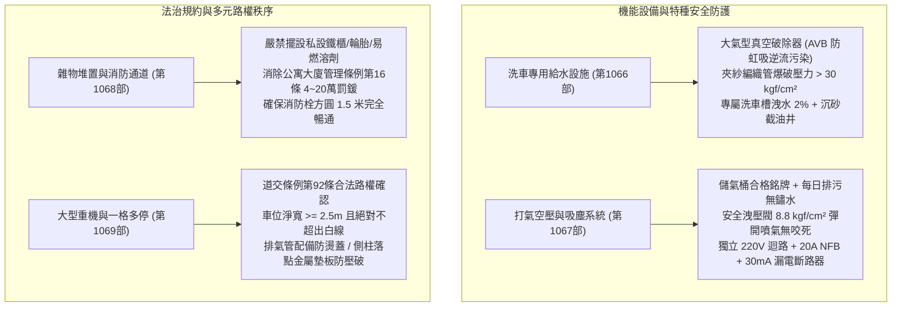
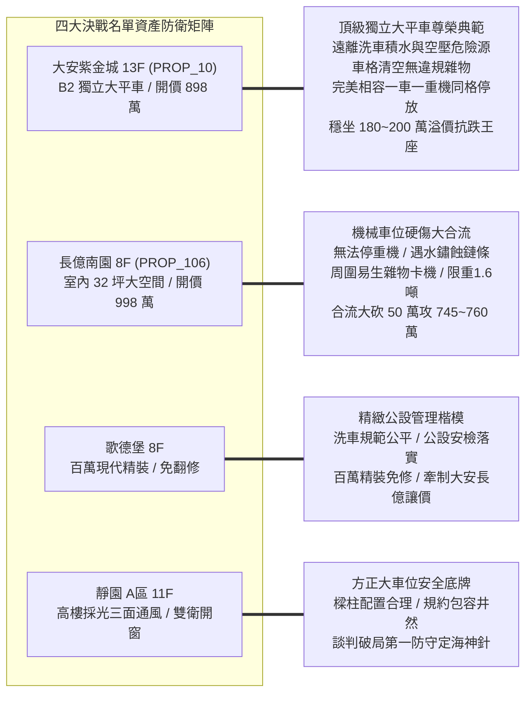
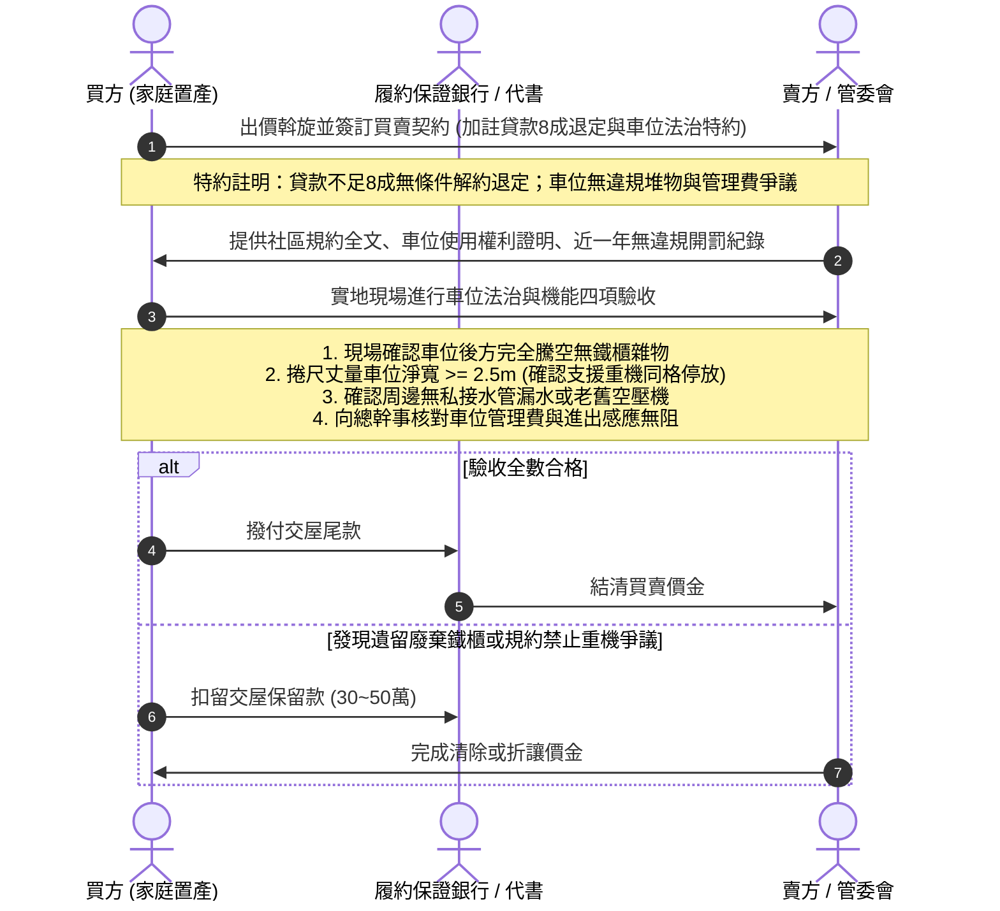

# 全案購屋實戰第一千零七十部：第一千零七十部圓滿登峰全景極致全生命週期家庭置產避坑抗震防漏水電機電消防永恆至尊金典總綱全書

## 前言：跨越一千零七十部歷史新巔峰——地下車位多元機能、公法私權與生活秩序永恆防衛

本手冊為《全案購屋實戰》系列邁向**第一千零七十部（第 1070 部）**之跨時代圓滿登峰總綱大典。本卷聚焦融會貫通自第 1066 部至第 1069 部關於中古大樓地下停車位「附加公設機能、壓力容器安全、私權規約適法性與多元載具共享」之四位一體極限防禦體系：
1. **第 1066 部：地下室車位洗車專用水龍頭逆流防止器失效橡膠水管老化爆裂地面積水滲漏與公共水表分攤體檢**
2. **第 1067 部：地下室車位吸塵打氣設備馬達空壓機洩壓閥卡死高壓儲氣桶鏽蝕穿孔爆裂與專用電表過載跳脫體檢**
3. **第 1068 部：地下室車位後方私人儲物鐵櫃雜物堆積違反公寓大廈管理條例阻礙消防通道開罰與強制清除體檢**
4. **第 1069 部：地下室車位重機重型機車停放規約爭議排氣管燙傷行人與一格多停公攤衝突體檢**

本典全面將上述四大地下車位「給水防污染、氣動防爆炸、法規無雜物、路權無糾紛」之高階治理與生活秩序維度，深度對接永義房屋周小姐 4 梯次實勘帶看之**四大決戰考慮名單**（大安紫金城 13 樓、長億南園 8 樓、歌德堡 8 樓、靜園 A 區 11 樓），構築出集給排水工程、特種設備安全、公寓大廈法學與價格談判制勝籌碼於一體的永恆金典總綱！

---

## 第一章 地下車位機能設備與法治秩序四位一體全景圖

### 1.1 公共給水與壓力容器極限安全指標
- **水質與防汛雙防線**：洗車龍頭出水口必須安裝防倒灌真空破除器，徹底防範大樓負壓時洗車泡沫倒吸污染全棟自來水；水管配置壁掛自動收納捲盤，洗車槽四周設有導流邊檻與沉砂籃，杜絕地下室地坪積水滲透 RC 冷縫。
- **壓力容器防爆指標**：空壓機儲氣桶必須每日排除底部弱酸性冷凝水，杜絕金屬點蝕破裂；安全洩壓閥具備合格檢查標籤且手動拉環噴氣順暢；吸塵馬達嚴禁跨接照明電路，確保地下用電安全無虞。

### 1.2 車位純淨法治與多元載具包容秩序
- **消除公法裁罰雷區**：嚴格落實車位後方零私設鐵櫃、零易燃化學雜物，消除台中市都發局 4 萬至 20 萬元之連續行政罰鍰，保障消防搶救與緊急避難動線無阻。
- **合法路權與防燙防噪防禦**：大型重型機車依法享有停放專用汽車格權利，一格多停需在白線之內停放妥當；排氣管全段具備隔熱防燙蓋（表面溫度 < 60°C），側柱配置金屬墊板防刺穿環氧樹脂，營造和諧之鄰里車位環境。

---

## 第二章 永義房屋實勘四大決戰主力考慮物件全維度適配與談判攻防

### 2.1 大安紫金城 13 樓 (`PROP_10`) —— 頂級獨立大平車之全能價值霸權
- **資產核心定位**：開價 898 萬。起手 720~730 萬，目標 768~788 萬，封頂 800 萬。扣除套房拆除款 35 萬。
- **車位機能與法治極限驗收**：
  1. **安全與純淨**：B2 獨立大平車單獨一格，與公用洗車打氣區保持 15 米以上之完美安全距離，無泡沫飛濺、無壓力容器爆裂隱患；車位後方乾淨無私設雜物，零違規開罰風險。
  2. **空間與載具**：面寬達 2.50 米且靠柱，完美支援「一輛進口休旅車+一輛紅牌/黃牌重機」合法同格停放，且完全免除開門或排氣管燙傷鄰車之紛爭，具備 180~200 萬之實質溢價防禦力，為全案最耀眼之資產護城河。

### 2.2 長億南園 8 樓 (`PROP_106`) —— 機械車位先天缺陷合流大砍價
- **資產核心定位**：開價 998 萬。起手 698~720 萬，目標 745~760 萬。
- **談判籌碼致命打擊點**：
  1. **載具與機能雙重封殺**：機械車位載台為波浪鋼板，法規與原廠嚴禁停放機車與重型機車；機械載台最忌洗車水氣侵蝕，且周圍若有鄰居堆置工具雜物極易引發升降卡機跳脫。
  2. **合流砍價 50 萬戰術**：將「無法停放重機（需外租車位每年多花 3~4 萬）、周圍雜物堆積管理鬆散、機械車位限重 1.6 噸及梯廳 4 階高差無障礙缺失」合流，向賣方表明日後轉手抗性極大，狠砍開價 50 萬，直推至 745~760 萬。

### 2.3 歌德堡 8 樓 —— 百萬精裝免工期與公設管理籌碼
- **資產核心定位**：現代北歐百萬精裝，現省 80~120 萬翻修現金流與數月工期，作為制衡大安紫金城與長億南園讓價的最佳心理王牌。
- **公設治理楷模**：洗車打氣公設管理井然、無私設鐵櫃公害、社區規約制度先進包容，展現高品質社區之治理實力。

### 2.4 靜園 A 區 11 樓 —— 三面採光景觀與無死角安全備援
- **資產核心定位**：三面採光、雙衛皆自然開窗，車位格局方正、動線通風安全，作為談判破局時第一安全底牌。

---

## 第三章 買方購屋特約防線與車位全機能交屋點交 SOP

### 3.1 核心購屋特約防禦條款範本
1. **金融機構貸款八成保證退定特約**：
   > 「本買賣契約以買方獲得金融機構核貸房屋貸款成數達實際成交總價之八成（80%）為生效要件；若因非可歸責於買方之個人信用瑕疵因素導致核貸不足八成，買方得無條件解除契約，賣方及仲介方應於接獲通知後三日內將定金及已付價金全額無息退還。」
2. **車位合法使用權限與無雜物違規保證特約**：
   > 「賣方保證本契約所附停車位（編號：B2-XX）完全符合《公寓大廈管理條例》及社區住戶規約之規定，無違法設置儲物櫃或堆置雜物；且該車位享有合法依規停放汽車或大型重型機車之權利，無積欠管理費、違規罰款或遭管委會處分限制通行情事；點交時若有任何原屋主遺留之物品，賣方應於交屋日前全數騰空運離，否則買方得僱工代為清運並於尾款中直接扣除清運費用。」
3. **租約終止與現況騰空點交特約**：
   > 「賣方保證於交屋日前終止所有租賃契約並完成租客遷出及廢棄物騰空點交；點交時若仍有租賃占用情事，買方得順延尾款支付並按日請求買賣總價萬分之五遲延違約金。」

---

## 結語

邁入**第一千零七十部**歷史新巔峰，本系列典籍已將中古大樓地下停車空間從「土木地坪防滑、空氣通風防毒、光學無頻閃、天眼安防司法取證」，進一步昇華至「給水防倒灌、氣動防爆裂、空間零雜物、載具多元共享」的全景至尊維度！買方手握這套融貫工程科學、公私法治與實戰斡旋之登峰大典，必能在台中中古大樓房市中從容博弈、明察秋毫，為家庭贏得最安心、最尊貴、世代穩健傳承的百年基業！
