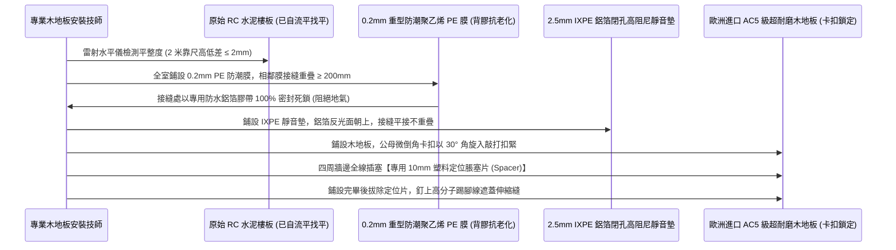
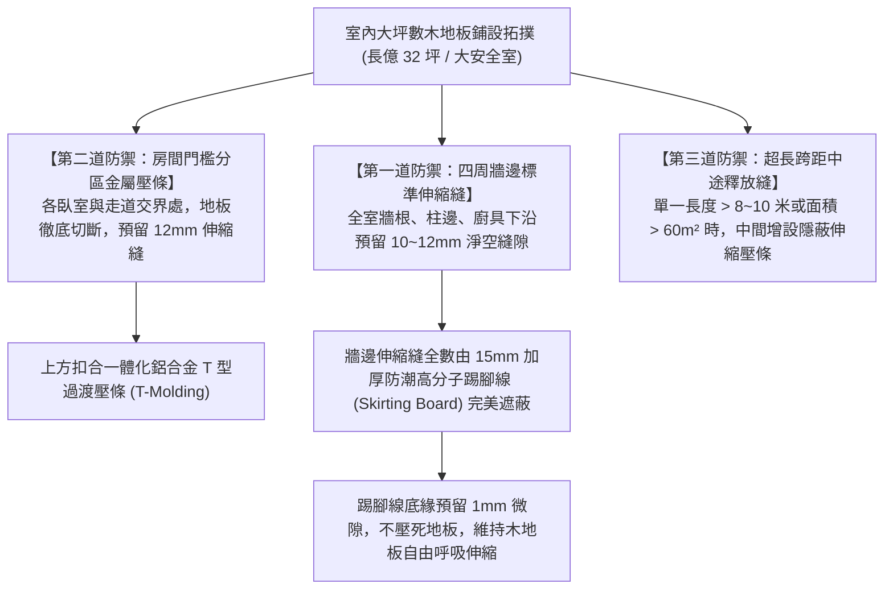
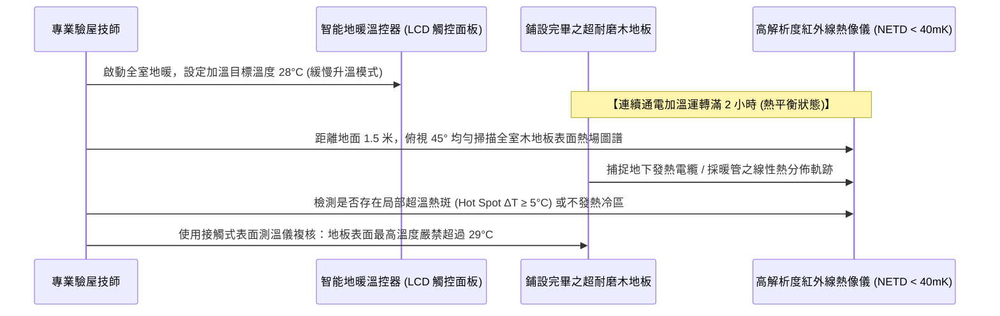

# 全案購屋實戰第一千零七部：中古大樓全室超耐磨木地板鋪設防潮靜音墊、抗熱膨脹伸縮縫留設與地暖紅外線熱成像驗收工序全書

## 導言：家庭起居步履觸感之終極舒適與耐用防線

在集合住宅中古大樓之室內精裝工程中，地面鋪設工程直接承載著家庭全體成員每日赤足行走、幼兒在地爬行玩耍、以及長輩步履防滑減震的「最親密物理接觸界面」。現代高質感住宅翻修工程中，「歐洲進口超耐磨木地板（Laminate / Engineered SPC Flooring）」由於具備極致逼真的天然原木紋理、溫潤不冰涼的腳感、以及高達 AC4/AC5 級的耐磨抗刮性能，已全面取代傳統冰冷、堅硬且易滑倒摔傷的拋光石英磚。

然而，在台灣高溫高濕的海島型氣候環境下（特別是本案主力攻堅標的——室內實坪達 32 坪、客餐廳連通走道單一長度超過 12 米的 **長億南園 8 樓 (`PROP_106`)**，以及重新拆除套房隔間打通為大器家庭格局的 **大安紫金城 13 樓 (`PROP_10`)**），超耐磨木地板若施工工法不當，普遍會在入住數月至一年後爆發四大毀滅性災難：
1. **熱脹冷縮應力集中引發地磚整面「起拱爆裂（Buckling）」**：木地板基材（高密度纖維板 HDF）具有天然的「濕脹乾縮」物理特性。若施工師傅未在牆邊、門檻、轉角處留設足夠寬度的「彈性伸縮縫（Expansion Gap）」，或大坪數未設置分區金屬壓條分隔，在梅雨季高濕環境下，地板膨脹產生的橫向擠壓應力無處釋放，整片地板會像地殼造山運動般瞬間向上隆起 5cm~10cm，踩踏時像走在彈簧床上晃動，最終卡扣脆斷爆開！
2. **底層未鋪防潮鋁箔膜引發「反潮發霉與黑斑」**：中古大樓原始 RC 樓板內部常年蓄積結構微觀水氣。若直接將木地板鋪在地面，地氣上升滲入地板背部，木質纖維迅速發霉發黑、釋放霉菌孢子，地板邊緣翹曲呈「瓦狀變形（Cupping）」，散發陣陣刺鼻霉味。
3. **欠缺高阻尼隔音墊引發「踩踏空洞踏步聲與樓下鄰居抗議」**：木地板若與水泥地直接接觸，人在上方走動、穿拖鞋踏步或小孩奔跑時，會產生嚴重的「空洞金屬撞擊聲（Clicking Noise）」，衝擊波透過樓板直接傳導至樓下住戶天花板（樓板衝擊音超標），引發樓下鄰居狂敲天花板報警投訴。
4. **若加裝地暖系統（Floor Heating）欠缺熱力學阻熱層與均熱設計**：高檔地暖系統若未做底部擠塑保溫板隔離，熱量有超過 40% 會向下流失給樓下住戶天花板（無效耗能）；且若發熱電纜接頭接觸不良，會產生局部超高溫熱斑（Hot Spots），將木地板烘烤碳化開裂甚至引發自燃暗火！

為此，本第一千零七部全書深入解構超耐磨木地板之吸水膨脹力學、標竿防潮靜音墊隔音抗衝擊工藝、全室彈性伸縮縫精確留設公式、以及地暖紅外線熱成像（FLIR）驗收標準。

---

## 一、超耐磨木地板熱力學膨脹係數與起拱隆起失效機制

```mermaid
flowchart TD
    A["春夏季梅雨季連續高濕 (空氣濕度 RH > 80%~90%)"] --> B["木地板 HDF 高密度纖維基材毛細孔吸水膨脹"]
    B --> C["全室木地板產生橫向微觀尺寸伸長 (每米伸長 1.5mm~2.0mm)"]
    C --> D["長億南園 8 樓長跨距 12 米累計膨脹量達 18mm~24mm"]
    
    D -->|若牆邊未留足伸縮縫 (僅留 3~5mm)| E["地板四邊死死頂住踢腳線與 RC 混凝土牆體"]
    E --> F["木板內部產生巨大的水平壓應力 (超過卡扣抗剪強度)"]
    F --> G["整片地板失去平面平衡，向阻力最小的上方拱起隆起 (Buckling)"]
    G --> H["踩踏空洞彈跳、公母卡扣撕裂斷裂、地板徹底報銷"]

    D -->|標竿工法：預留 10~12mm 伸縮縫 + 分區壓條| I["膨脹位移被四周隱蔽伸縮縫完全吸收"]
    I --> J["踢腳線與 T 型壓條完美遮蓋縫隙、地板百年平整如鏡"]
```

### 1. 木質複合板吸水厚度膨脹率與長度膨脹計算
- **材料標準（EN 13329 / CNS 11342）**：優質超耐磨木地板之「吸水厚度膨脹率（Thickness Swelling）」必須 **$\le 10\%$（特優級 $\le 5\%$）**，基材密度 **$\ge 880\text{ kg/m}^3$**。
- **熱脹冷縮與濕度伸縮公式**：
  $$\Delta L = L_0 \times (\alpha_t \cdot \Delta T + \alpha_h \cdot \Delta RH)$$
  其中 $\alpha_h$ 為濕度膨脹係數（約 $0.15\text{ mm/m}\cdot\%10\text{RH}$）。在台灣濕度自 50% 飆升至 90% 時（$\Delta RH = 40\%$），每公尺長度將伸長約 **$1.5\text{mm}$**！對於跨距達 10 米的客餐廳，單向膨脹位移量高達 **$15\text{mm}$**！若四周牆邊未留足 **$10\text{mm} \sim 12\text{mm}$ 寬的伸縮縫**，地板必拱無疑。

### 2. 樓板衝擊音（Impact Sound）隔音法規極限
- **法規依據**：台灣《建築技術規則》建築設計施工編第 46-6 條，分戶樓板衝擊音隔音性能指標（$\Delta L_{w}$ 或 $L'_{n,w}$）：
  - 鋼筋混凝土樓板厚度 15cm 以上者，表面鋪設緩衝材後之衝擊音衰減量必须 **$\Delta L_{w} \ge 17\text{ dB}$**（使樓下最大衝擊音降至 **$58\text{ dB}$ 以下**）。
  - 若使用普通薄塑膠發泡紙（僅厚 1mm），隔音衰減量不足 $8\text{ dB}$，完全不符合國家防噪法規，樓下鄰居可依法提起民事損害賠償並勒令拆除！

---

## 二、標竿防潮靜音墊隔音抗衝擊鋪設工藝

淘汰傳統容易粉化之普通珍珠棉（EPE），全面升級為 **「厚度 2.0mm~3.0mm 鋁箔複合交聯聚乙烯（IXPE）或高密度天然軟木隔音墊」**：



### 1. 地面平整度之「2米靠尺 2mm 極限原則」
- 超耐磨木地板屬於懸浮式鋪設（Floating Installation），對基底平整度要求極高。
- **檢驗標準**：地面以 2 米水平靠尺掃描，最大高低落差 **嚴禁超過 2.0mm**。
- 若原始水泥地面坑窪不平（落差 $> 3\text{mm}$），木地板踩踏時內部卡扣會長期承受上下交變剪切力，數月內卡扣必發生斷裂崩解，踩踏時發出「吱吱嘎嘎」的金屬摩擦怪聲。地面不平整處必須先施作 **高抗裂環氧樹脂自流平水泥（Self-leveling Underlayment）** 進行超平整找平。

### 2. IXPE 閉孔靜音墊之微觀聲學與阻尼特性
- **材料構造**：IXPE（電子輻射交聯聚乙烯）具備獨立閉孔微氣泡結構（孔徑 $< 50\mu\text{m}$），表面複合厚度 $0.05\text{mm}$ 純鋁箔。
- **聲學優勢**：動態剛度（Dynamic Stiffness）$s' \le 30\text{ MN/m}^3$，能將拖鞋踏步與重物掉落的瞬間高頻衝擊波轉化為微觀熱能，使樓板衝擊音降低 **$20 \sim 22\text{ dB}$**，腳感扎實沉穩，完全消除空洞踏步噪聲。

---

## 三、全室抗熱膨脹伸縮縫留設與門檻過渡標竿工序



### 1. 門檻過渡壓條之「切斷分區」原則
- 許多業主追求「全屋一體化通鋪、不加門檻壓條」，但在大坪數中古大樓中，客廳、走道與各臥室的溫濕度、日照強度與使用頻率完全不同。
- 若全屋無縫死通鋪，各房間的膨脹應力會在狹窄的走道門框處「高度扭曲集中」，導致門框處地板 100% 拱起開裂。
- **標竿要求**：每個房間門下正下方（關門時門扇剛好遮住處），地板必須截斷並預留 **12mm 伸縮空隙**，上方蓋上與木地板同色的 **陽極氧化鋁合金高強度 T 型壓條**，各區域獨立伸縮互不干涉。

---

## 四、地暖系統（若配置）紅外線熱成像（FLIR）驗收標準

若主臥或客廳配置先進的低溫輻射電地暖或水地暖系統，驗收時必須出動高解析度紅外線熱像儀實施動態熱力學診斷：



### 1. 熱場均勻度與溫升極限判定標準
- **表面溫度極限**：超耐磨木地板製造商原廠規範，地暖環境下地板表面溫度 **絕對嚴禁超過 $27^\circ\text{C} \sim 29^\circ\text{C}$**。超過 $30^\circ\text{C}$ 會導致 HDF 木質纖維內部膠水熱裂解、甲醛釋放量超標，並引發木地板嚴重翹曲收縮。
- **熱像圖合格標準**：
  - **優良（綠燈）**：紅外線熱影像呈現均勻平行的發熱條紋，各區域溫差 **$\Delta T \le 2.0^\circ\text{C}$**，全室升溫平緩。
  - **致命隱患（紅燈）**：若在某一處突然出現直徑 10cm 的亮白色高溫圓形熱斑，溫度飆升至 **$40^\circ\text{C} \sim 50^\circ\text{C}$ 以上**，證實該處電暖發熱線存在虛接、打折扭結或局部保溫層穿孔，隨時有引燃木地板底層之火災危險，必須立即斷電拆除檢修！

---

## 五、四大主力候選物件木地板鋪設專項預算與施工攻防

### 1. 👑 大安紫金城 13 樓 (`PROP_10`)：全室超耐磨木地板高空舒心工程
- **現況挑戰**：本物件為 **13 樓頂層**，原始為 4 間出租套房，地坪鋪設的是老舊破損的廉價塑膠地貼（PVC 地磚），底層殘留大量頑固黑膠，且套房隔間拆除後地坪存在多處高低落差。
- **翻修方案**：
  - 徹底刮除舊塑膠地貼黑膠，施作全室高抗裂水泥自流平找平（厚度 3~5mm）。
  - 全室鋪設歐洲進口 AC5 級頂級超耐磨木地板（厚度 12mm），搭配 2.5mm IXPE 鋁箔防潮靜音墊，四周嚴留 12mm 伸縮縫。
  - 鋪設面積約 25 坪，工程預算約 **15 萬 ~ 18 萬元**。此筆費用完全由買方談判斬獲之 **「35 萬套房拆除翻修折讓款」** 全額覆蓋，零額外支出，將老舊破套房瞬間升級為頂級奢華舒適家庭大宅！

### 2. 🌟 長億南園 8 樓 (`PROP_106`)：32 坪大空間長跨距分區防拱工程
- **現況挑戰**：室內實坪達 32 坪超大空間，客餐廳連通長度達 12 米，若無分區壓條，木地板極易在梅雨季大面積起拱爆裂。
- **翻修方案**：
  - 客餐廳與各臥室門檻處強制配置鋁合金同色 T 型壓條分區，四周配置加厚高分子防水踢腳線。
  - 鋪設面積約 30 坪，工程預算約 **18 萬 ~ 22 萬元**，由談判強勢砍落之 **50 萬讓價款** 充裕分攤。

---

## 六、全案總結：木地板工程驗收五大不可妥協鋼鐵防線

1. **查防潮膜重疊**：地板鋪設前，底層 0.2mm PE 防潮膜必須重疊 20cm 以上，且接縫處全數以防水鋁箔膠帶密封死鎖。
2. **驗靜音墊厚度**：靜音墊必須為 **$\ge 2.0\text{mm}$ 高密度 IXPE 鋁箔墊**，腳踩踏步實測樓板衝擊音降低 $\ge 17\text{ dB}$，無空洞虛浮感。
3. **量牆邊伸縮縫**：踢腳線安裝前，以卡尺實測木地板與四周牆壁、柱子之淨縫隙，必須 **嚴格在 10mm ~ 12mm 之間**，嚴禁緊貼牆體。
4. **測平整無異響**：在全室各處用力走動踏步，地板表面無起伏彈跳，接縫處無「吱吱」摩擦怪聲，2 米靠尺落差 $\le 2\text{mm}$。
5. **熱像儀掃全場**：若配置地暖，通電 2 小時後以紅外線熱像儀掃描，表面溫度 $\le 28^\circ\text{C}$，全場無任何局部超溫熱斑，安享百年溫馨！
