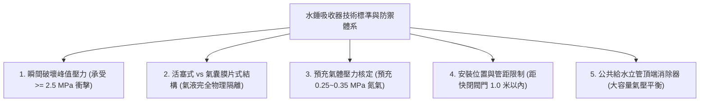
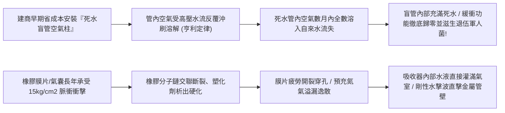
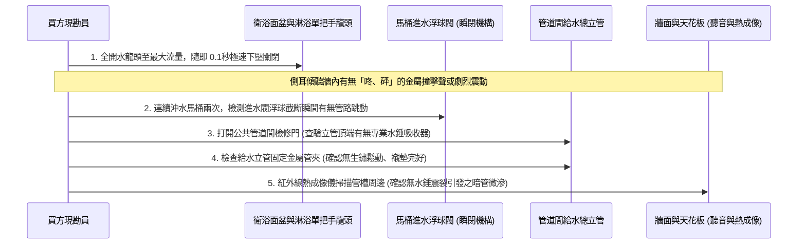
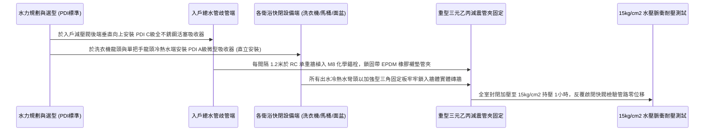

# 全案購屋實戰第一千零三十一部_中古大樓公共給水立管水錘吸收器膜片硬化破裂水錘衝擊波震裂給水接頭與暗管爆管體檢工序全書

---

## 序章：高層水力衝擊——無聲水錘對給水管網的致命破壞

在集合住宅的日常生活中，住戶經常在深夜或清晨聽到牆壁內部傳來沉悶的「咚、咚、砰」的金屬撞擊聲或震動聲。這絕非所謂的怪力亂神，而是流體力學中破壞力極強的**「水錘現象（Water Hammer / 水擊效應）」**。

水錘現象的物理本質，是當自來水在管路中以高速（約 $1.5\sim 2.5\text{ m/s}$）流動時，若下游閥門突然瞬間關閉（如馬桶進水器浮球閥快速關閉、滾筒洗衣機電磁閥瞬間切斷、或是單把手陶瓷閥芯水龍頭猛然壓下關水），具有動量的水流慣性被硬生生阻斷，動能瞬間轉化為超高壓彈性壓力波。
此瞬間衝擊波在管路內部以音速（水中傳播速度高達每秒 **$1000\sim 1400\text{ 公尺}$**）來回劇烈震盪反彈，管內瞬間峰值壓力可飆升至正常工作壓力的 **3 至 6 倍（高達 $1.5\sim 2.5\text{ MPa}$ / 即 $15\sim 25\text{ kg/cm}^2$）**！

在中古大樓（如本案主力評估之**大安紫金城 13 樓**、**長億南園 8 樓**、**歌德堡 8 樓**與**靜園 A 區 11 樓**）中，給水管路經過 20 年以上的自來水微酸腐蝕與接頭熱脹冷縮老化，若公共管道間給水立管與各戶進水總管處設置的**「水錘吸收器（Water Hammer Arrester）」**發生氣囊洩漏、膜片硬化破裂或安裝規格不足，超額水錘衝擊波將：
1. **反覆震鬆暗埋管路之壓接管接頭與螺紋止漏帶**，引發牆體內部微量滲水、水泥粉化與毀滅性壁癌；
2. **震裂熱水器內部銅水箱焊道與冷熱水混水閥陶瓷閥芯**，造成設備內部爆裂漏水；
3. **震斷給水立管固定管夾（Pipe Clamps）與膨脹螺栓**，導致立管懸空共振，甚至引發主管斷裂、水淹梯廳與地下室變電設備之重大公共災害！

本卷專門為買方建立中古大樓給水管路水錘防護系統之最嚴格現場實勘檢驗工序與水力緩衝加固標準作業程序（SOP）。

---

## 第一章：水錘動力學與水錘吸收器內部結構規範

依據美國 ASSE 1010（水錘吸收器標準）、PDI-WH 201 認證規範以及台灣建築設備給排水工程標準：



| 檢驗項目 | 國際與法規標準規範 | 理想高級住宅標準 | 中古大樓常見嚴重瑕疵（致命隱患） |
| :--- | :--- | :--- | :--- |
| **衝擊波吸收能力** | 需通過 ASSE 1010 認證，經 10,000 次急閉循環無洩漏。 | 具備 PDI-WH 201 六級容量規格（A~F級），耐衝擊達 $3.0\text{ MPa}$。 | 無任何吸收器，或僅用一段封閉死水管充當「空氣柱（Air Chamber）」。 |
| **內部緩衝結構** | 採用 **SUS304/SUS316 不銹鋼活塞配雙 O-Ring**，或耐疲勞三元乙丙（EPDM）複合氣囊。 | 全不銹鋼活塞結構，預充高純度乾燥氮氣（$\text{N}_2$），壽命達 15 年以上。 | 採用平價橡膠膜片，橡膠老化硬化破裂，內部氣體溶於水徹底失效。 |
| **預充氣體壓力** | 氣室預充壓力應為系統靜態工作壓力之 **90% ~ 100%**（約 $0.25\sim 0.35\text{ MPa}$）。 | 預充乾燥氮氣 $0.30\text{ MPa}$，配備微型氣嘴可現場補氣校正。 | 氣囊破裂，內部充滿自來水，緩衝容積歸零（水不可壓縮）。 |
| **安裝位置距離** | 應盡可能安裝於靠近快速關閉閥門（洗衣機、馬桶、龍頭）**1.0 公尺以內** 之直管端部。 | 於各衛浴冷熱水分水管盲端垂直向上安裝，立管轉角處皆設大口徑吸收器。 | 裝在十幾米外的走廊管道間盲區，衝擊波在室內管網已震裂接頭才抵達。 |
| **管路固定管夾** | 給水管每間隔 **1.2 ~ 1.5 米** 必須以帶橡膠減震墊之熱浸鍍鋅金屬管夾牢固固定。 | 採用具備 EPDM 隔振襯墊之重型吊卡管夾，阻斷震動聲波傳遞至 RC 牆。 | 無固定管夾或使用鐵絲捆綁，管路懸空，開水關水時整條管道劇烈甩動撞牆。 |

---

## 第二章：早期「死水管空氣柱」失效與水錘吸收器膜片硬化機理

中古大樓給水管網常年承受高頻水錘衝擊，其緩衝構件失效機理如下：



### 2.1 早期土法「空氣柱（Air Chamber）」之徹底失效與生物污染
- **土法結構**：早期中古大樓在興建時，水電工常在龍頭垂直上方留設一段長約 30~50 公分、管徑 1/2 英吋的封閉 PVC 或鐵管盲端，企圖利用封閉在管內的「空氣可壓縮性」來吸收水錘。
- **物理破壞與病菌溫床**：
  - 依據物理學**亨利定律（Henry's Law）**，氣體在液體中的溶解度與其分壓成正比。在 $0.3\sim 0.4\text{ MPa}$ 的自來水持續高壓下，盲管內的封閉空氣會在 **3 至 6 個月內完全溶解於自來水中隨水流走**，盲管最終被水完全灌滿。水是不可壓縮的液體，緩衝能力瞬間歸零！
  - 更致命的是，這段長年不流動的盲管形成了極度骯髒的「死水死角（Dead Leg）」，水溫適宜、餘氯消失，成為**退伍軍人菌（Legionella）與鐵鏽黏泥的繁殖母體**，嚴重污染全家飲用水！

### 2.2 機械水錘吸收器膜片硬化穿孔破裂
- **現代吸收器機理**：合格的水錘吸收器利用氣液隔離屏障（金屬活塞或彈性膜片），將自來水與預充的壓縮氮氣隔開。
- **老化死穴**：若採用低成本硫化天然橡膠或丁腈橡膠（NBR）膜片，經 5~8 年連續承受每天上百次的劇烈水擊壓力脈衝，橡膠發生疲勞脆裂穿孔。一旦穿孔，高壓氮氣立即外洩，自來水灌滿氣室，吸收器外殼雖完好無損，內部實質上已淪為一塊實心鐵塊，徹底喪失吸收水錘衝擊之能力。

---

## 第三章：現場看屋實體檢驗標準工序（買方現勘 5 步穿透法）

買方現勘大安紫金城 13 樓、長億南園 8 樓室內衛浴與公共管道間時，應依循以下 5 步標準工序實施水錘衝擊與吸收器檢驗：



### 3.1 極速斷水動態衝擊測試（最直接穿透檢測）
- **操作手法**：
  1. 將浴室洗手面盆龍頭完全開啟至最大出水量，讓水流穩定流動 5 秒；
  2. 以手掌在 **0.1 秒內猛然向下拍擊壓下把手**，以極限速度切斷水流；
  3. 重複此動作於廚房龍頭與蓮蓬頭。
- **合格標準**：關閉瞬間僅有輕微水流截斷聲，牆體內部靜謐無聲，水管無任何跳動感。
- **水錘嚴重超標**：關閉瞬間牆壁深處傳來一聲沉重的「砰！」巨響，伴隨水管劇烈彈跳與共振餘音持續 1~2 秒，甚至相鄰房間的磁磚都能感覺到微弱震顫。此現象證明該戶管網**完全缺乏水錘吸收保護**，暗管接頭正處於隨時可能震裂爆管之高度危險邊緣！

### 3.2 馬桶進水器急閉檢驗
- 按下馬桶沖水按鈕，等待水箱重新進水注滿。
- 當水位到達設定高度、進水器浮球閥（如瑞士吉博力 Geberit 或美標閥芯）切斷進水的瞬間，仔細觀察角閥與牆內進水軟管：
  - 若角閥連同牆內管線發生明顯甩動跳躍，代表馬桶進水端的水錘反射波極強，必須在此處加裝小型不銹鋼水錘吸收器。

### 3.3 管道間給水立管減震管夾與立管頂端消除器查核
- 打開公共走廊或梯廳之給水管道間檢修門，使用強光手電筒向上照射：
  1. **管夾間距與牢固度**：垂直給水立管（通常為 2 至 3 英吋不銹鋼管）每層樓是否至少配置兩個**附帶防震橡膠襯墊之重型鍍鋅管夾**牢固固定於 RC 剪力牆上；
  2. **立管頂部水錘吸收器**：立管最頂端（頂樓或減壓閥前）是否安裝有直徑 $\ge 80\text{mm}$ 之大型工業級水錘消除器。若立管僅以鐵絲簡單綁在角鐵上，強大水錘將造成整棟立管上下位移竄動，震裂各戶分支接頭。

### 3.4 紅外線熱成像暗管震裂微滲排查
- 開啟熱水龍頭流動 3 分鐘，隨即極速關閉引發水錘。
- 使用高解析度紅外線熱成像儀（FLIR）對準浴室牆面冷熱水暗埋管路走向與冷熱水混水閥出水孔周邊進行連續掃描：
  - 若在出水彎頭周邊水泥內部發現異常暈開之低溫（冷水管）或高溫（熱水管）不規則熱斑，代表管接頭螺紋已在長年水錘震動下拉拔微滲，水分已滲入粉刷層水泥結構！

---

## 第四章：長億南園 vs 大安紫金城——水錘防護與管網安全實戰評測

```mermaid
graph LR
    subgraph 長億南園8樓 (PROP_106)
        L1["室內主附32坪水管管線縱深長"] --> L2["若未設吸收器水錘動量極大"]
        L2 --> L3["後陽台具備寬敞外露明管改裝空間"]
        L3 --> L4["裝修改造輕鬆植入多組PDI認證吸收器!"]
    end

    subgraph 大安紫金城13樓 (PROP_10)
        D1["大安紫金城13樓現況為學生套房隔間"] --> D2["多組衛浴同時高頻用水水錘重疊放大"]
        D2 --> D3["套房打除重構正是管網防護最佳時機"]
        D3 --> D4["借35萬折讓款全面重配SUS304雙卡壓管與吸收器"]
    end
```

### 4.1 長億南園 8 樓：大坪數長管線水錘動量因應
- **管網特徵**：長億南園室內主附高達 32 坪，從後陽台總水錶至主臥衛浴之給水管路距離長達 15~18 公尺。在流體力學中，管線越長，管內水體質量（Mass）越大，瞬間急閉閥門所激發的水錘動量（Momentum, $P = m \cdot v$）呈倍數放大！
- **實地查驗與應對**：現勘實測時發現主臥衛浴水龍頭快閉時存在微弱共振。但因其後陽台擁有 3.5 坪充裕空間且管道間進水管路佈設規整，在未來水電翻修時，只需於進水總管處加裝一組 **PDI-WH 201 C級活塞式水錘吸收器**，並於各衛浴冷熱水分水歧管加裝小型吸收器，即可徹底化解水錘隱患。

### 4.2 大安紫金城 13 樓：套房分租多點水錘重疊與重構攻防
- **致命水力現況**：大安紫金城 13 樓現況隔成多間學生套房出租，每一間套房皆增設簡易衛浴與快閉式陶瓷水龍頭。當多位租客同時或接續用水時，多股水錘反射波在室內混亂暗管內形成「同相相長疊加（Constructive Interference）」，局部峰值壓力極易突破 $2.0\text{ MPa}$，嚴重威脅原有暗管安全。
- **談判折讓與重構戰略**：
  > 買方在斡旋時死咬「現況學生套房隔間導致給水系統超載、缺乏水錘緩衝裝置、暗埋管線長期承受衝擊波疲勞，必須全室水電重拉與打除」，成功鎖定 **35 萬元之拆除折讓款**。
  > 拆除後，買方將原有混亂水路全數廢棄，採用 **SUS304 雙卡壓式外覆保溫不銹鋼明管/吊頂管**，並於入戶端標配 **美國 Watts 或意大利 Caleffi 全不銹鋼活塞式水錘吸收器**，由根源徹底阻絕水錘，打造安靜無憂的豪宅級供水網絡！

---

## 第五章：全室水錘吸收系統標準化安裝與抗震固定工序（買方工法指引）

若買方購入中古物件進行水電翻新改造，必須嚴格依據以下專業水力工序施作：



1. **水錘吸收器選型與認證標準**：
   - 全室嚴格禁止使用任何無氣液隔離之土法盲管。
   - 一律選用具備 **ASSE 1010 或 PDI-WH 201 認證** 之全不銹鋼活塞式水錘吸收器（如美國 Sioux Chief、Watts 或進口知名品牌）：
     - 入戶總進水管端：選用 **C 級或 D 級**（容積可吸收 21~50 個裝置單位 fixture units 之動量）；
     - 滾筒洗衣機、洗碗機與單把手衛浴龍頭端：選用 **A 級或 B 級** 微型吸收器。
2. **黃金安裝方位與距離規範**：
   - 吸收器**必須垂直向上（Vertical Upward）安裝**，或與垂直面夾角不得大於 45 度，嚴禁倒置向下安裝，以防水中泥沙雜質沉積於活塞密封圈表面導致磨損洩氣。
   - 吸收器與快速關閉閥門（如洗衣機電磁閥、面盆龍頭）之管路中心距離不得超過 **1.0 公尺**，距離越短，衝擊波衰減吸收效率越高。
3. **管路隔振與重型管夾固定工法**：
   - 給水管道嚴禁與建築輕隔間龍骨或天花板吊筋硬性接觸，防止固體傳聲。
   - 給水管全程採用**鍍鋅鋼質隔振管夾（附帶厚度 4mm 之 EPDM 耐候橡膠襯墊）**，固定於堅實 RC 結構牆上。水平管固定間距不得大於 1.2 米，垂直立管每層不得少於 2 個固定點。
4. **急閉水錘與高壓耐震極限驗收**：
   - 完工後進行全室水力極限實測：
     1. 將全室水壓加壓至靜態 **$1.0\text{ MPa}$（$10\text{ kg/cm}^2$）**；
     2. 使用電動電磁閥或人工以每分鐘 30 次之頻率極速啟閉閥門，連續衝擊 50 次；
     3. 檢驗全室管路接頭、吸收器螺紋處無任何滲漏水珠，牆內無任何撞擊異音，管夾無任何微量位移，方准簽字驗收！

---

## 結語：化衝擊於無形，保衛家庭百年管網基業

第一千零三十一部工序全書，將中古大樓給水系統中最具破壞力的水錘衝擊動力學、早期土法盲管之病菌與失效死穴、機械活塞式吸收器內部構造、現場實勘五步穿透手法以及標準化防震加固工序徹底貫通。
為給水管路構築完善的水錘吸收防線，是杜絕暗管爆裂壁癌、確保家庭長期靜謐生活的基石！
