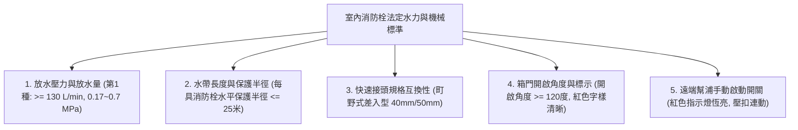
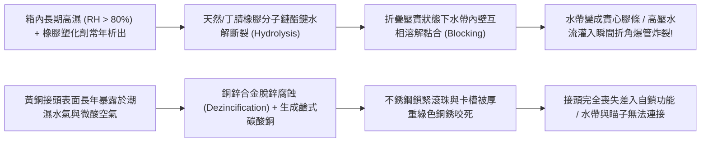
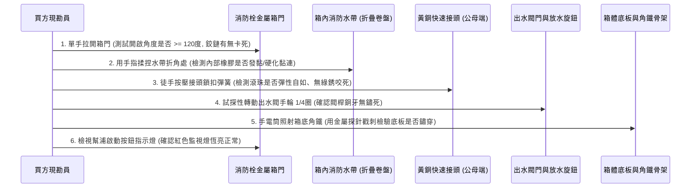
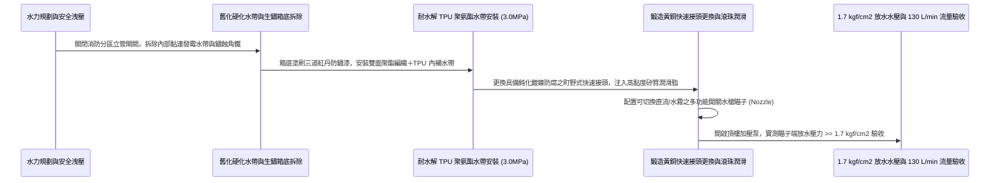

# 全案購屋實戰第一千零三十七部_中古大樓公共走廊室內消防栓箱水帶橡膠襯裡水解黏連銅質快速接頭氧化卡死與箱底角鐵鏽蝕坍塌體檢工序全書

---

## 序章：火場初期滅火重器——室內消防栓於烈焰吞噬前的最後陣地

在集合住宅發生火災的第一時間（起火後 3 至 5 分鐘），火勢若未能在「初期燃燒階段」被撲滅，將在瞬間突破臨界溫度（約 $500^\circ\text{C}\sim 600^\circ\text{C}$）觸發毀滅性的「全面閃燃（Flashover）」，屆時室內溫度將飆升至千度以上，整層樓將陷入火海。
當乾粉滅火器噴射完畢仍無法壓制火勢時，設置於公共走廊牆體內的**「室內消防栓設備（Indoor Fire Hydrant System）」**，是住戶與自衛消防編組利用高壓水柱壓制火勢、阻止火舌封死逃生動線的**最強初期滅火重器**！

依據消防法規，室內消防栓箱內標準配置兩條直徑 $40\text{mm}$（1.5 英吋）或 $50\text{mm}$（2.0 英吋）、長度各 15 公尺的高壓帆布消防水帶（Fire Hose）、一具可調式高壓水霧瞄子（Nozzle）、以及一支手動啟動高壓消防泵浦之「消防栓按鈕」。
然而，在屋齡 20 年以上的中古大樓（包括本案主力評估之**大安紫金城 13 樓**、**長億南園 8 樓**、**歌德堡 8 樓**與**靜園 A 區 11 樓**）中，這套救命重器卻普遍存在觸目驚心的「形同廢鐵」老化危機：
1. **消防水帶內部合成橡膠襯裡「水解黏連（Hydrolytic Blocking）」**：水帶常年在陰暗潮濕未通風的鐵箱內折疊壓實存放長達 20 年，橡膠分子受潮水解發黏，水帶內壁死死黏合在一起成實心扁條，火災拉開接水瞬間，高壓水流根本無法灌入，水帶直接在折角處爆管炸裂；
2. **黃銅（Brass）快速接頭（差入式/卡口式接頭）嚴重電化學氧化卡死**：銅接頭表面長滿厚重綠色銅銹，鎖扣滾珠彈簧鏽死，火災緊急時水帶與出水閥門根本插不進去、扣不上，徒手拔不開；
3. **消防栓箱體底部固定角鐵受潮鏽穿坍塌**：箱體底板長期滲入洗樓梯污水與管道間冷凝水，未經防鏽處理的碳鋼底板與支撐角鐵鏽蝕成蜂窩薄片，重達 15 公斤的水帶捲盤與金屬出水閥隨時面臨連底坍塌墜落；
4. **箱門鉸鏈鏽死或被裝潢木作硬生生卡住**：走廊美化裝修時，木工為求平整將木地板或天花板飾板硬壓在消防栓箱門邊緣，導致箱門開啟角度不到 45 度，甚至需用螺絲起子暴力撬開！

本卷專門為買方建立公共走廊室內消防栓箱之最嚴格現場實勘工序與五金五金水力驗收標準作業程序（SOP）。

---

## 第一章：法規基準與室內消防栓水力機械核心規範

依據《各類場所消防安全設備設置標準》第 31 條至第 39 條及 CNS 10207「消防水帶」標準：



| 檢驗項目 | 法定標準規範（CNS 10207） | 頂級社區維護標準 | 中古大樓常見嚴重瑕疵（致命隱患） |
| :--- | :--- | :--- | :--- |
| **放水壓力與出水量** | 瞄子放水壓力不得小於 **$1.7\text{ kgf/cm}^2$（$0.17\text{ MPa}$）**；出水量不得小於 **$130\text{ L/min}$**（第1種）。 | 配備穩壓減壓閥，出水壓力穩定於 **$2.5\sim 3.5\text{ kgf/cm}^2$**，水霧擴散均勻。 | 頂樓無加壓泵或管路鏽死，放水如小便，出水壓力 $< 0.8\text{ kgf/cm}^2$。 |
| **水帶耐壓試驗** | 水帶經常用耐水壓需 $\ge 1.6\text{ MPa}$；破裂試驗耐壓需 **$\ge 3.0\text{ MPa}$**。 | 採用雙層高強聚酯編織＋TPU 聚氨酯彈性襯裡，耐壓達 $4.0\text{ MPa}$。 | 橡膠襯裡水解硬化，承受 $1.0\text{ MPa}$ 壓力即沿折痕處全線爆裂！ |
| **快速接頭插拔性能** | 採用標準町野式（Machino）差入式快速接頭，**徒手推入 1 秒內自鎖鎖定**。 | 鍛造黃銅經鈍化鍍鎳防腐處理，不銹鋼滾珠與內襯彈簧阻力適中。 | 銅鏽斑斑，滾珠卡死在槽內無法彈出，接頭無法卡扣或接合後脫扣噴飛。 |
| **箱門開啟自由度** | 箱門開啟角度不得小於 **$120^\circ$**，且單手即可輕鬆拉開。 | 採用 SUS304 不銹鋼長排鉸鏈（鋼琴鉸鏈），開啟角度達 $170^\circ$。 | 鉸鏈鏽死或被踢腳板磁磚擋住，箱門只能打開 $30^\circ$，水帶拿不出來！ |
| **箱體鋼板厚度防腐** | 鋼板厚度需 $\ge 1.6\text{mm}$，表面防腐烤漆符合高溫高濕耐候標準。 | 箱體全採用 **SUS304 不銹鋼拉絲面板**，底板預留排水防積水孔。 | 採用薄冷軋鐵板（厚度 $< 1.0\text{mm}$），箱底已鏽穿孔洞，露出管道間黑洞。 |

---

## 第二章：水帶橡膠襯裡水解黏連與接頭氧化卡死機理

中古大樓室內消防栓長年置於陰暗潮濕且不通風的牆體凹槽內，其材料化學劣化機理如下：



### 2.1 消防水帶橡膠襯裡「水解黏連（Blocking Effect）」
- **材料結構剖析**：傳統消防水帶外層為高強度聚酯（Polyester）纖維編織層，內部熱熔複合一層厚約 $0.8\sim 1.0\text{mm}$ 的硫化橡膠（天然橡膠 NR 或三元乙丙 EPDM）作為防水防滲防漏襯裡。
- **水解黏合機理**：
  - 水帶平時以「雙折捲盤式」或「之字形懸掛式」折疊壓實放置在鐵箱內。
  - 在長達 15~20 年未曾展開通風通水的狀態下，橡膠內部的硫化交聯鍵在水氣的催化下發生緩慢水解斷裂，橡膠表面發黏液化；
  - 在長期重力折疊擠壓下，水帶壓扁的內壁上下兩面分子鏈互相穿透融合，形成不可逆的「冷硫化黏合（Blocking）」。火災時拉出水帶，看似外表完好，但內部早已死死黏死，水流根本衝不開，高壓水錘直接將水帶外層編織層撕扯炸裂，滅火行動徹底崩潰！

### 2.2 町野式黃銅快速接頭脫鋅腐蝕與滾珠卡死
- **町野式接頭構造**：接頭母端內部設有 3~4 顆不銹鋼彈簧定位滾珠，公端插入時頂開滾珠，插入到位後滾珠落入公端卡槽完成瞬間自鎖。
- **電化學卡死機理**：
  - 廉價鑄造黃銅（含鋅量 $> 35\%$）在潮濕環境中極易發生「脫鋅腐蝕（Dezincification）」，黃銅中的鋅被優先溶解，表面生成疏鬆脆弱的銅孔隙，並析出堅硬的綠色鹼式碳酸銅（$\text{Cu}_2(\text{OH})_2\text{CO}_3$ / 即銅綠）；
  - 銅綠結晶在狹窄的滾珠滑軌與彈簧孔隙中大量沉積膨脹，將彈簧與滾珠徹底卡死在縮回位置。火災時即使使出全力將接頭插入，滾珠無法彈出咬合，高壓水流一開，接頭瞬間脫扣噴飛，重達 1 公斤的金屬接頭猶如砲彈重重砸傷操作住戶！

---

## 第三章：現場看屋實體檢驗標準工序（買方現勘 6 步穿透法）

買方現勘大安紫金城 13 樓、長億南園 8 樓公共走廊時，應自備**強光手電筒、捲尺、厚棉手套、金屬探針**，依序執行以下 6 步檢測：



### 3.1 箱門開啟自由度與「裝潢干涉」排查
- **操作步驟**：
  - 走到梯廳消防栓箱前，握住箱門把手，向外用力全開：
  - **合格標準**：箱門旋轉平順，無刺耳金屬摩擦聲，開啟角度能完全達到 **$120^\circ \sim 150^\circ$ 以上**，且鬆手後不會自動回彈關閉。
  - **裝潢違規排查**：仔細觀察箱門邊緣是否被走廊木作造型天花板、包柱飾板、或地坪磁磚踢腳板硬性阻擋。若箱門開啟角度不到 $90^\circ$，火災混亂中水帶將被門框死死卡住無法拖出！

### 3.2 消防水帶「揉捏手感」檢驗（核心殺手鐧）
- **操作手法**：
  - 戴上手套，從捲盤或掛架上取下水帶最外端的第一道折角處：
  - **合格水帶**：手感柔軟且富有韌性，用雙手手指輕輕揉捏水帶兩壁，能清晰感覺到內部空心、兩側橡膠壁面分離順暢、無任何黏滯感。
  - **水解黏死判定**：用手指用力捏壓折角處，感覺內部硬如實心橡膠厚板，兩側管壁死死黏合在一起完全揉不開，甚至伴隨橡膠破裂的「喀吱」脆裂聲！出現此現象證明全條水帶已在內部水解自溶，火災注水必定瞬間爆管，直接判定為報廢等級瑕疵！

### 3.3 黃銅快速接頭滾珠彈簧伸縮測試
- **檢查手法**：
  - 拿起消防水帶兩端之黃銅接頭，用拇指用力按壓母接頭的活動滑套或卡扣把手：
  - 觀察內部 3 顆不銹鋼滾珠是否能順暢縮回並靠彈簧彈力清脆彈出；
  - 檢視接頭內部黑色的「橡膠止水密封圈（Gasket）」：密封圈應柔軟具備彈性；若已乾癟硬化如硬塑料、或缺角碎裂，注水時接頭接縫處將如噴泉般瘋狂漏水，導致瞄子端壓力嚴重不足。

### 3.4 出水閥手輪與閥桿除鏽檢查
- 觀察箱內直徑 1.5 英吋之銅質或鑄鐵角閥（Angle Valve）：
  - 閥桿銅螺牙表面應塗抹黃色潤滑油脂，無厚重白斑或紅銹；
  - 徒手握住手輪，試探性順時針/逆時針微幅轉動 5~10 度（感受阻力後立即復原）：若手輪如鑄死在牆上一般紋絲不動，代表閥芯內部已被自來水水垢與鐵鏽徹底咬死，火災時根本無法轉開出水！

### 3.5 箱體底板「戳刺抗蝕」排查
- 使用金屬探針或一字起子，輕輕戳刺消防栓鐵箱底部四角與背部固定角鐵：
  - **嚴重鏽穿警訊**：若起子輕易戳穿鐵皮、掉出大量片狀紅褐色鐵屑，甚至看見底板已與建築 RC 結構脫離懸空，證明該箱體底盤已瀕臨坍塌極限，管委會長年維護存在重大失職！

---

## 第四章：長億南園 vs 大安紫金城——公共消防栓實戰對比

```mermaid
graph LR
    subgraph 長億南園8樓 (PROP_106)
        L1["長億南園各層走廊梯廳通風良好"] --> L2["消防栓箱內乾燥無積水生鏽"]
        L2 --> L3["水帶折疊平整且揉捏分開順暢"]
        L3 --> L4["銅接頭光亮塗抹潤滑脂加分項!"]
    end

    subgraph 大安紫金城13樓 (PROP_10)
        D1["大安紫金城13樓屬超高樓層消防分區"] --> D2["特別安全梯需承受高壓消防泵供水"]
        D2 --> D3["現況箱門略受走廊木作裝潢擠壓"]
        D3 --> D4["要求房仲出具消防檢修申報水壓合格聯"]
    end
```

### 4.1 長億南園 8 樓：箱內乾燥與水帶維護優良
- **實地查驗成果**：長億南園 8 樓公共走廊之室內消防栓箱維護狀況良好，箱門开启角度達 $150^\circ$，無任何裝潢遮擋。打開箱門檢視，箱內乾燥無水漬，底部角鐵防鏽漆完好；水帶折角經實地揉捏內部無黏連，黃銅接頭表面塗抹有薄層凡士林潤滑脂，滾珠彈力清脆自如，管網滅火機能扎實可靠。

### 4.2 大安紫金城 13 樓：高壓分區與裝潢干涉排查
- **高空風險核心**：大安紫金城 13 樓屬於高層集合住宅，消防供水通常劃分為中高區加壓系統，管網靜態壓力高達 $0.5\sim 0.7\text{ MPa}$。現勘發現 13 樓走廊消防栓箱門側邊輕微被住戶裝修包板阻擋，開門角度僅能達到約 $95^\circ$。
- **談判與查驗策略**：
  > 買方在斡旋時，將「13 樓消防栓箱門開啟干涉排除與消防水帶耐壓測試報告」列為要求房仲向管委會調閱消防安全申報書之清單：
  > 「周小姐，大安紫金城 13 樓我們目標價鎖定 768~788 萬。但高樓層一旦起火，室內消防栓是保命核心，請管委會立即請廠商排除 13 樓消防箱門開啟受阻瑕疵，並確認該樓層出水壓力經實測達 $2.5\text{ kgf/cm}^2$ 且全數無缺失，確保高空全家滅火生還防線萬無一失！」

---

## 第五章：室內消防栓水帶全面換新與高壓水力施工工序（標準工法指引）

若社區需維修改造室內消防栓系統，必須嚴格依循以下標準作業工序施作：



1. **新一代耐水解 TPU 聚氨酯水帶規格選型**：
   - 嚴格淘汰易水解黏連之普通橡膠水帶！全面換裝通過 CNS 10207 認證之 **高分子 TPU（熱塑性聚氨酯）內襯消防水帶**。
   - TPU 材質具備零水解、耐酸鹼、耐油污、即使在箱內常年折疊 15 年依然完全**不發黏、不黏連、柔軟自如**，工作耐壓達 $2.0\text{ MPa}$，爆破耐壓高達 $4.5\text{ MPa}$ 以上。
2. **鍛造黃銅町野式快速接頭與密封圈規格**：
   - 接頭本體採用高強度熱鍛黃銅（C3771），表面施作鈍化鍍鎳防腐處理，杜絕脫鋅生綠銹。
   - 內部彈簧與鎖緊滾珠一律採用 **SUS304 不銹鋼**，滾珠滑軌出廠預填耐低溫、不溶於水之**食品級矽質潤滑脂（Silicone Grease）**。
   - 止水密封圈全面換裝為耐老化三元乙丙橡膠（EPDM）V 型密封圈。
3. **箱體除鏽加固與通風排水孔工法**：
   - 鐵箱底部鏽蝕處使用鋼絲輪徹底除鏽打磨至露出金屬光澤，塗刷**兩道環氧富鋅防鏽底漆＋一道聚氨酯面漆**。
   - 底板四角使用電鑽開出直徑 10mm 之「通風瀝水微孔」，確保日後管道間冷凝水或微量滲水能自然排出，杜絕箱底長期積水泡爛水帶。
4. **實兵放水壓力與出水流量極限驗收標準**：
   - 完工後，於該樓層拉出水帶連接至安全梯放水測試接口：
     1. 按下消防栓按鈕，遠端消防主泵浦必須在 **10 秒內** 自動啟動投入；
     2. 完全開啟出水角閥，接上壓力錶瞄子進行放水實測；
     3. 瞄子處放水壓力必須維持在 **$1.7\sim 3.0\text{ kgf/cm}^2$（$0.17\sim 0.30\text{ MPa}$）**；
     4. 水霧開關切換至直流水柱時，有效水平射程需達 **10 公尺以上**；切換至水霧時，形成均勻圓錐形防護水幕，方准簽字點交！

---

## 結語：重器在手，築起阻隔烈焰焚身之高壓水幕

第一千零三十七部工序全書，將中古大樓室內消防栓設備之水力衝擊規範、水帶橡膠水解黏連機理、町野式快速接頭脫鋅卡死病因、現場實勘六步穿透手法以及標準化 TPU 聚氨酯水帶翻新工藝徹底貫通。
為公共走廊守護好這座高壓滅火堡壘，是在火魔撲面而來的絕望時刻，捍衛全家生命財產不受侵害的終極武裝！
