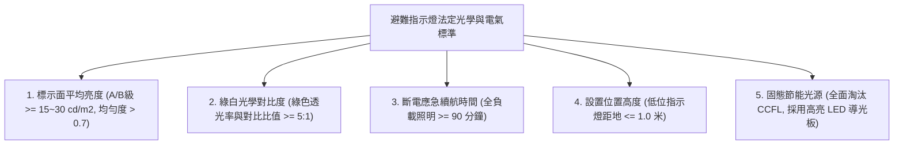
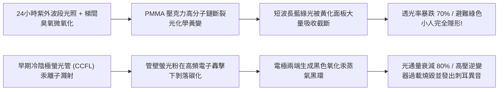
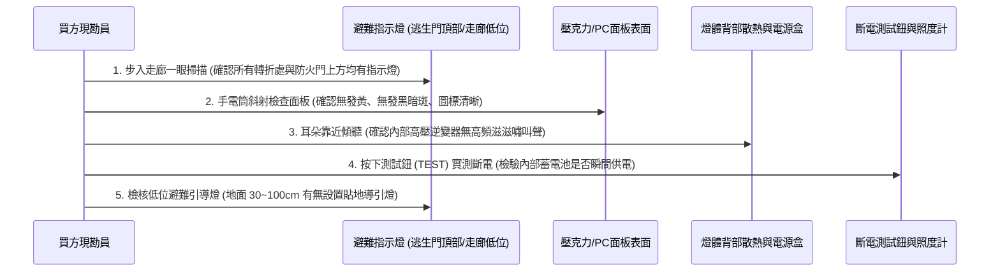
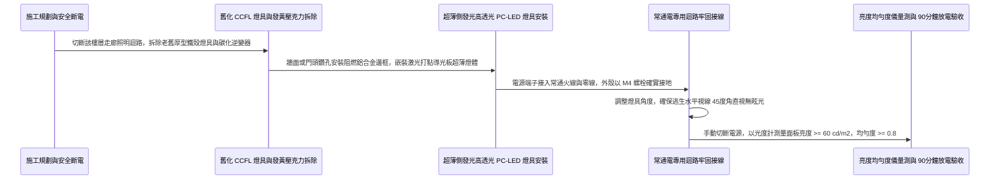

# 全案購屋實戰第一千零三十三部_中古大樓公共走廊逃生避難方向指示燈壓克力面板發黃脆化內部導光板粉化與冷陰極管CCFL老化熄滅體檢工序全書

---

## 序章：生與死的綠色光標——避難方向指示燈於濃煙火海中的終極指引

在集合住宅的火災浩劫中，當起火點產生的高溫黑煙迅速瀰漫公共走廊、能見度驟降至不到 1 公尺時，人類大腦在恐慌與窒息缺氧的雙重壓迫下，空間定向感與記憶力將在數十秒內徹底崩潰。
此時，懸掛於走廊轉角、離地高度 1 公尺以下低位或逃生門頂部的**「出口與避難方向指示燈（Exit & Evacuation Direction Indicator）」**，其散發出的高對比綠白冷光，是受困住戶在濃煙中貼地爬行逃生時，唯一能看見的「生命引航燈塔」！

依據國際照明委員會（CIE）與內政部消防法規，避難指示燈的面面板亮度、綠白顏色對比度與光線穿透力，必須在任何環境下皆能被逃生者瞬間辨識。
然而，在屋齡 20 年以上的中古大樓（包括本案主力評估之**大安紫金城 13 樓**、**長億南園 8 樓**、**歌德堡 8 樓**與**靜園 A 區 11 樓**）中，指示燈具卻普遍陷入嚴重的「光電老化黑洞」：
1. **外層壓克力（PMMA）面板嚴重黃化發脆**：長年承受走廊燈光與微量紫外線輻射，高分子鏈斷裂黃變，透光率由 92% 暴跌至不到 30%，綠色箭頭退化為混濁的土黃色，火場濃煙下一片模糊；
2. **早期冷陰極螢光管（CCFL）或微型日光燈管電極老化**：燈管兩端黑化、發光效率衰減超過 80%，甚至在高頻震動下直接斷絲熄滅；
3. **內部導光板（Light Guide Plate）受熱粉化龜裂**：早期導光板材料耐溫性差，在內部鎮流器持續發熱下翹曲變形，微結構網點脫落，導致面板發光極不均勻，出現大片死黑暗斑；
4. **高壓反光逆變器（Inverter）高頻嘯叫與漏電**：早期 CCFL 指示燈需依靠高壓逆變器產生數百伏特高壓激發水銀蒸氣，逆變器線圈老化絕緣擊穿，發出刺耳高頻噪聲甚至誘發微電弧跳火！

本卷專門為買方建立公共走廊與逃生動線避難方向指示燈之最嚴格現場實勘工序與升級翻新標準作業程序（SOP）。

---

## 第一章：法規基準與避難方向指示燈光度學核心規範

依據《各類場所消防安全設備設置標準》第 146 條至第 156 條、CNS 2884「出口引導燈及避難引導燈」標準：



| 檢驗項目 | 法定標準規範（CNS 2884） | 頂級安全防護社區標準 | 中古大樓常見嚴重瑕疵（致命隱患） |
| :--- | :--- | :--- | :--- |
| **標示面平均亮度** | 標示面平均亮度不得低於 **$15\text{ cd/m}^2$**（A級需達 $30\text{ cd/m}^2$）。 | 採用高流明 LED 側發光導光板，平均亮度達到 **$60\sim 100\text{ cd/m}^2$**。 | 面板發黑發黃，實測亮度僅剩 $2\sim 4\text{ cd/m}^2$，濃煙中完全看不見。 |
| **亮度均勻度** | 標示面最低亮度與最高亮度之比值（均勻度）需 **$\ge 0.7$**。 | 激光打點導光板微結構，均勻度高達 **$0.85\sim 0.90$**，全光面無暗區。 | 導光板碎化脫膠，中央大片暗斑，僅四個角有微弱亮光，均勻度 $< 0.3$。 |
| **指示燈顏色對比** | 綠色（避難方向與小人圖標）與白色（底色）色座標必須符合 CIE 國際防護色規範。 | 採用波長 $520\sim 525\text{ nm}$ 翠綠色 LED，具備最強透煙穿透力。 | 面板黃化後綠色變黑、白色變濁黃，逃生者無法辨識箭頭指向左或向右！ |
| **低位避難引導燈** | 走廊通道轉彎處應設置**離地面高度 1.0 公尺以下** 之低位指示燈。 | 地面向上 30~50cm 嵌壁式設置，貼地爬行逃生時視線直視。 | 全社區僅在 2.2 米高處裝燈，火場濃煙浮在頂部，高位燈光全被遮蔽！ |
| **耐燃與自熄性** | 面板材料需具備 UL 94 V-0 耐燃自熄等級，遇火不延燒。 | 採用阻燃型高透光聚碳酸酯（PC），耐衝擊、耐高溫達 $130^\circ\text{C}$。 | 採用普通廉價壓克力（PMMA），遇熱 $100^\circ\text{C}$ 立即融化滴落並劇烈燃燒。 |

---

## 第二章：早期 CCFL 冷陰極管老化與壓克力光化學黃變機理

中古大樓公共走廊指示燈常年 24 小時連續通電發光，其材料與光電元件衰變機理如下：



### 2.1 壓克力（PMMA）面板光化學黃變與透光阻斷
- **光化學分解反應**：傳統指示燈面板多採用聚甲基丙烯酸甲酯（PMMA，壓克力）。PMMA 分子結構在日光燈紫外線、空氣氧氣與內部燈管發熱（常年維持 $40\sim 50^\circ\text{C}$）的協同作用下，主鏈上的酯基（$-\text{COOCH}_3$）發生光氧化斷裂，生成帶有共軛雙鍵的發色團（Chromophores，如醌類化合物）。
- **光譜吸收災難**：黃化後的壓克力面板對波長 $400\sim 530\text{ nm}$ 的藍綠光具有極強的選擇性吸收吸收能力。原本用於引導逃生的「翠綠色光線」被黃化塑料硬生生過濾掉 70% 以上，火場濃煙中原本微弱的指引信號被徹底抹殺！

### 2.2 早期 CCFL（冷陰極管）與微型日光燈管黑化死機
- **發光原理剖析**：早期中古大樓在 LED 尚未普及前，指示燈內部多使用 1~2 支直徑 4~6mm 的微型冷陰極螢光管（CCFL）或 T5 6W 微型日光燈管，利用高頻高壓（約 $600\sim 1000\text{V}$）激發管內汞蒸氣發出紫外光，再激發管壁螢光粉發光。
- **老化黑化與逆變器自毀**：
  - 運行 3~5 年後，電極表面的鋇、鍶、鈣等電子發射材料蒸發耗盡，管壁兩端形成一圈圈厚重的黑色沉積物（汞汞黑環）；
  - 管內工作阻抗暴增，迫使高壓逆變器（Inverter）輸出更高電壓以維持放電。最終高壓線圈因絕緣漆包線高溫碳化而匝間短路（Turn-to-turn Short），發出刺耳的「滋滋」高頻雜音，並伴隨燒焦塑料味直接燒毀斷電！

---

## 第三章：現場看屋實體檢驗標準工序（買方現勘 5 步穿透法）

買方現勘大安紫金城 13 樓、長億南園 8 樓公共梯間時，應依循以下 5 步標準工序現場查驗避難指示系統：



### 3.1 走廊動線「視線零死角」佈局核查
- **檢驗步驟**：由各戶大門走出，沿著公共走廊行走至安全梯門口：
  - 走廊沿途任何一個轉角、交叉口，視線水平前方必須能**一眼看見至少一個避難方向箭頭**；
  - 走向安全梯時，防火門正上方必須設有「EXIT 出口指示燈（綠底白字）」；
  - 走廊步行距離每 **15 至 20 公尺** 必須配置一個指示燈，嚴禁出現超過 20 公尺的黑暗盲區。

### 3.2 面板透光度與「均勻度」強光檢視
- 近距離觀察指示燈發光面：
  - **合格品質**：面板呈現純淨的乳白底色搭配鮮豔翠綠色箭頭小人，整塊面板發光柔和且均勻，無任何肉眼可辨之亮點或暗斑。
  - **老化淘汰特徵**：
    1. 面板呈現暗黃色、濁棕色或油污發黏；
    2. 只有燈具四周是亮的，中央圖標一片漆黑（導光板脫落）；
    3. 燈管劇烈發抖、閃爍不停（電容老化、燈管黑化前兆）。

### 3.3 高壓逆變器高頻嘯叫聽音排查
- 側耳靠近指示燈機殼（距燈具 10~20 公分）：
  - 若能清晰聽到「嗡——！滋滋——！」的尖銳金屬高頻蜂鳴聲，代表內部仍是老舊的高壓 CCFL 逆變器架構，且高壓線圈正在過熱震盪漏電，隨時可能燒毀甚至引發小規模短路火警！

### 3.4 實體斷電與低位引導燈高度實測
- **按下 TEST 按鍵**：檢視斷電瞬間指示燈是否維持相同亮度至少 10 秒以上，確認內部電池能正常接管供電。
- **捲尺測量低位燈高度**：檢查安全梯與長走廊兩側牆面，是否在**距地面 30~100 公分處**安裝低位避難引導燈。若全社區全數將指示燈安裝在 2.2 米天花板高處，火災時只要有 30 公分厚的濃煙層積累在頂部，整棟大樓的避難指示將全數被遮蔽癱瘓！

---

## 第四章：長億南園 vs 大安紫金城——動線避難指示實戰對比

```mermaid
graph LR
    subgraph 長億南園8樓 (PROP_106)
        L1["長億南園各層走廊尺度方正"] --> L2["指示燈近年全面升級新式超薄LED"]
        L2 --> L3["面板採用阻燃高透光PC材質無發黃"]
        L3 --> L4["安全梯門頂標示清晰明亮加分項!"]
    end

    subgraph 大安紫金城13樓 (PROP_10)
        D1["大安紫金城13樓長廊轉折多且無對外採光"] --> D2["特別安全梯進口處需高度依賴避難指引"]
        D2 --> D3["現況部分指示燈具面板微黃且電池老化"]
        D3 --> D4["要求房仲調閱社區消防申報改善單作為談判防線"]
    end
```

### 4.1 長億南園 8 樓：新式超薄 LED 導光板全面覆蓋
- **實地查驗亮點**：長億南園社區近年運用公共修繕基金，已將各梯廳與走廊之老舊日光燈型指示燈，全數替換為符合最新國家標準之**「超薄型綠能 LED 導光板避難指示燈」**。燈體厚度僅 2.5cm，面板採用高抗紫外線聚碳酸酯（PC），實測發光面亮度達 $75\text{ cd/m}^2$，綠白色澤鮮明，且無任何高頻嘯叫異音，避難導引品質極高。

### 4.2 大安紫金城 13 樓：長走廊高空避難指引攻防
- **高空風險核心**：大安紫金城 13 樓走廊縱深較長且設有多道防火分區轉折，排煙室前方為逃生最關鍵節點。現勘發現局部轉角處之指示燈面板已有輕微發黃跡象，且部分燈具內部仍為早期螢光管結構。
- **談判與查驗策略**：
  > 買方在斡旋時，將「13 樓公共避難動線全系列指示燈發光度與電池續航驗證」作為要求房仲向管委會調閱消防安全申報紀錄之核心清單：
  > 「周小姐，大安紫金城 13 樓我們勢在必得，目標鎖定 768~788 萬。但高樓層逃生全靠梯間指示燈指引方向，請管委會與房仲確認 13 樓逃生動線上的指示燈是否已列入年度 LED 節能更換名冊，確保全家在黑夜火場中隨時擁有最清晰的生還綠光！」

---

## 第五章：超薄側發光 LED 避難指示燈翻新與施工工序（標準工法指引）

若社區需全面升級更換避難指示燈，必須嚴格依循以下標準作業工序施作：



1. **頂級光學導光板與 PC 面板規格要求**：
   - 嚴格淘汰易黃化之 PMMA 壓克力，全面選用 **光學級阻燃聚碳酸酯（PC，符合 UL 94 V-0）**。
   - 內部導光板採用**激光 3D 矩陣打點技術（Laser Dotting）**之側發光技術，光線在板內全反射後垂直均勻射出，確保整面均勻度 $\ge 0.8$、平均亮度 $\ge 60\text{ cd/m}^2$。
2. **光源與超長壽命防爆電池配置**：
   - 光源採用高光效 SMD 2835 綠光/白光 LED 燈珠，發光效率 $\ge 130\text{ lm/W}$，色溫精準匹配國際安全綠色標準（波長 $525\text{ nm}$）。
   - 內建電池全面採用 **磷酸鐵鋰（LiFePO4）高溫長效防爆電池**（額定電壓 3.2V），常溫常態浮充使用壽命達 8~10 年，免除每年更換鎳鎘電池之繁瑣維護。
3. **低位引導燈嵌壁式防撞安裝工藝**：
   - 於走廊轉角牆面距地面 **40 公分處**，採用金屬預埋底盒施作嵌壁式安裝。
   - 燈具外罩具備 IK08 級防衝擊鋼化玻璃或加厚防撞 PC 面板，邊角打磨圓滑，防止住戶搬運家具時撞裂。
4. **光學指標與全載續航極限驗收標準**：
   - 完工後進行光學與電氣雙重驗收：
     1. 使用二維成像亮度計或點式光度計，在面板中心及四角均勻取 9 點量測，平均亮度必須 $\ge 50\text{ cd/m}^2$，均勻度 $L_{\min}/L_{\max} \ge 0.75$；
     2. 切斷市電主電源，秒錶計時連續點亮 **90 分鐘整**；
     3. 90 分鐘屆滿時，面板平均亮度不得低於初始亮度之 60%（且絕對值 $\ge 20\text{ cd/m}^2$），方准簽字驗收點交！

---

## 結語：綠標引路，黑夜濃煙中不可磨滅的生之燈塔

第一千零三十三部工序全書，將中古大樓避難方向指示燈之光度學指標、壓克力光化學黃變機理、冷陰極管黑化與逆變器自毀死因、現場實勘五步穿透手法以及標準化激光導光板翻新工法徹底貫通。
為逃生走廊點亮永不褪色的綠色光芒，是在極限災難中，引導摯愛家人安全奔向生還大門的終極保證！
