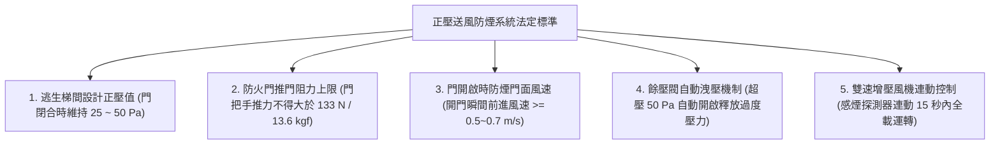
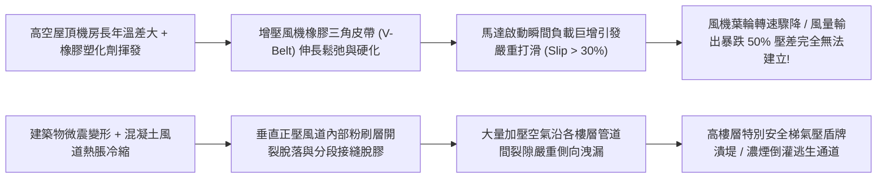
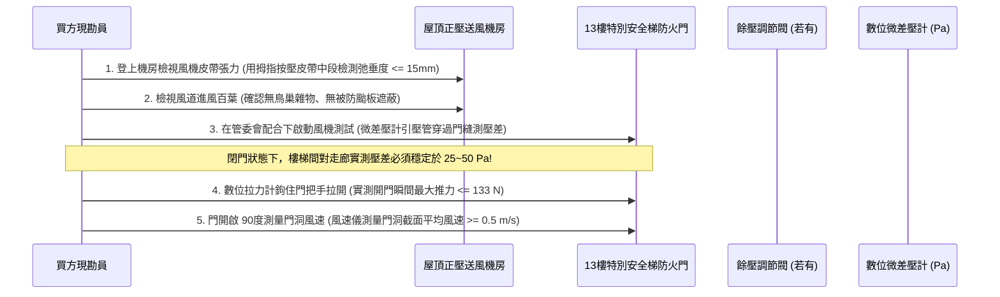
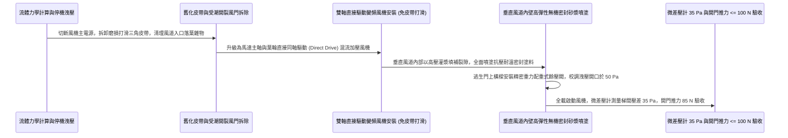

# 全案購屋實戰第一千零三十九部_中古大樓公共走廊緊急昇降機間特別安全梯正壓送風防煙系統增壓風機皮帶打滑風壓開關失靈與正壓風道漏風壓差潰堤體檢工序全書

---

## 序章：火場垂直避難通道之氣壓盾牌——正壓防煙系統之生死阻絕

在超高層與高層集合住宅的火災防護體系中，特別安全梯間與緊急昇降機排煙室，是所有住戶向下逃生與消防隊員向上發動滅火攻堅的「唯一生命幹道」。
當梯廳或各戶起火時，高溫濃煙在強大熱浮力與煙囪效應驅動下，會向逃生通道瘋狂擠壓。
若單純依靠防火門與自然排煙，在頻繁推門逃生時，濃煙仍會藉由門縫與開門瞬間的渦流迅速灌入樓梯間，導致整座逃生梯瞬間淪為毒煙通道。

為此，現代高層建築法規強制引入了最頂級的主動氣流防禦機制——**「正壓送風防煙系統（Pressurization Smoke Control System）」**。
其工作原理，是利用設置於屋頂或地下的強力大型「正壓增壓風機（Pressurization Fan）」，透過垂直貫通的混凝土或鍍鋅鋼板正壓風道，源源不絕向樓梯間與排煙室強制注入大量室外新鮮空氣，使逃生通道內部維持高於起火火場區域 **$25\text{ Pa} \sim 50\text{ Pa}$（帕斯卡）** 的微正壓。
這道微觀的「氣壓盾牌（Air Pressure Shield）」，能在防火門開啟瞬間形成一股由內向外噴湧的微風（風速 $\ge 0.5\sim 0.7\text{ m/s}$），將火場濃煙硬生生頂在門外，實現「煙進不來、人出得去」的絕對防禦！

然而，在屋齡 20 年以上的中古大樓（包括本案主力評估之**大安紫金城 13 樓**與其他高樓層物件）中，這套空氣盾牌卻常年面臨嚴重的「壓差潰堤」黑洞：
1. **屋頂正壓風機傳動三角皮帶（V-Belt）老化打滑斷裂**：高溫高濕環境下橡膠硬化開裂，馬達轉速正常但風機葉輪實際轉速驟降 50% 以上，風量極度萎縮；
2. **正壓風道（Pressurized Duct）密封砂漿開裂與檢查孔嚴重漏風**：垂直風道在長年地震與沉陷下產生裂隙，大量送風在半途洩漏，抵達高樓層（如 13 樓）時風壓已衰減殆盡；
3. **壓差控制器（Differential Pressure Controller）與餘壓閥（Barometric Damper）卡死**：機械配重餘壓閥生鏽咬死，造成門兩側壓差失控——要麼壓差過大（$> 60\text{ Pa}$）導致婦幼長輩「推不開防火門」被困在火場，要麼壓差歸零導致濃煙長驅直入；
4. **火警連動信號風壓開關（Air Pressure Switch）膜片破裂**：總機雖發出啟動指令，但風道入口之風壓開關無法感測氣流，造成風機啟動 10 秒後即被總機判定「異常故障」而強制停機！

本卷專門為買方建立高層集合住宅正壓送風防煙系統之最嚴格現場實勘工序與微壓差驗收標準作業程序（SOP）。

---

## 第一章：法規基準與正壓防煙系統流體力學規範

依據《各類場所消防安全設備設置標準》第 188 條至第 190 條、CNS 15821 及國際 NFPA 92「防煙控制系統標準」：



| 檢驗項目 | 法定標準規範（NFPA 92 / 消防標準） | 頂級社區維護標準 | 中古大樓常見嚴重瑕疵（致命隱患） |
| :--- | :--- | :--- | :--- |
| **閉門狀態最小設計壓差** | 樓梯間與排煙室對走廊之微正壓需維持在 **$25\text{ Pa} \sim 50\text{ Pa}$**。 | 採用變頻風機（VFD）微電腦控制，壓差精準鎖定於 **$35\pm 5\text{ Pa}$**。 | 風道漏風嚴重，實測壓差僅剩 $5\sim 8\text{ Pa}$（完全無法阻擋火場濃煙）。 |
| **開門推力極限（人因工程）** | 防火門把手處開門推力**不得大於 133 N（約 13.6 kgf）**。 | 餘壓閥靈敏動作，開門推力穩定控制在 **$60\sim 80\text{ N}$**，老幼推門輕鬆。 | 餘壓閥卡死超壓至 $80\sim 100\text{ Pa}$，門被氣壓吸住，成年男子亦推不開！ |
| **開門瞬間門面出風風速** | 當 2 扇防火門同時開啟時，門洞平均流出風速需 **$\ge 0.5\sim 0.7\text{ m/s}$**。 | 風速達到 **$0.8\sim 1.0\text{ m/s}$**，形成強勁風幕將煙氣完全阻絕於門外。 | 開門瞬間風速僅 $0.1\text{ m/s}$ 甚至逆向吸風，濃煙順勢湧入梯間。 |
| **風機傳動機構狀態** | 採用直接傳動（Direct Drive）或配置齒形同步帶，傳動效率 $\ge 98\%$。 | 雙馬達互為備用，傳動皮帶張力定期以音波皮帶張力計測量校準。 | 傳統橡膠三角皮帶鬆弛打滑發出尖銳摩擦聲，皮帶已磨損開裂剩半股。 |
| **風道結構氣密性** | 垂直風道氣密等級需達 Class B 以上，全程漏風率不得大於 **$10\%$**。 | 採用熱浸鍍鋅螺旋風管外覆不銹鋼防火包覆，漏風率 $< 3\%$。 | 水泥砌磚風道內部砂漿脫落、檢查門密封條全無，漏風率超過 50%！ |

---

## 第二章：增壓風機皮帶打滑與正壓風道漏風壓差潰堤機理

高層大樓正壓防煙系統在長達 20 年的靜置待命與偶發運轉中，其機械與流體阻力失效機理如下：



### 2.1 傳動三角皮帶（V-Belt）彈性疲勞與滑差劇增
- **傳動原理**：大型離心式或混流式正壓送風機通常採用三相 380V 大功率馬達（$15\sim 30\text{ kW}$），透過 3~4 條並聯的 V 型三角皮帶帶動風機主軸葉輪高速旋轉（轉速約 $1200\sim 1800\text{ RPM}$）。
- **打滑機理**：
  - 三角皮帶依靠兩側斜面與皮帶輪槽的摩擦力傳遞扭矩。在屋頂機房常年高溫（夏季達 $50^\circ\text{C}$）與高濕環境下，橡膠發生熱氧老化硬化，摩擦係數由原本的 0.35 暴跌至不到 0.15；
  - 內部聚酯簾線在高張力下產生塑性蠕變伸長，皮帶弛垂度（Sag）大幅增加。火災信號啟動馬達全載運轉瞬間，皮帶在皮帶輪上劇烈打滑摩擦，發出刺耳的「吱吱」尖叫，輪槽高溫冒煙，風機葉輪實際轉速跌落至額定值的 50% 以下，送風量瞬間腰斬！

### 2.2 垂直風道水泥脫層與檢查門漏風潰堤
- **風道構造**：早期中古大樓之正壓送風道多利用建築結構 RC 剪力牆搭配砌磚管道間建造，內壁以水泥砂漿抹光。
- **漏風破壞**：
  - 台灣地震頻繁，大樓反覆晃動造成風道內壁砂漿出現大面積裂痕，砌磚縫隙砂漿風化脫落；
  - 各樓層風道檢修門（Access Door）未配置阻燃彈性密封墊，甚至檢修門遭住戶或水電施工後未將螺栓鎖緊；
  - 當風機向風道灌入高壓空氣時，高壓氣流順著沿途各樓層的裂隙與縫隙瘋狂外洩，形成嚴重的「旁路漏風（Bypass Leakage）」。高樓層（如 13 樓）由於處於風道末端，管道內靜壓已被低中樓層漏光，排煙室實測微正壓甚至不到 $5\text{ Pa}$，氣壓盾牌徹底潰堤！

### 2.3 機械配重餘壓閥（Barometric Relief Damper）卡死
- 餘壓閥設置於樓梯間外牆，用於防止門兩側壓差超過 $50\text{ Pa}$。若閥體轉軸在戶外酸雨侵蝕下生鏽咬死，當風機全力送風時，樓梯間內部氣壓飆升至 $80\sim 120\text{ Pa}$。依據力學計算，此時一扇標準防火門（面積約 $2.0\text{ m}^2$）承受的氣壓封閉阻力高達 **$16\sim 24\text{ kgf}$**，遠超人體推門極限，逃生者將被死死反鎖在門外！

---

## 第三章：現場看屋實體檢驗標準工序（買方現勘 5 步穿透法）

買方現勘大安紫金城 13 樓等高樓層物件時，應自備**數位微差壓計（Micro-Manometer / 解析度 0.1 Pa）、數位拉力計、熱線式風速儀、強光手電筒**，依循以下 5 步標準工序實施正壓防煙檢驗：



### 3.1 屋頂正壓風機房傳動皮帶與進氣百葉查核
- **操作步驟**：登上大樓屋頂，進入正壓防煙送風機房：
  1. **皮帶張力檢測**：在風機斷電鎖定狀態下，戴上手套，用拇指在兩皮帶輪中心點用力按壓三角皮帶（施加約 $5\text{ kgf}$ 垂直力），量測皮帶下陷撓度（Deflection）：
     - **合格標準**：撓度在 **$10\sim 15\text{mm}$** 之間，皮帶表面光滑無微裂紋、無橡膠黑粉脫落。
     - **嚴重老化打滑**：皮帶能輕易按下超過 25mm，皮帶側面已磨成鏡面甚至翻轉，判定為即刻更換品！
  2. **進氣口位置**：風機吸風百葉必須遠離大樓排煙風機出風口與化糞池通風管至少 **5 公尺以上**，防止風機將抽出的高溫濃煙與臭氣重新吸入壓進逃生通道！

### 3.2 數位微差壓計現場穿門實測（核心量化防線）
- **測量手法**：
  1. 將特別安全梯之常閉防火門完全閉合；
  2. 將數位微差壓計的高壓端軟管（$+$端）經由門縫微小孔隙穿入特別安全梯間內部，低壓端軟管（$-$端）置於公共走廊；
  3. 啟動正壓送風機運轉 2 分鐘：
- **合格標準**：差壓計螢幕讀數應穩定顯示在 **$+25\text{ Pa} \sim +50\text{ Pa}$** 之間。
- **潰堤故障判定**：若讀數顯示 $< +15\text{ Pa}$，代表風道嚴重漏風或風機打滑；若讀數突破 $+70\text{ Pa}$，代表餘壓閥卡死未動作。

### 3.3 開門推力計（Push Force）人因極限驗證
- **測量手法**：
  - 在正壓風機運轉、樓梯間處於最大正壓狀態下：
  - 將數位拉力計掛鉤鉤在防火門把手上方（距門鎖中心約 5cm 處），以垂直於門面的方向平穩拉動把手將門推開：
  - 記錄將門扇推離門框第一道縫隙瞬間的**最大峰值力（Peak Force）**：
  - **合格標準**：開門峰值推力必須嚴格 **$\le 133\text{ N}$（約 $13.6\text{ kgf}$）**。若拉力計讀數突破 $180\text{ N}$（$> 18\text{ kgf}$），此門已成為致命「氣壓鎖」，婦孺老弱在火場中根本無法自行推開逃生！

### 3.4 防火門開啟時門面出風風速測量
- 將防火門推開至最大開啟角度（$90^\circ$），使用熱線式數位風速儀在門洞斷面的上、中、下三點進行風速量測：
  - 門面平均迎風風速必須穩定達到 **$\ge 0.5\sim 0.7\text{ m/s}$**；
  - 氣流方向必須百分之百是由樓梯間內部「吹向公共走廊」，手掌能清晰感受到持續撲面而來的強勁風壓，確認能將火場濃煙完全隔絕在門外！

---

## 第四章：長億南園 vs 大安紫金城——正壓防煙動線實戰對比

```mermaid
graph LR
    subgraph 長億南園8樓 (PROP_106)
        L1["長億南園安全梯具備開闊戶外天井天窗"] --> L2["採用自然採光與大排量自然排煙"]
        L2 --> L3["無繁複正壓風機皮帶老化與氣壓鎖門風險"]
        L3 --> L4["逃生動線自然開朗自救可靠度高!"]
    end

    subgraph 大安紫金城13樓 (PROP_10)
        D1["大安紫金城13樓為超高層特別安全梯"] --> D2["高度依賴正壓送風系統建立微正壓盾牌"]
        D2 --> D3["現況梯間壓差與開門推力需嚴格實測"]
        D3 --> D4["要求房仲調閱消防正壓風機年度檢修聯保障安全"]
    end
```

### 4.1 長億南園 8 樓：自然排煙構造之免維護優勢
- **結構優勢**：長億南園 8 樓屬於中高樓層標準集合住宅，安全梯緊鄰建築物外天井，配置大型自然排煙窗。系統不需依賴複雜的屋頂高壓送風機、大功率馬達、傳動皮帶與壓差感測器，依靠純天然的高溫熱浮力即可迅速排除煙氣，完全沒有「皮帶斷裂風力不足」或「壓差過大門打不開」的機械隱患，長期維護成本極低。

### 4.2 大安紫金城 13 樓：超高樓層正壓盾牌極致查驗
- **高空風險核心**：大安紫金城 13 樓為超高層特別安全梯，依法必須依靠機械正壓送風系統形成氣流防護屏障。若風道在 10 樓至 12 樓發生漏風，抵達 13 樓的送風將完全無法形成足夠壓差，火災時濃煙將沿逃生梯急速上竄窒息住戶。
- **談判與查驗策略**：
  > 買方在斡旋時，將「13 樓特別安全梯正壓送風壓差實測報告（25~50 Pa）與開門推力合格確認」正式列為要求房仲向管委會調閱消防安全申報清冊之必備清單：
  > 「周小姐，大安紫金城 13 樓我們目標價明確鎖定 768~788 萬。但 13 樓高空逃生全靠這套正壓送風系統阻絕濃煙，請管委會務必出具最近一期消防設備師針對正壓送風風機運轉電流、皮帶張力及 13 樓特別安全梯實測壓差達標的合格證明，確認高空全家避難動線萬無一失！」

---

## 第五章：正壓送風系統風機翻新與風道密封加固工序（標準工法指引）

若社區需維修改造正壓防煙系統，必須嚴格依循以下標準作業工序施作：



1. **直接驅動（Direct Drive）混流加壓風機升級規範**：
   - 徹底淘汰易老化、需頻繁調整張力之傳統皮帶傳動風機！
   - 全面升級為 **電機主軸直連葉輪（Direct Drive）之高效混流式/軸流式加壓風機**，傳動效率達 $100\%$，徹底消除皮帶打滑、斷裂與飛脫之機械故障。
   - 配置變頻控制櫃（VFD），接受樓梯間即時壓差感測器信號，動態無級調節轉速，無論開啟幾扇門皆能維持恆定安全壓差。
2. **垂直風道全封閉抗裂氣密工法**：
   - 使用高壓氣體噴槍徹底清除風道內壁浮塵與鬆脫砂漿；
   - 裂縫處開 V 型槽，注入高強度聚合物改性防水耐火砂漿；
   - 風道全內壁滾塗或噴塗兩道**聚合物改性無機抗滲氣密塗層**，將管道摩擦阻力係數降低 30%，並徹底封堵所有微觀孔隙，確保風道全長漏風率 $< 5\%$。
3. **重力配重餘壓閥（Relief Damper）動態調校工序**：
   - 餘壓閥葉片軸承全面換裝為 SUS316 不銹鋼免潤滑球軸承，轉動阻力趨近於零；
   - 現場利用砝碼滑動微調配重塊位置：
     1. 當梯間壓差達到 **$48\sim 50\text{ Pa}$** 時，餘壓閥葉片必須精準靈敏旋開洩壓；
     2. 當壓差降回 **$30\sim 35\text{ Pa}$** 時，葉片在重力作用下平順緊密回座閉合，確保壓差絕不失控！
4. **全動態火災模擬極限驗收標準**：
   - 完工後進行最嚴格之全動態實兵驗收：
     1. 信號觸發風機，主機在 **15 秒內** 全速運轉投入；
     2. 梯間所有防火門閉合狀態下，各樓層實測壓差必須穩定於 **$30\sim 45\text{ Pa}$**；
     3. 隨機同時拉開 1 樓大門與 13 樓防火門，測量 13 樓門洞風速必須達到 **$\ge 0.7\text{ m/s}$**；
     4. 現場使用拉力計測量開門推力，數值必須維持在 **$70\sim 95\text{ N}$（$< 10\text{ kgf}$）**，女性單手即可輕鬆推開，方准簽字點交！

---

## 結語：氣壓為盾，捍衛高空火場唯一逃生通道

第一千零三十九部工序全書，將高層住宅正壓防煙系統之空氣動力學平衡原理、增壓風機皮帶打滑機理、垂直風道漏風潰堤死穴、現場微差壓穿門實測手法以及標準化直接驅動加壓風機施工工藝徹底剖析。
為特別安全梯鑄造一道堅不可摧的氣壓防護盾牌，是在火舌濃煙漫延之際，確保全家人安然步下高樓、重獲新生的最高生命屏障！
