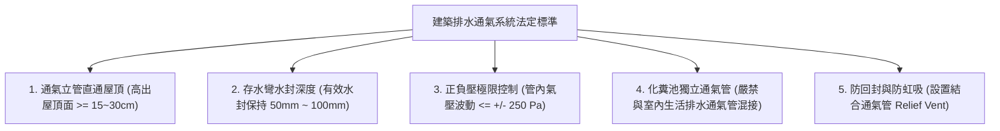
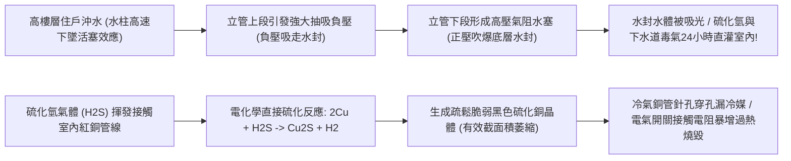
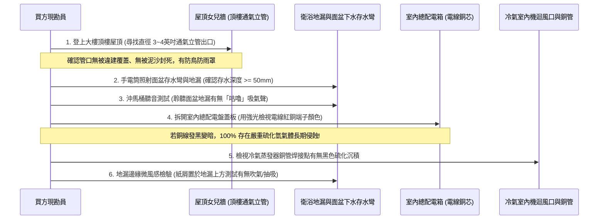
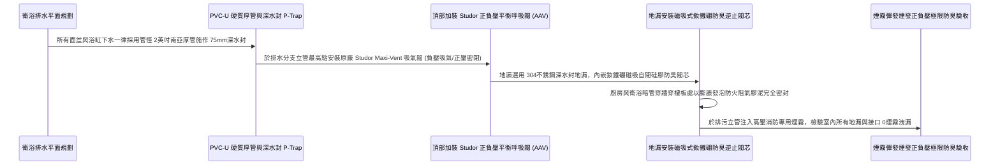

# 全案購屋實戰第一千零三十二部_中古大樓地下室污水化糞池正負壓平衡透氣立管未直通屋頂破封臭氣倒灌與硫化氫氣體腐蝕銅管電線體檢工序全書

---

## 序章：看不見的毒氣侵蝕——硫化氫與下水道臭氣之全屋毀滅性穿透

在許多中古大樓看屋現場，買方走入室內衛浴、廚房流理台下方或後陽台洗衣區時，常會聞到一股若有似無的「下水道悶臭味」或「臭雞蛋味」。
許多一般購屋者與不肖房仲往往輕描淡寫地歸咎於「太久沒住人，存水彎乾涸倒點水就好」。然而，這背後往往隱藏著中古大樓管線配置中最隱蔽、最難根治、且破壞力極其致命的結構性工程缺陷——**「污水化糞池通風透氣立管（Vent Stack）設計缺陷或施工截斷，未依規定直通建築物最高處屋頂」**！

在集合住宅的重力排水與化糞池消化體系中，糞便與有機污物在厭氧菌發酵過程中，會大量產生甲烷（$\text{CH}_4$）、氨氣（$\text{NH}_3$）以及強毒性、高腐蝕性的**硫化氫（$\text{H}_2\text{S}$）氣體**。
若大樓透氣立管系統在頂樓被住戶違章加蓋封死、被水電工偷懶直接接駁於吊頂暗處、或未配置獨立正負壓平衡呼吸閥：
1. **水封破封（Trap Seal Loss）**：排水立管在樓上鄰居大量沖水時產生巨大的流體負壓抽吸（Siphonage），或暴雨時管道內部正壓氣阻，直接將室內所有馬桶、面盆與地漏的防臭水封「吸乾」或「吹爆」，劇毒臭氣 24 小時直灌室內；
2. **電氣設備與銅管電化學黑化腐蝕**：硫化氫氣體具備強酸性與強還原性，空氣中僅需 $0.05\sim 0.1\text{ ppm}$ 的微量濃度，便能使室內冷氣蒸發器銅管、熱水器銅水箱、水龍頭黃銅閥芯以及配電箱內所有的紅銅導線、開關接點發生劇烈的電化學黑化氧化反應，生成黑色脆性硫化銅（$\text{Cu}_2\text{S}$），導致冷氣冷媒 1~2 年內漏光報廢、配電開關接點電阻暴增發熱跳火！
3. **神經毒性危害人體健康**：低濃度硫化氫長期吸入會麻痺人體嗅覺神經，造成慢性頭痛、眼角膜紅腫潰瘍、支氣管炎，嬰幼兒更易誘發過敏性氣喘與免疫力衰退。

本卷專門為買方建立中古大樓化糞池透氣立管、存水彎破封與硫化氫銅腐蝕之最嚴格現場實勘工序與管路改造標準作業程序（SOP）。

---

## 第一章：建築排水通氣水力學原理與法規通風立管規範

依據《建築技術規則建築設備編》第二章「給水排水系統及衛生設備」第 29 條至第 37 條、以及國際標準排水規範（IPC / UPC）：



| 檢驗項目 | 法定與國際工程規範標準 | 頂級防臭抗毒住宅標準 | 中古大樓常見嚴重瑕疵（致命隱患） |
| :--- | :--- | :--- | :--- |
| **通氣立管頂端出口** | 必須直接垂直貫穿並**引出屋頂面至少 15~30 公分**，遠離門窗與進風口 3 米以上。 | 通氣管高出屋頂女兒牆 60cm，端部配置全不銹鋼防鳥防蟲風帽。 | 頂樓被違章鐵皮屋直接封在屋內，或被裝潢木作直接截斷封死在管道間內！ |
| **化糞池專用通風管** | 化糞池必須設置獨立通風管直通戶外大氣，管徑不得小於 2 英吋（50mm）。 | 配置活性碳化學除臭吸附過濾器，管徑達 3 英吋（75mm）排氣暢通。 | 化糞池無通風管，氣體沿污水主管逆流向上，各樓層水封全面破封。 |
| **存水彎水封高度** | 各衛生器具存水彎（P-Trap / S-Trap）之有效水封深度應在 **$50\text{mm} \sim 100\text{mm}$** 之間。 | 配置深水封（75mm）搭配自封式矽膠重力逆止防臭防蟲地漏芯。 | 水封深度小於 25mm，或採用淺水盤地漏，乾涸或受壓瞬間破封。 |
| **管內氣壓波動範圍** | 排水立管內部正負氣壓波動幅度不得超過 **$\pm 250\text{ Pa}$（$\pm 25\text{ mmAq}$）**。 | 安裝正負壓平衡吸氣閥（AAV），將管內負壓嚴格限制在 $-50\text{ Pa}$ 以內。 | 沖水時立管負壓高達 $-1500\text{ Pa}$，鄰戶存水彎瞬間被吸光（咕嚕作響）。 |
| **金屬抗硫化腐蝕** | 配電盤銅排與電子接點環境硫化氫濃度需 **$< 0.003\text{ ppm}$（ISA G1 級環境）**。 | 電箱封裝良好且室內管路零破封，銅線經 10 年依舊維持亮紫紅色金屬光澤。 | 室內硫化氫超標，電箱開關接點與冷氣銅管全面發黑結焦，微電弧跳火。 |

---

## 第二章：正負壓誘發存水彎破封與硫化氫金屬腐蝕機理

中古大樓給排水管網中，下水道臭氣穿透防線與金屬腐蝕之化學物理機理如下：



### 2.1 排水立管「水活塞效應」與水封雙向破壞
- **負壓抽吸（Siphonage）**：
  - 當高樓層住戶（如 13 樓或 10 樓）沖馬桶時，大量水體夾帶固體在直徑 4 英吋（100mm）的排水立管內高速下墜（速度達 $4\sim 6\text{ m/s}$），形成一段緊密填充的水活塞（Water Piston）。
  - 若屋頂通氣管被堵塞，水活塞後方瞬間形成真空吸力（負壓），強行將中下樓層住戶的面盆存水彎與浴缸存水彎裡的水「吸光吞入排水管」，這就是常聽到的「咕嚕、咕嚕」水封抽空聲！
- **正壓噴濺（Backpressure）**：
  - 水活塞前方推擠管內空氣，在立管轉折處（特別是 2 樓或地下室化糞池進口端）形成劇烈的壓縮正壓。正壓氣流直接將 2 樓或低樓層住戶的地漏水封「吹爆噴濺」，黃水與惡臭氣體噴湧而出。

### 2.2 硫化氫對居家金屬與電氣設備之毀滅性腐蝕
- **化學反應機理**：
  $$\text{H}_2\text{S} + 2\text{Cu} \xrightarrow{\text{常溫常壓}} \text{Cu}_2\text{S}\downarrow + \text{H}_2\uparrow$$
  硫化氫（$\text{H}_2\text{S}$）與空氣中的水氣結合形成弱酸性電解質，直接與紅銅反應生成**黑色非導電結晶體「硫化銅（$\text{Cu}_2\text{S}$）」**。
- **實體災難後果**：
  1. **冷氣蒸發器銅管穿孔**：分離式冷氣室內機之散熱鰭片與細薄銅管（壁厚僅 $0.3\sim 0.5\text{ mm}$），在硫化氫腐蝕下迅速出現微觀針孔（Pinhole Leakage），冷媒在每年夏季前漏光，更換整台室內機費用高達數萬元；
  2. **總配電箱電氣火災隱患**：配電箱內的無熔絲開關（NFB）接線螺絲與電線銅芯表面形成一層堅硬黑垢，接觸電阻由毫歐姆級暴增至數歐姆。大電流通過時產生局部高熱（可達 $150^\circ\text{C}\sim 250^\circ\text{C}$），引發塑膠外殼碳化燃燒，此為中古大樓極易被誤判為「電線走火」的真兇！

---

## 第三章：現場看屋實體檢驗標準工序（買方現勘 6 步穿透法）

買方現勘大安紫金城 13 樓、長億南園 8 樓時，應自備**強光手電筒、一字起子、衛生紙屑、氣味感知棒與打火機/試紙**，依序執行以下 6 步檢驗：



### 3.1 登上大樓頂樓屋頂查驗通氣管口
- **操作步驟**：
  - 走上頂樓平台，尋找垂直穿出地板之金屬或 PVC 白色排水通風管（直徑通常為 $75\sim 100\text{mm}$）。
  - **檢查重點**：
    1. 管口高度是否高出頂樓地板至少 20 公分，避免暴雨時屋頂積水倒灌入通氣管；
    2. 檢查頂樓加蓋鐵皮屋：若頂樓有違規加蓋出租套房，不良鐵皮工班為圖平整，常將通氣管硬生生鋸斷封在鐵皮地板下或室內，造成全棟臭氣在頂樓迴流，此為特大雷區！

### 3.2 沖水聯動聽音與氣流跳動測試（水封穩定度）
- **操作手法**：
  1. 在衛浴地漏上方平放一小片薄衛生紙屑；
  2. 按下馬桶大沖水閥，同時全開洗手台龍頭排水；
  3. 仔細觀察地漏上方的衛生紙屑與耳朵傾聽面盆下水孔：
- **合格標準**：衛生紙屑靜止不動，管道內部無任何異音，水面平靜。
- **破封現象**：衛生紙屑被氣流向上吹飛、或被猛烈吸下地漏孔；面盆排水孔傳出響亮的「咕嚕！呼呼！」喘氣聲，代表管路通氣嚴重不良，水封正被強行撕裂抽空！

### 3.3 配電盤內紅銅導線「抓黑化」檢驗（核心殺手鐧）
- **致命指徵檢驗**：在屋主或房仲陪同下，打開室內總配電箱（Breaker Box）外蓋，使用強光手電筒近距離照射無熔絲開關進線端之剝皮裸露紅銅線：
  - **健康狀態**：合格且無臭氣侵蝕之銅線，表面應呈現光亮的**橙紅微紫金屬光澤**。
  - **硫化中毒判定**：若銅線表面失去金屬光澤，轉變為**暗黑色、灰黑色沉積物、或佈滿煤炭般的黑屑**，100% 證明該室內長期處於化糞池硫化氫毒氣籠罩環境中！此瑕疵足以作為大砍裝修重拉水電預算之鐵證。

### 3.4 廚房洗碗槽與衛浴面盆下水存水彎構造
- 彎腰檢查面盆下方排水軟管：
  - 劣質裝修常使用一根白色蛇腹軟管直接直插地板排污孔，完全未做「S 型或 P 型存水彎」，甚至排污孔與軟管接縫處未打矽利康或加裝防臭橡膠密封圈（Deodorant Plug），導致整棟下水道氣體沿縫隙直噴室內櫃體！

---

## 第四章：長億南園 vs 大安紫金城——排水通氣與臭氣防護實戰對比

```mermaid
graph LR
    subgraph 長億南園8樓 (PROP_106)
        L1["長億南園為低公設比傳統格局"] --> L2["各衛浴鄰近外牆天井通風優良"]
        L2 --> L3["頂樓通氣立管無遮蔽直通大氣"]
        L3 --> L4["配電箱銅端子呈現健康亮紅金屬光澤!"]
    end

    subgraph 大安紫金城13樓 (PROP_10)
        D1["大安紫金城13樓現況為學生隔間套房"] --> D2["多增設衛浴地漏未做存水彎水封破封"]
        D2 --> D3["套房異味重且局部電線已見微黑"]
        D3 --> D4["借35萬折讓款全室打除並重配德國防臭呼吸閥"]
    end
```

### 4.1 長億南園 8 樓：正規通風立管與健康金屬光澤
- **實地現勘成果**：長億南園 8 樓雙衛浴皆配置獨立管道間，經登上頂樓核查，其排水透氣立管以不銹鋼防鳥罩直通屋頂大氣，管口高出地面 35cm。打開室內總配電箱以手電筒仔細檢視，主幹線與分路開關之紅銅導線均保持鮮亮之紫紅光澤，完全無硫化氫黑化痕跡，證明全棟排水正負壓平衡健康，水封完好無缺。

### 4.2 大安紫金城 13 樓：套房亂改排水破封與折讓重構
- **致命水路現況**：大安紫金城 13 樓被前手改為多間學生套房出租，改裝時為求省事，新增之套房衛浴排水管直接斜向拉明管匯入總排污管，且地面地漏未施作標準存水彎；現勘時室內隱約聞到下水道悶酸味，且分電箱內局部銅線接點已出現暗灰微黑之初期硫化斑點。
- **談判折讓與重構戰略**：
  > 買方在斡旋時死咬「現況學生套房私改排水破壞全戶防臭區劃、硫化氫氣體已侵蝕電路與銅管、全室衛浴下水與電箱必須全部打除重造」，成功鎖定 **35 萬元之拆除折讓款**。
  > 接手後，拆除工程直接打除多餘私接排水管，並於總排污端加裝 **歐洲原廠 Studor 正負壓吸氣閥（AAV）**，地漏全面更換為磁吸自封防臭芯，徹底瓦解毒氣威脅！

---

## 第五章：全室防臭防硫化重構標準工序（買方工法指引）

若買方購入中古物件後進行衛浴翻新，必須嚴格依據以下防臭抗硫化標準工序施作：



1. **正負壓平衡吸氣閥（Air Admittance Valve, AAV）標準配置**：
   - 若大樓原始通氣管管徑不足，在室內水電改造時，應在衛浴天花板最高處或流理台下方排水分支管頂端，加裝通過 EN 12380 認證之 **Studor（荷蘭/英國原裝）吸氣閥**。
   - **作動邏輯**：當樓上或本戶沖水產生負壓時，閥瓣在 $-10\text{ Pa}$ 極微弱吸力下自動向下開啟吸入新鮮空氣，瞬間消除負壓保護存水彎水封；當管內恢復正壓或靜態時，閥瓣受重力與正壓作用瞬間嚴密閉合，確保下水道臭氣與硫化氫 100% 封鎖在管內！
2. **存水彎水封與管件選型**：
   - 嚴格禁止使用波紋伸縮軟管隨意彎曲充當存水彎。
   - 面盆與洗碗槽下水一律採用 **SUS304 不銹鋼硬質 P-Trap 存水彎**，或具備檢修清污孔之厚質 PVC 硬管存水彎，有效水封深度必須精準保持在 **$50\sim 75\text{mm}$**。
3. **磁吸自封雙重防禦地漏芯**：
   - 全室淋浴間與乾區地漏全面更換為具備**「釹鐵硼永久磁鐵磁吸自閉機構」**之防臭地漏芯。
   - **常閉無縫密閉**：有水流下時，重力克服磁力推開閥瓣排水；無水流時，強磁吸力瞬間將矽膠密封墊嚴絲合縫吸回閉合，即使幾個月不在家水封自然蒸發乾涸，磁吸閥瓣依然能死死阻絕下水道蟑螂與臭氣倒灌！
4. **高壓煙霧彈排污管氣密防臭驗收**：
   - 完工後，在公共排污立管檢修孔投入消防專用發煙罐並啟動加壓風機（加壓至 $+250\text{ Pa}$）：
     1. 觀察室內所有面盆下水、馬桶底座打膠邊緣、地漏與冷氣排水孔；
     2. 保持加壓 15 分鐘，室內無任何煙霧滲出、無任何刺鼻氣味；
     3. 使用硫化氫氣體偵測儀在室內各排水孔連續量測，讀數必須維持在 **$0.00\text{ ppm}$**，方准簽字驗收！

---

## 結語：氣味純淨，固守家庭健康尊嚴之最後防線

第一千零三十二部工序全書，將中古大樓化糞池下水道之正負壓動態流體力學、硫化氫對居家銅管與電氣設備之電化學腐蝕破壞、現場配電箱「抓黑化」穿透手法以及標準化 Studor 吸氣閥重構工藝徹底講透。
唯有由源頭阻絕毒氣、守住每一個存水彎水封，方能讓家人在清新純淨的空氣中，安享一生的健康與安寧！
