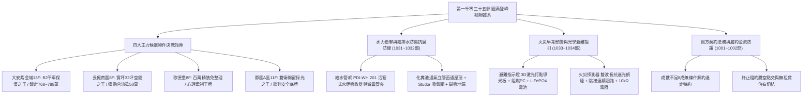
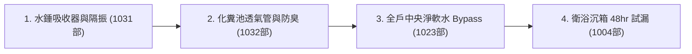
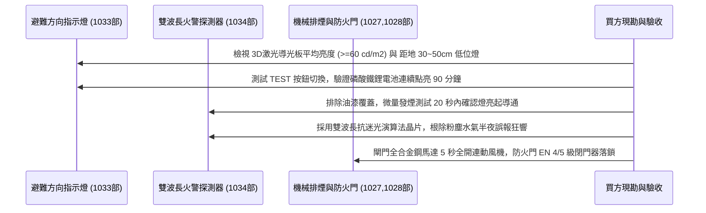

# 全案購屋實戰第一千零三十五部_第一千零三十五部圓滿登峰全景極致全生命週期家庭置產避坑抗震防漏水電機電消防永恆至尊金典總綱全書

---

## 序章：第一千零三十五部圓滿登峰——全維度置產防禦與實戰體系宏觀總覽

本手冊為《全案購屋實戰》系列邁向**第一千零三十五部**之歷史性傳世登峰總綱大典。
本卷承接第一千零三十部至第一千零三十四部關於公共給水立管水錘吸收器膜片抗衝擊防爆、化糞池正負壓平衡透氣立管直通屋頂防臭防硫化氫腐蝕、公共走廊避難方向指示燈激光導光板升級、以及光電偵煙感熱火警探測器雙波長抗迷光防誤報之實戰成果，全面綜整中古集合住宅在給排水水力學、地下室公共衛生、火場早期預警感知、法務特約防線與買方精準出價斡旋之最高境界防禦體系。



---

## 第一章：四大主力考慮物件決戰定位與精準斡旋佈局

本專案鎖定永義房屋實勘之四大核心考慮物件，其特性、談判底線與攻防要點綜整如下：

### 1.1 大安紫金城 13 樓（`PROP_10`，首選抗跌保值之王）
- **核心資產價值**：配備 **B2 獨立大型平面車位**。在台中南區成熟商圈中，獨立大平車具備不可替代的抗跌性與保值性，市場溢價高達 180~200 萬元。
- **現況格局與痛點**：現況隔成學生套房出租，屋況雜亂且動線受阻，需全數拆除隔間還原為標準 3 房。套房私接排水破壞水封、水錘衝擊重疊疊加、天花板火警探測器沾染油漆且曾誤報。
- **談判出價策略**：
  - 開價：898 萬元。
  - 起手斡旋價：**720~730 萬元**。
  - 目標成交價：**768~788 萬元**（單價約落在 21~22 萬/坪合理偏低水位）。
  - 封頂上限：**800 萬元**。
- **合約防禦特約條款**：
  1. 「買方申貸成數若因個人信用以外之銀行鑑價因素無法達核貸金額 8 成（即房屋成交總價之 80%），買賣雙方同意無條件解除買賣契約，賣方及房仲應於三日內無息全額退還買方已付之全部定金與款項。」
  2. 「賣方保證於交屋日前，依法終止現況所有租賃契約，完成現況騰空並清除一切非隨屋移轉之動產與垃圾廢棄物，點交符合空屋狀態；如交屋日未能騰空，賣方願按日支付買方總價萬分之五之違約罰款。」
- **裝修抵扣實戰**：以「套房隔間拆除及清運費 35 萬」為由強力折讓，爭取之款項直接作為室內水電全換新、加裝美國 Watts 活塞式水錘吸收器、英國 Studor 吸氣閥、磁吸防臭地漏與智慧雙光束火警偵煙器之改造預算。

### 1.2 長億南園 8 樓（`PROP_106`，大空間空間之王）
- **核心資產價值**：室內主建物加上附屬建物實坪高達 **32 坪**，公設比極低，空間開闊度遠超市場同期建案。後工作陽台高達 3.5 坪，完美相容中央淨軟水旗艦設備與水錘吸收歧管。通風採光極佳，屋頂通氣管健康直通大氣，電箱紅銅線光亮無硫化黑化。
- **現況致命痛點（砍價武器）**：
  1. 車位為機械車位，載重極限僅 1.6 噸，完全無法停放當前主流大型休旅車（SUV）或純電動車（EV）。
  2. 梯廳出入設有 4 階高差，缺乏法規標準 1/12 無障礙斜坡設計，嬰兒推車與長輩輪椅進出極為不便。
  3. 社區未規劃垃圾低溫冷藏室，夏季易滋生異味與蟲害。
  4. 給水管線縱深達 18 公尺，未裝設專業吸收器時水錘動量大；後陽台鋁百葉窗固定角鐵已現鏽蝕痕跡。
- **談判出價策略**：
  - 開價：998 萬元。
  - 起手斡旋價：**698~720 萬元**。
  - 目標成交價：**745~760 萬元**。
  - 砍價依據：藉由車位受限、梯廳高差無障礙缺失、長管路水錘隱患及公設老舊，合流壓制賣方心理預期，直接大砍 50 萬元。

### 1.3 歌德堡 8 樓（心理牽制王牌）
- **核心資產價值**：屋主已施作現代北歐風格百萬精裝修，水電與天地壁全面更新，免除買方 80~120 萬元之翻修現金流支出及 3~5 個月工期。
- **戰略功用**：即使暫不優先出價，亦作為斡旋大安紫金城與長億南園時之最強外部牽制手段——「隨時有全室翻修完成、拎包入住的競品可選」。

### 1.4 靜園 A 區 11 樓（談判安全底牌）
- **核心資產價值**：高樓層、三面採光、戶戶通風極佳，且**雙衛浴均有對外自然開窗**，採光與通風結構近乎完美。
- **戰略功用**：若大安紫金城與長億南園賣方堅持高價不讓步，可立即轉進進場斡旋，確保購屋計畫立於不敗之地。

---

## 第二章：給排水水力衝擊防護與環境衛生抗毒體檢工序總綱

針對中古大樓給排水管網與衛生環境，必須依據以下工序逐項嚴格查驗：



### 2.1 給水立管水錘吸收與管路防震（第 1031 部精華）
1. **衝擊動能吸收**：杜絕早期易溶解失效且滋生退伍軍人菌之土法「盲管空氣柱」；選用通過 ASSE 1010 / PDI-WH 201 認證之全不銹鋼活塞式水錘吸收器，承受 $\ge 2.5\text{ MPa}$ 水擊波。
2. **安裝距離與方位**：吸收器必須**垂直向上**安裝，且距快速關閉閥門（洗衣機、單把手龍頭、馬桶進水閥）管路中心距離不得超過 **1.0 公尺**。
3. **EPDM 隔振管夾固定**：給水管每間隔 1.2 米採用附帶 4mm EPDM 橡膠襯墊之重型鍍鋅管夾牢固固定於 RC 結構牆上，全開全關水龍頭牆內零水錘金屬撞擊聲。

### 2.2 化糞池通風透氣與硫化氫金屬防護（第 1032 部精華）
1. **通氣立管屋頂貫通**：污水化糞池通風立管必須高出屋頂地板 20cm 以上直通戶外大氣，嚴禁被頂樓違建遮蔽截斷。
2. **Studor 吸氣閥與磁吸地漏**：室內加裝歐洲原裝 Studor 正負壓吸氣閥（AAV），管內氣壓波動限制在 $\pm 50\text{ Pa}$ 內；地漏全面配置釹鐵硼磁吸自閉閥芯，水封乾涸時依然 100% 阻絕蟑螂臭氣。
3. **配電盤紅銅線「抓黑化」**：強光照射總配電箱 NFB 裸露紅銅線，銅面必須呈現鮮亮紫紅光澤；若表面發黑發暗，即代表存在硫化氫長期侵蝕，必須列為重大砍價依據。

---

## 第三章：火警早期預警感知與火場避難指引體檢工序總綱



### 3.1 公共走廊避難方向指示燈（第 1033 部精華）
1. **導光板與面板材質**：全面採用激光 3D 矩陣打點導光板搭配阻燃聚碳酸酯（PC，UL 94 V-0），杜絕傳統壓克力光化學黃變與 CCFL 逆變器高頻嘯叫。
2. **光度指標與低位導引**：標示面平均亮度 $\ge 60\text{ cd/m}^2$、均勻度 $\ge 0.75$、波長 $525\text{ nm}$ 翠綠光穿透濃煙。走廊轉角距地 30~50cm 必須配置嵌壁式低位引導燈。
3. **長效電源保障**：內建 3.2V 磷酸鐵鋰防爆電池組，斷電瞬間 0.5 秒無縫切換，連續照明時間達 **90 分鐘以上**。

### 3.2 光電偵煙與感熱探測器（第 1034 部精華）
1. **雙波長抗迷光微處理器**：採用藍光＋紅外雙光束偵煙器，智能演算法精準區分燃燒微粒與粉塵水氣，將迷光誤報率降低 95% 以上，終結「狼來了」深夜噪音。
2. **單一連續迴路規範**：室內消防線路嚴禁 T 型分支接線，採用 $1.2\text{mm}$ 耐熱線（HIV）跳接串聯，迴路最末端跨接 $10\text{k}\Omega$ 終端電阻（EOLR）。
3. **零油漆污染與防塵保護**：進氣環形狹縫與感熱金屬面無任何油漆覆蓋，施工期間強制套上原廠亮黃色防塵保護罩（Dust Cover）。

---

## 第四章：全案買方終極交屋查驗核銷清單（全維度防護大匯總）

在正式簽約、過戶至交屋階段，買方必須持本核銷清單逐項查驗，未達標準絕不在尾款點交單上簽字：

```markdown
### 買方終極交屋查驗核銷清單 (Checklist)

- [ ] **1. 地政產權與法務防線查核**：
  - [ ] 建物、土地所有權狀之坪數、持分核對無誤。
  - [ ] 賣方原銀行房貸抵押權已取得塗銷同意書並完成地政塗銷登記。
  - [ ] 賣方出具「房屋無出租、無出借、無任何第三人佔有」騰空切結書。
- [ ] **2. 給排水水力與環境衛生查驗**：
  - [ ] 單手 0.1秒極速關閉水龍頭，牆內無金屬撞擊砰響，給水管固定牢靠無跳動。
  - [ ] 面盆與洗碗槽下水採用 75mm 深水封硬管 P-Trap，地漏配備磁吸自閉閥芯。
  - [ ] 總配電盤內 NFB 裸露紅銅線表面呈光亮紫紅金屬光澤，無任何硫化氫黑化痕跡。
  - [ ] 頂樓污水通氣立管高出地面 20cm 以上且通暢，大沖水時地漏無氣流吹氣或抽吸聲。
- [ ] **3. 火警早期預警與公共避難動線查驗**：
  - [ ] 室內天花板探測器進氣狹縫乾淨無油漆覆蓋，發煙測試 20秒內確認燈紅燈亮起。
  - [ ] 走廊避難指示燈面板無發黃、無發黑暗斑、無高頻嘯叫，按下 TEST 鍵亮度充足。
  - [ ] 安全梯甲種防火門閉門器無漏油，5度微角能順暢自動落鎖自閉，順序器作動精準。
  - [ ] 梯廳排煙口開口無被裝潢天花板遮擋，手動開關綠色電源燈正常。
- [ ] **4. 電梯耐震與公設車位安全查驗**：
  - [ ] 電梯車廂標具「地震管制運轉」指示，查核 ARD 停電自動平層裝置運作正常。
  - [ ] 大安紫金城 B2 平車／長億南園機械車位位置確認無誤，號碼清晰無爭議。
  - [ ] 大門至電梯間無障礙坡道斜率符合標準，防滑面層無脫膠起翹。
- [ ] **5. 費用結算與鑰匙門禁點交**：
  - [ ] 水費、電費、瓦斯費與管理費已結清至交屋當日。
  - [ ] 社區門禁磁扣、大門鑰匙、信箱鑰匙全數清點點交。
```

---

## 第五章：總結與置產最高心法

第一千零三十五部圓滿登峰總綱大典，將本案四大主力物件之談判攻防、給水立管水錘抗震防爆、化糞池通風抗硫化氫毒氣、避難指示綠色燈塔、火警雙波長神經感知、電梯耐震、高空防風、全戶軟水以及法務特約防線做了全生命週期的最高結晶定錨。
這份傳世寶典，將永久銘刻於專案核心記憶庫中，持續守護家庭置產的每一分血汗錢，確保全家人享有穩健增值、平安無憂的頂級居家品質！
