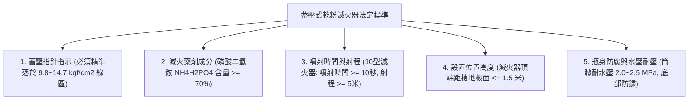
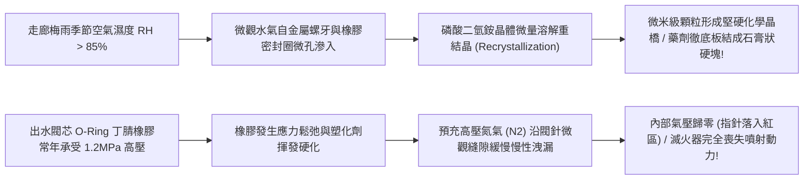
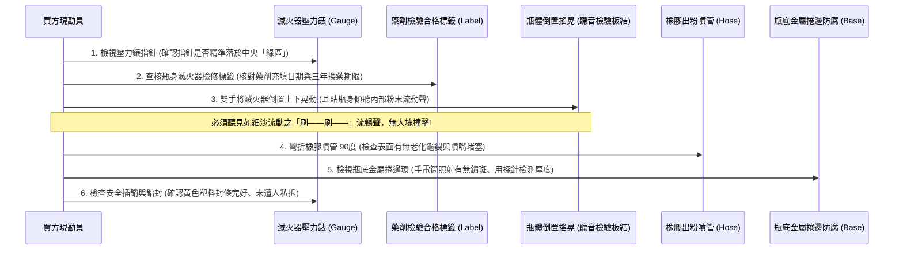
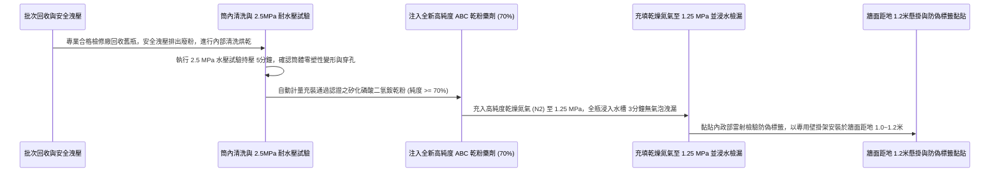

# 全案購屋實戰第一千零三十八部_中古大樓公共走廊乾粉滅火器蓄壓壓力表指針失壓落入紅區乾粉藥劑結塊板結與橡膠噴管老化龜裂體檢工序全書

---

## 序章：火警第一線尖兵——滅火器於起火 60 秒內的生死制霸

在建築消防安全的大防禦體系中，無論是大樓自動灑水系統、室內消防栓，抑或是消防隊的雲梯車救援，都有其系統啟動的滯後時間（延遲時間通常在 3 至 10 分鐘以上）。
而在家庭日常環境中，電氣短路、延長線過載發熱、瓦斯爐油鍋起火、神明桌香燭傾倒引燃窗簾等突發火情，由微弱火星演變為吞噬客廳的熊熊烈火，往往只需短短的 **60 至 90 秒**。

在這個最為關鍵、決定全家人命運的「初期起火階段（Initial Stage）」，懸掛於公共走廊牆面、電梯旁或住戶玄關門口的**「ABC 型蓄壓式乾粉滅火器（Dry Chemical Fire Extinguisher）」**，是任何一位家庭成員（包含長輩與青少年）不需經過複雜訓練、伸手即可取用並在 15 秒內壓制火勢的**第一線保命尖兵**！

然而，在屋齡 20 年以上的中古大樓（包括本案主力評估之**大安紫金城 13 樓**、**長億南園 8 樓**、**歌德堡 8 樓**與**靜園 A 區 11 樓**）中，走廊滅火器卻常年被當作「應付安檢的牆角擺設」，普遍陷入形同虛設的「四大報廢病態」：
1. **蓄壓式壓力錶指針失壓落入左側「紅區（Recharge Zone）」**：內部充裝之高純度乾燥氮氣（$\text{N}_2$）因密封閥芯橡膠圈微裂，經過數年微量滲漏，驅動推力完全歸零，拔掉插銷壓下把柄毫無氣體噴出；
2. **乾粉滅火藥劑（磷酸二氫銨）嚴重受潮「結塊板結（Caking）」**：滅火器長期置於潮濕走廊或地坪，粉末吸濕受潮，內部原本細膩如麵粉的微米級粉末結成硬如磚頭的死塊，即便氣體噴出，噴管亦瞬間被粉塊卡死；
3. **EPDM 橡膠加強型噴管（Discharge Hose）老化龜裂碎化**：噴管長期暴露於空氣中，橡膠硬化脆裂，高壓氣體噴出瞬間噴管直接在接頭處斷裂脫飛，粉末狂噴操作者面部引發窒息；
4. **鋼質筒體底部嚴重電化學鏽蝕穿孔**：清潔工拖地污水長年浸泡筒底，鋼板厚度被鏽蝕削薄至不到 1mm，瓶內 $1.37\text{ MPa}$ 壓力隨時可能引發金屬疲勞「炸底爆裂」，化為致命金屬破片傷人！

本卷專門為買方建立公共走廊滅火器之最嚴格現場實勘工序與功能維護驗收標準作業程序（SOP）。

---

## 第一章：法規基準與乾粉滅火器物理機械核心規範

依據《各類場所消防安全設備設置標準》第 28 條至第 30 條、CNS 1387「滅火器」及《滅火器藥劑更換及充填作業規定》：



| 檢驗項目 | 法定標準規範（CNS 1387） | 頂級社區維護標準 | 中古大樓常見嚴重瑕疵（致命隱患） |
| :--- | :--- | :--- | :--- |
| **壓力錶指針指示** | 指針必須精準停留在中央 **「綠色正常區（Green Zone）」**（$0.98\sim 1.47\text{ MPa}$）。 | 壓力指針穩定於綠區中央偏右（約 $1.2\sim 1.3\text{ MPa}$），氮氣飽滿。 | 指針落入左側「紅色低壓區」（失壓無法噴射），或偏入右側「超壓區」。 |
| **藥劑有效使用年限** | 乾粉滅火藥劑**法定使用年限為 3 年**，屆滿必須由合格檢修廠進行翻新換藥。 | 社區每 2~3 年統一批次抽檢更換，瓶身貼附清晰防火防偽雷射認證檢驗標籤。 | 出廠超過 8~10 年從未換藥，內部粉末早已吸濕結成死硬石膏塊！ |
| **噴射性能（10型規格）** | 噴射有效時間不得小於 **10 秒**；有效水平噴射射程不得小於 **5 公尺**。 | 充氣充藥飽滿，有效噴射時間達 **15~18 秒**，初速高、覆蓋粉霧極大。 | 氣壓不足，噴射時間不到 3 秒即斷氣，粉末僅吐出一團煙霧隨即熄火。 |
| **橡膠噴管耐壓與柔軟度** | 噴管需通過 $2.0\text{ MPa}$ 耐水壓試驗，在 $-20^\circ\text{C}\sim +55^\circ\text{C}$ 下維持柔軟彈性。 | 採用內襯聚酯編織網之抗紫外線 EPDM 橡膠噴管，噴嘴附帶固定卡扣。 | 噴管表面佈滿放射狀龜裂紋，輕折即斷裂脫膠，高壓噴射時脫落。 |
| **筒底防腐保護托架** | 瓶身防腐烤漆完整，筒體底座應加裝**塑料防腐絕緣底座（Base Boot）**。 | 底盤加裝高強度工程塑料防潮腳墊，隔絕地面積水接觸鋼板。 | 金屬底座直接貼合潮濕磁磚，底圈長滿厚重紅褐色鏽瘤，隨時鏽穿爆瓶。 |

---

## 第二章：乾粉藥劑板結受潮與閥門氮氣慢性洩漏機理

中古大樓走廊滅火器長年靜置，其內部物理化學衰變與密封失效機理如下：



### 2.1 乾粉滅火藥劑「重結晶板結（Caking Effect）」
- **化學成分剖析**：通用型 ABC 乾粉滅火劑核心有效成分為**磷酸二氫銨（$\text{NH}_4\text{H}_2\text{PO}_4$）**與硫酸銨（$(\text{NH}_4)_2\text{SO}_4$），表面經矽油（Silicone Oil）疏水包覆處理，以維持良好的流動性（顆粒粒徑通常在 $10\sim 50\mu\text{m}$）。
- **板結物理機理**：
  - 磷酸二氫銨屬於強極性易吸濕鹽類。在長達數年的存放中，若筒內防潮密封微量失效，空氣中的水分子穿透矽油分子間隙；
  - 水分子在相鄰顆粒接觸點形成微小液橋，將顆粒表面的鹽類微量溶解；當環境溫度上升、濕度降低時，溶解的鹽分再度脫水結晶，在相鄰粉末顆粒之間形成堅固的「晶體固體橋（Solid Bridge）」；
  - 數千億個固體橋互相連接，使原本蓬鬆細緻的滅火乾粉，在重力沉降沉積下，硬化凝結成一塊塊硬如石膏的堅實硬塊！火災按壓噴射時，虹吸管吸入口被大粉塊徹底卡死，氣體噴出但粉末紋絲不動！

### 2.2 閥門橡膠密封圈微觀老化與高壓氮氣滲逸
- **蓄壓式結構**：滅火器將乾粉與驅動氣體（高純度乾燥氮氣 $\text{N}_2$）共同儲存在同一個高壓鋼瓶內，依靠按壓把手頂開閥針、壓縮密封 O-Ring 釋放混合氣體。
- **洩漏死穴**：出水閥針處的丁腈橡膠（NBR）或氟橡膠 O-Ring，常年在 $1.2\sim 1.4\text{ MPa}$ 的持續靜態高壓壓迫下，橡膠分子產生不可逆之「永久壓縮變形（Compression Set）」。微觀裂紋逐漸擴展，分子直徑極小的氮氣分子緩慢沿著閥桿金屬光潔面微量滲逸，在無聲無息中使瓶內壓力每個月衰減 $0.02\text{ MPa}$，最終指針徹底跌入零位紅區，成為滅火廢鐵。

---

## 第三章：現場看屋實體檢驗標準工序（買方現勘 6 步穿透法）

買方現勘大安紫金城 13 樓、長億南園 8 樓公共走廊時，應自備**強光手電筒、厚棉手套、金屬探針與抹布**，依循以下 6 步標準工序實施滅火器檢驗：



### 3.1 壓力錶指針色區精確判讀
- **操作手法**：眼睛平視滅火器閥門頂部直徑約 2.5cm 的圓形壓力錶：
  - **綠色區域（合格）**：指針必須停在綠色扇形區間內（刻度值約 $9.8\sim 14.7\text{ kgf/cm}^2$）。
  - **左側紅色區域（報廢/失壓）**：指針偏向左側「RECHARGE / 充填」紅區，代表內部推進氣體已經漏光，按下把柄毫無任何滅火能力，必須立即重灌！
  - **右側超壓區域（危險）**：指針偏向右側「OVERCHARGE / 超壓」區，代表充壓過高或受環境高溫烘烤，可能在碰撞時引發閥門爆裂傷人。

### 3.2 瓶體倒置「聽沙聲」檢驗藥劑板結（核心絕技）
- **操作手法**：
  1. 雙手握住滅火器提把與瓶底，將滅火器**上下垂直翻轉 180 度（底朝天）**；
  2. 耳朵緊貼在鋼質瓶壁上，仔細傾聽內部乾粉下落的聲音；
  3. 隨後再次翻轉回正，反覆操作 2~3 次。
- **合格狀態**：內部傳出如同**細膩海沙滑落的「刷——刷——」連續平順流動聲**，感覺重心平緩轉移，代表內部乾粉顆粒乾燥蓬鬆、無板結。
- **嚴重板結判定**：翻轉時完全無聲音，或過了 1 秒鐘突然傳來一聲沉悶的**「咚！」重物墜落撞擊聲**，代表整桶乾粉已在底部凝結成一整塊巨大堅硬的「粉磚」！此滅火器在火災時噴出的只有純氮氣，乾粉根本出不來，直接宣判死刑！

### 3.3 橡膠噴管彎曲彈性與噴嘴防蟲檢驗
- 拔下固定在瓶身的黑色橡膠噴管，雙手將噴管**中段彎折至 90 度**：
  - 觀察外層橡膠表面：若出現大量如蜘蛛網般的白灰色微裂紋，或手掌搓揉時有黑色橡膠碳粉沾手，代表橡膠已深度老化脆裂；
  - 手電筒照射噴嘴出口內部：確認無泥壺蜂（泥蜂）或小蜘蛛在噴嘴內築泥巢（中古大樓極常見之噴嘴堵塞病因）。

### 3.4 瓶身防偽雷射檢驗標章與有效期限
- 檢查貼於滅火器瓶身上的長方形「滅火器藥劑更換及充填檢修合格標籤」：
  - 標籤上必須具備內政部消防署委託機構之**防偽雷射金屬貼紙**；
  - 查核「下次檢驗日期」：若日期已逾期（超過 3 年），依照《消防法》規定該滅火器即屬違規失效器材，管委會必須依法全數回收更換！

### 3.5 瓶底金屬接縫捲邊鏽蝕排查
- 將滅火器底座翻起，用強光手電筒近距觀察瓶底圓形壓接捲邊：
  - 若底座金屬長滿黑色、紅褐色鏽蝕疙瘩，甚至金屬層狀剝落，代表鋼板厚度已被嚴重削弱。蓄壓滅火器內部常年承受高達 10 餘公斤之壓力，嚴重鏽蝕之鋼瓶極易在搬運撞擊或火災受熱時**「炸底爆開」**，其威力如同小型手榴彈，極端危險！

---

## 第四章：長億南園 vs 大安紫金城——走廊第一線滅火防護實戰對比

```mermaid
graph LR
    subgraph 長億南園8樓 (PROP_106)
        L1["長億南園各層走廊配置標準滅火箱"] --> L2["滅火器具備獨立塑料防腐底座"]
        L2 --> L3["壓力錶指針全數精準落於綠區"]
        L3 --> L4["倒置搖晃沙沙聲清脆加分項!"]
    end

    subgraph 大安紫金城13樓 (PROP_10)
        D1["大安紫金城13樓現況為學生出租套房"] --> D2["走廊滅火器被雜物推擠鞋櫃遮擋"]
        D2 --> D3["現況滅火器檢修標籤已逾期1年半"]
        D3 --> D4["要求房仲督促管委會全數換新通過安檢"]
    end
```

### 4.1 長億南園 8 樓：定期點檢換藥之優良表現
- **實地查驗亮點**：長億南園 8 樓梯廳之滅火器放置於專用紅色金屬滅火器箱內，離地平整；滅火器底部配置有加厚 ABS 塑料防潮底座，無任何鏽斑。隨機抽驗兩具滅火器，壓力指針全數精準落於綠色安全區中央；倒置晃動時傳出流暢細膩的「刷刷」細沙流動聲，無任何結塊撞擊；瓶身最新檢驗標籤仍在 3 年有效期限內，第一線滅火防線維護極佳。

### 4.2 大安紫金城 13 樓：標籤逾期與擺放遮擋攻防
- **高空風險核心**：大安紫金城 13 樓走廊因前手出租給學生，門口鞋櫃與雜物較多，公用滅火器被部分推擠至角落，不易第一時間看見；且經近距離審閱瓶身標籤，其藥劑有效期限已於 **1 年前屆滿**，壓力錶指針已微幅偏向綠區左側邊緣。
- **談判與查驗策略**：
  > 買方在斡旋時，將「13 樓全層滅火器全數更換最新檢驗合格品並排除走廊動線遮擋」列為要求房仲向管委會調閱資料與促成改善之清單：
  > 「周小姐，大安紫金城 13 樓我們勢在必得，目標鎖定 768~788 萬。但 13 樓長廊為高空避難動線，滅火器逾期是重大公共安全瑕疵。請管委會立即依規完成 13 樓全數滅火器重新充填換藥並貼上最新防偽合格標籤，確保交屋時全家安全無虞！」

---

## 第五章：滅火器標準換藥充填與走廊黃金定位工序（買方工法指引）

若買方購入中古物件後進行家庭滅火器升級，或推動社區公共滅火器整頓，必須嚴格依據以下專業工序施作：



1. **認證檢修廠標準「翻新水壓檢驗」鐵律**：
   - 滅火器每滿 3 年換藥時，嚴禁流於形式只補打氣體！
   - 必須委託具備內政部認可證照之滅火器性能檢查合格機構：
     1. 將舊瓶體進行 **$2.0\sim 2.5\text{ MPa}$ 之全筒水壓試驗**，持壓 5 分鐘檢測鋼板彈性膨脹率，凡產生永久變形或微滲者一律強制報廢砸毀；
     2. 出水閥體更換全新耐老化氟橡膠（FKM）O-Ring 密封圈，確保 3 年內氣體零滲漏。
2. **高純度磷酸二氫銨乾粉與乾燥氮氣標準**：
   - 藥劑嚴格禁止使用回收再生劣質粉末！
   - 必須採用純度 $\ge 70\%$ 之全新矽化磷酸二氫銨超細粉末，具備絕佳抗吸濕與流動性；
   - 推進氣體必須使用**純度 $\ge 99.5\%$ 之無水乾燥工業氮氣**，嚴禁使用含水分之普通壓縮空氣（壓縮空氣中的水氣會在瓶內直接誘發藥劑板結！）。
3. **極限「整瓶浸水氣密試驗」驗收**：
   - 充氣完成後，整具滅火器（含出水閥與壓力錶）必須完全浸沒於透明清水槽內，水面靜置觀察 **至少 3 分鐘**。
   - 閥芯、螺牙、壓力錶介面與筒底捲邊嚴禁冒出任何一顆微小氣泡，方准擦乾貼上雷射認證標籤！
4. **走廊與室內「黃金三步」人因工效懸掛規範**：
   - **安裝高度極限**：滅火器手柄頂端距地高度必須控制在 **$1.0\sim 1.2\text{ 公尺}$**（小於法規 1.5 米上限），確保家中身材嬌小之長輩或女性無需彎腰或高舉即可順手提拔。
   - **位置選定原則**：
     1. 嚴禁直接放置於潮濕地坪或鞋櫃後方隱蔽處；
     2. 必須使用專用重型金屬壁掛鉤（Bracket）牢固掛載於牆面實體磚牆上；
     3. 擺放點必須位於逃生通道必經之路線上，距離任何房間門口不超過 **3 至 5 步（約 3 公尺）**，達成起火 10 秒內取用噴射之終極生還標準！

---

## 結語：手起粉落，斬斷祝融燎原之致命初萌

第一千零三十八部工序全書，將中古大樓第一線滅火神器——蓄壓式乾粉滅火器之流體動力學標準、磷酸二氫銨吸濕重結晶板結機理、高壓氮氣慢滲洩漏死穴、現場倒置「聽沙聲」穿透絕技以及標準化專業換藥工藝徹底講透。
唯有壓力充盈、粉末蓬順、擺放就手，方能在火光竄起的危急 60 秒內，以雷霆萬鈞之勢，將全家從火海邊緣強勢拉回平安之境！
