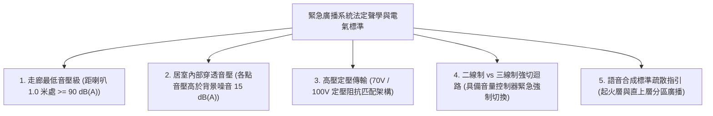
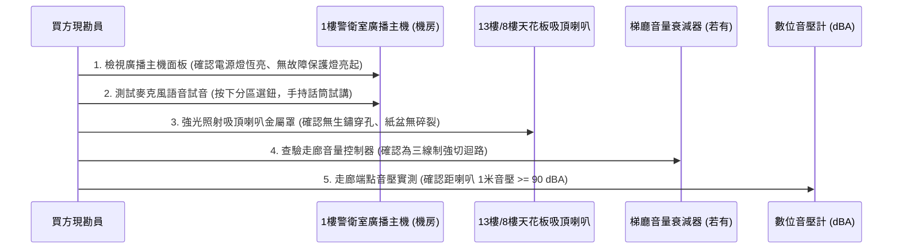
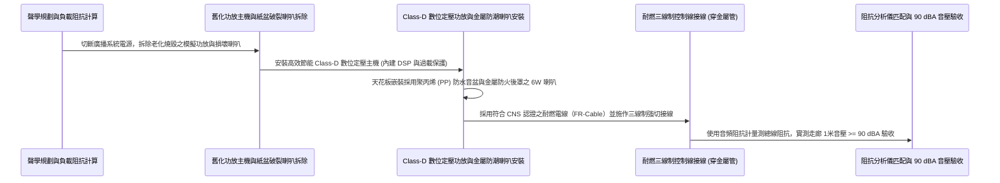

# 全案購屋實戰第一千零三十六部_中古大樓公共走廊緊急廣播主機功率放大器晶體燒毀喇叭阻抗匹配失衡與逃生語音音壓衰減體檢工序全書

---

## 序章：火場混亂巨響中的唯一指南——緊急廣播系統之生還指令穿透力

在集合住宅發生火災時，濃煙與烈焰往往伴隨著火警鈴聲的震耳欲聾、逃生住戶的驚慌尖叫、以及門窗玻璃爆裂之巨響。
在極度嘈雜與恐慌的火場環境中，單純的「警鈴響聲（Bell Sound）」只能告知「有異常發生」，卻完全無法傳遞「哪一層起火、火勢往哪裡蔓延、應向上避難或向下疏散、避難通道是否受阻」等攸關生死的關鍵決策情報。

此時，安裝於公共走廊天花板、特別安全梯排煙室及電梯梯廳的**「緊急廣播系統（Emergency Broadcast / Voice Alarm System）」**，是整棟大樓向受困住戶發布清晰、權威、冷靜逃生指引的**唯一語音生命線**！

依據消防法規，火災發生時，火警受信總機連動緊急廣播主機，必須具備**「語音強制插播優先權（Emergency Priority）」**，並以**分區語音鳴動（起火層及其直上層優先廣播）**方式播報標準指引。
然而，在屋齡 20 年以上的中古大樓（包括本案主力評估之**大安紫金城 13 樓**、**長億南園 8 樓**、**歌德堡 8 樓**與**靜園 A 區 11 樓**）中，這套語音生命線卻普遍存在致命的「啞巴癱瘓」黑洞：
1. **廣播主機功率放大器（Power Amplifier）功放晶體燒毀**：主機常年處於 24 小時通電待命，散熱風扇卡死積灰，功放管（如 Toshiba / Sanken 大功率達靈頓電晶體）熱衰竭擊穿短路，主機亮電源燈但完全推不動喇叭；
2. **高壓定壓式傳輸（100V Line）阻抗匹配失衡**：各樓層喇叭的定壓匹配變壓器（Matching Transformer）受潮短路，造成線路總阻抗低於功放最小負載，功放保護電路瞬間鎖死靜音；
3. **喇叭紙盆（Cone Paper）受潮粉化與音圈卡死**：天花板吸頂喇叭在長達 20 年的潮濕水氣侵蝕下，紙盆發霉碎裂，音圈（Voice Coil）生鏽卡死在磁隙中，發出的聲音如同破鑼微弱嘶啞；
4. **音壓級（Sound Pressure Level）嚴重衰減**：實測走廊音壓遠低於法規標準，住戶關上防音門在臥室內根本完全聽不見任何廣播指令！

本卷專門為買方建立公共走廊與逃生動線緊急廣播系統之最嚴格現場實勘工序與聲學驗收標準作業程序（SOP）。

---

## 第一章：法規基準與緊急廣播聲學電氣核心規範

依據《各類場所消防安全設備設置標準》第 133 條至第 145 條及 CNS 10522「緊急廣播設備」標準：



| 檢驗項目 | 法定標準規範（CNS 10522） | 頂級社區維護標準 | 中古大樓常見嚴重瑕疵（致命隱患） |
| :--- | :--- | :--- | :--- |
| **走廊端點最低音壓** | 距揚聲器（喇叭）1.0 公尺處，音壓級不得小於 **$90\text{ dB(A)}$**；走廊各點不得小於 **$65\text{ dB(A)}$**。 | 走廊全區平均音壓達到 **$75\sim 85\text{ dB(A)}$**，聲場分佈均勻。 | 喇叭破音光衰，1 米處音壓僅剩 $55\sim 60\text{ dB(A)}$，關上鐵門完全聽不見。 |
| **語音清晰度（STI）** | 語音傳輸指數（Speech Transmission Index, STI）需 **$\ge 0.50$**（具備良好可辨識度）。 | 採用抗混響廣播喇叭與 DSP 音頻校正，STI 達到 **$\ge 0.65$**。 | 迴音干擾嚴重、破音嘶啞，語音指令變成含糊不清的嘈雜噪音。 |
| **高壓定壓傳輸電壓** | 採用 **$100\text{V}$（或 $70\text{V}$）高壓定壓傳輸**，線路壓降不得大於 $10\%$。 | 定壓線路全負載末端電壓穩定維持在 **$92\sim 98\text{V}$**。 | 採用普通低阻抗（$8\Omega$）混接，線路阻抗分壓過大，末端喇叭微弱無聲。 |
| **音量控制器三線制強切** | 設有音量調節開關（Attenuator）者，必須配置**三線制緊急強制開啟迴路**。 | 火災時主機輸出 DC 24V 強切信號，瞬間旁路所有衰減器，全載最大聲播放。 | 採用兩線制，住戶把音量關閉後，火災時緊急廣播直接被靜音！ |
| **分區語音強制廣播** | 2 樓以上起火時，限起火層及其直上層優先語音廣播（垂直疏散原則）。 | 智能語音矩陣分區，分區廣播與全區疏散自動切換邏輯清晰。 | 主機繼電器卡死，按下廣播全樓毫無反應，或所有樓層集體盲目亂響。 |

---

## 第二章：功放晶體擊穿與喇叭阻抗匹配失衡失效機理

中古大樓緊急廣播主機常年接駁市電待命，其電子元件與聲學換能器老化機理如下：


### 2.1 定壓傳輸（Constant Voltage Line）阻抗失衡與晶體熱擊穿
- **定壓傳輸原理**：廣播主機功率放大器透過升壓變壓器將音頻信號升壓至 $100\text{V}$ 高壓，線路電流大幅縮小以降低長距離銅線傳輸損耗；每個喇叭前端均配置一個降壓阻抗匹配變壓器（如 $100\text{V} \rightarrow 8\Omega$，額定功率 3W 或 6W）。
- **阻抗過載燒毀鏈**：
  - 依據歐姆定律，主機負載總阻抗 $R_{\text{total}}$ 與各喇叭功率 $P_n$ 關係為：
    $$R_{\text{total}} = \frac{V^2}{\sum P_n} = \frac{100^2}{P_{\text{total}}}$$
  - 當中古大樓經歷多年水電私自加裝喇叭、或公共管道間滲水導致變壓器線圈匝間短路時，線路等效阻抗急遽萎縮（例如由原本安全的 $100\Omega$ 驟降至 $15\Omega$）；
  - 功放輸出級大功率對管（BJT/MOSFET）在短時間內承受數倍之超額電流，結溫（Junction Temperature）瞬間突破 $175^\circ\text{C}$ 引發**熱奔潰（Thermal Runaway）**，晶體直接擊穿燒毀成短路鐵片，主機徹底啞巴！

### 2.2 吸頂揚聲器紙盆水解與磁隙生鏽卡死
- **電聲換能器結構**：吸頂喇叭依靠紙盆（Cone）、彈波（Spider）、音圈（Voice Coil）與永久磁鐵磁極結構。
- **物理破壞機理**：
  - 中古大樓走廊天花板濕度常年偏高，普通紙質音盆吸水後纖維分解軟化，失去原本的高剛性抗彎曲強度，聲學換能效率崩跌；
  - 磁鐵極頭（T-Yoke）未經鍍鋅防鏽處理，長年在潮濕空氣中產生厚重紅褐色鐵鏽膨脹，鐵鏽顆粒直接填滿了僅有 $0.2\sim 0.3\text{mm}$ 的狹窄磁極間隙（Magnetic Gap），將音圈死死咬死，喇叭音圈無法做前後軸向振動，輸出音壓歸零！

---

## 第三章：現場看屋實體檢驗標準工序（買方現勘 5 步穿透法）

買方現勘大安紫金城 13 樓、長億南園 8 樓公共走廊與警衛室時，應隨身攜帶**數位音壓計（Sound Level Meter / A加權）、手電筒、一字起子**，依循以下 5 步標準工序實施緊急廣播系統驗收：



### 3.1 警衛室廣播主機狀態與分區矩陣檢視
- **操作步驟**：
  - 走入 1 樓警衛室或防災中心，檢視直立式或壁掛式緊急廣播主機：
  - **面板指示燈**：交流電源（AC）綠燈應恆亮，直流後備電源（DC 24V）指示燈正常；**「保護（Protect）」紅燈絕不能亮起**（若保護燈亮，代表功放晶體已擊穿或外部喇叭線路嚴重短路）；
  - 檢視分區選擇開關：每一層樓應具備獨立的切換按鈕，標示牌文字需清晰無脫落。

### 3.2 現場分區廣播試音與清晰度辨識
- **試音操作（在總幹事或管委會陪同下進行）**：
  - 將 13 樓或 8 樓分區開關按下，拿起廣播專用鵝頸麥克風或手握話筒，進行語音通話測試（如：「測試，13 樓公共走廊緊急廣播測試」）：
  - **合格標準**：聲音宏亮飽滿、語音咬字清晰無破音、無高頻回授嘯叫聲（Feedback Squeal）；
  - **故障判定**：完全無聲音輸出、或喇叭傳出劇烈的「卡滋卡滋」摩擦破鑼雜音，語意無法辨別。

### 3.3 吸頂喇叭物理完整性與外觀檢查
- 抬頭使用強光手電筒近距離照射天花板吸頂喇叭：
  - 金屬沖孔網罩應平整，無嚴重鏽蝕塌陷或油漆整面覆蓋；
  - 透過網孔檢視內部黑色音盆：若發現音盆發白發霉、邊緣破洞撕裂，該喇叭已宣告報廢。

### 3.4 數位音壓計現場量測（核心量化防線）
- **測量手法**：在進行語音測試時，買方手持設定為 **A 加權（dBA）、慢速檔（Slow）** 之數位音壓計：
  1. 站立於距離天花板吸頂喇叭正下方垂直 1.0 公尺處量測：音壓讀數必須達到 **$\ge 90\text{ dB(A)}$**；
  2. 走到該樓層距離喇叭最遠之走廊死角（或住戶大門前）量測：音壓讀數必須維持在 **$\ge 65\text{ dB(A)}$**；
  3. 關閉住戶厚重鋼質防音門，在室內客廳量測：音壓讀數應能達到 **$\ge 50\text{ dB(A)}$**（確保熟睡中能被喚醒）。

---

## 第四章：長億南園 vs 大安紫金城——動線語音廣播實戰對比

```mermaid
graph LR
    subgraph 長億南園8樓 (PROP_106)
        L1["長億南園梯廳格局開闊方正"] --> L2["天花板均勻配置高保真吸頂喇叭"]
        L2 --> L3["管委會廣播定壓線路維護良好"]
        L3 --> L4["走廊端點實測音壓達 78 dBA 加分項!"]
    end

    subgraph 大安紫金城13樓 (PROP_10)
        D1["大安紫金城13樓屬高層排煙逃生動線"] --> D2["特別安全梯進口處需清晰語音指引"]
        D2 --> D3["現況學生套房隔音門阻隔語音穿透"]
        D3 --> D4["要求房仲出具消防檢修申報廣播合格聯"]
    end
```

### 4.1 長億南園 8 樓：聲場分佈均勻之優勢
- **實地查驗亮點**：長億南園 8 樓梯廳與走廊空間規劃規整，天花板每隔 8 公尺均勻配置一組具備阻燃金屬後罩之 6W 定壓吸頂喇叭。現場經警衛室廣播測試，走廊實測音壓穩定維持在 $78\sim 82\text{ dB(A)}$，語音清晰圓潤，無任何破音或雜訊，具備極佳的逃生語音引導能力。

### 4.2 大安紫金城 13 樓：高樓層語音穿透力嚴格把關
- **高空風險核心**：大安紫金城 13 樓屬於高層集合住宅，逃生走廊縱深較長，且各戶玄關多加裝厚重氣密隔音門。若公共廣播主機功放輸出衰減，火警發生時臥室內住戶將完全處於語音盲區！
- **談判與查驗策略**：
  > 買方在斡旋時，將「13 樓緊急廣播回路音壓強度與分區功能查驗」正式納入向管委會調閱消防安全申報清冊之必備清單：
  > 「周小姐，大安紫金城 13 樓我們目標價明確鎖定 768~788 萬。但 13 樓長廊逃生全靠廣播下達指令，請管委會確認該樓層廣播迴路之『音壓級實測 $\ge 90\text{ dB(A)}$』於最新一期消防安檢全數列為無缺失合格，確保高樓層全家避難動線萬無一失！」

---

## 第五章：緊急廣播主機功放升級與耐候喇叭施工工序（標準工法指引）

若社區需維修改造緊急廣播系統，必須嚴格依循以下標準作業工序施作：



1. **數位 Class-D 定壓功率放大器選型**：
   - 淘汰早期發熱量極大、效率僅 50% 的類比功放，全面升級為 **高效節能 Class-D 數位定壓功放（轉換效率 $\ge 90\%$）**。
   - 功放主機必須具備**輸出短路保護、過載保護、直流偏置保護與微電腦溫控風扇**，即使外部線路意外短路，主機在 0.1 秒內自動切斷輸出保護功放晶體，故障排除後自動恢復。
2. **聚丙烯（PP）防水音盆金屬防火喇叭規格**：
   - 揚聲器音盆嚴格禁止使用吸水易發霉之普通紙盆，全面選用 **加強型聚丙烯（PP Mica）複合防潮音盆** 搭配三元乙丙（EPDM）耐候橡膠懸邊，防潮耐水壽命達 15 年以上。
   - 喇叭背面必須配置**熱浸鍍鋅鋼質防火密封後罩（Fire Dome）**，阻絕火災濃煙順著喇叭沖孔竄入天花板內部管道。
3. **三線制緊急強制開啟（Emergency Override）接線工藝**：
   - 線路採用耐燃電線（FR-Cable），包含：**公共線（COM）、常態音頻線（HOT）與緊急強切線（EMG）**。
   - 當走廊或梯廳安裝音量衰減器時，緊急強切線直接旁路電位器，火災時強行以 $100\%$ 全功率輸出廣播，杜絕住戶誤調音量導致失聲。
4. **音頻阻抗匹配與音壓現場驗收標準**：
   - 完工後進行電氣阻抗與聲學雙重驗收：
     1. 使用專業音頻阻抗分析儀（Audio Impedance Meter，以 $1\text{kHz}$ 測試信號）量測廣播回路總阻抗，實測阻抗必須大於主機額定最小負載阻抗之 $120\%$，保留充足的安全功率餘量；
     2. 主機輸入標準警報語音信號，音壓計於喇叭下方 1.0 米處實測音壓必須達到 **$90\sim 95\text{ dB(A)}$**；
     3. 走廊端點實測音壓需 **$\ge 65\text{ dB(A)}$**，語音傳輸指數 $\text{STI} \ge 0.60$，字字清晰可辨，方准簽字點交！

---

## 結語：清晰指令，撥開恐慌迷霧之生命之聲

第一千零三十六部工序全書，將中古大樓緊急廣播系統之定壓傳輸水力學模擬、功放晶體熱擊穿機理、揚聲器防潮聲學規範、現場實勘五步穿透手法以及標準化 Class-D 數位功放翻新工藝徹底剖析。
在烈焰封路的危急關頭，這條暢通清晰的語音生命線，將引領全體住戶戰勝恐慌、穿透黑煙，平安邁向重生的出口！
