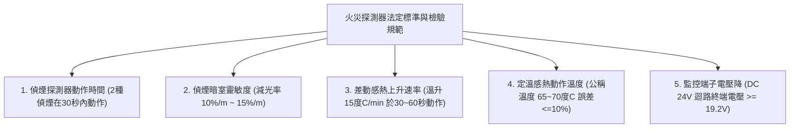
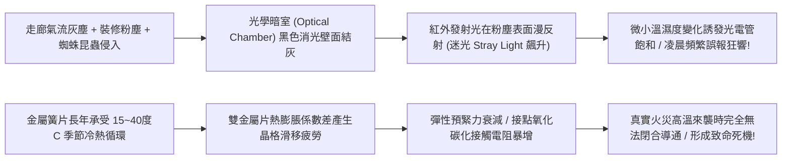
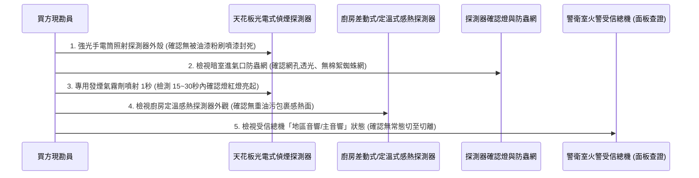
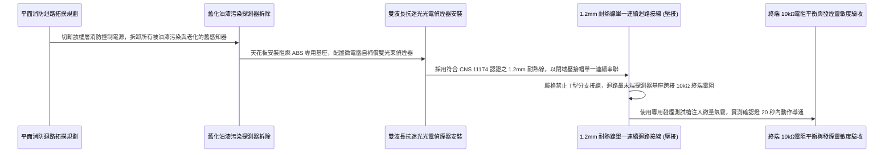

# 全案購屋實戰第一千零三十四部_中古大樓公共走廊差動式定溫式火災探測器感熱雙金屬片疲勞光電式偵煙室積灰迷光誤報體檢工序全書

---

## 序章：火警神經末梢——探測器靈敏度與誤報狼來了的致命危機

在集合住宅的火災初期防護鏈條中，天花板上安裝的**「火災感知探測器（Fire Detectors）」**，是整棟大樓最早感知火災威脅、啟動警鈴鳴動、連動機械排煙與廣播疏散的「火警神經末梢」。
依據探測物理機制，主要分為兩大類：
1. **差動式 / 定溫式感熱探測器（Heat Detectors）**：主要安裝於廚房、公設機房與地下車道，利用氣體膨脹或感熱雙金屬片受熱翻轉，在環境溫度異常急遽上升或達到固定臨界溫度（如 $65^\circ\text{C}\sim 70^\circ\text{C}$）時觸發報警；
2. **光電式分離型 / 散射型偵煙探測器（Photoelectric Smoke Detectors）**：主要安裝於客廳、臥室、公共走廊與特別安全梯間，利用光學暗室內的紅外線發射管與光電接收管，當煙霧微粒進入暗室產生廷得耳效應（Tyndall effect）散射光線時觸發火警。

然而，在屋齡 20 年以上的中古大樓（包括本案主力評估之**大安紫金城 13 樓**、**長億南園 8 樓**、**歌德堡 8 樓**與**靜園 A 區 11 樓**）中，天花板上的探測器往往陷入兩極化的致命病態：
- **病態一：感應鈍化甚至死機（真火警時不報警）**：
  感熱探測器內部雙金屬片（Bimetallic Strip）長期承受冷熱循環產生晶格疲勞蠕變，靈敏度嚴重遲鈍；或偵煙暗室進氣防蟲金屬網被油垢灰塵完全封死，火災濃煙根本進不去暗室，造成火勢蔓延燒穿天花板時火警總機依然毫無反應！
- **病態二：光學暗室積灰引發「迷光效應」（頻繁誤報狂響）**：
  光電暗室內部黑化迷宮壁面吸附了 20 年的飄塵、棉絮與微小昆蟲（如跳蟲、小蜘蛛），紅外線發射光束在灰塵表面產生嚴重的「背景迷光反射（Stray Light）」，光電管接收之背景電壓逼近警報門檻。每當走廊微風吹動、或梅雨季空氣濕度超過 85% 時，水氣凝結灰塵引發折射，導致全棟大樓在半夜 2、3 點警鈴大作、排煙風機狂嘯！

頻繁的誤報促使不勝其擾的管委會或警衛做出極度危險之舉動——**直接在受信總機將全棟警報靜音、或將探測器線路乾脆拔除**，使全棟大樓徹底失去火警預警能力！
本卷專門為買方建立公共走廊與室內火災探測器之最嚴格現場實勘檢驗工序與靈敏度校驗標準作業程序（SOP）。

---

## 第一章：法規基準與火災感知探測器電氣光學規範

依據《各類場所消防安全設備設置標準》第 112 條至第 132 條及 CNS 8874「火災探測器」標準：



| 檢驗項目 | 法定標準規範（CNS 8874） | 頂級社區維護標準 | 中古大樓常見嚴重瑕疵（致命隱患） |
| :--- | :--- | :--- | :--- |
| **光電偵煙動作減光率** | 煙濃度減光率在 **$10\%\sim 15\%/\text{m}$** 時，應於 **30 秒內** 動作報警。 | 智能微處理器數位補償，減光率維持精準 $10.5\%/\text{m}$。 | 光室積滿灰塵，乾淨空氣下減光率已被迷光抬升至 9%，隨時誤報。 |
| **感熱雙金屬片動作** | 差動式探測器在以 **$15^\circ\text{C}/\text{min}$** 加熱時，需於 **30~60 秒內** 閉合導通。 | 彈性簧片鍍金微動開關，動作靈敏且復歸誤差 $< 2\%$。 | 雙金屬片氧化彈性疲勞，需加熱到 $90^\circ\text{C}$ 以上才動作，形同報廢。 |
| **防蟲網目孔徑規範** | 光學暗室外圍防蟲不銹鋼紗網孔徑需在 **$0.5\sim 0.8\text{mm}$** 之間。 | 配置超細防靜電不銹鋼絲網，杜絕靜電吸塵並阻絕微小昆蟲。 | 防蟲網破洞、或網目被油漆工粉刷覆蓋，孔隙全死。 |
| **回路末端電阻與電壓** | 探測器迴路（L-C線）端點必須配置 **$10\text{k}\Omega$ 終端電阻（EOLR）**，監視電壓 $\ge 19.2\text{V}$。 | 雙向定址式信號迴路，自帶隔離器與迴路斷線即時警報。 | 終端電阻被拔除，或線路對地阻抗 $< 0.1\text{M}\Omega$，總機長期帶病報故障。 |
| **動作指示確認燈** | 探測器動作時，本體紅色確認燈（LED）必須恆亮鎖定。 | 高亮度寬角雙色 LED（待機微閃綠燈，報警恆亮紅燈）。 | 確認燈燒毀，總機顯示火警卻完全找不到是哪一戶哪一顆在動作。 |

---

## 第二章：感熱雙金屬片疲勞蠕變與偵煙室迷光誤報機理

天花板上的火災探測器常年處於空氣對流、油煙與溫差環境中，其物理與光學老化機理如下：



### 2.1 光電偵煙暗室「迷光效應（Stray Light Effect）」與半夜誤報
- **光學暗室正常原理**：光電式偵煙器內部設有一個特殊的「迷宮式暗室（Optical Maze）」。暗室內部塗布吸收紅外光的黑色消光吸光層。紅外線發光二極體（IR LED）以每秒數次的頻率向暗處發射脈衝光束，而光敏光電二極體（Photodiode）安裝在偏離發射光軸 120 度角的位置。無煙時，光敏管完全接收不到直射光，背景迷光微弱（輸出電流 $< 0.1\mu\text{A}$）。
- **積灰誤報毀滅鏈**：
  - 運轉 5 至 10 年後，暗室迷宮的黑色壁面吸附了厚達數百微米的灰塵與油垢，消光層失去吸光能力，轉變為強反射面；
  - 即使空氣中毫無煙霧，IR 光束打在灰塵顆粒與反光壁面上，直接折射進光敏管，使背景電流上升至臨界報警線（如 $0.8\mu\text{A}$）；
  - 深夜凌晨氣溫驟降、相對濕度上升至 90% 以上時，空氣中的微小水霧附著於灰塵上，光折射率暴增，瞬間突破 $1.0\mu\text{A}$ 報警門檻！全社區警報在凌晨 3 點大響，迫使警衛將總機關閉，埋下真正大火無人知曉的悲劇。

### 2.2 差動式探測器雙金屬片晶格蠕變與波紋膜片漏氣
- **差動式感知器原理**：差動感熱探測器利用空氣受熱膨脹原理（彈性金屬波紋膜片）搭配微小的「洩漏微孔（Leakage Hole）」。慢速溫升時氣體由微孔自然溢出不報警；當火災快速溫升時，氣體膨脹速度遠大於洩漏速度，膜片膨脹頂合電氣觸點。
- **洩漏孔堵塞或膜片穿孔**：
  - 若洩漏微孔被油漆或黏稠油煙封死，夏季高溫午後陽光直射時，正常升溫即造成氣體無法排洩而頻發誤報；
  - 反之，若金屬膜片經 20 年氧化產生微觀腐蝕針孔，火災快速升溫時氣體直接由穿孔漏出，膜片永遠無法鼓起，造成真火災完全不報警的死機狀態！

---

## 第三章：現場看屋實體檢驗標準工序（買方現勘 5 步穿透法）

買方現勘大安紫金城 13 樓、長億南園 8 樓室內天花板與公共走廊時，應自備**強光手電筒、便攜式專用發煙測試罐（Smoke Tester Aerosol）、伸縮測試桿與放大鏡**，依序執行以下 5 步檢測：



### 3.1 探測器本體「防油漆覆蓋」外觀審查
- **裝修常見死穴**：前手屋主或投資客在重新粉刷室內天花板水泥漆時，為圖省工未將探測器拆下或以塑膠袋包覆，直接將油漆噴塗在探測器外殼上：
  - 檢視探測器側邊所有進氣環形狹縫與感熱金屬面：
  - 若進氣孔縫隙被白色水泥漆、乳膠漆結塊堵塞超過 1/3，濃煙無法進入暗室，該探測器已完全失去探測機能，判定為全廢！

### 3.2 強光透射防蟲網檢測光室清潔度
- 使用高流明強光手電筒貼近探測器側邊進氣網格照射，以肉眼或放大鏡觀察內部迷宮：
  - **合格清潔度**：內部金屬防蟲細網烏黑發亮，網眼清晰通透，內部無雜物。
  - **嚴重積灰迷光特徵**：防蟲網表面掛滿灰白色棉絮、毛髮、蜘蛛網，手電筒照射內部呈現反光白霧狀，代表光室內部已積滿迷光灰塵，處於隨時誤報邊緣。

### 3.3 專用發煙測試劑靈敏度動態驗收
- **操作手法（在管委會或房仲許可下操作）**：
  - 使用消防專業環保試驗發煙劑（不殘留油漬之專用氣霧罐），於探測器下方 30 公分處輕噴 **0.5 至 1 秒鐘**：
  - **合格標準**：煙霧緩慢升騰進入探測器後，本體紅色確認燈應在 **15 至 30 秒內** 穩定恆亮點亮，受信總機對應分區發出火警信號。
  - **感應遲鈍**：噴煙超過 45 秒甚至連續補噴確認燈仍毫無動靜，證明暗室光電元件已嚴重光衰或線路斷線。

### 3.4 廚房定溫感熱探測器金屬面重油污檢驗
- 檢查瓦斯爐正上方天花板之定溫感熱探測器：
  - 感熱集熱金屬面（黃銅或鋁合金圓形突出面）不得被一層厚達 1~2mm 之黏稠黃褐色油煙完全包裹。
  - 硬化油垢具備極強的隔熱保溫效應，火災時會將熱氣流隔絕在金屬面外，使感熱動作時間延遲長達數分鐘以上，失去初期滅火黃金時機！

---

## 第四章：長億南園 vs 大安紫金城——火警感知神經實戰對比

```mermaid
graph LR
    subgraph 長億南園8樓 (PROP_106)
        L1["長億南園各戶格局通風良好"] --> L2["室內探測器外觀維護乾淨無油漆覆蓋"]
        L2 --> L3["走廊配置新式防迷光光電偵煙器"]
        L3 --> L4["火警感知靈敏且無誤報紀錄加分項!"]
    end

    subgraph 大安紫金城13樓 (PROP_10)
        D1["大安紫金城13樓現況為學生隔間套房"] --> D2["前手私自分拆多間房增設探測器線路混亂"]
        D2 --> D3["套房天花板探測器沾滿粉刷油漆"]
        D3 --> D4["借35萬折讓款全室打除並重配智能定址探測器"]
    end
```

### 4.1 長億南園 8 樓：標準規範維護與良好清潔度
- **實地現勘成果**：長億南園 8 樓室內天花板探測器維持原始建商標準配置，外殼未遭後期油漆污染，進氣狹縫乾淨通透；公共走廊與安全梯間之光電偵煙探測器近年已由管委會統一部署更換為具備「抗迷光雙波長微處理晶片」之新式偵煙器。調閱警衛室火警紀錄清冊，近三年無任何半夜誤報紀錄，系統可靠度極高。

### 4.2 大安紫金城 13 樓：套房亂改線路混亂與折讓重構
- **致命消防現況**：大安紫金城 13 樓被前手改為多間學生套房出租，改裝時為應對消防檢查，水電工將原始火警單迴路私自串聯分拆出 5~6 個分支出去。天花板上的探測器多處沾染白色乳膠漆，部分探測器內部防蟲網被厚重灰塵封死；經查訪同層鄰居，該戶曾因探測器積灰在深夜引發全棟警報誤響。
- **談判折讓與重構戰略**：
  > 買方在斡旋時死咬「現況學生套房私自改裝破壞全戶火警探測迴路、探測器全數遭油漆污染失效、隨時有誤報及真火警死機之重大公安責任，全室天花板消防探測必須全部打除重配」，成功鎖定 **35 萬元之拆除折讓款**。
  > 接手後，拆除工程直接打除多餘混亂線路，依標準 3 房格局全室重新拉設符合 CNS 規範之耐熱線，換裝全新原廠光電偵煙器與廚房定溫感熱器，為高樓層置產築牢第一道智慧防禦！

---

## 第五章：全室智慧防迷光火災探測器標準施工工序（買方工法指引）

若買方購入中古物件後進行室內裝修，必須嚴格依循以下標準作業工序施作：



1. **新一代雙波長微處理器抗迷光探測器選型**：
   - 嚴格淘汰早期單波長光電探測器！全面換裝具備**「藍光＋紅外雙光束（Dual Spectrum）」**或自帶微處理晶片之智能偵煙器。
   - **智能防誤報演算法**：晶片能精準辨識微小粉塵顆粒（灰塵、水氣粒子直徑較小）與燃燒煙霧顆粒（微粒直徑較大）在雙波長下的散射散射比值，將水氣灰塵引發的誤報率直接降低 95% 以上，徹底根除半夜警報狂響！
2. **單一連續迴路（Class B Wiring）接線規範**：
   - 消防探測器配線**嚴格禁止採用「T 型分支（T-Tap）」**！
   - 必須採用「跳接式單一連續迴路」：進線（L+ / L-）與出線各接專用螺絲端子，電線斷線時總機立即報知「斷線故障」。
   - 電線全面採用符合 CNS 11174 認證之 **$1.2\text{mm}$ 耐熱電線（HIV）**，外穿金屬管或阻燃 PVC 管保護。
3. **終端電阻（EOLR）標準規格**：
   - 迴路最末端的一顆探測器基座端子間，必須牢固跨接一顆阻值匹配總機規範之 **$10\text{k}\Omega$（或 $4.7\text{k}\Omega$）1/2W 金屬皮膜電阻**，確保受信總機對該迴路全程進行微電流斷線監視。
4. **裝修保護罩（Dust Cover）鐵律**：
   - 在油漆粉刷、木作砂光、打磨批土施工期間，**所有新安裝之探測器必須全數套上原廠亮黃色防塵保護罩（Dust Cover）**。
   - 待全室完工細清完畢、開窗通風粉塵完全散去後，方准將保護罩取下，杜絕任何一粒施工粉塵污染光學暗室！

---

## 結語：敏銳感知，守護家人於微時之火警哨兵

第一千零三十四部工序全書，將中古大樓火災探測器之光電廷得耳效應散射原理、感熱雙金屬片彈性疲勞破壞、暗室積灰迷光半夜誤報病因、現場實勘五步穿透手法以及標準化雙波長智能探測器施工工藝徹底講透。
天花板上那顆微小的白色圓盤，是守護全家生命安全的無眠哨兵，唯有感知敏銳、零油漆污染，方能在火魔降臨之初，搶下至關重要的生還先機！
